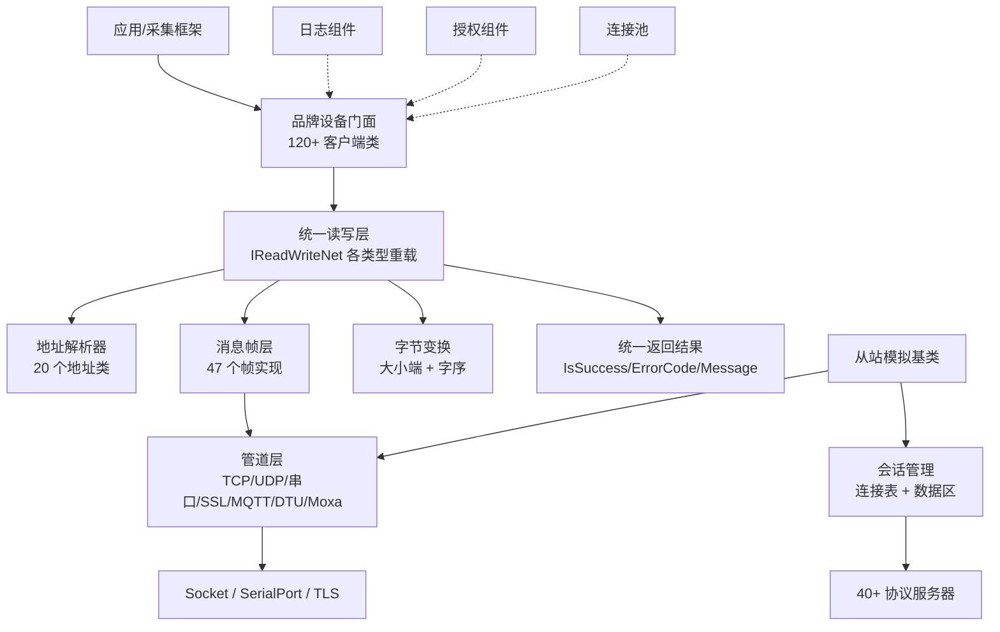

# PA-01｜商用级 .NET 多协议通信内核库

> **分析对象**：类库（.NET 单一程序集，附服务器端从站模拟能力）
> **编号**：PA-01（按脱敏约定，不披露来源标识）
> **技术栈**：C# / .NET Framework 3.5 & 4.5.1 & .NET Standard 2.0 & .NET Core 3.0 多目标；WinForms 依赖仅用于内置日志查看与授权窗体
> **规模画像**：开源快照核心库 211 个 `.cs`、63,205 行；仓库合计 453 个 `.cs`（含演示与测试）。商业版以二进制 + XML 文档形态分发，文档中可核实的公开类型 679 个、文档成员 10,469 条
> **成熟度画像**：商业化（十余年迭代，覆盖 40+ 现场协议家族，含从站模拟与授权体系）

---

## 1. 定位与问题域

### 1.1 它是什么

一个把所有工业设备读写收敛为同一组方法签名的 .NET 通信内核：调用方只需要 `连接 → Read(地址, 长度) → 得到带成功标志的结果`，不必关心底下是 S7comm、MC 协议、FINS、CIP 还是 Modbus RTU。

它的核心不是"协议多"，而是**三个统一**：

| 统一项 | 表现形式 | 解决的问题 |
|---|---|---|
| 统一返回 | 泛型结果对象携带 `IsSuccess / ErrorCode / Message / Content` | 网络异常、地址非法、PLC 拒绝写入不再混在异常与返回值里 |
| 统一读写 | 一个读写接口定义 bool/16/32/64 位/浮点/字符串/字节数组的成组重载 | 上层采集框架不必为每个品牌写适配器 |
| 统一寻址 | 地址是字符串，由各品牌地址解析器翻译为结构化地址 | 配置表里可以只存 `"DB1.100.2"`、`"D100"`、`"s=2;x=3;100"` |

开源快照的自述里给了一个很能说明设计动机的对照：最初目标是"一行代码读 PLC"，但现场返回异常太常见（网络断、地址写错、PLC 不允许该操作），于是引入了统一返回对象，把"可能失败"变成类型系统的一部分。这是该库最重要的设计决策，也是它区别于同期大量"裸 Socket 封装"的地方。

### 1.2 面向的用户与场景

| 用户 | 典型场景 | 对该库的真实诉求 |
|---|---|---|
| 上位机/SCADA 开发者 | 一套软件适配多家 PLC | 品牌差异被库吸收，现场换 PLC 只改配置 |
| 设备厂商软件工程师 | 随机床/产线交付采集软件 | 交付周期短，单机部署，Windows 环境 |
| MES/数采集成商 | 项目制，每个项目 PLC 型号都不同 | 协议覆盖广度 > 架构优雅度 |
| 教学与二次开发者 | 学习协议报文 | 有可运行的报文示例与地址示例 |

场景共性：**单进程、Windows、设备数量几十到几百、轮询周期秒级、以"能读通"为第一优先级**。这也是该库所有取舍的根源。

### 1.3 边界（不做什么）

- 不做设备模型：没有点位（tag）概念，没有工程单位、量程、缩放、死区、质量码、时间戳。读回来就是一个数值。
- 不做调度：没有采集计划、时间片、批读合并、优先级。轮询节奏由调用方的 `Timer` 决定。
- 不做北向：没有 OPC UA / Sparkplug B / 统一信息模型，数据出库要靠调用方自己拼。
- 不做配置中心：开源快照里没有任何配置文件读写；商业版演示程序用 XML 存设备参数，但那是演示层行为，不是库能力。
- 不做持久化与断点续传：无本地缓存、无 Outbox。
- 不做多设备编排：每个设备对象各自持有一条连接，库不负责设备间的关系。

---

## 2. 功能分析

### 2.1 功能域总览

| 功能域 | 功能点 | 实现方式 | 完成度 |
|---|---|---|---|
| 统一读写 | 按类型成组读写（bool/16/32/64/float/double/string/bytes） | 设备基类一次性铺开各类型重载，底层都归约为"读一段字节 + 字节变换解释" | 完整 |
| 统一返回 | 成功/失败 + 错误码 + 消息 + 内容 | 泛型结果对象，另提供 1~10 个泛型参数的重载版本用于多返回值 | 完整，但错误码粒度粗（默认 10000 为未分类） |
| 传输抽象 | TCP / UDP / 串口 / SSL / MQTT / DTU 透传 / Moxa 透传 / 远程调试通道 | 管道基类 + 11 个管道实现，统一"打开-发送-接收-关闭"与互斥语义 | 完整（商业版）；开源快照只有 Socket 与串口两路 |
| 字节变换 | 大小端 + 字序组合 | 4 种数据格式（ABCD/BADC/CDAB/DCBA）实现同一变换接口 | 完整 |
| 地址解析 | 品牌地址字符串 → 结构化地址 | 20 个地址类；每个品牌一个解析器，部分品牌共用一个地址结构 | 完整，但解析在每次请求时执行 |
| 消息帧 | 变长/定长帧的收全判定、头校验、序号提取 | 消息帧接口 + 47 个帧实现（每协议一个） | 完整 |
| 从站模拟 | 把本库当作 PLC/仪表/机器人被上级读取 | 服务器基类 + 40 余个协议服务器子类，共享会话管理与数据区 | 完整，是差异化能力 |
| 连接池 | 多连接复用、空闲回收、上限控制 | 独立算法组件：连接器接口 + 泛型池 + 30 秒周期清理定时器 | 可用，但与设备对象未打通，需手工接线 |
| 日志 | 分级日志、按时间/按大小/单文件三种落盘策略、UI 查看器 | 日志接口 + 抽象基类 + 3 个实现 + WinForms 查看控件 | 完整 |
| 授权 | 试用期 + 调用次数计数 + 授权码/证书 | 静态授权类，MD5 校验授权码；商业版增加证书校验入口 | 完整（商业版） |
| 对象映射 | 用特性标注 POCO 字段与设备地址，整对象读写 | 反射辅助类 + 地址特性 + 结构体特性 | 可用，演示价值大于工程价值 |
| 辅助算法 | PID、FFT、自增流水号、缓存数组、邮件、压缩 | 独立工具命名空间 | 可用，与通信主线弱耦合 |

### 2.2 协议与接口覆盖

按商业版 XML 文档可核实的类型数统计：`Profinet` 命名空间 234 个类型、`Robot` 27、`Instrument` 43、`CNC` 12、`ModBus` 13、`Secs` 16、`MQTT` 26、`WebSocket` 11，核心层 170。

| 协议家族 | 角色 | 传输 | 模块（目录角色名） | 备注 |
|---|---|---|---|---|
| S7comm（S7-200/300/400/1200/1500） | 主站 | TCP | 协议子模块/西门子 | 机架+槽位+TSAP+PDU 长度可配 |
| S7Plus | 主站 | TCP | 协议子模块/西门子 | 符号寻址，支持带引号的分段名 |
| Fetch/Write、PPI/MPI | 主站 | TCP/串口 | 协议子模块/西门子 | 老机型与编程口场景 |
| S7 服务器 | 从站 | TCP | 协议子模块/西门子 | 供上位机联调 |
| MC 协议（二进制/ASCII/UDP） | 主站 | TCP/UDP | 协议子模块/三菱 | 含 Q/L/FX5U |
| MC A-1E / A-3C | 主站 | TCP/串口 | 协议子模块/三菱 | 老一代机型 |
| FX 编程口 / FX Links | 主站 | 串口 | 协议子模块/三菱 | 485 组网 |
| MELSEC 服务器 | 从站 | TCP | 协议子模块/三菱 | 覆盖 MC/A-1E/A-3C/FX |
| FINS（TCP/UDP） | 主站 | TCP/UDP | 协议子模块/欧姆龙 | 网络号/节点号/单元号可配 |
| Host Link / Host Link C-Mode | 主站 | 串口/TCP | 协议子模块/欧姆龙 | C-Mode 支持 TIM/CNT |
| CIP / ConnectedCIP（欧姆龙） | 主站 | TCP | 协议子模块/欧姆龙 | 与罗克韦尔同族但标签语义不同 |
| FINS 服务器（TCP/UDP）、HostLink 服务器 | 从站 | TCP/UDP | 协议子模块/欧姆龙 | — |
| CIP / PCCC / SLC / MicroCIP / DF1 | 主站 | TCP/串口 | 协议子模块/罗克韦尔 | 标签读写 + 结构体句柄 |
| 罗克韦尔服务器 | 从站 | TCP | 协议子模块/罗克韦尔 | 含 CIP 消息路由 |
| ADS（倍福） | 主站 | TCP | 协议子模块/倍福 | 含 AMS 头标志与命令字 |
| ADS 服务器 | 从站 | TCP | 协议子模块/倍福 | — |
| 汇川（Modbus 族 + EasyNet） | 主站 | TCP/串口 | 协议子模块/汇川 | 按系列切换地址规则（含 EVO 的位地址） |
| 信捷（内部协议 + Modbus） | 主站 | TCP/串口 | 协议子模块/信捷 | — |
| 台达（DVP/AS，RTU/ASCII） | 主站 | TCP/串口 | 协议子模块/台达 | 两套地址规则分文件 |
| 富士（SPB/SPH/CommandSetting） | 主站 | TCP/串口 | 协议子模块/富士 | 三种帧格式 |
| 松下（Mewtocol、MC） | 主站 | TCP/串口 | 协议子模块/松下 | 位地址非 16 倍数时主动报错 |
| 基恩士（KV/Nano、MC、DL-EN1） | 主站 | TCP/串口 | 协议子模块/基恩士 | 含条码读码器 SR2000 |
| LS（Cnet、FastEnet、CPU 信息） | 主站 | TCP/串口 | 协议子模块/LS | — |
| GE SRTP | 主站 | TCP | 协议子模块/GE | — |
| 安川 Memobus（TCP/UDP） | 主站 | TCP/UDP | 协议子模块/安川 | — |
| 横河 Link | 主站 | TCP | 协议子模块/横河 | — |
| 山武 Digitron CPL | 主站 | TCP/串口 | 协议子模块/山武 | 温控表 |
| 丰田 ToyoPuc | 主站 | TCP | 协议子模块/丰田 | — |
| 西门子 Cimon / 南京 DCS / 特殊风机 | 主站 | TCP | 协议子模块/其它 | 行业专机协议 |
| Modbus TCP/RTU/ASCII/UDP | 双角色 | TCP/UDP/串口 | 协议子模块/Modbus | 富地址 `s=;x=;addr`，可覆盖站号与功能码 |
| DL/T 645（1997/2007）、DL/T 698 | 双角色 | 串口/TCP | 协议子模块/仪表 | 电能表，含服务器 |
| CJ/T 188 | 主站 | 串口/TCP | 协议子模块/仪表 | 水/气/热表 |
| IEC 60870-5-104 | 双角色 | TCP | 协议子模块/仪表 | 含类型 ID 与服务器 |
| SECS/GEM（HSMS） | 双角色 | TCP | 协议子模块/半导体 | 含 GEM 状态机 |
| MQTT（客户端/同步客户端/服务器） | 双角色 | TCP | 协议子模块/MQTT | 可作传输管道承载其它协议报文 |
| Redis | 主站 | TCP | 协议子模块/缓存 | 键/哈希/列表/订阅 |
| FANUC 机器人 | 主站 | TCP | 协议子模块/机器人 | 姿态、报警、任务 |
| ABB 机器人（Web API） | 双角色 | HTTP | 协议子模块/机器人 | — |
| KUKA（VarProxy / TCP） | 主站 | TCP | 协议子模块/机器人 | — |
| 安川机器人（YRC1000/HighEthernet） | 主站 | TCP/UDP | 协议子模块/机器人 | — |
| 埃斯顿 / 埃夫特 / 现代 / 雅马哈 | 主站 | TCP/UDP | 协议子模块/机器人 | 国产与日韩机型 |
| FANUC CNC（0i 系列） | 主站 | TCP | 协议子模块/数控 | 刀具、坐标、报警、目录遍历 |
| 读码器/视觉（基恩士、SICK、图尔克） | 双角色 | TCP/串口 | 协议子模块/识别 | 触发 + 结果回传 |
| 称重（托利多） | 双角色 | 串口/TCP | 协议子模块/称重 | 标准数据帧 |
| 身份证阅读器（SAM） | 主站 | 串口/TCP | 协议子模块/身份识别 | — |
| KNX | 主站 | UDP | 协议子模块/楼控 | — |
| 振动传感器 | 主站 | TCP | 协议子模块/传感器 | 特征值 + 原始波形 |
| Freedom（自由报文） | 双角色 | TCP/UDP/串口 | 协议子模块/透传 | 只收发字节，不解释 |
| DTU 透传 | 双角色 | TCP | 协议子模块/DTU | 注册包 + 透传通道 |
| WebSocket / HTTP / 文件传输 / 简化网络 / 推送网络 / 复杂网络 | 双角色 | TCP | 协议子模块/网络设施 | 库自有的应用层设施，不是工业标准 |

**统计口径**：按"品牌或标准"计为 50 个协议家族；按"客户端类"计则超过 120 个可实例化端点（同一品牌下二进制/ASCII/UDP/串口/OverTcp 各算一个类）。文档中带 `Server` 后缀的类型 59 个，其中真正的设备从站模拟约 40 个，其余是文件/推送/网关等基础设施服务器。

### 2.3 典型使用流程

```
1. new 设备类(型号枚举)  →  可选：设置 IP、端口、机架槽位、站号、字节序
2. SetPersistentConnection() 或首次读写时隐式建链
3. ReadInt16("D100")  →  结果对象判 IsSuccess  →  取 Content
4. 失败时读 Message/ErrorCode，决定重试或告警
5. Dispose
```

批读没有专门的规划器，调用方要么用 `Read(起始地址, 长度)` 拿回原始字节自己切分，要么循环读单点——这正是它作为"库"而非"采集引擎"的分界线。

### 2.4 功能完成度评估

| 能力 | 完成度 | 说明 |
|---|---|---|
| 协议覆盖 | 高 | 主流 PLC 与仪表基本齐全，长尾机型（部分国产 PLC、部分机器人）缺失 |
| 报文健壮性 | 高 | 帧头校验、长度推断、序号匹配在 47 个帧实现中逐协议处理 |
| 统一抽象 | 中 | 读写接口统一，但错误语义、连接语义、地址语义没有统一模型 |
| 从站模拟 | 高 | 40 余个服务器可与自家客户端对打，也可供第三方联调 |
| 采集工程能力 | 低 | 无点位、无调度、无批读规划、无质量码、无缓存 |

---

## 3. 架构分析

### 3.1 分层与模块



### 3.2 关键抽象与接口

| 抽象 | 职责 | 边界 | 位置 |
|---|---|---|---|
| 统一返回结果（泛型，1~10 参数） | 携带成功标志、错误码、消息、内容 | 只描述结果，不含重试策略；错误码是整型 + 本地化字符串 | 核心层/结果类型 |
| 设备通信基类 | 持有字节变换、字长、日志、连接参数 | 不持有采集计划与点位 | 核心层/设备基类 |
| 双向网络基类 | 长短连接、交互锁、套接字错误标记、账号认证 | 一次只允许一个在途请求 | 核心层/网络基类 |
| 统一读写接口 | 定义所有类型化读写 | 只约束签名，不约束实现语义（如长度的字/字节含义） | 核心层/读写接口 |
| 消息帧接口 | 头长度、内容长度推断、头合法性、序号 | 只管"收全一条"，不管协议语义 | 核心层/消息帧 |
| 管道基类 | 打开/关闭/发送/接收 + 管道级互斥 | 不含协议；SSL/MQTT/DTU 通过替换管道改变传输 | 核心层/管道 |
| 字节变换接口 | 40 余个 `Trans*` 重载 + 4 种数据格式 | 只做字节↔值，不做缩放与工程单位 | 核心层/变换 |
| 地址基类 | 地址字符串 → 结构（起始、长度、DB 块、站号、功能码） | 解析结果不缓存，随请求重建 | 核心层/地址 |
| 服务器基类 | 监听、会话表、上下线事件、数据区 | 数据区是裸字节数组，无标签语义 | 核心层/服务器 |
| 连接器接口 + 连接池 | 借出/归还/过期清理 | 与设备对象解耦，需调用方自己包一层 | 算法/连接池 |
| 授权组件 | 授权码/证书校验、试用计时、调用计数 | 静态状态，进程内全局 | 基础框架/授权 |

三条真正的"缝"值得注意：

1. **管道是唯一可替换的传输缝**。商业版把 TCP、UDP、串口、SSL、MQTT、DTU 注册包透传、Moxa 透传、远程调试通道统一到同一基类，因此"用 MQTT 承载 Modbus"这种需求不需要改协议实现，只换管道。这是该库最接近现代设计的地方。
2. **消息帧是唯一可替换的收包缝**。变长帧（S7、CIP）、定长帧（Modbus）、带结束符帧（部分仪表）都在这一层解决，协议层只关心"我收到了一条完整报文"。
3. **地址解析没有缝**。品牌设备类直接 `new` 自己的地址类，地址结构与协议实现硬绑定；同一份 MC 地址结构里塞了三菱、基恩士、松下三家的解析分支，这就是没有缝的代价。

### 3.3 数据流与时序

一次 `ReadInt16("D100")` 的路径：

```
地址字符串 → 地址解析器 → 起始地址+长度+功能码
  → 组装请求帧（协议类）
  → 进入交互锁
  → 取连接（长连接复用 / 短连接新建）
  → 管道发送
  → 循环接收直到消息帧判定"收全"
  → 帧头合法性校验（防错连、防串包）
  → 失败：关闭套接字、置错误标记、返回失败结果
  → 成功：字节变换按数据格式解释为 short
  → 释放交互锁，返回结果对象
```

关键点：**解析、组帧、收发、解释四步在同一个同步调用栈里完成**，中间没有异步边界，也没有"请求对象"这种可排队、可取消、可观测的实体。

### 3.4 并发与连接管理

| 维度 | 事实 | 后果 |
|---|---|---|
| 客户端并发模型 | 每设备一把混合锁（先自旋计数，竞争时退化到内核事件），锁内完成"取连接 + 发送 + 接收" | 同一设备天然串行；多线程读同一 PLC 会排队，不会报文交错 |
| 连接复用 | 长连接标记 + 套接字错误标记；正常时复用，错误时下次调用重建 | 无退避、无熔断、无重连风暴抑制 |
| 短连接 | 每次请求新建并关闭 | 高并发下 TIME_WAIT 与握手开销显著 |
| 特殊连接 | 支持外部指定套接字（透传/异形模式），可把一条已被服务器接管的链路借给设备对象 | 这是 DTU、网关场景的关键能力 |
| 异步 | 开源快照中所有 `Async` 方法均为 `Task.Run` 包装同步实现；商业版 7,540 个方法中 1,710 个带 `Async` 签名，但管道基类仍无异步成员 | 异步只是线程池分流，不解决 I/O 阻塞；线程数随并发线性增长 |
| 服务器并发 | 登录处理走线程池，每会话一个阻塞接收循环，会话表用锁保护 | 千级连接可用，万级连接不合适 |
| 背压 | 无 | 发送快于设备处理时只能靠超时兜底 |
| 连接池 | 独立组件，30 秒周期清理，可设上限与过期时间 | 只对"多连接并行读同一设备"有意义，需手工集成 |

### 3.5 配置、持久化与部署

- 库本身不读配置文件。所有参数通过属性设置：IP/端口/超时/机架槽位/站号/字节序/字长/是否长连接/是否清缓存。
- 无持久化：无点位表、无设备清单、无采集历史。
- 部署形态是单个 DLL（商业版 4.4 MB）+ XML 文档；依赖极少（JSON 库、TLS 原生库、串口组件）。
- 多目标通过"同一份源码 + 链接编译 + 少量条件编译"实现：Net35 工程用 207 条链接引用指向 Net45 工程的源文件，源码中仅 15 处 `#if !NET35` 与 4 处 `#if !NETSTANDARD2_0` 分支。这解释了它为什么能同时支持 3.5 与 Core 3.0，也解释了为什么 WinForms 窗体一直留在核心库里。

### 3.6 扩展机制

新增一个品牌需要改库源码，具体是四件套：

1. 地址解析类（继承地址基类，实现字符串解析）；
2. 消息帧类（实现帧接口的 6 个成员）；
3. 设备类（继承 TCP/串口/双向基类，实现组帧与解帧）；
4. 若需要从站，再加一个服务器子类。

没有接口注册、没有反射扫描、没有插件清单。**扩展 = 提交代码或 fork**。这对商业闭源库是合理的（控制质量、控制授权），对生态是障碍。

### 3.7 工程质量观察

| 观察点 | 事实 | 评价 |
|---|---|---|
| 文件规模 | 核心库 211 文件 63,205 行；单文件最大 1,627 行（设备基类），1,342 行（结果类型），1,222 行（网络基类） | 典型"单文件巨类 + region 分区"，可读但难测 |
| 注释 | 中文 XML 文档注释覆盖率高，带示例代码片段 | 对使用者友好，是它流行的重要原因 |
| 结果类型 | 为 1~10 个返回值各写一个泛型变体 | C# 7 元组之前的时代妥协，现在看是 API 膨胀 |
| 测试 | 测试工程 52 个文件，多为按协议组织的样例与断言 | 有测试，但偏"能读通"，缺边界与故障注入 |
| 死代码 | 存在 `#if false` 包裹的整段实现 | 说明有过未清理的实验分支 |
| 授权模块 | 标识符整体混淆为无意义字符串，含试用小时数与调用计数器 | 防破解意图明显，也说明授权是商业闭环的一部分 |
| 错误处理 | 失败路径统一"关连接 + 置错误标记 + 返回结果" | 一致性好，但错误码语义粗，调用方难以区分"网络断"与"地址错" |
| 平台耦合 | 核心库引用 WinForms（日志查看窗体、授权窗体、曲线控件） | 跨平台时这些类型无法加载，是历史包袱 |

---

## 4. 需求分析

### 4.1 显性需求

| 需求 | 现场原话（抽象） | 库的回应 |
|---|---|---|
| 一个软件适配多品牌 | "客户现场是啥 PLC 我就得支持啥" | 50 个协议家族、120+ 端点类 |
| 地址怎么写 | "手册上写 D100，你这里怎么填" | 每品牌地址示例 + 富地址语法 |
| 读不到要能看出原因 | "到底是网线断了还是地址错了" | 错误码 + 消息 + 收发报文日志 |
| 不能因为一个设备超时拖死整条产线 | "别的站还得采" | 每设备独立连接与超时，互不阻塞 |
| 要能模拟设备给客户演示 | "客户没有 PLC 怎么验收" | 40 余个从站模拟 |

### 4.2 隐性需求

| 隐性需求 | 该库的处理 | 缺口 |
|---|---|---|
| 字节序与字序 | 4 种数据格式 + 每设备可配 | 只能全局配一种；同一设备内不同区域字序不同时无法表达 |
| 字长语义 | 设备基类暴露"一个字占几个地址"（西门子 2，三菱/欧姆龙/Modbus 1） | 该语义靠调用方理解，接口签名上看不出来，极易踩坑 |
| 地址越界保护 | 部分协议在解析阶段校验（如松下位索引非 16 倍数报错） | 没有统一的越界检查，靠 PLC 返回错误 |
| 批量读优化 | 提供"读一段字节"的底层能力 | 无自动合并、无跨区域拆分、无请求数上限控制（S7 PDU、Modbus 125 寄存器上限需调用方自己算） |
| 断网续传 | 无 | 恢复后不补采，数据空洞由上层承担 |
| 时钟漂移 | 无 | 不读设备时钟，不校时 |
| 点位变更不停机 | 无点位概念 | 改地址必须改代码或改配置后重启采集逻辑 |
| 诊断可观测性 | 有报文级日志 | 无指标（成功率、时延分位、重连次数）、无链路追踪 |
| 许可与合规 | 授权码 + 证书 + 试用期 | 授权失败的行为由调用方决定，库不强制 |

### 4.3 非功能需求

| 维度 | 实际水平 | 说明 |
|---|---|---|
| 吞吐 | 单设备串行，百毫秒级往返 | 适合秒级轮询，不适合高频波形采集 |
| 时延确定性 | 依赖 OS 与设备 | 无优先级、无 deadline 传播 |
| 资源占用 | 每连接一线程（异步为线程池任务） | 千级设备时线程与句柄压力明显 |
| 可移植性 | 有 netstandard2.0 / netcoreapp3.0 目标 | 但核心库含 WinForms 类型，Linux 下需裁剪 |
| 可测试性 | 设备类硬依赖 Socket | 无传输注入点（管道层是商业版才补上的），单测只能打真实设备或本地模拟器 |
| 可观测性 | 文件日志 | 无结构化日志、无 metrics 端点 |

### 4.4 需求缺口与误判

1. **把"协议适配"当成了全部问题**。现场 80% 的工时不在协议，而在"点位表怎么来、地址怎么校验、批量怎么合并、失败了怎么补"。这个库把 20% 做到了极致，另外 80% 留给使用者。
2. **低估了地址的工程复杂度**。地址是字符串，解析在每次请求时进行，错误只能等到请求失败才暴露。没有"地址编译"这一步（一次性把配置里的地址全部解析、校验、生成批读计划），就没有上线前的静态检查。
3. **异步是伪需求还是真需求被误判**。用 `Task.Run` 包同步 I/O，在几十个设备时看不出问题，在几百个设备 + 高频轮询时线程池会被打满，表现为"CPU 不高但吞吐上不去"。
4. **授权把库变成了产品**。授权组件、试用计时、调用计数、证书校验都在核心库里，说明它的商业形态是"卖 DLL 授权"，而不是"卖服务"或"卖订阅"。这决定了它不会去做配置中心、云边协同这类需要长期运营的能力。

---

## 5. 可借鉴与应规避

### 5.1 可直接吸收的机制

| 机制 | 为什么值得吸收 | 迁移建议 |
|---|---|---|
| 结果对象而非异常 | 工业现场失败是常态，异常适合"程序错误"，结果对象适合"业务失败" | 目标产品用 `Result<T>` + 稳定错误码枚举，消息与码分离，码可被上游程序判断 |
| 消息帧抽象（头长/内容长/校验/序号） | 收包是几乎所有工业协议的共同难题，抽象一次收益全局 | 抽象为 `FrameCodec`，并补上"最大帧长""粘包残留""超时半包"三个边界 |
| 管道抽象（传输可替换） | 同一个 Modbus 可以跑在 TCP、串口、DTU 透传、MQTT 之上 | 目标产品把"通道"做成一等对象，协议只依赖通道接口，天然支持 DTU/网关/串口服务器 |
| 字节变换矩阵 | 大小端 × 字序是现场最常见的"读出来是乱数"根因 | 用显式枚举 + 每点位可覆盖，不要做成全局开关 |
| 从站模拟 | 售前演示、回归测试、客户验收都靠它 | 目标产品应内置"虚拟设备"能力，且与真实设备同一条数据通路 |
| 每品牌地址示例 | 极大降低学习成本 | 做成机器可读的地址 DSL + 示例库，直接进文档与校验器 |

### 5.2 明确应规避的做法

| 做法 | 问题 | 后果 |
|---|---|---|
| 单程序集装下所有协议 | 4.4 MB 单 DLL，无法按需裁剪 | 嵌入式/边缘小设备无法使用；任一协议漏洞要求整体升级 |
| 同步阻塞 + `Task.Run` 假异步 | 线程是稀缺资源 | 高并发下吞吐塌陷，且难以定位 |
| 每设备一把粗锁 | 实现简单 | 无法流水线化，无法做请求优先级 |
| 地址在请求时解析 | 省了缓存与编译 | 配置错误只能运行时暴露，且每次请求都有解析开销 |
| 核心库依赖 WinForms | 历史包袱 | 跨平台部署要剥离，单元测试要绕开 |
| 错误码粗粒度 + 本地化消息 | 消息给人看，码给机器看，二者混用 | 上游无法可靠判断"该重试还是该告警" |
| 授权逻辑与业务逻辑同库 | 商业与工程耦合 | 开源分支必须删授权，导致两套代码分叉 |
| 没有插件边界 | 扩展必须改库 | 生态无法形成，第三方协议只能 fork |

### 5.3 迁移到目标产品的成本

| 迁移项 | 成本 | 说明 |
|---|---|---|
| 协议知识（帧格式、地址规则、握手细节） | 高价值、可复用 | 这是该库最值钱的部分，但必须重写为语言无关的规格与测试向量，不能直接搬代码 |
| 结果对象 / 帧 / 管道三个抽象 | 低 | 概念可直接借鉴，Go 侧用接口 + error 重新表达 |
| 从站模拟 | 中 | 需要重写，但测试价值极高 |
| 地址示例库 | 低 | 可直接整理成测试用例 |
| 授权与日志组件 | 不需要 | 目标产品应使用独立许可与结构化日志 |

---

## 6. 结论

### 6.1 六维评分

| 维度 | 分数(1-5) | 理由 |
|---|---|---|
| 协议广度 | 5 | 50 个协议家族、120+ 端点、40+ 从站模拟，商用库里属于第一梯队 |
| 架构可演进性 | 2 | 单程序集巨石、同步阻塞、无插件边界，任何结构性改进都要动全身 |
| 跨平台能力 | 3 | 有 netstandard/netcore 目标，但核心库含 WinForms 类型且 I/O 全同步，Linux 下只能算"能跑" |
| 可运维性 | 2 | 只有文件日志，无指标、无健康检查、无配置管理、无热更新 |
| 工程质量 | 3 | 文档与示例优秀、失败路径一致；但巨类、死代码、测试偏浅 |
| 许可与合规风险 | 2 | 开源分支为 LGPL-3.0，商业分支为闭源授权；两套代码谱系并存，使用者极易误判许可边界 |

### 6.2 三条关键结论

1. **它是"协议知识库"，不是"架构蓝本"**。真正值得抄的是 47 个消息帧、20 个地址解析器、4 种字节序组合、40 余个从站模拟背后的协议细节与现场坑；它的分层（单 DLL、同步、粗锁、无点位模型）恰恰是目标产品必须避开的。
2. **"一个库打通所有品牌"解决的是集成商的交付焦虑，不是工厂的运维焦虑**。工厂要的是"点位不丢、断网能补、变更不停机、故障可定位"，这四件事在这个库里都没有对应抽象。目标产品应把价值重心从"支持多少协议"移到"采集是否可信"。
3. **授权形态决定了能力边界**。授权码 + 试用期 + 调用计数的模式，意味着它的商业目标是"卖 DLL、卖授权、卖源码"，因此不会投入配置中心、云边协同、可观测性这类需要持续运营的能力。目标产品若走订阅/服务路线，就不应复制这套架构。

---

## 附录：可核实的统计口径

| 指标 | 数值 | 取证方式 |
|---|---|---|
| 开源快照核心库文件数 / 行数 | 211 / 63,205 | 按目标框架工程目录统计 `*.cs` |
| 仓库 `.cs` 总数 | 453 | 全仓统计（含演示、测试、更新器） |
| 商业版公开类型数 | 679 | XML 文档中的类型成员条目去重 |
| 文档成员总数 | 10,469 | XML 文档 `<member>` 条目 |
| 带 `Async` 的方法数 | 1,710 / 7,540 | XML 文档方法条目计数 |
| 消息帧实现数 | 47 | 消息帧命名空间类型计数 |
| 地址解析类数 | 20 | 地址命名空间类型计数 |
| 管道实现数 | 11 | 管道命名空间类型计数 |
| 服务器类型数 | 59（其中设备从站约 40） | 类型名以 `Server` 结尾计数 |
| 条件编译分支 | 15 处 `#if !NET35`、4 处 `#if !NETSTANDARD2_0` | 源码扫描 |
