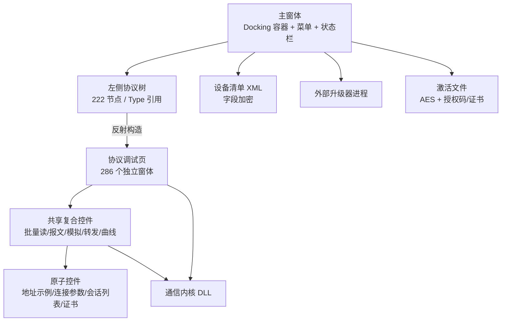

# PA-02｜商业库配套的桌面调试工作台

> **分析对象**：桌面应用（WinForms，二进制分发；演示工程源码可得）
> **编号**：PA-02（按脱敏约定，不披露来源标识）
> **技术栈**：C# / .NET Framework 4.x / WinForms / 第三方 Docking 布局库 / 动态表达式求值库 / OpenSSL 原生库
> **规模画像**：286 个独立窗体（排除 Designer）、751 个 `.cs`、204,585 行（其中 110,999 行为设计器生成）、362 个 `.resx`；协议树 222 个节点、218 个不同窗体类型
> **成熟度画像**：商业化（与 PA-01 内核同版本分发，承担售前演示、现场联调、兼容性验证三重角色）

---

## 1. 定位与问题域

### 1.1 它是什么

一个"协议调试工作台"：左侧按品牌/协议组织的树，点开节点在中间停靠一个调试页，页面上半部是连接参数，下半部是地址、读、写、批量、报文、曲线、模拟。

它不是通用串口助手，也不是抓包工具，而是**专门为某个通信内核做的可视化外壳**：每页直接构造内核里的设备对象，面板上每个勾选框最终都变成设备对象的一个属性。因此它同时是三样东西：

| 角色 | 面向谁 | 价值 |
|---|---|---|
| 售前演示器 | 客户/集成商 | "你说的这个 PLC 我们支持，现在就能读给你看" |
| 现场联调台 | 实施工程师 | 找地址、试读、写入、抓报文、对照手册 |
| 回归验证器 | 库作者 | 218 个协议页 = 218 个手工冒烟用例 |

### 1.2 面向的用户与场景

初次接触该库的开发者想知道"这个型号用什么类、地址怎么写"，工作台给的是地址示例页 + 一键生成代码；现场工程师怀疑地址或端口写错，工作台给的是参数面板 + 收发报文十六进制视图；集成商技术负责人要评估"能不能支持我客户的机型"，工作台给的是机型 × 支持程度的兼容性清单；库作者改了一个协议怕影响别的型号，工作台提供同品牌多形态页面并列（二进制/ASCII/UDP/串口）。

### 1.3 边界（不做什么）

- 不做工程化配置：设备参数存成一个平铺的 XML 清单，没有工程、分组、版本、回滚。
- 不做多设备编排：每页是独立会话，没有"同时轮询 50 台设备"的调度视图。
- 不做审计与自动化：没有操作日志、没有脚本/CLI/CI 入口，验证靠人点。
- 不做跨平台：WinForms + P/Invoke 串口 DLL + 机器绑定授权。

---

## 2. 功能分析

### 2.1 功能域总览

| 功能域 | 功能点 | 实现方式 | 完成度 |
|---|---|---|---|
| 协议导航 | 按品牌/协议分组的树，222 个节点 | 硬编码树构造，节点携带窗体 `Type`，点击时反射调用无参构造并停靠 | 完整 |
| 连接配置与单点读写 | IP/端口/超时/机架/槽位/站号/波特率/校验/数据格式；bool/16/32/64/浮点/字符串 | 每页自己的参数区 + 共享连接与读写控件 | 完整，但参数区每页重复实现 |
| 批量读与报文监视 | 多行地址表格；十六进制/ASCII/十进制/多类型数组共 12 种渲染 | 表格行 → 地址数组 → 批量/随机读；渲染器可切字反转 | 完整 |
| 地址示例 | 每个协议内置地址写法示例 | 静态示例对象 + 表格控件 | 完整，使用率最高的功能之一 |
| 代码生成 | 把当前面板参数生成初始化代码 | 反射读设备对象属性，按类型特判拼接文本（含 10 余个协议特例） | 完整 |
| 服务器模拟 | 把当前协议作为从站对外服务 | 复用内核服务器类 + 会话列表 + 证书控件 | 完整 |
| 数据模拟/转发、线程压力测试 | 数据区定时变化并转发到 MQTT/WebSocket/数据库；多线程并发读写 | 定时器 + 数据表 + 转发控件（含 SQL 模式）；每线程一个后台线程循环调用 | 可用 |
| 设备清单 / 自动升级 / 授权 | XML 存参数；外部升级器进程；激活文件 | 部分字段加密；版本忽略文件；AES 密钥取自文件创建时间 | 完整（商业闭环） |

### 2.2 协议与接口覆盖

按演示工程目录统计的窗体数（不含 Designer）：

| 分类 | 窗体数 | 说明 |
|---|---|---|
| PLC 品牌 | 135 | 三菱 20、欧姆龙 13、西门子 12、罗克韦尔 9、基恩士 8、LS 7、汇川 7、富士 7、信捷 5、台达 5、松下 4、安川 3、丰炜 3、麦格米特 3、自由协议 3、永宏 3，其余为横河/维控/图尔克/丰田/英威腾/GE/西蒙/倍福等单页或双页品牌 |
| 仪器仪表 | 24 | 电能表（645/698）、水气热表、温控表、IEC104、称重、身份证、光照、振动 |
| 机器人 | 13 | 发那科、ABB、库卡、安川、埃斯顿、埃夫特、现代、雅马哈 |
| Modbus | 10 | TCP/RTU/ASCII/UDP/服务器/特殊功能码 |
| MQTT / Redis / WebSocket | 19 | 客户端、同步客户端、服务器、主题、发布订阅、缓存键值 |
| 数控 / 数据库 / 算法 | 5 | 发那科 0i、SQL 直连、PID、FFT |
| 其它 | 15+ | 扫码/RFID、DCS、开放协议（拧紧枪）、调试技术（字节变换、正则、证书） |

导航树把这些内容组织为约 30 个一级分组，其中"调试技术"组单独收纳字节变换、正则、DTU 报文生成、证书生成等工具页——这暴露了它的真实定位：**一个工程师的日常工作台，而不只是协议列表**。

### 2.3 典型使用流程

新到一台型号不确定的 PLC：树上找品牌 → 填参数连接 → 连不上就换协议形态（二进制↔ASCII、TCP↔UDP、直连↔OverTcp）→ 打开"地址示例"照手册抄地址 → 单点读，值不对就切字节序/字序再读 → 读对了切"批量读"把要采的点一次读完 → 需要写入则写后读回校验 → 报文异常就开报文页逐字节对照手册 → 参数调好点"生成代码"贴进项目 → 客户没设备就切"服务器模拟"自己当从站。

其中"地址示例、调字节序、生成代码、从站模拟"四步是工作台不可替代的价值，也是单纯看文档学不会的部分。整体完成度可概括为：**协议可视化程度高、现场排障效率高、学习曲线低，但工程化与自动化程度低**——218 个页面全部靠人手点，无法进 CI。

---

## 3. 架构分析

### 3.1 分层与模块



### 3.2 关键抽象与接口

| 抽象 | 职责 | 边界 | 位置 |
|---|---|---|---|
| 停靠页基类 | 统一图标、日志注入、关闭钩子 | 只约定生命周期，不约定协议 | 演示层/窗体基类 |
| 协议树节点 | 承载显示名、图标索引、窗体类型 | 只是注册表，不承载实例 | 演示层/导航 |
| 共享复合控件 | 把"读/写/批量/报文/线程/数据表/导出/模拟/远程调试"九页签装进一个控件 | 依赖内核读写接口与设备基类 | 演示层/复合控件 |
| 批量读控件 | 地址表格 → 批量/随机读 → 12 种渲染 | 只认地址字符串与字节，不认协议 | 演示层/复合控件 |
| 代码生成控件 | 反射读设备对象 → 生成初始化代码 | 按类型特判，无法覆盖未来新增协议 | 演示层/复合控件 |

"插件式"是这里最值得注意的设计：树节点存 `Type`，点击时反射调用第一个无参构造函数得到停靠页。于是新增协议页只需"写窗体 + 树里加一行"。**没有接口、没有注册文件、没有依赖注入**——用最原始的方式实现了插件化，代价是窗体必须有无参构造、依赖必须从全局单例取。

### 3.3 数据流与时序

```
点击树节点 → 取 Type → 反射构造 → 注入日志/图标 → 停靠显示
  → 用户填参数 → 点连接 → 参数控件把值写进设备对象属性
  → 设备对象.ConnectServer() → 成功后启用读写页签
  → 读写页签调用设备对象.ReadXxx / WriteXxx
  → 结果对象 → 渲染到结果框 + 追加日志
```

关键点：**参数面板与设备对象之间是"属性赋值"而非"配置对象传递"**。这就是为什么代码生成控件能用反射把面板状态还原成代码——设备对象的属性就是全部配置。这个设计让"调试即配置"成立，也让设备对象承担了配置载体的职责。

### 3.4 并发与连接管理

| 维度 | 事实 | 影响 |
|---|---|---|
| UI 线程模型 | WinForms 单 UI 线程 + `async/await` 回 UI | 读写不卡界面，长任务仍靠线程池 |
| 多会话 | 每页一个设备对象、一条连接 | 可同时开十几个设备对比调试 |
| 压力测试 / 资源释放 | 每线程一个后台线程循环读写；关闭页签调用设备对象关闭方法 | 能验证内核锁与重连但不产出报告；释放依赖每页自己实现，容易漏 |
| 定时器 | 曲线、模拟、状态栏各用 WinForms 定时器 | 精度 55ms 级，不适合高频采样 |

### 3.5 配置、持久化与部署

- 设备清单：XML 根节点下平铺若干设备元素，字段包括名称、GUID、类型、IP、端口、超时、机架/槽位、串口参数、站号、字节序、校验方式、账号密码、单元号等 30 余项，部分字段加密存储。
- 激活文件：AES 加密，密钥来自文件创建时间，解密后是授权码或证书；控件库有独立激活文件与独立校验入口。
- 部署：主程序 3.8 MB、内核 4.4 MB、控件库 2.5 MB、文档 4.1 MB，外加串口原生 DLL（2010 年产物）、TLS 原生库、Docking 库、表达式求值库、JSON 库。
- 升级：启动时检查版本，拉起同目录下的独立升级器进程，支持"忽略此版本"文件。升级器与被升级程序分离，避免自替换的文件锁。

### 3.6 扩展机制

| 扩展点 | 方式 | 限制 |
|---|---|---|
| 新增协议调试页 | 写窗体 + 树里加一行 `Type` | 必须无参构造；依赖全局单例 |
| 新增共享能力 | 加一个控件并挂到复合面板 | 复合面板页签硬编码 |
| 新增语言 / 设备字段 | 逐控件写语言分支；改 XML 字段表 + 参数面板 | 无资源文件化；字段表与面板两次维护 |

### 3.7 工程质量观察

| 观察点 | 事实 | 评价 |
|---|---|---|
| 代码量结构 | 204,585 行中 110,999 行为设计器生成（54%） | 手写逻辑约 9 万行，密度不低 |
| 重复度 | 286 个窗体，参数区大量复制粘贴 | 加一个通用参数要改几十处 |
| 命名一致性与依赖卫生 | 窗体名与协议类名一一对应；串口原生 DLL 为 2010 年版本，TLS 库为 2023 年版本 | 可检索性好，是它能维护到今天的关键；老依赖是稳定性来源，也是漏洞来源 |
| 可测试性 | 无自动化测试入口 | 218 个页面 = 218 个只能手点的用例 |

---

## 4. 需求分析

### 4.1 显性需求

| 需求 | 现场表现 | 工作台的回应 |
|---|---|---|
| "这个型号你到底支不支持" | 售前被问住 | 兼容性清单 + 可现场演示 |
| "地址到底怎么写" | 手册与实现不一致 | 每协议地址示例，可直接复制 |
| "读出来是乱码" | 字节序/字序猜错 | 一键切换 4 种数据格式并即时重读 |
| "到底是网络问题还是协议问题" | 抓包工具看不懂应用层 | 应用层报文十六进制 + 收发方向 |
| "能不能一次多读几个点" | 单点读太慢 | 批量读表格 + 随机读 |
| "客户没设备怎么验收" | 演示卡壳 | 从站模拟 |

### 4.2 隐性需求

| 隐性需求 | 处理方式 | 缺口 |
|---|---|---|
| 参数试错成本要低 | 改参数即时生效，不用重启 | 无参数快照/对比，试错历史丢失 |
| 现场要能离线用、结果要能带走 | 单机 exe、文档内嵌；数据表可导出、代码可生成、报文可复制 | 升级要联网；无调试会话回放、无请求-响应配对、无时间轴 |
| 多人协作 | 设备清单可拷贝 | 无共享、无权限、无审计 |
| 授权不能太烦 | 激活文件放目录即可 | 换机、改系统时间会失效 |

### 4.3 非功能需求

- 启动数秒（含检查更新），内存数十 MB 起、随页签线性增长（每页一个设备对象与控件树）。
- 稳定性高：单页崩溃不影响其它页，这是 WinForms 的天然隔离。
- 可维护性中等：命名规范但重复度高；可移植性为零（Windows + 原生串口 DLL + 机器绑定授权）。

### 4.4 需求缺口与误判

1. **把"调试"理解成"单点调试"**。现场真正耗时的是"300 个点位怎么组织、怎么分批、怎么判断哪个点坏了"。工作台有批量读，但没有点位工程、没有导入导出、没有批量校验。
2. **没有把调试结果沉淀为资产**。调好的参数只能生成一段代码或存进平铺 XML，不能变成可版本化、可评审、可复用的设备模板。
3. **缺少"对照手册"的闭环**。地址示例由作者手工整理，与设备手册没有版本对应关系，遇到固件差异只能靠试。
4. **授权与调试体验冲突**。试用 24 小时、激活文件绑定机器，对售前演示是摩擦——这也是同类工具常见的"调试台免费、运行时收费"分界线的由来。

---

## 5. 可借鉴与应规避

### 5.1 可直接吸收的机制

| 机制 | 价值 | 迁移建议 |
|---|---|---|
| 树 + 停靠页 + 反射构造 | 极低成本实现"每协议一页"的插件化 | 目标产品用前端路由 + 组件注册，能力清单由后端下发 |
| 共享复合控件 | 一次实现，218 页复用 | 抽成独立组件库，协议页只声明"我要哪些页签" |
| 地址示例内嵌到调试页 | 学习成本骤降 | 做成"地址即文档"：示例可点击、可执行、可断言 |
| 代码生成 | 调试结果直接变成交付物 | 生成配置片段（YAML/JSON）比生成代码更持久 |
| 服务器模拟内置 | 演示与回归都靠它 | 目标产品把"虚拟设备"做成一等能力，支持真实报文录制回放；同时以配置热更新替代"参数即时生效" |

### 5.2 明确应规避的做法

| 做法 | 问题 | 后果 |
|---|---|---|
| 286 个窗体各自实现参数区 | 重复度极高 | 加一个通用参数要改几十处 |
| 全局单例 + 无参构造 | 依赖隐式 | 无法单测，无法并行初始化 |
| 设备清单是平铺 XML、双语靠散落判断 | 无层次无版本；易漏 | 设备一多就不可维护；新增语言等于重写界面 |
| 调试台与内核强耦合 | 内核升级要求工作台同步升级 | 现场版本碎片化 |
| 授权绑机器与文件时间 | 换机/改时间即失效 | 售前演示摩擦 |

### 5.3 迁移到目标产品的成本

| 迁移项 | 成本 | 说明 |
|---|---|---|
| 交互范式（树 + 页 + 共享面板） | 低 | 概念直接可用，Web 端更易做 |
| 调试能力清单（218 页对应的功能集合） | 中 | 可作为目标产品调试台的需求清单逐项对齐 |
| 地址示例库 | 中 | 需重新整理为结构化数据并加校验 |
| 代码生成 | 低 | 生成配置而非代码，比生成代码更持久 |

---

## 6. 结论

### 6.1 六维评分

| 维度 | 分数(1-5) | 理由 |
|---|---|---|
| 协议广度 | 5 | 218 个可点击的协议页，覆盖广度本身就是护城河 |
| 架构可演进性 | 2 | 反射 + 全局单例 + 286 个复制粘贴窗体，改动成本随页面数线性上升 |
| 跨平台能力 | 1 | WinForms + 原生串口 DLL + 机器绑定授权，无法移植 |
| 可运维性 | 2 | 无工程配置、无审计、无自动化，靠人维护 |
| 工程质量 | 3 | 命名规范、隔离性好，但重复度高、测试为零 |
| 许可与合规风险 | 2 | 与内核同源的商业授权，调试台本身也受激活约束 |

### 6.2 三条关键结论

1. **"驱动 SDK + 可视化调试台"是一个被验证的商业组合**。调试台把"支持多少协议"从文档表格变成客户眼前的一次成功读取，售前说服力远超 API 文档；同时把现场实施成本从"读文档"降到"点按钮"。目标产品应把"设备调试台"当一等公民，而非附属工具。
2. **调试台的真实工作流是"找地址 → 试读 → 调字节序 → 批量 → 写入 → 抓报文 → 对照手册"**，其中"试读 + 调字节序 + 抓报文"占大部分时间。任何新做的调试能力，都应优先压缩这三步的往返次数。
3. **它的局限不在功能，而在"不可积累"**：调好的参数不能变成模板，验证过的地址不能变成用例，排查过的故障不能变成知识。目标产品的调试台必须从第一天就把"调试即资产"作为设计前提——会话可保存、点位可导入、报文可回放、结果可进 CI。
