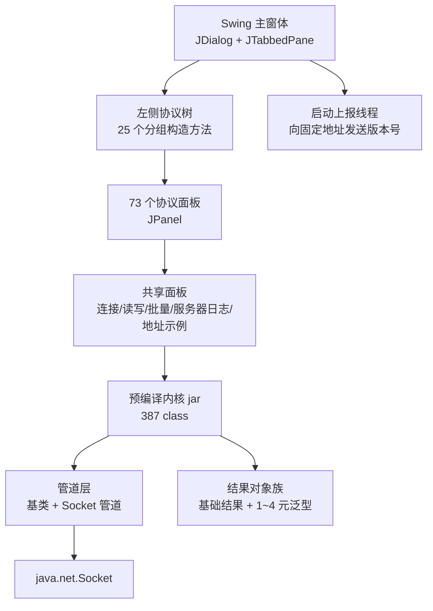

# PA-03｜同一内核的 JVM 移植与演示工程

> **分析对象**：类库 + 演示程序（核心以预编译 jar 分发，仓库仅含 Swing 演示层源码）
> **编号**：PA-03（按脱敏约定，不披露来源标识）
> **技术栈**：Java 8 / Swing / 原生 Socket / 无第三方依赖；核心为单个约 960 KB 的 jar
> **规模画像**：演示层 119 个 `.java`、20,644 行、73 个窗体、14 个自定义控件；jar 内 387 个 class、54 个包
> **成熟度画像**：生产可用但明显滞后于 .NET 主线（协议家族约为后者的三分之一，无异步、无串口 I/O）

---

## 1. 定位与问题域

### 1.1 它是什么

把 PA-01 那个 .NET 通信内核的**能力集合**在 JVM 上重做一遍：同样的品牌、同样的地址字符串、同样的"结果对象 + 读写方法"风格，配一套 Swing 演示程序。

但它不是"移植"这个词的常规含义。仓库里没有内核源码——只有演示层 119 个 Java 文件；真正的协议实现以预编译 jar 提供。也就是说：

| 层 | 形态 | 可见性 |
|---|---|---|
| 协议内核 | 预编译 jar（387 个 class） | 只有方法签名与行为，无源码 |
| 演示程序 | Java 源码（119 文件 / 20,644 行） | 完全可见 |
| 文档 | 演示程序的地址示例 + 方法注释 | 部分可见 |

这解释了"跨语言复用"的真实做法：**不是绑定、不是桥接、不是 IL 翻译，而是各语言独立实现 + 统一的 API 形状**。同一套命名（`ConnectServer`、`ReadBool`、`IsSuccess`）在两个运行时里各写一遍。

### 1.2 面向的用户与场景

| 用户 | 为什么不用 .NET 版 | 该移植版的真实价值 |
|---|---|---|
| 已有 MES/SCADA 是 Java 的工厂 | 生产系统跑在 Tomcat/Spring 上，不能再引入 CLR | 设备采集直接进 Java 服务，不用跨进程 |
| Linux 服务器部署 | .NET Framework 版只能跑 Windows | jar 可在任意带 JRE 的 Linux 上跑 |
| 信创/国产化环境 | 要求 JDK + 国产 OS | JDK 8 兼容性最好 |
| 教学与协议研究 | 想看 Java 怎么写工业协议 | 演示层源码可读，但内核不可读 |

场景共性：**服务端、Linux、与既有 Java 系统同进程**。这与 .NET 版的"Windows 上位机"是两种完全不同的部署形态。

### 1.3 边界（不做什么）

- 不做异步：jar 内没有任何 `Async` 类，演示层 20,644 行里只有 2 处显式起线程。
- 不做串口 I/O：`Serial` 包里只有 CRC16、LRC、校验类型三个工具类，没有任何串口打开/读写的实现；所有串口协议页面都以 "SerialOverTcp" 形式存在。
- 不做传输抽象：管道层只有"基类 + Socket 管道"两个类，没有 SSL、MQTT、DTU、Moxa 管道。
- 不做完整服务器侧：只有 4 个从站模拟（S7、FINS、MC、Modbus）。
- 不做 Redis 客户端、WebSocket 客户端/服务端：jar 里分别只有"Redis 帮助类"和"WebSocket 消息类"。

---

## 2. 功能分析

### 2.1 功能域总览

| 功能域 | 功能点 | 实现方式 | 完成度 |
|---|---|---|---|
| 连接管理 | IP/端口/超时、串口参数（仅 OverTcp 形态） | 共享连接面板 + 设备对象属性赋值 | 完整 |
| 单点读写 | bool/16/32/64/浮点/字符串/字节 | 按类型分支调用内核方法，结果统一渲染 | 完整 |
| 批量读 | 地址表格 + 批量/随机读 | 表格行 → 地址数组 | 完整 |
| 报文监视 | 十六进制/ASCII/多类型渲染 | 结果文本框 + 日志 | 完整 |
| 地址示例 | 每协议一份示例表 | 静态示例对象 + 表格 + "标题行/单位/默认类型"元数据 | 完整，比 .NET 版多了单位与默认类型字段 |
| 服务器模拟 | S7 / FINS / MC / Modbus 四种 | 复用内核服务器类 + 会话日志面板 | 部分 |
| 多协议页签 | 每协议一个 `JPanel`，由主窗体加进页签 | 主窗体 25 个分组构造方法显式注册 | 完整 |
| MQTT | 客户端、同步客户端（发布/订阅） | 回调接口 + 消息对象 | 完整 |
| 电能表 | DL/T 645（OverTcp） | 专用控制面板 + 地址示例 | 完整 |
| 温控表 | RKC 系列（OverTcp） | 同上 | 完整 |
| 授权 | 授权码 + 试用 | 静态授权类，启动时校验 | 完整 |

### 2.2 协议与接口覆盖（与 .NET 版对比）

按 jar 内包结构与演示目录逐项核对：

| 协议家族 | .NET 版 | JVM 版 | 备注 |
|---|---|---|---|
| 西门子 S7 / S7Plus / FetchWrite / PPI | 有 | 部分（S7、FetchWrite、PPI；无 S7Plus） | 无符号寻址 |
| 三菱 MC / A-1E / A-3C / FX / CIP | 有 | 有 | 覆盖最完整的一家 |
| 欧姆龙 FINS / HostLink / C-Mode / CIP | 有 | 有 | 含 FINS 服务器 |
| 罗克韦尔 CIP / PCCC / SLC / MicroCIP / DF1 | 有 | 部分（无 DF1 串口、无服务器） | — |
| 倍福 ADS | 有 | 有（客户端） | 无服务器 |
| 汇川 / 信捷 / 台达 / 富士 / 松下 / 基恩士 / LS | 有 | 前六家有（无 LS） | 多为 Modbus 变体 |
| GE SRTP / 安川 Memobus / 横河 Link / 丰田 ToyoPuc | 有 | 有 | — |
| 山武 / 丰炜 / 图尔克 / SICK / 托利多 / KNX / 身份证 / 振动传感器 / 特殊风机 | 有 | 无 | 长尾品牌全部缺失 |
| Modbus TCP/RTU/ASCII/UDP + 服务器 | 有 | 有（含服务器） | — |
| DL/T 645（1997/2007） | 有 | 有（2007 OverTcp） | 无 1997、无服务器 |
| DL/T 698 / CJ/T 188 / IEC 104 | 有 | 无 | 电力与水务场景缺口 |
| SECS/GEM | 有 | 无 | 半导体场景缺口 |
| MQTT 客户端/服务器 | 有 | 客户端 + 同步客户端（无服务器） | — |
| Redis | 有（客户端 + 订阅） | 仅帮助类 | 无法直接使用 |
| WebSocket | 有（客户端 + 服务端） | 仅消息类 | 无法直接使用 |
| 机器人（发那科/ABB/库卡/安川/埃斯顿/埃夫特/现代/雅马哈） | 8 家 | 仅发那科 | — |
| 数控（发那科 0i） | 有 | 有 | — |
| 从站模拟总数 | 约 40 | 4 | 最大能力缺口 |

**统计**：jar 内 `Profinet` 包覆盖 18 个品牌/标准命名空间（.NET 侧为 30 个）；PLC 类协议家族约为 .NET 的 60%，仪器仪表约为 25%，机器人约为 12%，服务器约为 10%。

### 2.3 典型使用流程

```
1. 主窗体左侧树 → 点品牌分组（如三菱）→ 页签打开该协议的调试面板
2. 连接面板填 IP/端口 → 点连接（在 Swing 事件线程上同步执行）
3. 地址示例面板选一行 → 自动填入地址框
4. 单点读 → 结果框显示值或错误
5. 切批量页 → 多行地址 → 一次读
6. 切服务器页 → 启动从站，观察会话日志
```

与 .NET 版几乎逐行对应，差别只有两处：**用页签代替停靠面板**，**没有代码生成控件**。

### 2.4 功能完成度评估

| 能力 | 完成度 | 说明 |
|---|---|---|
| 主流 PLC 读写 | 高 | 日系与欧系主力机型齐全 |
| 电力/水务/半导体/机器人 | 低 | 这些正是 Java 侧客户（能源、MES）最常遇到的场景 |
| 服务器模拟 | 低 | 只有 4 种，无法覆盖客户验收场景 |
| 串口现场 | 零 | 只能通过串口服务器转 TCP |
| 异步与并发 | 零 | 无线程模型，界面在读写期间冻结 |

---

## 3. 架构分析

### 3.1 分层与模块



### 3.2 关键抽象与接口

| 抽象 | 职责 | 边界 | 与 .NET 版的差异 |
|---|---|---|---|
| 结果对象（基础） | 成功标志、错误码、消息，均为 **public 字段** | 无内容载荷 | .NET 版是属性；Java 版是字段，符合"直译"而非"Java 惯例" |
| 结果对象（1~4 元泛型） | 携带 1~4 个返回值 | 无 5 元以上版本 | .NET 版做到 10 元 |
| 结果链式扩展 | `Then` / `ThenExOne..Four` / `Convert` | 只在结果对象上，不在设备上 | .NET 版没有等价物 |
| 设备基类 | 连接、读写、字节变换、超时 | 与 Socket 强绑定 | 无管道注入点 |
| 管道基类 | 加锁进入/离开 + 计时 | 只有锁语义，无 I/O 语义 | .NET 版 11 个管道实现，Java 版 1 个 |
| 消息帧接口 | 头长、内容长推断、头校验、序号 | 与 .NET 同构 | 逐协议重写 |
| 地址解析 | 品牌地址字符串 → 结构 | 与 .NET 同构 | 缺少部分品牌 |

`Then` 系列是这个移植版**唯一超出 .NET 版的设计**：让"读成功再写、写成功再读回"可以链式表达，失败自动短路。它出现在 Java 侧，说明移植者在新语言里补了自己想要的能力——但 .NET 主线没有回吸，两版从此分叉。

### 3.3 数据流与时序

```
点击分组 → new 协议面板(JTabbedPane) → 面板构造时 new 设备对象
  → 用户点"连接" → 在事件分发线程(EDT)上同步 ConnectServer()
    → 成功：启用读写区
    → 失败：弹模态对话框
  → 读：在 EDT 上同步 ReadXxx() → 结果渲染到 JTextArea
```

关键点：**整条链路没有异步边界**。20,644 行演示代码里，`SwingUtilities.invokeLater` 只出现 1 次且被注释掉；显式 `Thread` 只有 2 处（启动上报、MQTT 订阅）。因此一次 10 秒超时的读取会让整个窗口无响应 10 秒。

### 3.4 并发与连接管理

| 维度 | 事实 | 影响 |
|---|---|---|
| UI 线程 | 所有网络调用在 EDT 上执行 | 读超时 = 界面冻结，用户以为程序死了 |
| 设备并发 | 每设备一把管道级锁 | 同设备串行，与 .NET 一致 |
| 多设备 | 每个页签一个设备对象 | 无法并行——都在同一个 EDT 上 |
| 后台线程 | 仅 2 处：启动上报、MQTT 订阅 | 不是并发框架，是临时补丁 |
| 定时刷新 | 无统一调度器 | 轮询要靠页面自己起线程，而样例没有 |

这是整个移植版最严重的架构缺陷：**把"同步 API"原样搬到 GUI 单线程模型上**，而 .NET 侧至少还有 `async/await` 把等待让出 UI 线程（尽管底层是 `Task.Run`）。

### 3.5 配置、持久化与部署

- 配置：演示层没有设备清单持久化，参数只存在内存里；关闭即丢。
- 部署：单个 jar（约 960 KB）+ 演示源码，无第三方依赖，JDK 8 即可运行。
- 分发：以 Maven 坐标发布预编译包，版本号 3.9.x；与 .NET 侧 v12 明显不同步（推断落后若干代）。
- 启动行为：主窗体构造时起一个线程，用"简化网络客户端"向一个固定公网地址发送框架版本号。这是**版本统计/授权关联**行为，不是业务功能（推断其目的是装机量统计）。

### 3.6 扩展机制

没有。jar 是封闭的：新增协议必须等作者发版。演示层可以加页面，但页面依赖的设备类不在 jar 里就无从构造。这与 .NET 版"改源码加四件套"相比更封闭——闭源分发 + 无插件接口，等于把扩展权完全收归作者。

### 3.7 工程质量观察

| 观察点 | 事实 | 评价 |
|---|---|---|
| 直译痕迹 | 自带 `List`（继承 `ArrayList` 并加 `Add`/`getCount`）、`Encoding`（静态 ASCII/UTF8/Unicode 字段）、`BitConverter`、`MemoryStream`、`Convert`、`Array`、`AutoResetEvent` | 把 .NET BCL 的语义在 Java 里重造了一遍，是"逐行翻译"的直接证据 |
| 无符号数 | `ReadUInt16` 返回 `Integer`，`ReadUInt32` 返回 `Long` | 用加宽模拟无符号，API 形状与 .NET 不同，调用方需自行截断 |
| 长度参数 | 统一用有符号 `short` | 单次读写上限 32767，与 .NET 的 `ushort` 语义不一致 |
| 命名风格 | 方法用 PascalCase（`ReadBool`/`ConnectServer`），属性用 JavaBean 的 get/set | 两套风格混用，IDE 自动补全体验差 |
| 注释 | 中文块注释 + `// region` 手写分区 | 与 .NET 的 `#region` 对应，说明是同一份心智模型 |
| 未完成项 | 主菜单"关于"直接弹"当前的功能没有实现" | 移植未收尾 |
| 绝对布局 | 全部 `setBounds`，无布局管理器 | 分辨率适配靠一个 `componentResized` 监听器硬改尺寸 |

---

## 4. 需求分析

### 4.1 显性需求

| 需求 | 现场原因 | 移植版的回应 |
|---|---|---|
| 在 Java 服务里直连 PLC | MES/SCADA 是 Java，跨进程调用有部署与运维成本 | 同进程 jar，直接调用 |
| 跑在 Linux | 服务器不装 Windows | 纯 Java Socket，无原生依赖 |
| API 与 .NET 版一致 | 团队两套技术栈，希望知识可迁移 | 方法名、结果对象、地址语法全部对齐 |
| 信创环境 | JDK 8 + 国产 OS | 无第三方依赖，兼容性最好 |
| 电能表/温控表 | 能源管理与锅炉房场景 | DL/T 645、RKC 有专门面板 |

### 4.2 隐性需求

| 隐性需求 | 处理方式 | 缺口 |
|---|---|---|
| 不能阻塞业务线程 | 无 | 同步 API，调用方必须自己丢线程池 |
| 不能阻塞 UI | 无（EDT 直接调用） | 演示程序自己就违反了这条 |
| 无符号与字节序的正确性 | 加宽 + 字节变换类 | 与 .NET 语义存在细微差异，跨语言对账困难 |
| 字符串编码 | 自带 `Encoding` 封装 | 电能表等 GB 系编码场景可用，但编码对象不是 JDK 标准类型 |
| 串口现场 | 只支持 OverTcp | 直连 485 的设备无法接入 |
| 许可合规 | 源码仅限研究，商用需授权 | 企业法务通常不接受"不可读内核 + 商用授权"的组合 |

### 4.3 非功能需求

| 维度 | 实际水平 | 说明 |
|---|---|---|
| 吞吐 | 单设备串行、单线程调用 | 与 .NET 版同级，但缺少异步分流 |
| 响应性 | 差（GUI 场景） | EDT 阻塞是硬伤 |
| 资源占用 | 低 | 单 jar、无依赖 |
| 可移植性 | 高 | 有 JRE 即可 |
| 可观测性 | 低 | 无日志框架集成，只有演示层文本框 |
| 可测试性 | 低 | 设备类硬绑 Socket；jar 无源码，无法 mock |

### 4.4 需求缺口与误判

1. **误判了 Java 生态的集成方式**。Java 侧用户要的不是"一个能读 PLC 的类"，而是"能塞进 Spring 的、可配置、可监控、可连接池化的 Bean"。这个 jar 提供的是"类库"，不是"组件"，中间那段适配全靠客户自己写。
2. **误判了串口的必要性**。Java 串口需要额外原生库（或纯 Java 实现），作者选择回避，结果是把大量 485 现场排除在外。
3. **API 形状一致被当成了目标本身**。命名对齐降低了跨语言学习成本，但也把 .NET 的历史包袱（字段 vs 属性、结果对象族、长度用 short）一并搬进了 Java。
4. **没有回答"谁来维护两份实现"**。协议一旦分叉，行为差异只能靠人肉对账；从协议家族数量差（30 vs 18）可以看出，分叉已经发生且不可逆。

---

## 5. 可借鉴与应规避

### 5.1 可直接吸收的机制

| 机制 | 价值 | 迁移建议 |
|---|---|---|
| 结果对象族 + `Then` 链式调用 | 让"读-校验-写-回读"成为一条表达式，失败自动短路 | Go 侧用 `func(T) (U, error)` 组合或显式步骤机，避免 error 检查噪音 |
| 地址示例携带元数据（单位、默认类型、是否支持位/字） | 示例本身就是点位模板的雏形 | 目标产品把地址示例升级为"点位模板"，可直接导入 |
| 用页签/树组织协议面板 | 比"菜单 + 弹窗"更接近工程师心智 | Web 端用左侧树 + 多标签工作区 |
| 单 jar 零依赖 | 分发极简，适合内网离线部署 | Go 的静态二进制天然具备这一优势 |
| API 命名跨语言对齐 | 团队知识可迁移，文档可共用 | 用"规范 + 契约测试"保证对齐，而不是靠人工翻译 |

### 5.2 明确应规避的做法

| 做法 | 问题 | 后果 |
|---|---|---|
| 同步 API 直接接到 GUI 线程 | 无异步边界 | 界面冻结，用户强杀进程 |
| 重造语言标准库（List/Encoding/BitConverter） | 与生态脱节 | 与 Jackson、Netty、日志框架互操作困难 |
| 无符号用加宽模拟 | 语义漂移 | 跨语言对账时高位判断出错 |
| 长度参数用有符号 short | 上限 32767 | 大块读取被静默限制 |
| 内核闭源 + 无插件接口 | 扩展权收归作者 | 客户遇到缺失协议只能等发版或换方案 |
| 启动时向固定地址上报版本 | 隐私与合规风险 | 内网/涉密环境直接被安全审计拦下 |
| 两套实现各自演进 | 无共享测试 | 协议行为分叉，问题无法复现 |

### 5.3 迁移到目标产品的成本

| 迁移项 | 成本 | 说明 |
|---|---|---|
| 协议语义与地址模型 | 高 | 必须抽成语言无关的规格（帧定义 + 地址文法 + 测试向量），不能照抄任一实现 |
| 结果/错误模型 | 低 | 概念通用，Go 用 `error` + 错误码枚举重写 |
| 演示层交互 | 低 | 页签 + 树 + 共享面板的结构可直接借鉴 |
| 现有 Java 代码 | 不复用 | 只作为行为参照与测试语料 |
| 多语言 SDK | 中 | 用"协议线格式 + 稳定 API 契约 + 契约测试"三件套，而不是逐语言翻译 |

---

## 6. 结论

### 6.1 六维评分

| 维度 | 分数(1-5) | 理由 |
|---|---|---|
| 协议广度 | 3 | 主流日系/欧系 PLC 齐全，但电力、水务、半导体、机器人缺口明显 |
| 架构可演进性 | 2 | 无异步、无管道抽象、内核闭源、无插件，任何扩展都要等发版 |
| 跨平台能力 | 4 | 纯 Java + 零依赖，Linux/信创环境可用；扣分在串口缺失 |
| 可运维性 | 2 | 无配置持久化、无日志框架集成、无指标、无健康检查 |
| 工程质量 | 2 | 直译痕迹重（自造 BCL）、API 风格混用、GUI 阻塞、未完成项可见 |
| 许可与合规风险 | 2 | 源码仅限研究、商用需授权；启动上报行为在内网环境有合规风险 |

### 6.2 三条关键结论

1. **跨语言复用的真实做法是"各语言独立实现 + 统一 API 形状"，不是绑定**。这个移植版证明了它可行（学习成本低、文档可共用），也证明了它的代价（两份实现必然分叉：协议家族 30 vs 18、管道 11 vs 1、异步 1710 vs 0）。任何声称"一套代码多语言运行"的方案，都要回答"分叉后谁负责对齐"。
2. **工业客户要 Java 版的真实动机是"部署形态"，不是"语言偏好"**：既有 MES/SCADA 是 Java、服务器是 Linux、环境要求信创。因此多语言 SDK 的第一优先级不是"功能对等"，而是"能在对方的运行时里被正确集成"——可配置、可注入、可监控、可连接池化，这四件事比多支持五个品牌更重要。
3. **对目标产品（Go）的启示：协议语义与地址模型必须语言无关地定义**。正确做法是把"帧格式、地址文法、错误码、测试向量"沉淀为独立规格与契约测试，各语言 SDK 只做"规格的实现 + 契约的通过"；而不是把某一份实现逐行翻译成另一种语言——翻译会带走原语言的全部历史包袱（无符号语义、长度上限、结果对象族、字段 vs 属性）。
