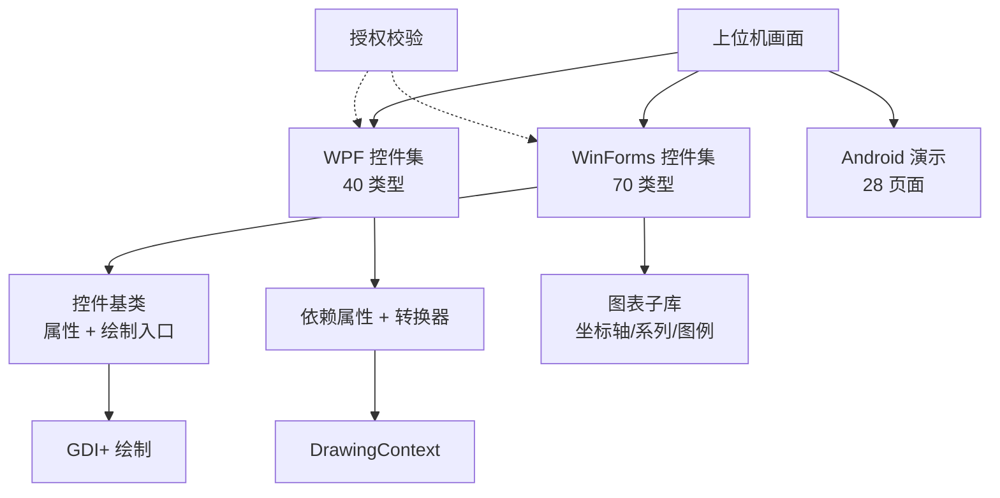

# PA-04｜工业 HMI 可视化控件库

> **分析对象**：控件库（.NET 类库，WinForms / WPF 双端各自实现，另附 Android 演示）
> **编号**：PA-04（按脱敏约定，不披露来源标识）
> **技术栈**：C# / .NET Framework 4.5+ / WinForms（GDI+）/ WPF（XAML + DrawingContext）/ Xamarin.Android（演示）
> **规模画像**：公开类型 150 个（WinForms 命名空间 70、WPF 40、图表 13、数码段 7）、文档化属性 869 条；演示 77 个 WinForms 窗体、32 个 WPF 窗口、28 个 Android 页面
> **成熟度画像**：商业化（NuGet 分发，运行时需授权码激活）

---

## 1. 定位与问题域

### 1.1 它是什么

一套"工业图形积木"：把管道、阀门、泵、风机、罐、锅炉、电机、传送带、加工中心、仪表盘、曲线、柱状图、饼图、甘特图、LED 点阵、进度、温度计、电池、状态矩阵、签名板等画成可拖拽的 .NET 控件，上位机开发者把它们摆到窗体上，改几个属性（数值、量程、颜色、方向），就得到一张"看起来像组态"的画面。

它卖的是**图元与绘制**，不是组态能力。这个区别决定了它的全部优点与全部局限。

### 1.2 面向的用户与场景

上位机开发者要的是"不想自己画泵和阀门，拖上去就能用"；设备厂商要的是"图元像那么回事、交付周期短"；看板开发者要仪表盘、柱状图、状态矩阵；教学场景要现成示例与可读源码。

场景共性：**Windows 桌面、单机、WinForms/WPF、画面由程序员硬编码布局**。没有"工艺工程师自己画画面"这一层用户。

### 1.3 边界（不做什么）

- 不做组态引擎：没有画面文件格式、没有图元树、没有编辑器、没有版本管理。
- 不做绑定与报警：只有 `Value` 属性和"按区间换颜色"，没有报警对象、优先级、确认、抑制。
- 不做历史存储：曲线控件只管画，不管数据从哪来、存多久。
- 不做 Web：三端（WinForms / WPF / Android）各自绘制，没有共享渲染层。
- 不做工艺语义：图元叫"罐""阀""泵"，但不知道罐里装什么、阀属于哪条管线。

---

## 2. 功能分析

### 2.1 功能域总览

| 功能域 | 功能点 | 实现方式 | 完成度 |
|---|---|---|---|
| 工艺图元 | 管道（含转向/流向/流速）、阀、泵、风机、锅炉、罐、反应釜、电机、传送带、CNC 加工中心、机床、工厂 | 每图元一个控件类，重写绘制，几何路径 + 渐变色 | 完整（30+ 图元） |
| 仪表、图表、指示 | 圆盘/弧形/表盘/刻度盘、七段/十六段/LED 点阵；实时与历史曲线、柱状、饼、甘特；指示灯、走马灯、电池、温度计、液位、进度条 | 自绘坐标系/刻度 + 数据系列 + 分区着色 | 完整，图表无缩放/平移/导出 |
| 状态、标注、装饰、动画 | 状态矩阵（行列着色/点击回调/三种渲染形状）；标注文本/线/区间、箭头、标题栏、面板、时钟、签名板；管道流动、液位升降、电机旋转 | 二维颜色表；独立控件族；定时器帧计算（仅 5 个控件暴露动画开关） | 完整，但状态矩阵不是报警模型 |
| 娱乐 | 五子棋（含 AI）、俄罗斯方块 | 完整游戏逻辑 | 完整，与工业无关 |

### 2.2 控件类别清单

| 类别 | 代表图元 | 数量 |
|---|---|---|
| 管道 | 直管、转角管、三通、流动动画 | 1 类 + 方向/转角枚举 |
| 阀门 / 泵 / 风机 / 热工 | 手阀、调节阀；离心泵、真空泵、水泵；风机、鼓风机、冷却风扇；锅炉、温度计 | 10 |
| 容器 / 动力 | 罐、水箱、水池、反应釜、瓶；电机（两种造型） | 7 |
| 输送 / 机床 | 传送带、滚筒传送带、分类器；CNC 加工中心、机床、工厂 | 6 |
| 仪表盘 / 数码 | 圆盘、弧形、表盘、刻度盘；七段、十六段、LED 点阵 | 7 |
| 曲线 / 统计图 | 实时曲线、历史曲线、游标标注；柱状、横向柱状、饼、甘特 | 8 |
| 进度 / 指示 / 交互 | 进度条、彩色进度、线形进度；指示灯、走马灯、电池；开关、按钮、签名板 | 9 |
| 状态 / 标注 / 结构 | 状态矩阵；标注文本/线/色块；面板、面板标题、面板文本 | 8 |
| 装饰 / 娱乐 | 箭头、时钟、滚动文字；五子棋、俄罗斯方块 | 5 |

该版本公开类型清单中未见独立二维码控件（签名板存在），按事实记录不臆测。

### 2.3 双端与三端对照

| 维度 | WinForms 端 | WPF 端 | Android 端（演示） |
|---|---|---|---|
| 公开控件类型 | 70 | 40 | 无独立库，直接引用演示 |
| 图元覆盖 | 全量（30+） | 子集（约 26） | 子集（28 个页面） |
| 绘制技术 | GDI+ 自绘（重写绘制方法） | XAML + 依赖属性 + 转换器 | 平台原生绘制 |
| 动画 / 设计器 | 定时器 + 帧计算；属性可序列化 | 依赖属性 + 动画；XAML 属性 + 绑定 | 平台动画；无设计器 |

**同一个图元要写三遍**，这是该库最大的结构性成本。WPF 端的存在不是为了"跨平台"，而是为了"同一批客户从 WinForms 迁到 WPF 时不用换控件供应商"。

---

## 3. 架构分析

### 3.1 分层与模块



### 3.2 关键抽象与接口

| 抽象 | 职责 | 边界 | 评价 |
|---|---|---|---|
| 控件基类 | 承载尺寸、颜色、字体、重绘触发 | 只管"画自己"，不管数据来源 | 典型自绘控件模型 |
| 数值属性（Value/Min/Max） | 工程量映射到图形比例 | 无单位、无缩放、无质量码 | 19 个控件暴露此类属性 |
| 分区颜色（Color1..Color5） | 按数值区间换色 | 区间边界写死在控件里 | 6 个控件用这套命名；图表系列另为"数据+颜色+样式" |
| 动画开关 | 控制是否逐帧刷新 | 帧率由定时器决定 | 仅 5 个控件暴露 |

关键观察：**属性设计是"每个控件自带一套颜色"，不是"一套状态语义 + 主题"**。869 条文档属性里颜色类占大头，命名多为"颜色 1/2/3"或"边缘色/中心色/背景色"。后果是：换主题要逐控件改属性；"报警红/警告黄/正常绿"没有统一定义；图元无法表达"我处于什么状态"，只能表达"我现在是什么颜色"。

### 3.3 数据流与时序

```
业务代码读到值 → 设置控件 Value 属性 → setter 比较新旧值，不同则重绘
  → 绘制方法按 Value/Min/Max 算几何比例 → 按分区颜色选前景色
  → 画路径、渐变、文本
  → 若开动画：定时器每次 Tick 推进一帧（液位升降、管道流动、电机旋转）
```

这条链路里没有"数据源"概念：谁赋值、失败怎么办、值是否过期，全在业务代码里，控件对"数据可信度"一无所知。

### 3.4 并发与连接管理

控件库没有连接概念，并发问题集中在 UI 线程：绘制全部在 UI 线程完成，图元多时首帧卡顿；动画由 WinForms 定时器（演示中 600ms 级）叠加驱动，图元多时 CPU 抖动；后台线程直接设值会抛跨线程异常，需要调用方自己切回 UI 线程；曲线控件按点全量重绘，万点级曲线明显掉帧。

### 3.5 配置、持久化与部署

- 配置即属性：外观与行为都是控件属性，靠设计器序列化进窗体代码或 XAML；没有画面文件与主题包，画面就是窗体类，改布局要改代码、重新编译，颜色散落在每个控件实例上。
- 部署：单个控件 DLL（发行包内约 2.5 MB）+ 授权文件；与通信内核分属两个授权体系（各有独立激活文件与校验入口）。

### 3.6 扩展机制

新增图元只能继承控件基类重写绘制，**无法把既有图元组合成新图元**；改外观只能改"颜色/尺寸"属性，不能改"语义/状态"；新增图表类型要自己实现坐标轴与系列；跨端没有复用通道，每个平台重写一遍。

### 3.7 工程质量观察

| 观察点 | 事实 | 评价 |
|---|---|---|
| API 规模 | 150 个公开类型、869 条属性文档 | 单类型平均 5.8 个属性，粒度细但缺抽象 |
| 命名与双端一致性 | 同一概念在不同控件叫法不同（颜色 1..5/边缘色/中心色）；WinForms 70 类型 vs WPF 40 类型且属性不完全对应 | 学习成本靠示例消化，迁移时属性要重新对一遍 |
| 职责漂移 | 控件库里包含五子棋 AI、俄罗斯方块 | 把它当通用绘图框架，缺产品边界 |
| 授权耦合 | 授权校验在控件库内，Android 演示每页都要先设授权码 | 试用与演示体验受影响 |
| 设计器支持 | WinForms 属性可序列化；WPF 支持绑定与转换器 | 这是它能被广泛采用的关键工程能力 |

---

## 4. 需求分析

### 4.1 显性需求

| 需求 | 现场原因 | 控件的回应 |
|---|---|---|
| 画面要"像工业" | 客户验收看第一眼 | 30+ 工艺图元，渐变 + 阴影 + 动画 |
| 状态要一眼看出 | 操作工不看数字看颜色 | 分区颜色 + 指示灯 + 状态矩阵 |
| 要有动感、有趋势图 | 静态图像"死机"；要看产量与温度趋势 | 管道流动/液位升降/电机旋转；实时与历史曲线、柱状、饼、甘特 |
| 要能触摸操作、要快速交付 | 现场用触摸屏；项目周期短 | 开关/按钮/签名板；拖控件 + 改属性，一天出一屏 |

### 4.2 隐性需求

| 隐性需求 | 处理方式 | 缺口 |
|---|---|---|
| 工艺语义可视化 | 图元只有形状，没有介质/流向/所属管线 | 管线连接是"看起来对"，不是模型里对 |
| 状态机着色 / 报警闪烁 | 分区颜色 + 定时器切色 | 无"正常/警告/报警/离线/未确认"统一枚举，无优先级与确认后常亮 |
| 高 DPI、主题与换肤 | 按像素绘制；逐控件改属性 | 高分屏下图元模糊或错位；无法整体换肤 |
| 数据可信度、图元复用 | 无；无组合机制 | 值超时/坏值时无法自动变灰；一条"泵+阀+管"单元要复制十几个控件 |

### 4.3 非功能需求

渲染性能中等（单屏几十个图元流畅，上百个 + 动画时掉帧）；内存占用低；可维护性中等（图元隔离好但三端重复）；可移植性低（仅 Windows 桌面，Android 为演示级）；可测试性低（绘制结果难以断言）。

### 4.4 需求缺口与误判

1. **把"组态"误判成"控件"**。组态的本质是"工艺模型 + 图元 + 绑定 + 状态 + 权限 + 版本"，控件只是最表层。客户买控件时以为买的是组态能力，做完第一个项目就会发现：改一个阀门位置要重新编译发版。
2. **把"颜色"误判成"状态"**。用分区颜色表达状态，短期够用，长期无法回答"这个泵现在到底是报警还是停机"。状态必须先建模，再映射到颜色。
3. **低估了 Web 化的不可逆性**。画面正在从"桌面 EXE"迁到"浏览器 + 大屏 + 移动端"，三端各画一遍的路线在 Web 面前无法延续。
4. **忽略了图元的组合性与交付环境**。真实画面 80% 是重复的工艺单元（泵组、换热器、罐区），没有复合图元概念只能复制粘贴；同时按像素绘制让高分屏交付普遍返工。

---

## 5. 可借鉴与应规避

### 5.1 可直接吸收的机制

| 机制 | 价值 | 迁移建议 |
|---|---|---|
| 30+ 工艺图元清单 | 一份现成的"工业图形需求表" | 直接作为目标产品图元库的验收清单 |
| `Value/Min/Max` 三件套 | 工程量到图形比例的通用映射 | 保留，但补单位、量程、死区、质量码 |
| 分区着色 + 动画帧模型 | 阈值可视化与流动/液位/旋转的最小实现 | 升级为"状态 → 颜色"映射，阈值来自配置；Web 端用 CSS/SVG 动画或 Canvas 帧循环 |
| 状态矩阵 + 可序列化属性 | 工位/库位状态墙；拖拽即用的关键 | 抽象为"二维状态网格"，颜色由状态枚举决定；Web 端用属性面板 + JSON schema 实现等价体验 |

### 5.2 明确应规避的做法

| 做法 | 问题 | 后果 |
|---|---|---|
| 每个控件自带 `Color1..5`；图元不知道工艺含义 | 无主题、无状态语义；只是形状 | 换肤要改几千个属性、报警色各写一套；无法做管线连通性与因果追溯 |
| 三端各写一遍 | 重复劳动 | 图元与属性漂移，Web 端无法承接 |
| 画面 = 窗体代码、控件库塞游戏与授权、无高 DPI 方案 | 改布局要编译；边界模糊；按像素绘制 | 工艺工程师无法自助修改；体积/许可/维护成本上升；高分屏交付返工 |

### 5.3 迁移到目标产品的成本

| 迁移项 | 成本 | 说明 |
|---|---|---|
| 图元清单与视觉规范 | 中 | 需重绘为 SVG，工作量在图元数量 |
| 图元语义模型（设备类型/状态/连接关系） | 高 | 目标产品要新增的能力，控件库没有可抄的部分 |
| 动画、主题与组态编辑器 | 低 / 高 | 前端技术成熟，CSS 变量一次解决换肤；编辑器控件库完全没有，需从零设计 |
| .NET 控件代码 | 不复用 | 只作为视觉与交互参照 |

---

## 6. 结论

### 6.1 六维评分

| 维度 | 分数(1-5) | 理由 |
|---|---|---|
| 协议广度 | 1 | 不适用：本方案不含通信协议；若以图元覆盖折算约为 4 |
| 架构可演进性 | 2 | 每图元独立实现、每端各写一遍、属性即配置，演进靠不断加控件 |
| 跨平台能力 | 2 | 名义上 WinForms/WPF/Android 三端，实际三套绘制，Web 端为零 |
| 可运维性 | 1 | 无画面文件、无主题包、无版本管理，交付即代码 |
| 工程质量 | 3 | 图元隔离好、设计器支持完善；但命名不统一、职责漂移、无测试 |
| 许可与合规风险 | 2 | 商业授权 + 运行时激活嵌在控件库内部，替换成本高 |

### 6.2 三条关键结论

1. **组态画面的本质不是"画得像"，而是"工艺语义 + 状态 + 绑定"**。控件库解决了"像"，没解决"语义"：它不知道罐里是什么、阀属于哪条线、泵现在是什么状态。目标产品若只做图元库，会重复它的天花板。
2. **Web 化是必由之路，但工业图形语义必须标准化建模**。图元应是 SVG 符号，状态应是枚举（正常/警告/报警/离线/未确认），颜色应是主题 token 的映射，绑定应是"点位 → 图元属性"的声明式配置。有了这四层，同一套图元可同时服务桌面、大屏、移动端。
3. **对目标产品的分工建议：Go 侧只提供数据与语义，渲染交给前端**。Go 负责点位值、质量码、状态机、报警级别、图元-点位绑定关系与主题配置的下发；前端负责 SVG 渲染、动画与交互。这样既不重复"三端各画一遍"的错误，也让工艺工程师通过配置而非编译来改画面。
