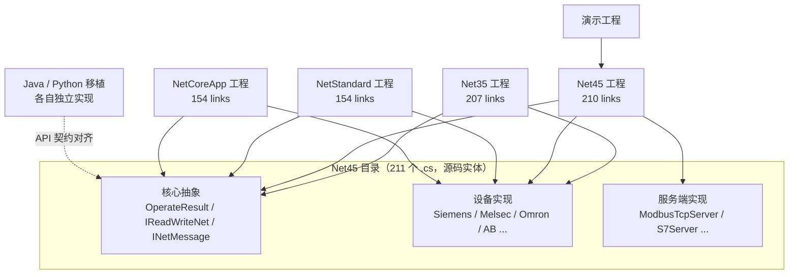

# PA-05｜开源社区版通信库分支

> **分析对象**：类库（.NET 多目标，附 Java/Python 移植与演示工程）
> **编号**：PA-05（按脱敏约定，不披露来源标识）
> **技术栈**：C# 7.0 / .NET Framework 3.5 & 4.5 / .NET Standard 2.0 / .NET Core 3.0；另有 Java 1.8、Python 3.6 移植
> **规模画像**：核心源码 211 个 `.cs`；四个工程分别链接 207/210/154/154 个源文件；约 29 个设备类
> **成熟度画像**：社区开源（LGPL-3.0），与闭源商业版同源

---

## 1. 定位与问题域

本方案指某开源工业通信库 2019 年 12 月的主分支（社区版，快照提交 `04730e8`，程序集版本 7.0.1.0）。
它解决的问题与 PA-01 同源：用统一的 `OperateResult` 抽象承载多品牌 PLC 与 Modbus 的读写。差异在
分发形态——社区版以 **LGPL-3.0** 发布、不设授权码与试用期；商业版则闭源收费，并在 v12 引入
证书校验。

选择该分支作为样本的理由：

- 它是这套代码谱系中**唯一可获取完整源码**的版本，实现细节只能以此为准；
- 它保留了 2019 年的技术栈与工程组织方式，可看到「多目标框架 + 多语言移植」的真实取舍；
- 它与商业版 v12 同源，可直接对照出「开源发行版被裁剪了什么」。

社区版 README 自述与商业版「拥有同样的操作 API」并提供商业版入口，因此其定位是**商业版的能力子集与公开镜像**，而非独立产品。

---

## 2. 功能分析

### 功能范围

README 列出的能力可分为四组：

| 组别 | 内容 |
| --- | --- |
| 核心 | 统一返回结果、日志（net45 起）、中文注释、单元测试、NuGet 包 |
| 网络基础 | 客户端/服务端基类、Modbus 客户端与服务端、文件服务、持久连接服务 |
| 设备协议 | 三菱 MC 系列、西门子 S7/PPI/FetchWrite、AB CIP、Omron FINS、LS、Keyence、Panasonic、Fuji、Fatek、Modbus、Redis、MQTT、IEC104、机器人、CNC、Profinet 等 |
| 授权 | 无（README 明确写「无授权要求」） |

### 与商业版 v12 的差异

差异不是零散的，而是按发行版定位成组裁剪：

| 维度 | 社区版（2019-12） | 商业版 v12 |
| --- | --- | --- |
| 异步 API | 无 `async` 方法 | 1,710 个 Async 方法 |
| 协议家族 | 约 29 个设备类 | 50 个协议家族 |
| Profinet 品牌目录 | 10 个 | 30 个系列 |
| 目标框架 | net35 / net45 / netstandard2.0 / netcoreapp3.0 | 增加 net6.0 / net8.0 等 |
| 授权校验 | 无 | 授权码 + 试用期 + 证书 |
| 版本 | 7.0.1.0 | 12.x |

两个可复核的量化事实：社区版四个工程共链接 207 / 210 / 154 / 154 个源文件；商业版 XML 文档登记 679 个公开类型、1,710 个 Async 方法。**异步能力是商业版独占**，社区版 socket 调用全部是同步或 APM 回调。

### 被裁掉的东西

- 异步接口族：核心库没有任何 `async` 修饰符；唯一以 `Async` 命名的多 PLC 类**整体被注释**，不参与编译。
- 协议广度：Profinet 下只有 10 个品牌目录、39 个 `.cs`，而 v12 有 30 个系列。
- 服务端与云侧能力：社区版有 Modbus/S7/MC 等从站模拟，但没有商业版较完整的服务端组件矩阵。

**推断**：社区版承担「入门、教学、社区引流」职能，异步与协议广度被刻意留作商业版的差异点。

---

## 3. 架构分析

### 工程组织：一份源码、四个工程

社区版不采用 SDK 风格的多目标框架，而是**四个工程各自用 `<Compile Include="..\...">` 链接同一批源文件**：

| 工程 | 目标框架 | 链接源文件数 | 依赖 |
| --- | --- | --- | --- |
| 核心库 Net35 | net35 | 207 | 无 NuGet |
| 核心库 Net45 | net45 | 210 | 无 NuGet |
| 核心库 NetStandard | netstandard2.0 | 154 | Json、SqlClient、Drawing.Common、IO.Ports |
| 核心库 NetCoreApp | netcoreapp3.0 | 154 | 同上 |

源文件实体集中在 Net45 目录（211 个 `.cs`），其余三个工程只放工程文件与签名密钥。新增一个协议类必须手工改动四个工程的 `Compile Include` 列表；漏改不会报错，只会在某个 TFM 上静默缺类型。

### 模块关系图

### 关键抽象

- `OperateResult` / `OperateResult<T>`：统一返回，带 `IsSuccess`、`Message`、`ErrorCode`；
- `IReadWriteNet`：设备读写契约，屏蔽品牌差异；
- `INetMessage`：报文帧接口，每个协议家族提供实现；
- `IByteTransform`：字节序与字序变换（大小端、字交换）；
- `NetworkDeviceBase` / `NetworkDoubleBase` / `NetworkServerBase`：长连接、短连接与服务端基类。

### 并发模型

- 设备侧：同步阻塞 socket，超时靠 `Socket.ReceiveTimeout`；基类内**没有显式锁**，同一实例被多线程共用时需调用方自行串行化（推断，基于基类无 `lock`/`Semaphore`）。
- 服务端侧：`ThreadPool.QueueUserWorkItem` 分发会话，`BeginAccept` 回调式重入；accept 失败后 `Thread.Sleep(1000)` 再试，属 APM + 线程池模型而非 `async/await`；没有 `CancellationToken`，取消只能靠关 socket 或等超时。

### 故障恢复

- 客户端：每次请求失败返回失败结果，是否重连由上层决定；没有熔断、退避或连接池健康检查。服务端：accept 循环带 1 秒退避，可承受端口短暂不可用；会话异常只影响单连接。无跨实例故障转移，也没有商业版较完整的连接池治理。

---

## 4. 需求分析

### 满足与不满足

| 需求 | 结论 | 依据 |
| --- | --- | --- |
| 学习协议实现 | ✅ | 源码完整、注释为中文 |
| 闭源商用 | ⚠️ | LGPL-3.0 允许，但有链接与源码提供义务 |
| 零授权成本 | ✅ | 无授权码、无试用期 |
| 高并发异步 | ❌ | 无 `async` API，同步阻塞 |
| 跨平台 | ⚠️ | 有 netstandard/netcore 工程，但依赖 `System.IO.Ports` 等平台包 |
| 协议广度 | ⚠️ | 约 29 个设备类，Profinet 10 个品牌 |
| 服务端模拟 | ⚠️ | 有 Modbus/S7/MC 从站，矩阵不完整 |

### 架构代价

1. **四份工程清单是手工同步的**。211 个源文件被四套 `Compile Include` 重复描述，新增/删除文件需要改四处；任何遗漏只在特定 TFM 暴露。
2. **net35 与 net45 各自维护完整清单**，链接数只差 3 个、同一批服务端类型在两者中都参与编译；框架差异靠 16 处 `#if NET35` 条件编译兜底，阅读成本高。
3. **`MelsecNetMultiAsync` 是整文件注释的死代码**。文件名与类名都带 Async，实际 0 处 `async`，容易误导使用者以为存在异步多 PLC 能力。
4. **同步模型限制吞吐**。每设备一连接、每请求一阻塞，服务端靠线程池顶住并发；连接数上升时线程与内存成本线性增长。

### 许可边界

LGPL-3.0 的关键约束不在「能否商用」，而在**分发时的合规动作**：修改库本身需公开修改部分；静态链接或内联（含 AOT、单文件打包）会触发「重新链接」义务。工业现场常见的单体部署、离线升级恰恰容易踩到这条线；而同一代码谱系又存在闭源商业版，使用者在选型时容易误判自己拿到的是哪一份授权。

---

## 5. 可借鉴与应规避

### 可借鉴

1. **一份源码、按 TFM 生成多个工程**，在 2019 年的工具链下是可行做法；今天应改用 SDK 风格
   多目标（`<TargetFrameworks>`），由编译器而非人工维护文件清单。
2. **统一的返回抽象 + 报文接口 + 字节变换接口**三层切分清晰：协议差异被压在 `INetMessage` 与
   `IByteTransform`，上层读写逻辑可复用。
3. **服务端 accept 循环的 1 秒退避**是简单有效的自愈手段，适合无人值守现场。
4. **README 明确标注开源版与商业版的关系**，比含糊其辞更利于合规判断。

### 应规避

1. **用四份 `Compile Include` 手工同步源码**：新增文件漏改即静默缺类型，应改为多目标框架或
   共享 `.props`。
2. **保留整文件注释的 `*Async` 类**：命名承诺了不存在的能力，应删除或实现。
3. **设备实例无锁却不声明线程约束**：应在文档中明确「非线程安全」，或在基类提供串行化开关。
4. **把 LGPL 库当作「随便用」**：闭源分发前必须确认链接方式与源码提供义务，尤其是单文件打包。
5. **同步阻塞 + 线程池的服务端模型**：连接规模上去后不可运维，新设计应从第一天就提供异步路径。

---

## 6. 结论

### 六维评分

| 维度 | 评分（1-5） | 理由 |
| --- | --- | --- |
| 协议广度 | 3 | 约 29 个设备类、Profinet 10 个品牌，覆盖主流但远不及商业版 50 家族 |
| 架构可演进性 | 2 | 四份手工工程清单、同步阻塞、整文件注释死代码 |
| 跨平台能力 | 3 | 有 netstandard2.0/netcoreapp3.0 工程与 NuGet 依赖，但串口等仍绑平台包 |
| 可运维性 | 2 | 无异步、无健康检查、无指标，服务端靠线程池与 1 秒退避 |
| 工程质量 | 3 | 有单元测试与统一抽象，但工程清单重复、死代码未清理 |
| 许可与合规风险 | 2 | LGPL-3.0 的链接与源码义务易被低估，且与闭源商业版同源并存 |

### 三条关键结论

1. **社区版是商业版的裁剪镜像，不是独立产品**：异步（0 vs 1,710）、协议家族（29 vs 50）、
   Profinet 品牌（10 vs 30）成组缺失，说明裁剪是按发行版策略执行的，而非技术演进自然落后。

2. **它最大的架构问题是「一份源码、四份清单」的工程组织**：211 个源文件被四套 `Compile Include`
   重复描述，新增文件需改四处且漏改不报错；这是比「同步阻塞」更隐蔽的长期维护成本。

3. **LGPL-3.0 是选型时最容易被忽略的约束**：零授权成本不等于零合规成本，闭源分发、静态链接、
   单文件打包都需逐项确认义务；同时并存的闭源商业版会进一步模糊授权边界。

> 参考结论：可作为「协议实现细节与报文格式」的知识库，不宜作为目标产品的架构蓝本。
