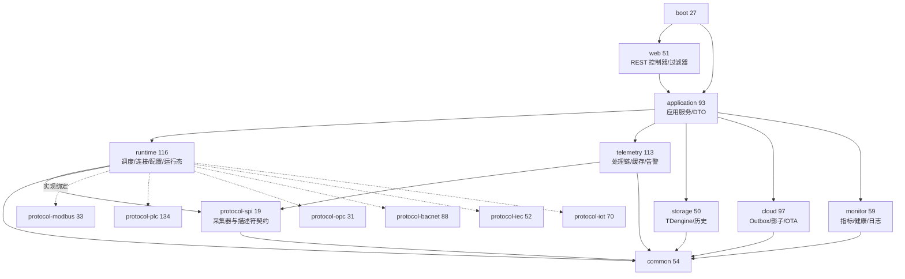

# PA-06｜Java 多模块单体采集网关

> **分析对象**：网关服务（Spring Boot 可执行 jar，内置网页控制台 + 可选 Electron 客户端）
> **编号**：PA-06（按脱敏约定，不披露来源标识）
> **技术栈**：Java 17 / Spring Boot 3.5.16 / Maven 16 模块；PLC4X 0.13.0、digitalpetri Modbus 2.1.3、jSerialComm、j60870、IEC61850Bean、Californium 3.11（CoAP）、Milo 1.0.8（OPC UA）、SNMP4J、Eclipse Paho、TDengine JDBC、MyBatis、ArchUnit；前端 Vue 3 + Electron
> **规模画像**：1087 个 `.java`（主代码 840 / 测试 247），约 19.2 万行；16 个 Maven 模块；26 个主协议描述符 + 8 个别名 = 34 个协议代码；28 个监控指标类；控制台 41 个 `.vue`、214 个 `.ts/.vue` 文件
> **成熟度画像**：生产可用（有 CI、依赖漏洞基线、浸泡测试、架构守护测试，并自带生产就绪度文档集）

---

## 1. 定位与问题域

### 1.1 它是什么

一个把"多协议采集"当作系统工程来做的 Java 网关：南向接 26 种现场协议，中间做点位归一化、质量判定、缓存与历史存储，北向同时提供 HTTP/WebSocket 接口、MQTT 云上报、TDengine 时序库三条出口。

它的自我定位不是"某协议的驱动库"，而是**一个可治理、可观测的采集底座**。判断依据来自三处代码事实：

| 事实 | 说明 |
|---|---|
| 存在独立的 `ProtocolDescriptor` 体系（19 个类） | 协议元数据是"数据"而非硬编码分支，前端据此渲染表单 |
| 运行态枚举细化到 8 个设备阶段 + 5 组子状态 | 说明作者区分"命令已下发"与"真的在出数" |
| 存在 `MavenModuleBoundaryTest` 与 6 条以上 ArchUnit 规则 | 模块边界被测试守护，而不是靠自觉 |

这个"系统"取向是本批 5 份文档中最值得对标的对象，也是最重的一份。

### 1.2 面向的用户与场景

| 用户 | 场景 | 真实诉求 |
|---|---|---|
| 集成商/项目交付 | 工厂私有化部署，一套软件适配多品牌设备 | 协议覆盖广、配置可视化、出问题能定位 |
| 平台厂商 | 把采集能力作为 IIoT 平台的底座做二次开发 | SPI 稳定、可插协议、北向可换 |
| 现场运维 | 停机后远程看"为什么没数" | 运行态与采集健康，而非仅"进程存活" |
| 平台侧对接 | 网关数据入云/入湖 | Outbox 至少一次、设备影子、子设备注册 |

### 1.3 边界（不做什么）

- **不拆微服务**：16 个模块最终只打 `boot` 一个 jar，没有 RPC、没有注册中心。这是刻意的（README 明确说明"模块化单体"）。
- **不做组态/HMI**：控制台只做设备/点位/推送/监控，没有画面编辑、报警弹窗、趋势组态。
- **不做脚本引擎**：边缘计算只有 `DataProcessor` 链（转换/单位/死区/质量/校验 6 类），没有通用脚本或规则 DSL。
- **不内置主站协议从站模拟**：测试用的 Fake 服务器仅存在于 test 目录，不对外提供。
- **不支持无 JVM 环境**：桌面端是 Electron 壳 + 远程后端，不是本地嵌入式运行时。

---

## 2. 功能分析

### 2.1 功能域总览

| 功能域 | 功能点 | 实现方式 | 完成度 |
|---|---|---|---|
| 设备与点位建模 | 设备、连接、点位三层；点位含数据类型/字节序/字序/缩放/死区/采集间隔 | `DeviceInfo` / `DeviceConnection` / `DataPoint` 三个模型，配置文件按设备分文件存储 | 完整 |
| 协议元数据 | 26 个协议描述符，声明连接字段、点位字段、能力状态、寻址模式 | `ProtocolDescriptor`（不可变 record）+ `ProtocolDescriptorProvider` 由 Spring 注入注册表 | 完整，含别名与冲突检测 |
| 采集调度 | 时间片相位轮 + 设备批次规划 + 自适应间隔 | `TimeSliceSchedulingCoordinator` / `DeviceBatchPlanner` / `AdaptiveCollectionUtil` | 完整 |
| 运行态 | 设备 8 阶段、传输/协议/健康/采集 4 组子状态、点位级结果 | `DeviceRuntimeSnapshot` + `DeviceRuntimeState` + `PointAcquisitionSnapshot` | 完整，是本方案最突出的部分 |
| 数据处理链 | 校验→转换→单位→死区→质量过滤→质量判定 6 节点 | 有序 `ProcessorNode` 链，按 priority 执行，支持多链（default/fast） | 完整；链配置仍以代码构造为主 |
| 实时缓存 | 本地 / Redis / 多级三种模式 | `LocalCacheManager` / `RedisCacheManager` / `MultiLevelCacheManager` | 完整 |
| 遥测管道 | 入站缓冲 → 处理阶段 → 缓存/流/历史三路扇出 | `TelemetryPostProcessPipeline` 分阶段 + 指标埋点 | 完整 |
| 历史存储 | TDengine 三种写入路径 + 批量缓冲 | 直连 JDBC / MyBatis / WebSocket STMT，`HistoryWriteBuffer` 聚合 | 完整 |
| 云上报 | Outbox、业务 ACK、批量聚合、冲突策略、影子、子设备注册、OTA | `CloudOutboxService` + `CloudAggregationService` + `ShadowManager` | 完整（ACK 提交模式有一种为预留） |
| 监控告警 | 28 个指标类、6 个健康指示器、告警规则与确认 | `monitor/metrics`、`monitor/health`、`monitor/alert` | 完整 |
| 配置治理 | 导入导出、差异计算、按版本热重启、敏感字段脱敏 | `ConfigDiff`、`ConfigRestartCoordinator`、`SensitiveConfigSanitizer` | 完整 |
| 控制台 | 网页 + Electron 两种交付；设备/点位/推送/历史/监控/日志 | Vue 3 工作台，构建产物复制进 `boot` 静态目录 | 完整 |
| 网络诊断 | Ping/TCP 端口/协议探测 | `NetworkDiagnosticService` | 可用 |

### 2.2 协议与接口覆盖

| 协议 | 角色 | 传输 | 模块（目录角色名） | 备注 |
|---|---|---|---|---|
| Modbus TCP | 主站 | TCP | 协议-Modbus | 走 PLC4X；默认 125 寄存器 / 2000 线圈 |
| Modbus RTU（含 ASCII 别名） | 主站 | 串口 | 协议-Modbus | 共享串口管理器，帧间延时 5ms 默认 |
| S7（S7-300/400/1200/1500） | 主站 | TCP | 协议-PLC | 批次上限 200/300，按 PDU 切分 |
| 三菱 MC | 主站 | TCP/UDP | 协议-PLC | 独立 codec 包（12 个文件） |
| 欧姆龙 FINS | 主站 | TCP/UDP | 协议-PLC | 批次 64/120 |
| EtherNet/IP（CIP） | 主站 | TCP | 协议-PLC | 批次 64/128 |
| 倍福 ADS | 主站 | TCP | 协议-PLC | 端口 48898 |
| KNXnet/IP | 主站 | UDP | 协议-PLC | 描述符与驱动在 PLC 模块内 |
| OPC UA | 主站 | TCP | 协议-OPC | 两条实现：Milo 原生 + PLC4X 包装 |
| OPC DA | 主站 | COM/DCOM | 协议-OPC | 需 Windows 侧桥接 |
| BACnet/IP | 主站 | UDP | 协议-BACnet | 自带 codec/session/service 分层 |
| BACnet MS/TP | 主站 | 串口 | 协议-BACnet | 需要串口↔RS-485 |
| BACnet/SC | 主站 | TLS WebSocket | 协议-BACnet | 端口 443 |
| IEC 60870-5-104 | 主站 | TCP | 协议-IEC | 批次 50/100 |
| IEC 60870-5-101 | 主站 | 串口 | 协议-IEC | 独立 link/transport 层 |
| IEC 61850 | 主站 | TCP | 协议-IEC | 基于 IEC61850Bean |
| DL/T 645-2007 | 主站 | 串口 | 协议-IEC | 批次仅 16/16，限制最严 |
| MQTT（含 SSL 别名） | 双角色 | TCP/TLS | 协议-IoT | 既可作南向数据源，也是北向通道 |
| HTTP（含 HTTPS 别名） | 主站(拉) | TCP | 协议-IoT | 带 JSON 取值路径提取器 |
| WebSocket（含 SSL 别名） | 主站(订阅) | TCP | 协议-IoT | 连接适配器 + 采集器 |
| SNMP v1/v2c/v3 | 主站 | UDP | 协议-IoT | 三个版本以别名复用同一驱动 |
| CoAP（含 DTLS 别名） | 主站 | UDP | 协议-IoT | Californium |
| 自定义帧 TCP / UDP | 主站 | TCP/UDP | 协议-IoT | 帧头/长度/校验可配 |

核实方式：`registry.registerPrimary(registry.descriptor("<CODE>", ...))` 在主代码中共出现 26 次；`registerAlias` 注册 8 个别名（`MODBUS_ASCII`、`MQTT_SSL`、`HTTPS`、`COAP_SSL`、`SNMP_V1/V2C/V3`、`WEBSOCKET_SSL`）。README 未给出协议数量的绝对声明，故此处只报代码可核实值。

### 2.3 典型使用流程

```
运维打开控制台 → 选协议（前端按 ProtocolDescriptor 渲染连接表单）
  → 填 host/port/从站号 → 保存（写本地配置，产生 configVersion）
  → 手动"启动设备" → 返回 accepted=true（仅表示命令被接受）
  → 运行态进入 STARTING → CONNECTING → WAITING_FIRST_SAMPLE
  → 首采成功 → ONLINE，采集健康显示 good/waiting/failed 点位计数
  → 点位值经处理链 → 缓存 + 历史 + 云上报 → 控制台轮询增量接口
```

`accepted` 与"采集中"的分离在 README 中被明确写成产品约束，代码里对应 `DeviceRuntimeSnapshot.ready` 与 `firstSampleAt` 两个独立字段——这是本方案最值得抄的一条产品级细节。

### 2.4 功能完成度评估

| 能力 | 完成度 | 依据 |
|---|---|---|
| 南向采集 | 高 | 26 协议，含串口/网口/UDP/TLS 四类传输 |
| 调度与批读 | 高 | 有协议差异化批次上限与地址连续性分组 |
| 运行态可观测 | 很高 | 设备+传输+协议+健康+采集五层状态并存 |
| 北向云链路 | 高 | Outbox 状态机 5 态、ACK 3 模式、影子 CAS |
| 实时推送 | 中 | 后端无真正 WebSocket 推流，前端靠 HTTP 增量轮询 |
| 边缘规则 | 低 | 只有 6 个处理节点，无规则 DSL/组合条件 |
| 多租户/权限 | 未见 | 无认证授权模块，依赖部署侧网关 |

---

## 3. 架构分析

### 3.1 分层与模块



依赖方向被 `MavenModuleBoundaryTest` 硬性约束：`application`/`web` 不得依赖任何具体协议模块；协议模块不得依赖 `storage`/`monitor`/`cloud`；父 POM 不得直接声明 `dependencies`（只能 `dependencyManagement`）。ArchUnit 另有 6 条以上规则锁定 `common` 不反向依赖 `core/api/monitor/storage`。

### 3.2 关键抽象与接口

| 抽象 | 职责 | 边界 | 位置 |
|---|---|---|---|
| `ProtocolCollector` | 标记接口，组合生命周期与元数据 | 自身不定义读写，能力靠下挂接口表达 | 协议-SPI |
| `CollectorLifecycle` | init/connect/disconnect/destroy + 统计 + 代次绑定 | 含 `releaseManagedConnection()` 只释放自己那条连接 | 协议-SPI |
| `ReadableCollector` | 单点/多点读 | 多点读的批量化由调用方（批次执行器）负责 | 协议-SPI |
| `WritableCollector` | 单点/多点写 | 返回值是布尔，不区分"部分失败" | 协议-SPI |
| `SubscribableCollector` | subscribe/unsubscribe | 不支持订阅时由描述符声明，运行期回退轮询 | 协议-SPI |
| `ReadPlanCapable` | `rebuildReadPlans(deviceId, points)` | 协议自建批读计划；不实现则用通用规划器 | 协议-SPI |
| `CommandableCollector` | 通用命令通道 | `Object executeCommand(String, Map)`，弱类型 | 协议-SPI |
| `ProtocolDescriptor` | 协议元数据不可变快照 | record，23 个字段；能力用 `ProtocolCapabilityState` 四态 | 协议-SPI |
| `DataProcessor` | 处理节点契约 | priority 排序，`ProcessResult` 携带质量码与 metadata | telemetry |

`ProtocolDescriptor` 的字段设计是"驱动前端动态表单"的关键，逐项对应关系如下：

| 描述符字段 | 前端效果 |
|---|---|
| `connectionFields: List<ProtocolFieldConfig>` | 连接表单字段（名称/类型/必填/默认值/分组/`requiredWhen` 条件显示/`storage` 存储位置） |
| `pointFields` + `pointAddressHints` | 点位表单字段与地址示例（如 Modbus 给 `40001`、`HOLDING_REGISTER:1`） |
| `dataTypes` / `driverDataTypes` | 数据类型下拉项；`ProtocolDescriptor.extendedDataTypes()` 给出 18 种 |
| `typeMode`（PLATFORM_ONLY / DRIVER_PRIMARY / PROTOCOL_FIELD_PRIMARY） | 决定"类型"由平台字段、驱动字段还是协议字段主导 |
| `platformDataTypeMode`（REQUIRED / DERIVED_EDITABLE / DERIVED_READONLY / ADVANCED） | 平台类型是必填、可推导可编辑、只读还是折叠进高级 |
| `addressingMode`（NUMERIC / SYMBOLIC / MIXED） | 决定地址比较与排序策略（数值提取 vs 字典序） |
| `implementationState` / `writeCapability` / `subscriptionCapability` / `browseCapability` | 四态能力徽标：SUPPORTED / UNSUPPORTED / RUNTIME_DEPENDENT / EXPERIMENTAL |

`RUNTIME_DEPENDENT` 与 `EXPERIMENTAL` 两态的存在说明作者拒绝"能/不能"二元声明——这与多数网关的布尔能力位形成差别。

### 3.3 数据流与时序

```
时间片相位轮（每 tick 前进一格）
  └→ 取该片的 DeviceBatchTask 列表
       └→ 校验代次/revision → 提交 batchDispatcherExecutor
            └→ claimDuePoints（按点位自适应间隔认领到期的点）
                 └→ 协议 readPoints（已按批次规划切好）
                      └→ CollectedDataProcessor → DataProcessorChain（6 节点）
                           └→ TelemetryPostProcessPipeline
                                ├→ 缓存（LOCAL/REDIS/MULTI_LEVEL）
                                ├→ 历史写缓冲 → TDengine
                                └→ 影子/聚合 → Outbox → MQTT/HTTP/TCP
```

时间片参数：相位轮 tick = `max(50ms, ceil(dueScanInterval / sliceCount))`；执行器队列为 `deviceStart` 256、`deviceReconnect` 512，溢出时用 `ObservedRejectedExecutionHandler` 记录后再抛 `AbortPolicy`——先观测再拒绝，而不是静默丢弃。

### 3.4 并发与连接管理

| 主题 | 做法 | 评价 |
|---|---|---|
| 调度并发 | 相位轮单线程推进 + 任务投递到线程池 | 避免"每设备一线程"的线性膨胀 |
| 设备内并发 | `DeviceBatchTask.tryStartExecution()` 防同设备重入 | 上一轮未结束不会叠加 |
| 代次隔离 | 每次启动/重启递增 `generation`，迟到结果按代次丢弃 | 解决"旧连接的数据污染新窗口"这类真实故障 |
| 连接复用 | `ConnectionManager` 按 groupId 分组，`Registration` 持 `ReentrantLock ioLock` | 同组共享一条链路，IO 串行化 |
| 串口互斥 | `SharedSerialChannelManager` 以物理端口为 key，引用计数 + 参数一致性校验 | 参数冲突直接抛异常，不静默复用 |
| 背压 | `MessageBatchDispatcher` 有界队列 + 三种溢出策略（BLOCK / DROP_LATEST / DROP_OLDEST） | 策略可选是可运维性的体现 |
| 重连 | `ReconnectCoordinator` 指数退避 `base × 2^n` 封顶 `maxDelay`，按设备去重 | 拒绝时也重新排期，不会永久放弃 |
| 配置重启 | `ConfigRestartCoordinator` 1000ms 防抖，只重启"配置真的变了且期望运行"的设备 | 防抖 + 差异判断，避免配置风暴 |
| 处理链 | `CopyOnWriteArrayList` 存节点，链级并发计数取最大值 | 读多写少场景合理 |

### 3.5 配置、持久化与部署

- **配置来源可切换**：`ConfigLoader` 有 file 与 remote 两种实现，file 实现按 `devices / points-dir / connections-dir` 分包读取 JSON。
- **配置版本**：`ConfigSnapshot` + `ConfigDiff`（added/removed/changed 设备、点位、连接五类差异）+ `ConfigVersionConflictException`，热更新按版本号判定。
- **部署形态**：单 jar，`server.port=9090`、`context-path=/collector`，静态控制台打进 `static/desktop/`；CI 会校验"网页控制台生成物是否最新"（`git diff --exit-code`），防止前端产物与源码不同步。
- **依赖编排**：`docker-compose.yml` + `docker-compose-soak.yml`（Redis 7、TDengine 3.4、Mosquitto 2），浸泡测试有独立编排。
- **桌面端**：Electron 壳 + 远程后端地址，`docs/production-readiness/` 下有 13 份基线文档（API 契约清单、依赖安全基线、Electron 交付安全、可观测性基线、实时规模基线等）。

### 3.6 扩展机制

新增协议的最小闭环是三步：实现 `ProtocolCollector`（+ 按需挂能力接口）→ 写一个 `ProtocolDescriptorProvider` 声明元数据 → 在独立 Maven 模块里打包。注册表在启动时校验 code 与 alias 冲突，冲突即启动失败（而非运行时静默覆盖）。查询侧提供 `resolve` / `canonicalProtocol` / `toSchema` 三个入口，`toSchema` 会自动为"可订阅"协议追加 `subscriptionFallbackStrategy` 字段（FAIL_FAST / FALLBACK_TO_POLLING）。

### 3.7 工程质量观察

| 观察项 | 事实 |
|---|---|
| 测试密度 | 247 个测试文件 / 840 个主代码文件 ≈ 29% |
| Fake 服务器 | Modbus TCP、三菱 MC（含内存模型）、BACnet/IP（含 BBMD、分段响应、特性服务器） |
| 兼容性矩阵 | `BacnetCompatibilityMatrixTest` 覆盖编码/分段/服务组合 |
| 浸泡测试 | `RealEnvironmentSoakIT`、`HistoryStageCapacityIT`、`CollectionThroughputStressIT` 等 7 个 IT + 隔离支撑类 |
| 架构守护 | ArchUnit 6+ 规则 + Maven 模块边界测试（直接解析 POM） |
| CI | 类型检查 → 前端测试 → 前端构建 → 产物一致性 → `mvn clean verify` |
| 债务痕迹 | 处理链配置处留 `TODO: 从数据库或配置文件加载处理器链配置`；`WebSocketService` 是空实现 |
| 文档化 | `THIRD-PARTY-NOTICES.md`、依赖安全基线、REAL-BACKEND-SMOKE 等 |

---

## 4. 需求分析

### 4.1 显性需求

从"现场采集要做成可治理、可观测的系统"这一命题反推，本方案覆盖了以下显性需求：

1. 一套软件接多品牌设备，新增协议不改主干代码。
2. 协议差异（连接参数、地址格式、数据类型、能力）必须能被界面自动呈现，而不是写死表单。
3. 采集不能同时打满网络：需要时间片与批次规划。
4. 单设备的点位不能一次全读：需要按数据类型与地址连续性分组、合并小批。
5. 稳定点位不必高频采：需要自适应间隔与变化率判定。
6. 采集失败要能区分"连不上""连上但没数""部分点位坏"。
7. 命令下发成功 ≠ 采集中：必须以采集健康与首采时间作为验收标准。
8. 配置改动要能热生效，且只重启受影响设备。
9. 数据要有质量码，下游才能决定是否入湖。
10. 断网期间数据不能丢：需要 Outbox 与补发。
11. 云侧要能确认收到：需要业务 ACK 与提交模式。
12. 历史数据要能按设备/点位/时间段查。
13. 现场问题要能远程定位：网络诊断、日志、指标。
14. 一个 jar 交付，客户不接受装一堆中间件。

### 4.2 隐性需求

| 隐性需求 | 方案中的对应处理 | 若缺失的后果 |
|---|---|---|
| 地址越界与非法地址保护 | `ProtocolPointValidator` + 协议侧地址解析异常收敛为点位级失败 | 一个坏点位拖垮整批 |
| 字节序/字序 | 描述符暴露 `byteOrder`/`wordOrder`，数据类型含 `FLOAT32_SWAP` 等 5 种变体 | 浮点数全错 |
| 点位变更不停机 | `ConfigRestartCoordinator` 只重启差异设备 | 改一个点位全厂停采 |
| 时钟漂移 | 采集结果携带 `firstValueAt`/`lastValueAt`/`generatedAt` 三个时间 | 无法判断数据陈旧 |
| 通道参数冲突 | 共享串口管理器校验参数一致性，冲突即报错 | 两个设备抢一个串口，间歇性乱码 |
| 背压 | 有界队列 + 溢出策略 | 高峰期内 OOM |
| 代次/租约 | generation + `CollectionTaskGuard` | 重启后旧数据覆盖新数据 |
| 许可与合规 | MIT 许可，第三方依赖单列 NOTICES | 商用集成时的法务阻塞 |

### 4.3 非功能需求

| 维度 | 现状 | 判断 |
|---|---|---|
| 启动时间 | Spring Boot 全量上下文 + 16 模块 | 推断：冷启动在秒级到十秒级，不适合"改完立刻看"的调试节奏 |
| 内存 | JVM 常驻 + 多级缓存 + 时间片采样列表（上限 20000 条） | 推断：空载亦需数百 MB 量级 |
| 部署体积 | 单 jar（含前端静态资源与全部协议依赖） | 推断：百 MB 量级 |
| 可观测性 | 28 个指标类 + 6 健康指示器 + 阶段耗时/相位轮追赶统计 | 强 |
| 水平扩展 | 无状态采集不可行（连接是本地资源）；有分布式锁抽象 | 弱，本就是边缘形态 |

### 4.4 需求缺口与误判

| 缺口 | 证据 | 影响 |
|---|---|---|
| 实时推送未落地 | `WebSocketService` 为空类；前端用 HTTP 短轮询 + 增量游标（12 次增量后强制全量） | 点数多时轮询成本高；`docs` 中"实时流"表述与实现有落差 |
| 边缘规则缺失 | 只有 6 个固定处理节点，无规则 DSL | 阈值报警需靠 `AlertManager` 的 metric/threshold，粒度粗 |
| 处理链不可配置 | 默认链在代码里 new 出来，配置加载留 TODO | 现场无法自定义处理顺序 |
| 权限模型缺失 | 无认证/授权模块 | 必须靠反向代理与网络隔离 |
| ACK 提交模式一半预留 | `CloudAckCommitMode.ACK_SUCCESS` 注释标为"预留模式" | 严格语义下只能用"发布成功即提交" |

---

## 5. 可借鉴与应规避

### 5.1 可直接吸收的机制

1. **协议描述符驱动表单**：把协议元数据做成不可变 record + Provider 注册 + 冲突即启动失败，是本方案最值得整体搬走的设计。它同时解决了三件事：前端表单、能力声明、文档生成。
2. **能力四态 + 拆分能力接口**：`SUPPORTED/UNSUPPORTED/RUNTIME_DEPENDENT/EXPERIMENTAL` 比布尔位诚实；`Readable/Writable/Subscribable/Commandable/ReadPlanCapable` 让"只读协议"不必实现空方法。
3. **运行态分层**：设备阶段（8）+ 传输状态（4）+ 协议状态（5）+ 健康（5）+ 采集状态（8）+ 点位结果，这套组合能回答"到底卡在哪一层"。
4. **代次隔离**：每次启动递增 generation，所有异步结果带代次校验。这是重启/热更新场景的通用解。
5. **协议差异化批次上限**：`ProtocolBatchStrategy` 用一张表把 23 个协议键映射到 `(默认批/最大批/合并上限/地址间隙阈值)`，比"全局 125"精确得多。
6. **指数退避 + 拒绝后重新排期**：线程池拒绝不是终点，而是下一次退避的起点。
7. **配置防抖 + 差异重启**：1000ms 防抖 + 五类差异，避免"改一个点位全量重启"。
8. **Outbox 状态机**：PENDING → PUBLISHING → WAITING_ACK → (WAITING_CONFIG / ISOLATED)，把"卡住"显式建模。

### 5.2 明确应规避的做法

| 做法 | 问题 | 目标产品应如何做 |
|---|---|---|
| 16 模块但单 jar | 模块边界靠测试维持，编译期仍可越界引用 | Go 用 internal 包 + 依赖方向检查工具即可，无需 16 个模块 |
| Spring 全量上下文 | 启动慢、内存高、镜像大 | 目标产品应做到"二进制 + 配置目录"启动 |
| 后端无真正推流 | 声称为实时流，实为轮询 | 要么真做 WebSocket/SSE，要么在文档里如实写轮询 |
| 处理链半配置化 | 代码构造 + TODO | 一开始就把链定义放进配置 |
| 状态字段爆炸 | 单快照 30+ 字段、4 组枚举并存 | 用"阶段 + 原因码"两字段表达，减少组合爆炸 |
| 无认证 | 依赖部署侧 | 至少提供 token + 只读/运维两级 |
| 弱类型命令通道 | `Object executeCommand(String, Map)` | 用带 schema 的命令注册表 |

### 5.3 迁移到目标产品的成本

| 机制 | 迁移成本 | 说明 |
|---|---|---|
| 描述符体系 | 低 | 纯数据结构，Go struct + 注册表即可 |
| 运行态模型 | 低 | 枚举与快照是语言无关的 |
| 时间片 + 批次规划 | 中 | 需重写调度循环；`goroutine + ticker` 比线程池更简单 |
| 处理链 | 低 | `[]Processor` 顺序执行 |
| Outbox + 影子 | 中 | 需选存储（本地文件/SQLite/Redis） |
| 协议实现 | 高 | 26 个协议无法照搬，Go 侧需重新找库或自研 |
| 控制台 | 中 | 前端可复用思路，接口契约需重定 |

---

## 6. 结论

### 6.1 六维评分

| 维度 | 分数(1-5) | 理由 |
|---|---|---|
| 协议广度 | 5 | 26 主协议 + 8 别名，覆盖 PLC/楼宇/电力/表计/IoT 五类，串口/网口/UDP/TLS 齐备 |
| 架构可演进性 | 4 | SPI 与描述符干净，模块边界有测试守护；扣分在状态模型膨胀与处理链半配置化 |
| 跨平台能力 | 4 | JVM 天然跨平台，但 OPC DA 等仍绑 Windows；Electron 桌面端需远程后端 |
| 可运维性 | 5 | 运行态分层、健康指示器、指标、网络诊断、配置差异与防抖重启俱全 |
| 工程质量 | 4 | CI 全链路 + 浸泡 + 架构守护 + 依赖基线；扣分在测试多为单元级、真机矩阵有限 |
| 许可与合规风险 | 5 | MIT；第三方依赖单列清单，无明显传染性许可 |

### 6.2 三条关键结论

1. **这是本批最值得对标的架构参照**：它把"采集"从"读寄存器"提升为"可治理系统"，其中协议描述符、运行态分层、代次隔离、协议差异化批次上限、配置防抖重启五项机制可以直接抽象成需求条目，与语言无关。
2. **它的重量是结构性的，不是优化问题**：Spring 生态 + JVM + 单 jar 全量依赖决定了启动、内存、体积三个指标的天花板。目标产品若以 Go 实现同样的机制集合，能在"启动 100ms 级、常驻几十 MB、单文件部署"上形成不可逆的差距——但代价是 26 个协议要重新找库或自研。
3. **它的短板恰好是目标产品的机会点**：实时推流没落地、边缘规则缺失、处理链不可配、无认证，这四项在有 JVM 包袱的前提下补起来成本都不低；Go 侧若在 v1 就把"推流 + 规则 + 可配处理链 + 最小认证"做进骨架，可以在功能完整度上直接越过它。

---

**附：本文所有数量均来自代码检索**（`find` 计数、`registerPrimary` 出现次数、枚举成员数、常量表条目数）。README 中未给出协议总数的绝对声明，故未引用任何 README 数字。
