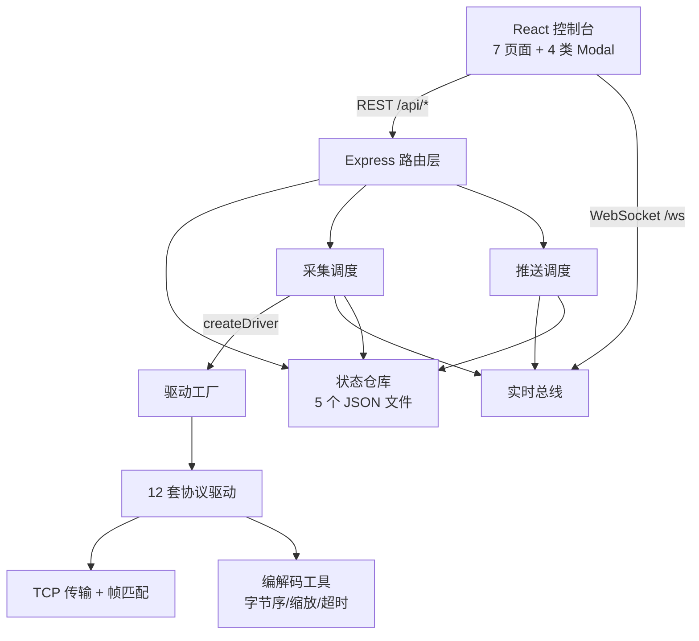

# PA-07｜Node 全栈轻量采集器

> **分析对象**：前后端一体的单机采集服务 + Web 控制台
> **编号**：PA-07（按脱敏约定，不披露来源标识）
> **技术栈**：TypeScript 6 / Node.js(ESM) / Express 5 / ws 8；React 19 / Ant Design 6 / Vite 8
> **规模画像**：46 个源文件、约 8,300 行；21 个协议类型值（19 个可采集）、12 套独立协议栈；23 个 REST 路由、7 个前端页面
> **成熟度画像**：内部可用（单人可运维的原型级成品，缺测试与许可声明）

---

## 1. 定位与问题域

### 1.1 它是什么

该方案把"采集后端 + Web 控制台"放在同一个仓库、同一个进程里交付：后端常驻轮询设备、把最新值缓存在内存、按事件广播给浏览器，并把整个工程状态以 JSON 文件落盘；前端是纯浏览器单页应用，负责设备、点位、推送通道的增删改查与实时看板。

它**不是**网关平台：没有历史库、没有报警引擎、没有脚本引擎、没有北向标准协议（OPC UA 服务器/MQTT Sparkplug 语义），推送只是把当前值快照投递出去。定位更接近"给一台工控机装一个能看数的采集盒子"。

### 1.2 面向的用户与场景

| 用户 | 场景 | 方案给出的答案 |
|---|---|---|
| 系统集成商现场工程师 | 到客户现场接 3~5 台 PLC，两天内要看到数 | 一个 `start.bat`，浏览器打开即用 |
| 设备厂商售后 | 远程确认设备寄存器读数是否正确 | 设备页"测试"按钮 + 点位实时值 |
| 小规模数据上报 | 把几十个点位推到客户 MQTT/HTTP/MySQL | 推送通道按周期发全量快照 |

### 1.3 边界（不做什么）

- 不做历史存储与趋势分析：持久化的只有"当前值"，没有时序表，趋势图无从谈起。
- 不做多用户、权限、审计：全部接口无鉴权（`Cors` 默认开启）。
- 不做集群/多实例：状态在进程内存 + 本地 JSON，天然单点。
- 不做 OPC UA 服务器、不做 PROFINET/OPC DA 采集（后者显式抛错），不做组态、报表、报警联动。

---

## 2. 功能分析

### 2.1 功能域总览

| 功能域 | 功能点 | 实现方式 | 完成度 |
|---|---|---|---|
| 设备管理 | 增删改查、启停、连通性测试 | REST + 前端表单；测试走独立驱动实例，超时后强制关闭 | 完整 |
| 点位管理 | 增删改查、批量导入、CSV 导入导出、写值 | 地址+数据类型+字节序+缩放偏移+只读/读写 | 完整 |
| 采集调度 | 按设备周期轮询、并发上限、断线重连 | 每设备自续 `setTimeout` + 全局任务队列 | 可用 |
| 实时展示 | 设备/点位/推送/日志四张实时表 | WebSocket 增量事件 + 首帧全量快照 | 可用 |
| 北向推送 | MQTT / TCP / HTTP / MySQL 四类通道 | 每通道定时器，发送启用点位快照 | 可用，效率偏低 |
| 系统设置 | 轮询周期、并发、日志级别、冷数据保留、CORS | 单条设置记录，保存后重载采集 | 完整 |
| 运行日志 | 分级、去重节流、按天/条数裁剪 | 内存环形 + 广播 + 落盘 | 可用 |
| 协议元数据 | 21 个协议的地址格式、连接字段、示例 | 前端静态配置表，驱动页只读展示 | 完整（文档性质） |

### 2.2 协议与接口覆盖

| 协议 | 角色 | 传输 | 实现来源 | 备注 |
|---|---|---|---|---|
| Modbus TCP/RTU/ASCII | 主站 | TCP / 串口 | 第三方 `modbus-serial` | 兼容 0/1 基地址与 3x/4x 区号两套写法 |
| 汇川 TCP/RTU | 主站 | TCP / 串口 | 复用 Modbus 驱动 | 仅协议别名，非独立栈 |
| 汇川 HCP | 主站 | TCP | 自研 | 帧格式与 MC 类似，独立编解码 |
| S7-300/400/1200/1500 | 主站 | TCP(ISO-on-TCP) | 自研 S7comm | 支持 DB/M/I/Q/T/C 区与位地址 |
| 三菱 MC 3E | 主站 | TCP | 自研 | 位/字软元件分命令，14 种软元件码 |
| 欧姆龙 FINS | 主站 | TCP | 自研 | D/CIO/W/H/A 区 |
| EtherNet/IP | 主站 | TCP(CIP) | 自研 | 按标签名读写，未做类 1/隐式报文 |
| BACnet/IP | 主站 | UDP | 自研 | 读/写 Present_Value |
| IEC 60870-5-104 | 主站 | TCP | 自研 | 总召唤 + 遥测/遥信缓存 + 单点/设定值下发 |
| DNP3 | 主站 | TCP | 自研 | Class0 轮询缓存 + CROB/模拟量直控 |
| OPC UA | 客户端 | TCP | `node-opcua` | 仅客户端，无服务器角色 |
| MQTT | 订阅方 | TCP | `mqtt` | 以订阅值作为采集源，按 topic+JSON 路径取值 |
| CoAP | 客户端 | UDP | 自研 | GET/PUT 文本载荷 |
| OPC DA / PROFINET | — | — | 占位驱动 | 明确抛错并给出原因，不静默失败 |

12 套自研/第三方栈覆盖 19 个可选类型值，密度在同类"轻量采集器"里偏高；代价见 3.7。

### 2.3 典型使用流程

```
新建设备(协议/地址/超时/周期) → 测试连通 → 录入或 CSV 导入点位
      → 保存触发 syncCollector() → 逐设备建驱动并启动轮询
      → 读值写入 tag.currentValue → WebSocket 广播 {type:'tag'}
      → 前端表格就地更新；推送通道按自己的周期取快照外发
```

### 2.4 功能完成度评估

| 能力 | 判断 | 依据 |
|---|---|---|
| 单机采集闭环 | 完整 | 配置、采集、展示、外发四段打通，无外部依赖 |
| 点位级诊断 | 弱 | 只有 good/bad 两态 + 最近一次错误日志，无错误码分类 |
| 断线恢复 | 中 | 设备级重连间隔可配；驱动实例失败即销毁重建 |
| 变更生效 | 粗 | 保存后全量 `syncCollector()`，所有设备驱动被关闭重建 |
| 数据留存 | 缺失 | 无历史表；"冷数据清理"清的是长期未用的**配置**，不是数据 |

---

## 3. 架构分析

### 3.1 分层与模块



模块边界清楚：路由层只做校验与响应，调度层只管"什么时候采集谁"，驱动层只管"怎么读一个点位"，状态层只管"怎么安全落盘"。三层之间没有反向依赖。

### 3.2 关键抽象与接口

| 抽象 | 职责 | 边界 | 位置 |
|---|---|---|---|
| 驱动接口（6 成员） | `connect/probe/readTag/writeTag/close` + `connected` | 只认"一个点位"，不认批量；不暴露原始帧 | 驱动基类文件 |
| 驱动基类 | 统一超时下限（≥500ms）、持有设备配置 | 不做重连、不做缓存、不做质量码 | 同上 |
| TCP 传输封装 | 连接复用、请求-响应、按帧匹配器切包 | 只处理 TCP；UDP 协议各自实现 | 传输文件 |
| 帧匹配器 | 判断缓冲区是否构成完整帧 | 每种协议各写一个，无统一帧头描述 | 传输文件 |
| 编解码工具 | 寄存器数量、字节/字序矩阵、缩放偏移、超时竞速 | 纯函数，可单测（实际未测） | 工具文件 |
| 状态仓库 | 单例内存状态 + 防抖落盘 + 原子替换 | 无事务、无版本、无并发写保护 | 状态文件 |
| 实时总线 | 连接集合 + 广播 + 进程内事件 | 无订阅过滤、无背压、无心跳 | 总线文件 |

### 3.3 数据流与时序

采集与推送是**两条独立的读路径**：采集按设备周期读点位，推送按通道周期直接从内存快照组包。二者不共享"本次采集完成"事件，因此推送可能拿到半新半旧的点位集合（部分设备刚读完、部分还没读）。这是"简单"换来的语义损失，对时序一致性有要求的场景不可接受。

### 3.4 并发与连接管理

| 维度 | 事实 | 后果 |
|---|---|---|
| 并发模型 | 单进程事件循环，无 worker | 任一驱动的同步计算（大 Buffer 拼装）都会阻塞所有设备 |
| 调度节拍 | 每设备一个自续 `setTimeout`，读完后按"在线用轮询周期/离线用重连间隔"再排下一次 | 不会出现 `setInterval` 堆积，但慢设备会长期占用并发槽 |
| 并发上限 | 全局队列 + `maxConcurrent`（默认 10）+ `queued/polling` 双集合去重 | 设备数超过上限时按队列顺序排队，无优先级 |
| 连接复用 | 每设备一个驱动实例，成功则常驻；失败即关闭并移除 | 重连成本可控；但保存配置会全量重建连接 |
| 请求超时 | 由各驱动的 socket 超时/竞速超时兜底，阈值来自设备配置 | 无统一"整轮采集超时"，卡死靠单请求超时累积暴露 |
| 故障恢复 | 设备级退避=固定重连间隔；错误日志 15s 节流 | 无指数退避、无熔断、无半开探测 |
| 背压 | WebSocket 逐连接 `send`，不检查缓冲 | 客户端慢时内存上涨（推断：点位多、刷新快时可见） |

### 3.5 配置、持久化与部署

- 状态拆成 5 个 JSON（设置/设备/点位/推送/日志），内存单例持有全部数据。
- 落盘策略：变更后 80ms 防抖；写临时文件再 `rename` 覆盖，`rename` 失败回退为直接覆写；写入期间的新变更置位后重排，避免并发写坏文件。
- 兼容旧版单文件存储：首次启动检测旧路径并迁移。
- 每小时清理一次"长期未启用的设备/推送通道及其点位"，天数可配（默认 30 天）；日志按保留天数与最大条数双向裁剪。
- 部署面：`PORT` 环境变量覆盖端口；生产模式直接托管前端构建产物，非 `/api`、`/ws` 路径回落 `index.html`；提供 Windows 启动脚本。

### 3.6 扩展机制

新增一个协议要改**五处**：协议类型联合、`isSupported` 判定、驱动工厂分支、驱动实现文件、前端协议元数据表。没有注册表、没有插件加载、没有协议描述符——与 PA-06 的 SPI 描述符、PA-08 的驱动清单+签名校验相比，属于"编译期硬编码"级别。

### 3.7 工程质量观察

正面：

- 后端 `strict` 开启，全仓 `any` 出现 0 次；前端开启 `noUnusedLocals/Parameters`，但**未开 `strict`**，两侧严格度不一致。
- 状态落盘、错误日志节流、驱动连接的并发去重（`connecting` Promise 复用）三处细节做得比多数同类原型扎实。
- 协议实现普遍带中文注释说明帧结构与字段含义，可读性好；占位驱动会解释"为什么不能实现"，而不是静默返回空值。
- 单文件规模克制（最大 480 行），职责单一。

负面：

- **零测试**：全仓没有测试文件、没有测试框架、没有 CI 配置；对 12 套手写协议栈而言，这是最大风险——帧长度、字节序、异常码全靠现场试。
- 无 `LICENSE` 文件：默认"保留所有权利"，任何复用都需要另行授权，属于合规红线。
- 静态检查只有 `oxlint` 的 4 条规则，无格式化、无提交钩子；推送通道的 MQTT/MySQL 口令明文存 JSON 并原样返回前端。

---

## 4. 需求分析

### 4.1 显性需求

现场工程师要的是：**接得上、看得见、推得出、改得快**。方案对这四点的响应是完整的：测试按钮解决"接得上"，WS 实时表解决"看得见"，四类推送通道解决"推得出"，表单+CSV 导入解决"改得快"。

### 4.2 隐性需求

| 隐性需求 | 方案表现 | 评价 |
|---|---|---|
| 断网续传 | 无缓存补发，断线期间数据直接丢失 | 未覆盖；对"上报"类场景是硬伤 |
| 时钟漂移 | 时间戳为本地格式化字符串，无时区、无单调时钟 | 弱；跨时区或多机对比会出错 |
| 点位变更不停机 | 保存即全量重建驱动 | 有中断窗口（推断：秒级） |
| 地址越界保护 | 各驱动解析地址时有基本校验，读长度越界靠设备异常码 | 部分 |
| 字节序/字序 | 提供了 6 种字节序 + 缩放偏移，可按点位覆盖 | 好，是同类里少见的细致 |
| 批量读优化 | 逐点位调用 `readTag`，连续地址不合并 | 缺失；点位数上升后请求数线性增长 |
| 诊断可观测 | 分级日志 + WS 推送 + 设备在线状态 | 中；无指标、无耗时统计、无请求计数 |

### 4.3 非功能需求

| 维度 | 实际水平 | 说明 |
|---|---|---|
| 性能 | 中低 | 单进程 + 逐点读 + 同步 JSON 序列化；百点位/秒级周期可撑，千点位需重构 |
| 可靠性 | 中 | 原子落盘避免半文件；但无 WAL、无历史，崩溃丢失最近一个防抖窗口的变更 |
| 安全 | 低 | 无鉴权、CORS 默认开、口令明文、无速率限制 |
| 可移植 | 高 | Node 全平台；串口依赖原生模块，需匹配 Node ABI |
| 可维护 | 中 | 结构清晰、注释充分；但零测试 + 无 CI 使重构缺乏安全网 |

### 4.4 需求缺口与误判

1. **把"实时看数"当成了"数据采集"**：只保留当前值，等于放弃了采集系统最核心的资产——历史。任何"昨天下午三点那个阀开了没"的问题都答不了。
2. **把"推送"当成了"集成"**：MQTT 每推一次新建连接、发完即断，QoS 只到 0/1 且无重发队列；MySQL 每次推送逐行 `INSERT`。这在几十点位时"能用"，在断网或对端限流时会持续丢点。
3. **把"协议数量"当成了"协议质量"**：19 个类型值的广度很亮眼，但没有一份协议测试向量或帧样本回放，广度是靠现场调试换来的。
4. **"冷数据清理"名不副实**：清理的是配置项而非数据，说明作者对"数据生命周期"的建模还停留在配置文件层面（推断）。

---

## 5. 可借鉴与应规避

### 5.1 可直接吸收的机制

| 机制 | 为什么值得吸收 | 迁移建议 |
|---|---|---|
| 驱动接口只暴露"单点位读写" | 极简接口让 12 套协议实现保持一致，新增协议心智负担低 | 保留简接口，但在其上再加一层"批量读计划"，不要让驱动自己决定批量 |
| 请求-响应 + 帧匹配器 | 把"粘包/半包"这个共性难题收敛到一个可复用组件 | 升级为声明式帧描述（头长+长度字段+尾标志），减少每协议手写匹配器 |
| 状态落盘：防抖 + 临时文件 + 原子替换 | 用 30 行代码解决"写一半崩了"的经典问题 | 目标产品用作配置落盘的最低标准；数据面另走 WAL |
| 错误日志节流（同键 15s） | 现场最常见的"日志刷屏拖垮系统" | 直接照搬，键为 设备/点位/通道 ID |
| 驱动连接的 `connecting` Promise 复用 | 并发调用只建一条连接，避免握手风暴 | 照搬；补上"握手失败后的退避" |
| 占位驱动显式报错并解释原因 | 比"假装支持"诚实，减少现场误判 | 目标产品对未实现能力统一走此模式，并在 UI 上标灰 |

### 5.2 明确应规避的做法

| 做法 | 问题 | 后果 |
|---|---|---|
| JSON 文件承载全部运行状态 | 无常驻数据库，写放大、无查询能力 | 无法做历史、无法多实例、无法审计 |
| 保存配置即全量重建驱动 | 一次改点位，全厂采集瞬断 | 点位多的现场不可接受 |
| 逐点位读、无批量计划 | 请求数 = 点数 × 频率 | 设备连接被打满，响应变慢，误判为"设备不稳" |
| 推送与采集解耦成两条读路径 | 快照可能跨采集轮次 | 上位机看到"同一时刻"的值实际不同步 |
| MQTT 每推一次建连 | 握手成本高、Broker 连接数抖动 | 高频推送下吞吐骤降 |
| 无鉴权 + CORS 全开 + 口令明文 | 内网也非可信环境 | 任意浏览器可写点位、可读数据库口令 |
| 无 LICENSE | 默认保留所有权利 | 不能合法复用，评估价值大打折扣 |

### 5.3 迁移到目标产品的成本

| 迁移项 | 成本 | 说明 |
|---|---|---|
| 12 套协议帧知识与地址规则 | 高价值、需重写 | 是本方案最值钱的部分；应转成测试向量而非直接移植代码 |
| 驱动接口与工厂 | 低 | 概念简单，目标产品用注册表 + 描述符重新表达 |
| 调度器（自续定时 + 并发队列） | 低 | 逻辑 200 行内，可重写为时间片调度 |
| 状态落盘与日志裁剪 | 低 | 作为配置面参考 |
| 前端 7 页面 | 中 | 表单与实时表的交互模式可借鉴，代码需重写 |
| 推送通道 | 低 | 仅取"通道抽象"概念，实现需改为长连接 + 重发队列 |

---

## 6. 结论

### 6.1 六维评分

| 维度 | 分数(1-5) | 理由 |
|---|---|---|
| 协议广度 | 4 | 19 个可采集类型值、12 套独立栈，含 S7/三菱/欧姆龙/EtherNet-IP/BACnet/IEC104/DNP3，广度超出"轻量工具"预期；缺 PROFINET、OPC DA、CC-Link，串口侧偏薄 |
| 架构可演进性 | 2 | 分层干净但扩展靠改 5 处硬编码分支，无插件边界；状态模型无法承载历史与多实例 |
| 跨平台能力 | 4 | Node 全平台，前端纯浏览器；扣分在串口原生模块与 Windows 启动脚本的隐含绑定 |
| 可运维性 | 2 | 有实时看板与分级日志，但无指标、无健康检查、无审计、无备份、无鉴权 |
| 工程质量 | 2 | 类型严格、细节考究、注释充分；但零测试、无 CI、前端未 strict、无许可文件 |
| 许可与合规风险 | 1 | 仓库无 `LICENSE`，默认保留所有权利；第三方依赖虽多为 MIT，项目本身不可直接复用 |

### 6.2 三条关键结论

1. **它的价值在"协议实现密度"，不在"系统架构"。** 12 套手写协议栈（S7comm、MC 3E、FINS、CIP、BACnet/IP、IEC104、DNP3、CoAP、HCP）覆盖了中小现场 80% 的连接需求，这是最值得研究的部分；而其调度、存储、推送设计都是"够用即止"，不宜作为目标产品的骨架。
2. **"单进程 + JSON 文件 + 无鉴权"是刻意的取舍，也是它的天花板。** 这套组合把部署成本压到最低（解压即用），代价是无法回答"历史数据""多用户""断网补传"这三个必然会出现的需求；一旦客户提出其中任意一个，架构必须重做而不是加功能。
3. **零测试 + 无许可，使它只能"读"不能"用"。** 对手写二进制协议而言，没有帧样本回放测试意味着每次改动都可能引入现场事故；没有许可声明意味着任何代码级复用都存在法律不确定性。目标产品应吸收其协议知识与接口形态，用测试向量和明确许可重建。

---

## 附录：可核实的统计口径

| 指标 | 数值 | 取证方式 |
|---|---|---|
| 后端源文件 / 行数 | 23 / 4,395 | `server/src/**/*.ts` 统计 |
| 协议目录文件 / 行数 | 17 / 2,991 | 协议子目录统计（含工厂、基类、工具、传输） |
| 前端源文件 / 行数 | 23 / 3,895 | `src/**/*.{ts,tsx,css}` 统计 |
| 协议类型值 / 可采集 | 21 / 19 | 类型联合与支持判定函数比对 |
| 独立协议栈 | 12 | 驱动类计数（Modbus、HCP、S7、MC、FINS、CIP、BACnet、IEC104、DNP3、OPC UA、MQTT、CoAP） |
| REST 路由 | 23 | 路由注册点计数 |
| 前端页面 | 7 | 页面目录文件计数 |
| 测试文件 / 测试框架 | 0 / 无 | 全仓检索 |
