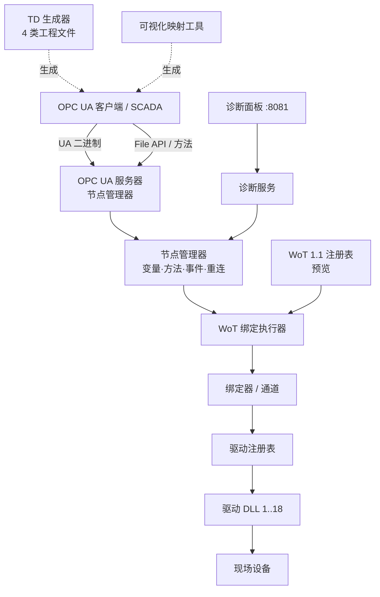

# PA-08｜WoT 驱动的 OPC UA 边缘网关

> **分析对象**：容器化边缘服务（南向多协议采集 + OPC UA 服务器）
> **编号**：PA-08（按脱敏约定，不披露来源标识）
> **技术栈**：.NET 10（部分工具多目标 net48）/ ASP.NET Core / OPC UA .NET Standard / Blazor Server
> **规模画像**：400 个 `.cs`、约 79,200 行；22 个工程、18 个协议驱动；93 个测试文件（598 个 `[Fact]`、78 个 `[Theory]`）
> **成熟度画像**：生产可用（有 CI/CodeQL/镜像/Helm/签名驱动包；5 个驱动标为实验性）

---

## 1. 定位与问题域

### 1.1 它是什么

该方案是一个**以 W3C Web of Things 描述（TD）为唯一配置契约**的 OPC UA 服务器：南向用协议驱动把设备数据读上来，北向把 TD 里声明的属性/动作/事件"物化"成 OPC UA 地址空间中的节点，供任何 OPC UA 客户端浏览、读写、调用。

它的关键取舍是把"组态"从私有 REST 接口搬到了 OPC UA 自身：TD 文件通过 OPC UA File API 上传，资产通过 OPC UA 方法（`CreateAsset` / `DeleteAsset` / `ConnectionTest` / `DiscoverAssets`）创建与探测，客户端用标准 UA 客户端即可完成全部配置。这是一条与 PA-06（Web 控制台）、PA-07（HTTP 控制台）完全不同的路线。

### 1.2 面向的用户与场景

| 用户 | 场景 | 方案给出的答案 |
|---|---|---|
| OT 集成商 | 车间有 5 种品牌 PLC，要统一暴露给上层 SCADA/MES | 18 个驱动覆盖主流品牌，TD 描述点位，UA 客户端直接订阅 |
| 信息化团队 | 想把设备数据映射到 OPC UA 伴生规范（Companion Spec） | 支持 UA Cloud Library 节点集下载与类型映射 |
| 设备厂商 | 交付设备时附带标准信息模型 | 提供 4 类工程文件到 TD 的生成工具 + 可视化映射工具 |
| 平台运维 | 边缘盒子批量部署 | Docker/K8s/Helm/ARM+x64，环境变量配置 |

### 1.3 边界（不做什么）

- 不做历史存储与断点续传：没有本地缓存队列，"读不到就是读不到"。
- 不做 SCADA 组态、报警确认工作流、报表：只把设备事件投影为 OPC UA 报警条件。
- 不做多租户与横向扩展：单实例、单地址空间，状态在进程内。
- 不提供"南向从站/仿真"：所有驱动都是客户端角色（Mock 驱动例外，用于自测）。
- 不承诺 TD 的完整语义：只实现绑定执行所需子集，未识别的 form 会被拒绝。

---

## 2. 功能分析

### 2.1 功能域总览

| 功能域 | 功能点 | 实现方式 | 完成度 |
|---|---|---|---|
| TD 接入 | 上传/删除/列出 TD 文件 | OPC UA File API（带 5 MB 上限）+ 本地目录扫描 | 完整 |
| 资产开通 | 创建、删除、连接测试、端点发现 | OPC UA 方法 + 管理角色校验 | 完整 |
| 地址空间物化 | TD 属性 → 变量节点、动作 → 方法、事件 → 事件源 | 节点管理器按 TD 动态建节点 | 完整 |
| 数据面 | 周期读、写、动作调用 | 每资产一个轮询循环；写走驱动并回填状态码 | 完整 |
| 报警投影 | 驱动事件 → OPC UA AlarmCondition | 有界通道 + 单工作者串行投影 | 可用 |
| 断线恢复 | 指数退避重连、事件订阅重启 | 1s→2s→…→60s 上限，成功即复位 | 完整 |
| 诊断面板 | 概览/UA 设置/地址空间/设备/驱动/WoT 文件/证书 | Blazor Server + HTTP Basic 认证 + 独立端口 | 完整 |
| 证书管理 | 信任/取消信任被拒证书、下载应用证书 | 文件系统 PKI 目录操作 | 完整 |
| 驱动装载 | 外部 DLL 热装载 + 允许列表 + 签名校验 | 可回收性关闭的 `AssemblyLoadContext` | 完整 |
| 伴生规范 | 按 TD 的 `mapToType` 解析并下载节点集 | UA Cloud Library 客户端 | 可用 |
| 许可 | OPC UA 方法写许可键，常量时间比对 | 环境变量持有期望值 | 完整（最简形态） |

### 2.2 协议与接口覆盖

| 协议 | 角色 | 传输 | 实现 | 备注 |
|---|---|---|---|---|
| Modbus TCP / RTU | 主站 | TCP / 串口 | 第三方 NModbus | 含值编解码封装，处理 32/64 位拼接 |
| OPC UA | 客户端 | TCP | 官方栈 | 连接其他 UA 服务器 |
| OPC DA | 客户端 | COM/DCOM | 自研 | 仅 Windows |
| OPC A&E | 客户端 | COM/DCOM | 自研 | 事件型驱动，只发事件不建属性 |
| HTTP | 客户端 | TCP | 自研 | 以 JSON 响应映射为点位 |
| Siemens S7 | 主站 | TCP | 自研 | S7comm |
| Rockwell CIP | 主站 | TCP | 自研 | 支持结构体类型注册（唯一覆盖该钩子的驱动） |
| Beckhoff ADS | 主站 | TCP | 自研 | TwinCAT |
| Mitsubishi MC | 主站 | TCP | 自研 | 实验性 |
| BACnet | 主站 | UDP | 自研 | 实验性 |
| IEC 61850 | 客户端 | TCP | 自研 | 实验性；代码量 7,600 行，含模型解析 |
| DMTF Redfish | 客户端 | HTTPS | 自研 | IT 设备带外管理 |
| LoRaWAN | 上行接入 | UDP/MQTT | 自研 | 12,100 行，含字段规则与派生值 |
| Matter | 客户端 | TCP | 自研 | 8,200 行 |
| OCPP 1.6J / 2.1 | 客户端 | WebSocket | 自研 | 充电桩协议，2.1 为实验性 |
| Aveva PI | 客户端 | HTTP | 自研 | 实验性 |
| Mock | 自测 | 内存 | 自研 | 契约测试与集成测试基座 |

驱动代码合计约 41,500 行，占全仓一半以上；其中 LoRaWAN、Matter、IEC 61850、OCPP 四个"非传统 PLC"驱动占了 32,000 行，说明该方案的南向重心在**能源/楼宇/充电/物联网**，而非纯工厂产线。

### 2.3 典型使用流程

```
1. UA 客户端连上服务器（用户名口令强制，启动时校验）
2. 通过 File API 上传 ThingDescription（TD 中声明 base URI、属性、动作、事件）
3. 服务器解析 TD → 注册命名空间 → 为每个属性建变量节点（初始 Bad）
4. 调用 CreateAssetForEndpoint → 校验端点策略 → 选驱动 → 建连接
5. 轮询循环按 TD 的 form 读取 → 更新变量值与状态码
6. 客户端订阅变量 / 调用方法（动作）/ 订阅事件（报警）
7. 删除资产 → 释放共享连接 → 删除节点
```

### 2.4 功能完成度评估

| 判断 | 依据 |
|---|---|
| 主链路生产级 | 开通、物化、读写、重连、诊断全链路有集成测试覆盖 |
| 驱动成熟度分层明显 | 12 个稳定驱动 + 6 个标注实验性；实验驱动的测试以契约测试为主 |
| 配置面"标准但陡峭" | 完全依赖 UA 客户端与 TD 文件，对不熟悉 OPC UA 的现场工程师门槛高（推断：因此另配了 Blazor 映射工具） |
| 可观测性偏"人看" | 有诊断面板与控制台遥测，但未见 Prometheus/健康检查端点 |

---

## 3. 架构分析

### 3.1 分层与模块



两个宿主共存于一个进程：OPC UA 服务器（4840 端口）与诊断 Web（8081 端口，HTTP Basic）。WoT 1.1 注册表是可选旁路，默认开启。

### 3.2 关键抽象与接口

| 抽象 | 职责 | 边界 | 备注 |
|---|---|---|---|
| 资产接口 `IAsset` | 连接、断开、读、写、执行动作，全部异步带取消令牌 | `IsConnected`/`GetRemoteEndpoint` 保持同步且**禁止 I/O** | 注释明确动机：避免旧代码 `.Result` 造成线程池饥饿；形状对齐上游 WoT 服务器库，便于未来迁移 |
| 驱动接口 `IProtocolDriver` | 方案（scheme）、绑定 URI、发现、生成 TD、建连资产、建点位、注册结构类型 | 不负责轮询、不负责重连、不持有 UA 节点 | `RegisterStructureTypes` 有默认空实现，18 个驱动中仅 Rockwell 覆盖 |
| 驱动注册表 | 按绑定 URI 查找驱动实例 | 只做查找，不做生命周期 | 装载阶段填充 |
| 绑定执行器 | 把编译后的 form 落到驱动上执行 | 不解析 TD 业务语义 | 一个 TD base 共享一条连接 |
| 端点策略 | 统一出站策略：允许私有网段与回环，永远封禁云元数据地址 | 不做认证，不做速率限制 | 同一策略服务 1.02/1.1/发现/执行四条路径 |
| 驱动装载上下文 | 隔离加载驱动 DLL，校验 SHA-256 允许列表与 Sigstore 签名 | 宿主程序集不重复加载 | 允许列表缺失时退回"全加载"兼容模式 |

### 3.3 数据流与时序

- **读**：轮询循环 → 驱动读单点 → 值 + 连接状态 → 更新 UA 变量（断开时状态码置 Bad，值保留）。
- **写**：UA 写请求 → 变量上记录"待写驱动"（`AsyncLocal` 传递）→ 驱动写 → 依据结果决定是否提交变量值；写失败不污染缓存，这是很少见的细节处理。
- **动作**：UA 方法调用 → 驱动"执行动作" → 输出参数回填；事件型驱动不建点位。
- **事件**：驱动事件 → 有界通道 → 单工作者 → 报警条件节点；队列积压时丢弃并计数，避免内存无界增长（推断：由通道容量与 2s 等待推断）。
- **连接共享**：同一个 TD base 的多条 form 共享一条连接，引用计数 + 单锁保护，连接动作在锁外执行，取消只影响等待者、不影响共享连接。

### 3.4 并发与连接管理

| 维度 | 事实 | 评价 |
|---|---|---|
| 并发模型 | 全异步；UA 栈不序列化访问，接口约定实现必须线程安全 | 与 PA-01/PA-10 的"锁 + 同步 I/O"形成鲜明对比 |
| 连接复用 | 每 TD base 一条连接，引用计数；失败连接不缓存（下次重试） | 设计正确，避免了"缓存失败结果"的常见坑 |
| 重连 | 指数退避 1s 起、上限 60s，成功复位；用单调时钟计算下次时刻 | 标准做法；无抖动（jitter），大规模同时断线会同步重连 |
| 轮询 | 每资产独立循环，1s 节拍内检查是否到采样时刻 | 简单；无批量读计划，TD 里 N 个属性就是 N 次读 |
| 背压 | 报警投影用有界通道；UA 变量更新无队列 | 事件面有保护，属性面靠驱动自身超时 |
| 故障隔离 | 单个资产读失败只影响该资产状态码；驱动异常被捕获并记录 | 无熔断计数，持续失败会一直重试 |

### 3.5 配置、持久化与部署

| 面 | 做法 |
|---|---|
| 目录 | `settings/`（TD 与配置）、`drivers/`（驱动 DLL）、`nodesets/`（伴生规范节点集）、`pki/`（证书与信任链） |
| 必填环境变量 | UA 用户名/口令；缺一项即拒绝启动（fail fast） |
| 可选变量 | 应用名、云库地址与凭据、UA 客户端凭据、GDS 地址、TLS 开关、文件大小上限、许可键、允许列表 OIDC 身份、离线模式 |
| 交付形态 | Docker 镜像 + 驱动包镜像（分卷挂载）+ Helm Chart + IoT Edge 部署模板 |
| 安全默认 | 诊断面板 HTTP Basic；未信任客户端证书在"无颁发者证书"时自动接受（预配模式），可用环境变量改为手动信任 |

### 3.6 扩展机制

扩展一个新协议的完整路径：

1. 新建类库，引用宿主工程但**不复制**宿主程序集（`Private=false`）。
2. 实现 `IProtocolDriver`（开通与 TD 生成）与 `IAsset`（运行时读写）。
3. 发布到 `drivers/<名称>/`，重启加载；或走驱动包流水线生成允许列表与签名。
4. 契约测试自动覆盖 scheme、绑定 URI、注册表解析、结构类型注册。

这是本卷中**插件边界最完整**的方案：有隔离加载、哈希允许列表、Sigstore 身份固定、离线降级开关，且失败即拒绝加载（fail-closed）。

### 3.7 工程质量观察

| 项 | 事实 | 评价 |
|---|---|---|
| 构建纪律 | `TreatWarningsAsErrors`、`EnforceCodeStyleInBuild`、中央包版本管理、`.editorconfig` | 强 |
| 测试规模 | 93 个文件 / 20,151 行；598 `[Fact]` + 78 `[Theory]`；含 bUnit 组件测试与 UA 服务器集成夹具 | 强，且测试代码占比 25% |
| 测试盲区 | 驱动程序集被排除在覆盖率统计外，仅做契约测试 | 中；18 个驱动的帧级正确性靠人工验证（推断） |
| 流水线 | CI、CodeQL、镜像发布、驱动包发布、Helm 发布五条工作流 | 完整 |
| 代码组织 | 节点管理器 3,098 行、诊断服务 766 行，属于"核心巨类" | 弱；改动风险集中 |
| 文档 | README 覆盖部署/环境变量/驱动开发/信任模型/威胁模型 | 强；但含组织与仓库信息，复用需重写 |

---

## 4. 需求分析

### 4.1 显性需求

现场要解决的是"**协议太多、模型不统一**"：同一车间里 PLC、电表、充电桩、楼宇控制器各有各的接口，上层只认 OPC UA。方案用 TD 把"设备能力"标准化，用驱动把"协议差异"隔离，用 UA 地址空间把"数据模型"统一——三段职责清晰，正是它相对 PA-06/PA-07 的核心差异。

### 4.2 隐性需求

| 隐性需求 | 方案表现 | 评价 |
|---|---|---|
| 断网续传 | 无本地队列，读失败即 Bad | 未覆盖；对"计费/计量"类场景不可接受 |
| 时钟与时间戳 | 依赖 UA 栈的时间戳，驱动不产生源时间 | 中；丢失设备侧时标 |
| 点位变更不停机 | 重新上传 TD 或删除重建资产 | 会短暂中断该资产 |
| 地址越界/非法输入 | 驱动内校验 + 端点策略 + 资产名校验与净化 | 较好 |
| 批量读优化 | 无合并，逐属性读 | 缺失；大点数资产的轮询成本高 |
| 诊断可观测 | 面板 + 控制台遥测 + 结构化日志 | 中；无标准指标端点 |
| 许可与合规 | MIT；驱动包签名可追溯到工作流 | 好 |

### 4.3 非功能需求

| 维度 | 实际水平 | 说明 |
|---|---|---|
| 性能 | 中高 | 异步 I/O + 连接共享；但逐点读、逐资产轮询，未做时间片与批读 |
| 可靠性 | 中高 | 重连退避、失败连接不缓存、写失败不污染缓存；缺 Outbox |
| 安全 | 高 | 强制认证、端点策略、驱动签名、文件大小上限、诊断面板认证 |
| 可移植 | 高 | net10 跨平台 + 容器 + ARM/x64；OPC DA/A&E 受 Windows 限制 |
| 可维护 | 中 | 测试与流水线完善；核心节点管理器过大，驱动覆盖率缺口 |

### 4.4 需求缺口与误判

1. **把"标准化"解决得很彻底，把"数据可信"留白了**：没有缓存补发、没有源时标、没有质量码映射规则，UA 侧只看到 Good/Bad，无法区分"设备离线""读超时""地址错"。
2. **TD 是强契约，也是强耦合**：TD 写错或驱动理解不一致时，错误发生在运行期而非上传期；缺少"TD 静态校验 + 试读"这一步（`ConnectionTest` 只测连通）。
3. **实验性驱动与稳定驱动混在同一交付面**：6 个实验协议只有契约测试，现场误用会把"协议实现不完整"记成"网关不稳定"。
4. **许可机制是占位级**：一个环境变量 + 常量时间比对，能防误用不能防绕过（推断：真实商用授权在发行版中另有实现）。

---

## 5. 可借鉴与应规避

### 5.1 可直接吸收的机制

| 机制 | 为什么值得吸收 | 迁移建议 |
|---|---|---|
| TD 作为唯一配置契约 | 配置即文档，工具链（生成器/映射器）可围绕它生长 | 目标产品把"点位模型"定义为可版本化的描述文件，而非表单字段 |
| 控制面走数据面协议 | 不额外造 REST，UA 客户端即可完成开通 | 若北向是 OPC UA，配置方法应挂在标准对象下并做角色校验 |
| 共享连接 + 引用计数 | 一个设备多条 form 只连一次 | 直接用；注意"连接在锁外执行、取消只影响等待者" |
| 失败连接不缓存 | 避免一次握手失败永久拉黑资产 | 直接用 |
| 写失败不提交缓存值 | 保证 UA 变量反映真实设备状态 | 直接用，这是可信度的关键细节 |
| 同步访问器禁止 I/O | 用接口注释把"不得阻塞"变成契约 | 目标产品的状态查询接口应显式标注此约束 |
| 驱动签名 + 允许列表 | 边缘设备装第三方 DLL 的真实风险 | 至少做哈希允许列表；有条件再加签名身份固定 |
| 端点策略单一来源 | 防止四条入口各自为政 | 出站校验必须收敛为一个策略对象 |

### 5.2 明确应规避的做法

| 做法 | 问题 | 后果 |
|---|---|---|
| 3,000 行节点管理器 | 建节点、轮询、重连、报警、文件、许可全在一个类 | 任何改动都可能波及其他能力，评审成本高 |
| 逐属性读、无批读计划 | 请求数 = 属性数 × 频率 | 大点数资产打满连接，延迟抖动 |
| 无 Outbox / 无源时标 | 断网即丢，时间由网关代打 | 计量类场景不可用 |
| 实验驱动与稳定驱动同权重交付 | 用户无法从 UI 区分成熟度 | 现场误判，信任受损 |
| 重连无抖动 | 大量资产同时断线会同步重连 | 恢复瞬间打爆设备（推断：现场规模大时明显） |
| 诊断面板用 Basic 认证 | 口令可逆编码，依赖反向代理补 TLS | 直接暴露 8081 即失守 |
| 依赖预览版上游包 | WoT 1.1 注册表标注 preview | 升级可能破坏地址空间与存储格式 |

### 5.3 迁移到目标产品的成本

| 迁移项 | 成本 | 说明 |
|---|---|---|
| TD 绑定与物化思路 | 中 | 概念可直接借用；实现依赖 OPC UA 栈，换栈需重写 |
| 18 个驱动的协议知识 | 高价值、需重写 | 含 LoRaWAN 字段规则、IEC 61850 模型解析等稀缺知识 |
| 插件装载与信任链 | 中 | `AssemblyLoadContext` + 哈希 + Sigstore 的组合可整体借鉴 |
| 诊断面板 | 低 | 7 个页面的信息架构可照搬 |
| TD 生成工具链 | 中 | 依赖各家工程文件格式（TIA/Aml/TwinCAT/CIP CSV），迁移价值高但工作量大 |
| 报警投影 | 中 | 事件 → 条件节点的映射逻辑需按目标信息模型重写 |

---

## 6. 结论

### 6.1 六维评分

| 维度 | 分数(1-5) | 理由 |
|---|---|---|
| 协议广度 | 5 | 18 个驱动横跨 PLC、楼宇、电力、充电、IT 带外与 LoRaWAN/Matter，南向广度在本卷中最高 |
| 架构可演进性 | 4 | 驱动插件化与 TD 契约是真正的扩展点；扣分在核心节点管理器过大、依赖预览版上游包 |
| 跨平台能力 | 4 | net10 + 容器 + ARM/x64 齐全；OPC DA/A&E 受 COM 限制，Windows 专用目标仍存在 |
| 可运维性 | 4 | 七个诊断页面、结构化日志、遥测计数、Helm 交付；缺标准指标端点与断网补传 |
| 工程质量 | 5 | 警告即错误、代码风格入构建、676 个测试用例、测试代码占 25%、CI/CodeQL/发布流水线完整 |
| 许可与合规风险 | 5 | MIT；驱动包签名身份固定，供应链可追溯 |

### 6.2 三条关键结论

1. **它把"配置面"也变成了标准协议，这是最有价值的设计判断。** 绝大多数网关的南向是标准的、北向是标准的、配置面却是私有 REST；该方案用 TD + UA 方法 + File API 把三者统一，使"网关可被任何 UA 客户端完全操控"，也让工具链（生成器、映射器）有了稳定的落点。
2. **工程纪律是它的第二道护城河。** 警告即错误、风格入构建、676 个用例、五条发布流水线、驱动签名与允许列表——这些"不产生功能"的投入，恰好是边缘软件最难补的部分；对比 PA-07 的零测试、PA-10 的控制台式回归，差距不在功能清单上。
3. **它的短板在"数据可信"而非"协议覆盖"。** 无 Outbox、无源时标、质量码只有两态、逐点读无批计划——这些在演示中看不出来，在计费、追溯、断网场景会集中暴露。目标产品若以"采集可信"为卖点，应把该方案的南向协议知识与插件信任链学过来，把数据面按 PA-09 的故障/质量码模型重建。

---

## 附录：可核实的统计口径

| 指标 | 数值 | 取证方式 |
|---|---|---|
| 全仓 `.cs` / 行数 | 400 / 79,189 | 全仓统计 |
| 服务端 / 行数 | 46 / 12,315 | 服务器工程目录 |
| 驱动 / 行数 | 242 / 41,468 | 驱动目录（18 个子工程） |
| 生成器 / 映射器 | 4 / 3,006；14 / 1,808 | 两个工具工程 |
| 测试 / 行数 | 93 / 20,151 | 测试工程 |
| 测试用例 | 598 `[Fact]` + 78 `[Theory]` | 特性计数 |
| 工程文件 | 22 个 `.csproj` | 全仓计数 |
| 诊断页面 | 7 个 Razor 页 | 页面目录 |
| 目标框架 | net10.0、net10.0-windows、net10.0-windows10.0.26100、net48 | 工程文件 |
| 重连退避 | 1,000 ms 起，60,000 ms 上限，倍增至上限 | 常量与调度函数 |
