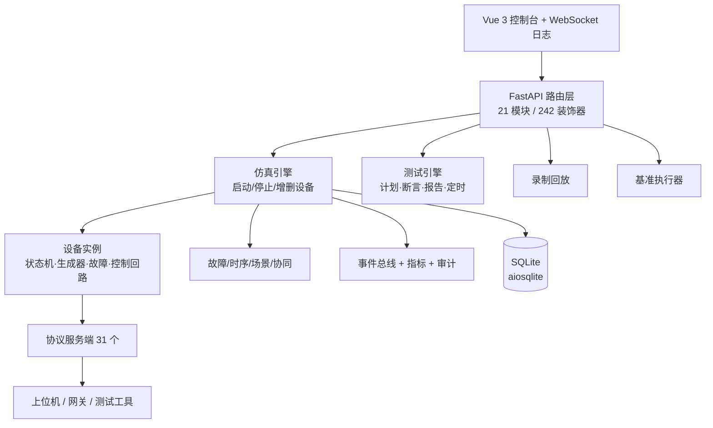

# PA-09｜工业协议仿真与测试平台

> **分析对象**：类平台型仿真器（多协议从站模拟 + 自动化测试 + 故障注入）
> **编号**：PA-09（按脱敏约定，不披露来源标识）
> **技术栈**：Python 3.10+ / FastAPI / SQLAlchemy(aiosqlite) / Pydantic 2 / Vue 3 / PyInstaller 桌面打包
> **规模画像**：191 个包内 `.py`（66,894 行）+ 91 个测试文件（22,987 行）；注册 31 个协议 id、26 个协议目录、135 个设备模板 JSON、21 个 API 路由模块
> **成熟度画像**：生产可用（CI + 金报文测试 + 容器/桌面双交付；核心引擎偏大、覆盖率门槛偏低）

---

## 1. 定位与问题域

### 1.1 它是什么

该方案要解决的不是"采集"，而是"**在没有真实设备的情况下把采集链路测出来**"。它在一台机器上起若干协议从站/服务端（Modbus、S7、MC、FINS、IEC 104、BACnet、OPC UA、MQTT、GB28181 等），按模板生成点位数据，按需注入传感器/通信/设备故障，并提供录制回放、自动化测试计划、断言、报告与帧级解码。

它同时扮演三个角色：**仿真器**（假设备）、**测试框架**（用例、断言、报告）、**排障工具**（报文解码、实时日志）。这三者在同一个进程、同一个 UI 里。

### 1.2 面向的用户与场景

| 用户 | 场景 | 方案给出的答案 |
|---|---|---|
| 上位机/网关开发者 | 手里没有 PLC，需要联调读点 | 选模板 → 起设备 → 改本机 IP 即可连 |
| 集成商 | 交付前验证"断线/超时/坏点"表现 | 9 类故障注入 + 状态机 + 质量码 |
| 测试工程师 | 每次发版回归一遍协议 | 测试计划 + 14 种断言 + HTML/Allure 报告 |
| 新人/教学 | 理解协议帧结构 | 帧字段级解码 + 四语言代码示例 |

### 1.3 边界（不做什么）

- 不做生产网关：虽有转发/Webhook/集成模块，但主线是"模拟与测试"，不是长期在线的数据通道。
- 不做硬实时：Python asyncio + 1s 级 tick，无法复现 PLC 的毫秒级扫描周期（推断）。
- 不做真实设备代理：EtherCAT/PROFINET 等二层协议只能是应用层近似，不能替代一致性认证。
- 不做多租户 SaaS：单实例、单数据库、单管理员体系。

---

## 2. 功能分析

### 2.1 功能域总览

| 功能域 | 功能点 | 实现方式 | 完成度 |
|---|---|---|---|
| 协议仿真 | 31 个协议 id，含 3 个主站模式 | 注册表 → 动态导入 → 协议类 | 完整（个别为实验性） |
| 设备建模 | 模板、点表、读写权限、缩放、单位 | 135 个模板 JSON + 点表导入 | 完整 |
| 数据生成 | 11 种生成器（固定/常量/随机/游走/正弦/三角/锯齿/方波/累加/脚本/物理） | 每点位独立配置 + 测点级生成周期 | 完整 |
| 状态机 | 7 状态（停止/运行/故障/编程/维护/启动中/停止中） | 显式转换表 + 进入/退出回调 + 历史 | 完整 |
| 故障注入 | 9 类：卡死/漂移/噪声/失效/间歇断连/延迟/丢包/设备故障/执行器卡死 | 注入器 + 传播链 + 严重度→质量码 | 完整 |
| 网络仿真 | 延迟、抖动、丢包、带宽、断连率、CRC 错、半开连接 | 每条响应前统一施加 | 完整 |
| 测试引擎 | 计划/套件/用例/变量提取/断言/报告/定时 | 14 种断言 + 基线对比 + Allure | 完整 |
| 录制回放 | 报文明文结构 + AES-GCM 加密 + Gzip 压缩 | 录制器 + 回放路由 | 可用 |
| 帧解码 | 9 个协议逐字段展开（Wireshark 式） | 每协议一个解码器 + 截断容错 | 完整 |
| 性能基准 | P50/P95/P99、吞吐、内存增量；回退阈值 10% | 基准执行器 + 内置 3 场景 | 可用 |
| 北向转发 | Webhook、转发、集成、gRPC | 独立模块 + 路由 | 可用 |
| 平台能力 | 5 角色 RBAC、审计、限流、WebSocket 日志、桌面打包 | JWT + bcrypt + 角色校验装饰器 | 完整 |

### 2.2 协议与接口覆盖

| 协议（id 数） | 角色 | 传输 | 备注 |
|---|---|---|---|
| Modbus TCP / RTU / 主站（3） | 从站 + 主站 | TCP / 串口 | 代码量最大（2,294 行），含读写保护与字序处理 |
| S7 / S7+ / 主站（3） | 从站 + 主站 | TCP | S7+ 为增强版；主站模式主动拨出 |
| MC（三菱）/ Mewtocol（松下）（2） | 从站 | TCP | 位/字软元件分别建模 |
| FINS（欧姆龙）（1） | 从站 | TCP/UDP | 含位操作 |
| AB CIP（1） | 从站 | TCP | 标签式寻址 |
| FANUC（1） | 从站 | TCP | 原始帧测试覆盖 |
| OPC UA 服务端 / 客户端（2） | 双角色 | TCP | 证书自动生成、TLS |
| OPC DA（1） | 服务端 | COM | 依赖 Windows |
| IEC 104 从站 / 主站（2）、IEC 61850（1） | 双角色 | TCP | 104 支持总召唤与突发上送 |
| DLT645 / CJT188 / Toledo 称重（3） | 从站 | 串口/TCP | 国内表计与衡器 |
| BACnet / CoAP / MQTT / HTTP / DDS（5） | 服务端/ Broker | UDP/TCP | MQTT 为 Broker 角色 |
| EtherCAT / PROFINET（2） | 从站 | 以太网 | 应用层近似（推断） |
| GB28181（1） | 服务端 | SIP/RTP | 视频接入，非工控但同属现场协议 |
| MTConnect（1） | 服务端 | HTTP | 机床数据 |
| 自定义 TCP / UDP（2） | 服务端 | TCP/UDP | 用户自定义报文 |

协议实现合计约 2.4 万行，最大的单协议模块 2,294 行（Modbus）。**主站模式**是它与多数"只做从站"的仿真器的关键差异：它也能作为客户端去拨真实设备，用于对比"我的模拟"和"真实设备"的响应差异。

### 2.3 典型使用流程

```
选模板/建点表 → 起协议服务(端口占用检测 + 自动找空闲端口)
   → 设备进入 启动中 → 运行，按生成器产点
   → 上位机/网关连上来读数（可用帧解码看收到什么）
   → 注入故障（卡死/延迟/丢包）→ 观察上位机行为与质量码
   → 建测试计划 → 跑断言 → 出报告 → 与基线比对
   → 需要复现时，回放录制的报文序列
```

### 2.4 功能完成度评估

| 判断 | 依据 |
|---|---|
| "模拟"这条线非常完整 | 协议、模板、生成器、状态机、故障、网络仿真六件套齐全 |
| "测试"这条线接近商用 | 计划/套件/断言/变量提取/基线/报告/定时七段闭环 |
| 协议深度不齐 | Modbus/S7/104 有金报文测试；EtherCAT/PROFINET/DDS 等以连通性为主 |
| 平台化痕迹明显 | RBAC、审计、限流、桌面版、K8s、Grafana 面板俱全 |

---

## 3. 架构分析

### 3.1 分层与模块



### 3.2 关键抽象与接口

| 抽象 | 职责 | 边界 | 备注 |
|---|---|---|---|
| 协议服务基类 | `start/stop` 幂等、连接处理、写回调、点位同步 | 不持有设备业务状态 | 基类文档明确五条并发契约（事件循环纪律、生命周期幂等、帧解析兜底、写传播、错误分类） |
| 设备实例 | 状态机、生成器、故障、控制回路、写冻结 | 不直接碰 socket | 外部写点位会"冻结"一段时间，避免生成器立刻覆盖（很实用的细节） |
| 状态机 | 7 状态 + 转换表 + 回调 + 历史 | 不做业务判断 | 状态决定"是否生成数据" |
| 故障注入器 | 9 类故障的激活/解除/历史 | 不做协议编码 | 用线程锁保护，与 asyncio 主循环混用 |
| 数据生成器 | 11 种波形与脚本 | 不感知协议 | 支持点位级生成周期 |
| 规则链 | DAG：源/过滤/变换/动作/延迟/分支/合并/汇 | 不做协议适配 | 可用于设备间联动（温控→风扇） |
| 事件总线 | 设备创建/启动/停止/协议状态事件 | 进程内 | 供 UI 与测试订阅 |
| 断言引擎 | 14 种断言 + 变量存储 | 不做协议解析 | 与帧解码器组合可断言"报文里第 N 字节" |

### 3.3 数据流与时序

引擎以固定 tick 驱动：每个设备在 RUN 状态下遍历点位 → 调用生成器 → 写入点位值 → 执行控制回路 → 标记更新点位；协议服务端在收到读请求时，从设备实例取当前值编码返回。写请求方向相反：客户端写 → 协议层回调 → 引擎校验访问权限 → 写入设备实例并设置冻结期 → 生成器在该点位冻结期内不覆盖。

故障在生成链路上生效而非在协议层：卡死让生成器返回首次值，漂移让值随时间线性偏移，通信类故障则在响应前返回空/延迟。这个"故障靠数据面、通信故障靠网络面"的分层，使同一套故障配置可以跨协议复用。

### 3.4 并发与连接管理

| 维度 | 事实 | 评价 |
|---|---|---|
| 并发模型 | 单 asyncio 事件循环；同步三方库必须 `to_thread` 桥接（写入基类契约） | 契约清晰，但依赖实现者自觉 |
| 设备内并发 | 每设备一把 `asyncio.Lock` 保护点位写入 | 简单有效 |
| 故障注入 | `threading.RLock`，在事件循环线程里加锁 | 风险：锁内若阻塞会卡住整个循环（推断：当前临界区很短） |
| 端口管理 | 启动前检测占用，失败时在区间内找空闲端口 | 现场"端口被占"的高频问题被显式处理 |
| 连接与清理 | `stop()` 必须释放端口/任务/客户端，不抛异常 | 有约束，但是否每个协议都做到需逐个体检 |
| 背压 | WebSocket 日志与指标为进程内结构；直方图最多保留 1000 条、超出截断到 500 | 有上限，不会无界增长 |
| 故障恢复 | 无"自动重启协议"机制；失败记 ERROR 状态并暴露给 UI | 由人决定，符合测试工具定位 |

### 3.5 配置、持久化与部署

| 面 | 做法 |
|---|---|
| 数据 | SQLite（aiosqlite，5s busy timeout；查询条数与偏移有上限）；Alembic 迁移仅 2 个版本 |
| 配置 | 环境变量 + `data/` 目录；JWT 密钥首次启动生成并落盘、设置文件权限 |
| 交付 | Docker Compose（单机/联合两种）、K8s（部署/入口/网络策略/密钥四件套）、Grafana 面板、PyInstaller 桌面打包 |
| 安全 | JWT + bcrypt，5 角色（admin/operator/user/viewer/guest），角色变更使旧令牌失效；WebSocket 首帧 10s 内必须带令牌 |
| 观测 | 自研指标（计数器/仪表/直方图）+ 审计日志 + 日志总线 + 限流 |

### 3.6 扩展机制

新增协议的路径很短：在协议目录实现一个继承基类的服务类 → 在 `_PROTOCOL_CLASSES` 字典里加一行"id → 模块:类" → 重启即被动态导入。加载失败会记录到错误表并通过 API 暴露，而不是整体崩溃——这一点比多数插件式设计更务实。模板则以 JSON 文件形式独立增长，不需要改代码。

### 3.7 工程质量观察

| 项 | 事实 | 评价 |
|---|---|---|
| 静态检查 | CI 跑 Ruff + MyPy（忽略缺失导入）+ 依赖安全扫描；但"警告允许" | 中；类型检查是宽松模式 |
| 测试规模 | 92 个测试文件 / 22,987 行；13 个"金报文"测试文件按协议逐字节断言 | 强；这是仿真器最该有的测试形态 |
| 覆盖率门槛 | `--cov-fail-under=41` | 弱；对 6.7 万行代码而言门槛偏低 |
| 代码组织 | 引擎 1,388 行、设备 782 行、故障注入 471 行 | 偏大；引擎承担了协议生命周期 + 设备 + 场景 + 时序 + 快照 |
| 文档漂移 | 协议基类注释写"17 种协议"，实际注册 31 个 | 小瑕疵，但反映注释未随迭代更新 |
| 依赖 | FastAPI/SQLAlchemy/Pydantic 2 均为当代主线版本；MIT | 好 |

---

## 4. 需求分析

### 4.1 显性需求

用户要的是"**不用买设备也能把采集软件测明白**"。拆开是四件事：协议要像（能连、能读、能写）、数据要活（会变、会坏、会恢复）、故障要可控（可注入、可复现）、结论要可交付（报告、回放、基线）。方案对这四点的覆盖是完整的，且第四点（可交付）明显超出一般开源仿真器。

### 4.2 隐性需求

| 隐性需求 | 方案表现 | 评价 |
|---|---|---|
| 可复现性 | 故障有起止时间与历史；录制可回放；基准可对比 | 好；随机生成器是否可设种子未见明确实现 |
| 时间可控 | 有测点级生成周期与场景时序，但无虚拟时钟 | 中；无法"加速 1 小时"跑老化测试 |
| 端口/资源冲突 | 端口占用检测 + 空闲端口搜索 + stop 清理约束 | 好 |
| 配置不丢 | SQLite 持久化 + 快照导入导出 | 好 |
| 协议保真 | 10 余个协议有金报文逐字节测试 | 好；其余协议以连通性为主 |
| 安全隔离 | RBAC + 限流 + K8s 网络策略 | 好 |
| 大规模负载 | 可一键生成大量虚拟设备，但单进程 asyncio 有上限 | 中；千级设备的时序精度会下降（推断） |

### 4.3 非功能需求

| 维度 | 实际水平 | 说明 |
|---|---|---|
| 性能 | 中 | 单进程；每设备 tick 遍历点位；基准模块能测但不能自动扩容 |
| 可靠性 | 中高 | 端口/清理/持久化考虑周全；故障注入用线程锁是隐患 |
| 安全 | 高 | 认证、角色、令牌失效、WS 鉴权、限流、审计齐备 |
| 可移植 | 高 | Python 跨平台 + Docker + 桌面 exe；串口协议在容器内受限 |
| 可维护 | 中 | 测试与文档充足；核心引擎与部分协议模块过大，注释有漂移 |

### 4.4 需求缺口与误判

1. **"仿真"与"真实"的边界没有量化**：文档强调协议覆盖数量，但没有给出每个协议的保真度等级（哪些字段支持、哪些异常码不支持）。对做认证测试的用户，这是最需要的信息。
2. **缺少虚拟时钟**：老化、超时、定时任务类场景只能真等，测试效率的天花板由此决定。
3. **覆盖率门槛与代码规模不匹配**：41% 的门槛意味着大量分支（尤其异常路径与协议边界）无测试保护，而仿真器恰恰最需要边界测试。
4. **"测试平台"与"仿真器"共用一套状态**：测试运行会改动设备状态，二者未隔离；并行跑多个测试计划时可能互相干扰（推断）。

---

## 5. 可借鉴与应规避

### 5.1 可直接吸收的机制

| 机制 | 为什么值得吸收 | 迁移建议 |
|---|---|---|
| 故障分类学（9 类 + 严重度→质量码） | 把"设备会怎么坏"变成可枚举、可测试的模型 | 目标产品的诊断/自测模块直接采用这套分类；质量码映射要落到自己的枚举 |
| 金报文测试 | 逐字节断言是协议实现唯一可靠的回归手段 | 每新增协议必须附黄金帧（请求/响应/异常/截断四类） |
| 写冻结期 | 外部写入后一段时间内生成器不覆盖 | 目标产品的"强制值/点表覆盖"功能可直接借用 |
| 端口占用检测 + 空闲端口搜索 | 现场部署最高频的失败原因之一 | 网关/仿真器都应内置 |
| 协议注册表 + 加载错误表 | 新增协议一行注册；失败可观测而非崩溃 | 目标产品用注册表 + 健康状态替代硬编码 switch |
| 帧字段级解码 | 把"抓包看不懂"变成"字段树" | 作为诊断工具的标配；可与日志系统共用解析器 |
| 基准 + 回退阈值 | 性能退化能被 CI 拦住 | 阈值设 10% 偏松，目标产品按指标分别设定 |

### 5.2 明确应规避的做法

| 做法 | 问题 | 后果 |
|---|---|---|
| 引擎类承担 6 种职责 | 协议生命周期、设备、场景、时序、快照、事件耦合 | 单文件 1,388 行，改动影响面不可控 |
| 线程锁与 asyncio 混用 | `RLock` 在事件循环线程内使用 | 一旦临界区变长就阻塞全进程 |
| 覆盖率门槛 41% | 与"测试平台"的自我要求不匹配 | 异常路径长期无保护，仿真器自身成为不可信组件 |
| 协议保真度无分级 | 31 个协议同权重呈现 | 用户误把"能连"当"能认证" |
| 缺虚拟时钟 | 时间相关场景只能真等 | 老化/超时/定时测试效率低 |
| 测试与仿真共用运行态 | 测试计划修改设备状态 | 并行/重复执行结果不稳定（推断） |
| 注释与实现漂移 | 基类注释仍写"17 种协议" | 新人判断失真，文档可信度下降 |

### 5.3 迁移到目标产品的成本

| 迁移项 | 成本 | 说明 |
|---|---|---|
| 协议帧知识与异常码 | 高价值、需重写 | 31 个协议的请求/响应结构与边界条件是最稀缺资产 |
| 故障模型与质量码映射 | 低 | 概念与枚举可直接移植 |
| 测试引擎（计划/断言/报告） | 中 | 断言类型与报告格式可借鉴，执行器需按目标语言重写 |
| 帧解码器 | 中 | 逐字段解析逻辑可复用为规格，但代码需重写 |
| UI 与平台能力 | 低 | 页面信息架构、RBAC 模型可照搬 |
| 基准与回退门禁 | 低 | 直接采用"指标 + 阈值 + 基线"三件套 |

---

## 6. 结论

### 6.1 六维评分

| 维度 | 分数(1-5) | 理由 |
|---|---|---|
| 协议广度 | 5 | 31 个协议 id、26 个协议目录、3 个主站模式，覆盖 PLC/表计/楼宇/电力/视频/机床，广度为本卷最高 |
| 架构可演进性 | 4 | 协议注册表 + 模板文件 + 规则链让扩展成本很低；扣分在 1,388 行引擎与线程/协程混用 |
| 跨平台能力 | 5 | Python 全平台 + Docker + K8s + 桌面打包；串口在容器内需额外映射 |
| 可运维性 | 4 | 指标/审计/限流/日志总线/Grafana/健康检查式诊断齐全；覆盖率与保真度透明度不足 |
| 工程质量 | 4 | 92 个测试文件、13 组金报文、Ruff/MyPy/CI；扣分在 41% 覆盖率门槛、巨类、注释漂移 |
| 许可与合规风险 | 5 | MIT；依赖均为宽松许可；无商业授权纠葛 |

### 6.2 三条关键结论

1. **它把"测试"做成了产品，而不是把"仿真"做成了玩具。** 故障分类、金报文、测试计划、基线对比、报告、定时执行——这条链路让它能进入交付流程，而不仅是开发者本机的临时工具；这也是它相对 PA-01（内置从站模拟）的关键升级：从"能模拟"到"能验收"。
2. **协议广度是表象，故障模型与帧级测试才是内核。** 31 个协议可以靠时间堆出来，但"9 类故障 × 4 级严重度 × 质量码映射"和"逐字节黄金帧"是可复用的方法论；目标产品若要做可信采集，应优先吸收这两块，而不是追求协议数量。
3. **它的自我验证强度配不上它的自我定位。** 一个用来判断别人系统是否可靠的平台，自身覆盖率门槛只有 41%，核心引擎是 1,388 行的多职责巨类，线程锁与事件循环混用——这些不影响演示，但会影响"用它得出的结论是否可信"。

---

## 附录：可核实的统计口径

| 指标 | 数值 | 取证方式 |
|---|---|---|
| 包内 `.py` / 行数 | 191 / 66,894 | 包根目录统计 |
| 测试文件 / 行数 | 91 / 22,987 | `tests/` 目录统计（另含 1 个 `conftest.py`） |
| 协议注册 id | 31 | 注册字典条目计数 |
| 协议目录 | 27（26 个协议 + `master`） | `protocols/` 子目录计数 |
| API 路由模块 / 装饰器 | 21 / 242 | `api/v1/` 含 `@router` 的文件与装饰器计数 |
| 设备模板 | 135 个 JSON | `templates/` 递归计数（文档称 133） |
| 断言类型 | 14 | 断言枚举条目（文档称 13 种） |
| 故障类型 / 严重度 | 9 / 4 | 故障枚举条目 |
| 设备状态 | 7 | 状态枚举条目 |
| 数据生成器 | 11 | 生成器枚举条目 |
| 金报文测试文件 | 13 | 测试目录文件名匹配 |
| 覆盖率门槛 | 41% | `pyproject.toml` 的 `--cov-fail-under` |
| 基准回退阈值 | 10% | 基准执行器常量 |
