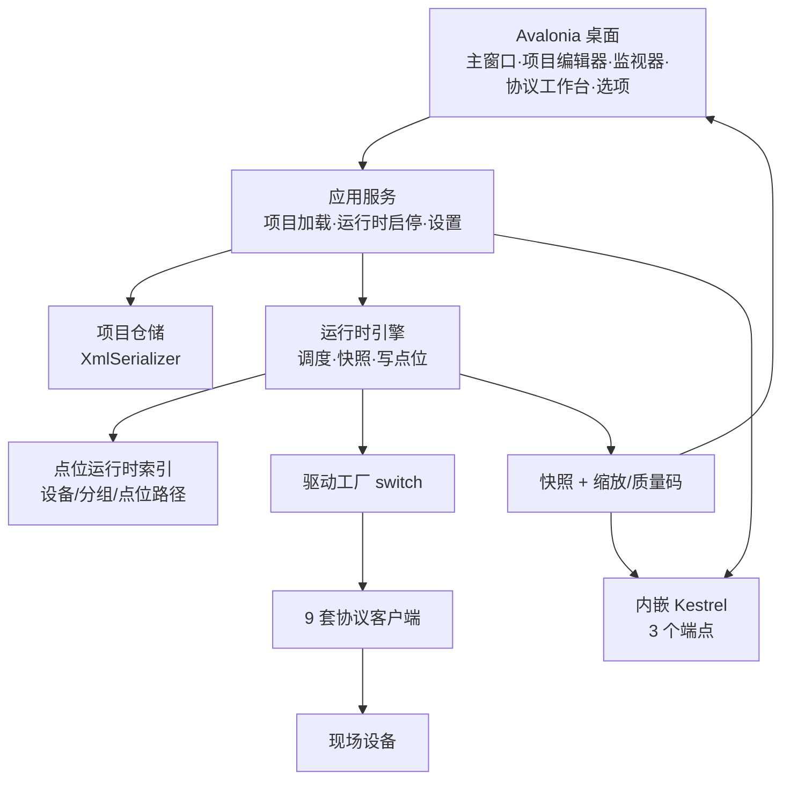

# PA-10｜Avalonia 跨平台 PLC 边缘网关

> **分析对象**：桌面型采集网关（项目编辑器 + 运行时引擎 + 内嵌 WebAPI）
> **编号**：PA-10（按脱敏约定，不披露来源标识）
> **技术栈**：C# / .NET 8 / Avalonia 11 / ASP.NET Core Minimal API（Kestrel 内嵌）
> **规模画像**：133 个 `.cs`、19,162 行；6 个工程；10 个协议枚举值、9 套协议实现；19 项控制台回归
> **成熟度画像**：原型可用（核心采集链路扎实，网关外围能力仍停留在文档层）

---

## 1. 定位与问题域

### 1.1 它是什么

该方案是一个**桌面形态的 PLC 采集与边缘网关工具**：用 Avalonia 做跨平台界面，在界面里维护"项目 → 通道 → 设备 → 分组 → 点位"的配置树，启动后由运行时引擎周期读取 PLC，把最新值缓存在内存，通过界面监视器、协议工作台和内嵌 WebAPI 三种方式对外呈现。

它原本是 Windows 桌面程序的跨平台重写：从代码可核实，重写覆盖了数据模型、调度、驱动与编辑器，但**网关侧的 MQTT、报警、规则、历史库、远程配置、插件驱动尚未进入代码**。因此本报告把它当作"采集内核 + 桌面编辑器"来分析，而不按文档宣称的完整网关来评分。

### 1.2 面向的用户与场景

| 用户 | 场景 | 方案给出的答案 |
|---|---|---|
| 现场调试工程师 | 确认某台 PLC 的地址、类型、字序对不对 | 协议工作台：直连、单点读写、报文级操作 |
| 自控/上位机开发者 | 让上层系统拿到实时点位 | 内嵌 WebAPI（健康检查、查询缓存、写点位） |
| 产线运维 | 看哪些设备断了、哪些点位读失败 | 运行监视器：设备状态与点位状态分离显示 |
| 项目交接 | 批量维护几百个点位 | 撤销/重做、复制粘贴、Excel 导入导出 |

### 1.3 边界（不做什么）

- 不做历史存储：只有内存快照，无时序库、无本地归档。
- 不做 MQTT/报警/规则/远程配置/回滚：文档有描述，快照代码中未找到实现（详见 2.1）。
- 不做 OPC UA 采集：协议枚举里没有该值。
- 不做插件驱动：驱动在编译期由工厂 `switch` 决定；也不做服务化部署，WebAPI 随桌面进程启停。

---

## 2. 功能分析

### 2.1 功能域总览（文档声称 vs 代码可核实）

| 功能域 | 文档声称 | 代码可核实 | 判断 |
|---|---|---|---|
| 设备/分组/点位编辑 | 有 | 完整：属性面板、编辑对话框、复制粘贴、撤销栈（上限 10 步） | 一致 |
| 通道抽象（协议+并发上限） | 有 | 完整：通道决定协议与并发，旧项目按协议自动建通道 | 一致 |
| 周期采集与重连 | 有 | 完整：100 ms 调度、点位级扫描周期、失败退避 | 一致 |
| 实时监视 | 有 | 完整：设备/点位双状态、250 ms 刷新、树形过滤 | 一致 |
| WebAPI | 有 | 部分：仅健康检查、查询缓存、写点位三类端点 | 缩水 |
| MQTT 订阅/上报/补发 | 有 | 未找到：全仓无 MQTT 客户端代码 | 未实现 |
| 报警/规则/本地历史库 | 有 | 未找到：无数据库依赖、无持久化采集值 | 未实现 |
| 远程配置下发/版本/回滚 | 有 | 未找到 | 未实现 |
| 插件驱动 | 有 | 未找到：驱动由编译期工厂创建 | 未实现 |
| OPC UA 采集 | 有 | 未找到：协议枚举 10 项，无 OPC UA | 未实现 |
| 单实例与托盘 | 有 | 完整：单实例协调器、关闭隐藏 | 一致 |

这张表决定了对该方案的基本判断：**它是一个正在跨平台移植中的项目，文档写的是目标形态，代码是当前进度。** 任何按文档评估其"网关能力"的结论都会失真。

### 2.2 协议与接口覆盖

| 协议 | 角色 | 传输 | 实现要点 | 备注 |
|---|---|---|---|---|
| Rockwell CIP | 主站 | TCP | 标签名寻址、数组分段、大 BOOL 数组 | 未实现多标签合包与分片续读 |
| Siemens S7 | 主站 | TCP | PDU 协商、按 PDU 分段 | 支持 DB 区与常见类型 |
| Mitsubishi MC 3E / 1E | 主站 | TCP/UDP | 字/位分别建模，3E 段 480 字/960 位，1E 段 64 字/160 位 | UDP 仅代码核查 |
| Mitsubishi 串口 / Q/L 串口 | 主站 | 串口 | 分别 64 字/256 位、120 字/480 位分段 | 无串口帧与真机验证 |
| Omron FINS | 主站 | TCP | 240 字/480 位分段 | 界面有 UDP 选项但驱动未使用 |
| Modbus TCP | 主站 | TCP | 125 寄存器/2000 位分段、事务号校验 | 有真实 TCP 报文验证 |
| Modbus RTU | 主站 | 串口 | 同 Modbus 分段 | 串口互斥用假客户端验证 |
| Virtual PLC | 模拟 | 内存 | 按 Host 共享数组，支持切片读写 | 用于回归测试 |

9 套实现覆盖 10 个枚举值（其中两个三菱串口协议共用一族实现），全部为同步阻塞 API。协议层代码 7,801 行，占全仓 41%，是投入最重的部分。

### 2.3 典型使用流程

```
新建通道(协议/并发) → 加设备(地址/站号/超时/周期) → 分组 → 点位(地址/类型/字序/缩放)
   → 保存到 Data/project.xml → 启动运行时 → 调度器按到期时间轮询 → 快照更新
   → 监视器 250ms 拉快照；WebAPI 读缓存；协议工作台可绕过项目直连调试
```

### 2.4 功能完成度评估

| 判断 | 依据 |
|---|---|
| 采集内核可用 | 通道限流、串口互斥、点位退避、代次防串扰均有实现且有回归证据 |
| 编辑体验完整 | 撤销/重做、剪贴板、Excel 导入导出、协议参数表单齐全 |
| 网关能力缺失 | 北向只有 3 个 REST 端点，无 MQTT/历史/规则；文档多项能力在代码中无对应物 |

---

## 3. 架构分析

### 3.1 分层与模块



6 个工程的职责相当清楚：协议通信（纯驱动，无 UI 依赖）、运行时（调度与快照）、项目 IO（XML/Excel）、WebAPI（宿主）、桌面（视图与视图模型）、回归测试（控制台）。

### 3.2 关键抽象与接口

| 抽象 | 职责 | 边界 | 备注 |
|---|---|---|---|
| `IPlcClient`（5 成员） | 连接、断开、读、写、协议标识 | 同步、无取消令牌、无批量接口 | 极简；23 个数据类型（标量/数组/线圈/离散输入）由同一读方法承载 |
| 驱动工厂 | 协议枚举 → 具体客户端 | 编译期 `switch`，未知协议抛异常 | 无插件、无注册表 |
| 通道配置 | 协议、启用、最大并发设备数（1~64，默认 4） | 只做配置与限流参数，不持有连接 | 设备上的协议字段仅为兼容保留 |
| 项目配置 | 设备扁平集合 + 通道集合；加载时按协议补建通道、回写归属 | 只做配置与迁移，不持有连接 | 点位运行时索引由配置派生，重复路径启动即拒绝 |
| 撤销命令栈 | 20 个命令类 + 栈 | 只管项目结构变更，不管运行时 | 上限 10 步 |
| 应用服务 | 项目路径、设置、运行时、WebAPI 生命周期 | 不做业务逻辑 | 保存、重启、内存维护的入口 |

### 3.3 数据流与时序

```
Timer(100ms) → 取所有设备状态，按"最久未获得执行机会"排序
   → 对到期设备：TryEnter(设备锁) + 通道信号量 Wait(0) + 串口信号量 Wait(0)
   → 起一个 LongRunning 工作线程执行 PollDevice
        → 从上次结束的点位继续，逐点判断是否到期
        → 到期则先排下一次（按点位/分组/设备三级扫描周期）
        → 读成功：更新快照（含缩放、质量码 Good）
        → 读失败：区分"地址/访问错误"与"通信错误"，前者只标记该点，后者关闭连接
        → 单次执行累计 100 ms 即让出通道，未轮到的点位下次继续
   → 释放串口（串行设备）、释放通道、结束工作线程
```

快照是唯一对外产物：界面每 250 ms 拉一次，WebAPI 直接读缓存，写入路径反向走同一把通道锁。**没有事件推送**，所有实时性都来自轮询。

### 3.4 并发与连接管理

| 维度 | 事实 | 评价 |
|---|---|---|
| 调度模型 | 单一定时器 + 每设备一个 `LongRunning` 线程执行同步 I/O | 简单直接；设备数上升时线程数线性增长 |
| 通道限流 | 每通道一个信号量，读写共用 | 正确的资源边界：一个慢设备不会拖垮别的通道 |
| 串口互斥 | 全局按端口名建信号量，跨通道生效；每个调度片段结束即关闭串口 | 少见但必要的处理，解决"多站点抢一个 COM 口" |
| 公平性 | 候选设备按"上次开始轮询时间"升序 | 避免固定顺序饿死后面的设备 |
| 点位级容错 | 失败点位 1s 起指数退避、上限 30s；其余点位不受影响 | 好；退避不会缩短原本更长的扫描周期 |
| 代次与锁纪律 | 每次启停递增运行代次，旧代次结果被丢弃；调度线程用 `TryEnter` 不等待 I/O 锁 | 解决"旧结果覆盖新快照"与"调度被慢设备卡死"两个经典问题 |
| 写路径 | 通道忙时立即返回"忙，请重试"，不排队 | 语义清晰；但会让上层自己重试 |

同步 I/O + 线程池/专用线程的组合，是该方案与 PA-08（全异步）最根本的架构差异。它在几十台设备时表现良好，在数百台时线程与上下文切换会成为上限（推断）。

### 3.5 配置、持久化与部署

| 面 | 做法 |
|---|---|
| 项目文件 | `Data/project.xml`，`XmlSerializer` 直读直写；加载时补默认值并迁移旧结构；**每次变更直接覆盖，无临时文件替换** |
| 设置 | `ipcsettings.json`（项目路径、WebAPI 端口与前缀等） |
| 批量维护 | Excel 2003 XML（SpreadsheetML）导入导出，510 行，自写读写器 |
| WebAPI | Kestrel 内嵌进程，支持路径前缀，仅 3 个端点，无认证 |
| 生命周期 | 单实例协调；退出时先停采集、停内存维护、停 WebAPI 再关窗 |

### 3.6 扩展机制

新增协议要改三处：协议枚举、驱动工厂分支、客户端实现；若要在界面可选，还要改编辑器的协议列表。对比 PA-06（SPI + 描述符）、PA-08（DLL + 允许列表），这是最"重编译"的扩展方式；但对只有 10 个协议的桌面工具而言，成本可以接受。

### 3.7 工程质量观察

| 项 | 事实 | 评价 |
|---|---|---|
| 回归测试 | 19 项控制台回归，自带 TCP 模拟 PLC（可注入坏帧、错误事务号），覆盖 6 协议报文、并发、串口互斥、代次 | 强；测试形态贴合问题域 |
| 测试框架 | 无 xunit/NUnit，自写断言与输出 | 中；无法并行、无覆盖率、无 IDE 集成 |
| 类型与构建纪律 | 全部工程 `Nullable=disable`；无 CI、无静态分析、无 `TreatWarningsAsErrors` | 弱；空引用与回归都只能靠人 |
| 代码卫生 | 两个工程残留模板文件 `Class1.cs`（其一靠 `Compile Remove` 排除）；多数窗口用 AXAML，通道编辑窗口为纯 C# | 迁移未收尾的痕迹 |
| 文档诚实度 | 自带一份核查文档，明确区分"已验证/仅代码核查/未实现"，并承认未做批量合并 | 很强；这是本卷罕见的自我审计 |
| 界面一致性 | 多数窗口用 AXAML，通道编辑窗口为纯 C# 构建 | 轻微不一致 |

---

## 4. 需求分析

### 4.1 显性需求

现场要的是"**把 PLC 的点读上来、让人看见、让上层拿到**"。方案对这三段的实现是完整的：驱动覆盖主流 PLC、监视器与工作台解决"看见"、WebAPI 解决"拿到"。相对 PA-07，它在**通道级并发与串口互斥**上做了更细的工程处理。

### 4.2 隐性需求

| 隐性需求 | 方案表现 | 评价 |
|---|---|---|
| 多点位批量读 | 仅"单点配置为数组"时合并；多个独立点位逐点读 | 缺失，且项目自己明确承认，没有伪装 |
| 点位变更不停机 | 保存后需重启运行时（应用服务提供重启入口） | 会中断采集 |
| 断网续传与时钟 | 无缓存队列；快照带采集时间但无源时标与时区处理 | 未覆盖 / 弱 |
| 地址/类型错误隔离 | 区分地址错误与通信错误，只影响单点 | 好 |
| 配置原子性与观测 | 直接覆盖写 XML；无指标、无日志落盘 | 弱；断电可能留下半个文件 |
| 安全 | WebAPI 无认证即可写点位 | 低；仅适合本机/可信内网 |

### 4.3 非功能需求

| 维度 | 实际水平 | 说明 |
|---|---|---|
| 性能 | 中 | 同步 I/O + 每设备线程；100 ms 调度与 100 ms 时间片控制了单设备占用 |
| 可靠性 | 中高 | 代次防护、退避、串口释放、坏帧重连都有；配置写入不原子是短板 |
| 安全 | 低 | 无认证、无 TLS、无速率限制 |
| 可移植与可维护 | Avalonia + net8 具备跨平台基础，但串口/托盘/单实例仍需平台适配；无 CI、无单元测试 | 中；模块边界清楚、注释充分 |

### 4.4 需求缺口与误判

1. **把"目标形态"写成了"现有能力"**：文档列出 MQTT、报警、规则、历史、远程下发、回滚、插件、OPC UA，代码里都没有。对评估者，这是最需要警惕的一点——**不能用文档给方案打分**。
2. **同步接口锁死了演进空间**：`IPlcClient` 无异步、无取消、无批量，导致运行时只能靠"每设备一个线程"绕开阻塞；要支持数百设备必须重写接口。
3. **WebAPI 的定位模糊**：三个端点既能读又能写却无认证；作为"上位机对接"安全等级不够，作为"本机调试"又不需要独立端口。再加上非原子写、无版本号、无备份，一次异常退出就可能丢项目。

---

## 5. 可借鉴与应规避

### 5.1 可直接吸收的机制

| 机制 | 为什么值得吸收 | 迁移建议 |
|---|---|---|
| 通道作为一等对象（协议+并发上限+启停） | 把"资源边界"和"协议边界"合并，天然支持多协议混跑 | 目标产品用"通道"承载限流与连接，而非设备各自为政 |
| 通道/串口双信号量 | 一个慢设备不会拖垮同通道，一个串口不会被两站同时打开 | 直接照搬；串口需补"打开失败重试"策略 |
| 运行代次（generation） | 彻底解决停止/重启后旧结果回写 | 任何"可重启的采集器"都应内置 |
| 公平调度 + 100 ms 执行片段 | 设备按"最久未执行优先"排序；单设备单次执行满 100 ms 即让出通道 | 避免尾部饥饿与单设备独占通道 |
| 点位级退避与错误分流 | 失败点位 1s 起指数退避、上限 30s，且不缩短原周期；地址错误只标记该点，通信错误才重连 | 坏点不拖累好点，恢复后不突然加速 |
| 自审文档（已验证/仅核查/未实现） | 让评估者能判断证据强度 | 目标产品的验收文档应强制三态标注 |

### 5.2 明确应规避的做法

| 做法 | 问题 | 后果 |
|---|---|---|
| 文档超前于实现 | 6 项能力只存在于文档 | 选型误判、验收纠纷 |
| 同步阻塞接口 + 每设备一个 `LongRunning` 线程 | 只能用线程换并发 | 设备数上升后线程爆炸，且无法优雅取消 |
| WebAPI 无认证可写点位 | 任意进程可改现场值 | 内网也不安全 |
| 无 CI / 无单元测试 / 可空性关闭 / 残留模板文件 | 仅靠控制台回归兜底 | 重构风险高，回归靠人跑，迁移未清理 |

### 5.3 迁移到目标产品的成本

| 迁移项 | 成本 | 说明 |
|---|---|---|
| 9 套协议的帧与分段知识 | 高价值、需重写 | 分段上限、地址规则、错误码是第一手现场知识 |
| 通道 + 双信号量 + 代次模型 | 低 | 三个概念可直接移植，代码量小 |
| 公平调度与时间片 | 低 | 逻辑简单，收益明显 |
| Excel 导入导出格式 | 中 | SpreadsheetML 兼容性好但代码需重写 |
| 桌面编辑器 | 中 | 交互模式可借鉴，Avalonia 代码不宜直接复用 |
| 自审核查文档的做法 | 低 | 应作为流程要求，而非代码迁移 |

---

## 6. 结论

### 6.1 六维评分

| 维度 | 分数(1-5) | 理由 |
|---|---|---|
| 协议广度 | 3 | 10 个枚举值全部为 PLC 主站协议，覆盖三菱/西门子/罗克韦尔/欧姆龙/Modbus；无 OPC UA、无楼宇/电力/表计协议 |
| 架构可演进性 | 3 | 通道与代次模型优秀；但同步接口、编译期工厂、无插件边界限制了规模与扩展 |
| 跨平台能力 | 3 | Avalonia + net8 具备跨平台基础；串口、托盘、单实例仍需平台适配，WebAPI 绑定 `+` 通配 |
| 可运维性 | 2 | 仅 3 个端点且无认证，无指标、无日志落盘、无历史；监视器只服务本机操作者 |
| 工程质量 | 3 | 19 项回归 + 自带 TCP 模拟 PLC + 诚实核查文档是亮点；但无 CI、无单元测试框架、可空性关闭、配置写非原子 |
| 许可与合规风险 | 5 | MIT；无第三方商业组件纠葛（图标另有声明文件） |

### 6.2 三条关键结论

1. **通道模型是它最值得学的东西。** 把"协议 + 并发上限 + 启停"收进通道，再用通道/串口双信号量 + 公平调度 + 运行代次解决资源竞争与状态串扰，这套组合在 1,273 行引擎里做到了少见的严谨；PA-06/PA-07 都缺这一层抽象。
2. **它的文档不能作为评估依据。** MQTT、报警、规则、历史库、远程下发、回滚、插件、OPC UA 八项能力在快照代码中均无对应实现；方案的真实身份是"跨平台移植中的采集内核"，按网关打分必然高估。评估这类项目时，应以"代码可核实"为唯一口径。
3. **同步接口决定了它的天花板。** `IPlcClient` 五个同步成员 + 每设备一个专用线程，在几十台设备时是简单可靠的工程选择，在数百台时就是结构性瓶颈；若目标产品要走向"边缘网关"，必须从异步、可取消、可批量的接口重新设计，而不是在这个接口上叠加功能。

---

## 附录：可核实的统计口径

| 指标 | 数值 | 取证方式 |
|---|---|---|
| 全仓 `.cs` / 行数 | 133 / 19,162 | 全仓统计 |
| 桌面 / 运行时 | 29 / 5,972；56 / 3,978 | 两个工程目录 |
| 协议通信 | 40 / 7,801 | 协议工程目录 |
| 项目 IO / WebAPI / 回归 | 3 / 541；2 / 397；3 / 473 | 三个工程目录 |
| 协议枚举值 / 驱动实现 / 质量码 | 10 / 9 / 8 态 | 枚举与工厂分支比对 |
| 调度周期 / 执行片段 / 退避 | 100 ms / 100 ms / 1s 起、2 倍递增、30s 上限 | 引擎常量与计算式 |
| 通道并发上限 / 撤销栈深度 | 1~64（默认 4）/ 10 | 配置归一化与视图模型参数 |
| WebAPI 端点 / 回归项 | 3（健康、查询、写入）/ 19 | 路由注册点与测试入口输出 |
