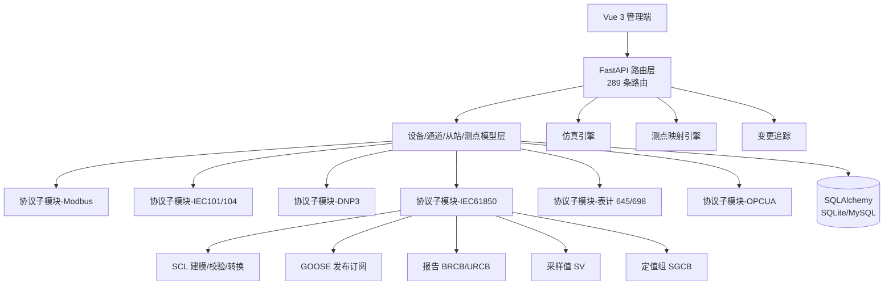

# PA-11｜电力协议仿真采集工作站

> **分析对象**：桌面应用（Vue 管理端 + Python 后端服务 + Tauri/Rust 桌面壳）
> **编号**：PA-11（按脱敏约定，不披露来源标识）
> **技术栈**：Python 3.11+ / FastAPI 0.128.0 / SQLAlchemy 2.0.45 / SQLite·MySQL；Vue 3.5 + Element Plus + Vite 5；Tauri v2 + Rust；协议库 pymodbus 3.12、c104 2.2.2、dlt645 3.2.0、pyiec61850-ng 1.6.1.10、pydnp3-pure、asyncua 2.0.1、aiomqtt
> **规模画像**：398 个 `.py`（约 8.9 万行）、289 条 API 路由；前端 125 个 `.vue` + 109 个 `.ts`；215 个测试文件；多协议后端子模块 8 个
> **成熟度画像**：内部可用偏生产（协议覆盖面完整、测试集中在 IEC 61850/OPC UA/IEC 104，但许可为强传染性）

---

## 1. 定位与问题域

### 1.1 它是什么

PA-11 是一个「先仿真、后接入」的工业与电力协议工作站：南向把 Modbus、IEC 60870-5-101/104、DNP3、IEC 61850、DL/T 645、DLT 698、OPC UA 等多套协议统一进一个后端服务，用内置模拟算法在**没有真实设备**的情况下把「建模—采集—映射—导出」全链路跑通；北向提供配置界面、数据查询与 IEC 61850 模型导出。

它的定位不是「某协议的驱动库」，而是**一个可离线验证的协议一致性工作台**。判断依据来自三处代码事实：

| 事实 | 说明 |
|---|---|
| 每个测点可绑定九种模拟算法（固定值/随机/自增/自减/计划/正弦/斜坡/脉冲/不仿真） | 说明「无设备出数」是一等公民，而非测试补丁 |
| 存在独立的「变更来源」标记（手动/仿真/映射/协议/客户端读取/内部） | 说明作者要区分「数据是人造的、设备来的还是算出来的」 |
| IEC 61850 拆出 报告/SCL 建模/GOOSE/采样值/定值组等十余个子模块 | 说明电力纵深是主攻方向，而非附带支持 |

### 1.2 面向的用户与场景

| 用户 | 场景 | 真实诉求 |
|---|---|---|
| 系统集成商 | 现场设备未到货，先做上位机联调 | 能立刻产出连续、可预期的数据流 |
| 协议开发/测试 | 验证第三方主站或从站实现 | 既能当服务端模拟，也能当客户端采集 |
| 电力自动化工程师 | 配置 IEC 61850 IED 模型、GOOSE、报告 | 建模、导出、定值组一体化 |
| 运维/交付 | 同型设备成批上线 | 批量复制 + 地址偏移 + 跨协议克隆 |

### 1.3 边界（不做什么）

- **不做组态/HMI**：界面只做设备、通道、测点、映射、协议配置，没有画面编辑、报警弹窗、趋势组态。
- **不做云平台**：北向止于本地接口与模型导出，无多租户、无云 Outbox。
- **不做实时流推送**：数据以请求-响应式查询为主（推断：前端靠轮询刷新）。
- **不追求单机极致吞吐**：映射用单线程池串行，调度偏保守（见 3.4）。
- **不是纯从站模拟器**：仿真与真实接入混在同一协议子模块内，未拆成独立仿真服务。

---

## 2. 功能分析

### 2.1 功能域总览

| 功能域 | 功能点 | 实现方式 | 完成度 |
|---|---|---|---|
| 设备建模 | 设备组自引用成树、通道、从站、测点四层 | 设备组树 + 通道（TCP 客户端/服务端/串口）+ 从站 + 遥测/遥信/遥控/遥调测点 | 完整 |
| 协议接入 | 8 类核心协议 + MQTT 各自独立子模块，统一连接—读写入口 | 每协议一个包，内含连接管理、编解码、配置 | 完整（各协议成熟度不一） |
| 仿真数据生成 | 九种模拟算法按测点绑定、按采集周期产出 | 测点持模拟类型与参数，采集循环触发下一帧 | 完整，是本方案核心 |
| 变更追踪 | 来源标记 + 定长历史队列 | 请求上下文存放变更源，写值前记录来源/旧值/新值/时间（最多 50 条） | 完整 |
| 测点映射 | 源测点经公式换算写入目标测点 | 受限 AST 白名单求值 + 单线程池 + 待映射合并 | 完整 |
| IEC 61850 建模 | ICD/SCD 解析、校验、转换、图形化建模 | SCL 建模子模块（解析器/校验器/转换器）+ 标准包 + CDC 模板 | 完整 |
| IEC 61850 运行 | GOOSE 发布订阅、报告 BRCB/URCB、SV、定值组 | GOOSE/报告/采样值/定值组各子模块，stNum/sqNum 与选编辑确认激活 | 完整 |
| 模型导出 | CSV/ICD/JSON/XML/tree 多格式 | 模型导出子模块 | 完整 |
| 消息捕获 | 收发报文环形缓冲 + 按协议解析 | 定长队列（最多 200 条）+ 约 10 个协议解析器 | 可用 |
| 批量配置 | 测点/设备/通道/映射批量复制 | 批量复制接口，IP/端口递增偏移，支持 IEC 61850/OPC UA 克隆 | 完整 |

### 2.2 协议与接口覆盖

| 协议/接口 | 角色 | 传输 | 代码位置（角色名） | 备注 |
|---|---|---|---|---|
| Modbus TCP/RTU | 主站/从站 | TCP/串口 | 协议子模块-Modbus | pymodbus 3.12 |
| IEC 60870-5-104 | 主站/从站 | TCP | 协议子模块-IEC104 | c104，支持总召唤、累计量召唤、CP56Time2a |
| IEC 60870-5-101 | 主站/从站 | 串口 | 协议子模块-IEC101 | 自带 ASDU 编解码与链路层帧 |
| DNP3 | 主站/从站 | TCP/串口 | 协议子模块-DNP3 | pydnp3-pure |
| IEC 61850 | 客户端/服务端 | TCP | 协议子模块-IEC61850 | pyiec61850-ng，含 GOOSE/SV/报告/定值组 |
| DL/T 645 | 主站/从站 | 串口 | 协议子模块-DLT645 | dlt645 3.2.0 |
| DLT 698 | 主站/从站 | 串口 | 协议子模块-DLT698 | 与 645 并列的表计协议 |
| OPC UA | 客户端/服务端 | TCP | 协议子模块-OPCUA | asyncua 2.0.1 |
| MQTT | 双角色 | TCP | 协议子模块-IoT | aiomqtt，主要用于北向/调试 |

核实说明：测试文件集中分布在 IEC 61850（52 个）、OPC UA（21 个）、IEC 104（8 个）三条协议线的测试目录，说明这三条协议线投入最深；其余协议测试相对稀疏，这是成熟度差异的直接证据。

### 2.3 典型使用流程

```
新建设备组（树节点）
  → 在组下建通道（TCP 客户端/服务端 或 串口，可开变更追踪）
  → 通道下建从站（协议 + 地址参数）
  → 从站下建测点（遥测/遥信/遥控/遥调），为每个测点选模拟算法
  → 启动采集：定时循环按模拟算法产出下一帧 → 记录变更来源与历史
  → （可选）配置测点映射：源测点经公式写入目标测点
  → （IEC 61850）导入/建模 ICD → 配置 GOOSE/报告/定值组 → 导出模型
  → 批量复制同型设备（IP/端口偏移），或克隆为其他协议形态
```

### 2.4 功能完成度评估

| 能力 | 完成度 | 依据 |
|---|---|---|
| 多协议接入 | 高 | 8 类核心协议 + MQTT 独立成模块；IEC 61850/OPC UA/IEC 104 测试最厚 |
| 无设备仿真 | 很高 | 九种算法 + 来源标记 + 定长历史，闭环完整 |
| IEC 61850 纵深 | 很高 | 建模/导出/GOOSE/报告/SV/定值组全覆盖 |
| 测点映射 | 中高 | AST 白名单安全，但串行执行、吞吐受限 |
| 批量运维 | 高 | 地址偏移复制 + 跨协议克隆 |
| 报文诊断 | 中 | 环形缓冲 + 10 个解析器，深度有限 |
| 北向输出 | 中 | 以查询与导出为主，无云上报与推流 |

---

## 3. 架构分析

### 3.1 分层与模块



### 3.2 关键抽象与接口

| 抽象 | 职责 | 边界 | 位置 |
|---|---|---|---|
| 设备组 | 自引用树节点，组织设备层级 | 只表达归属，不持有连接 | 模型层 |
| 通道 | 一条物理/逻辑链路（TCP 客户端/服务端/串口） | 持有连接参数与变更追踪开关 | 模型层 |
| 从站 | 通道下可寻址设备，绑定协议 | 协议参数与从站地址 | 模型层 |
| 测点 | 单个可读写数据项（遥测/遥信/遥控/遥调） | 地址、类型、工程单位、模拟算法 | 模型层 |
| 测点映射 | 源→目标的数据搬运与换算 | 公式白名单求值，不越权访问 | 映射引擎 |
| 变更来源 | 标记本次写入的动因 | 上下文变量传递，写入前记录 | 变更追踪 |
| 协议子模块 | 单协议的连接/编解码/配置实现 | 各自独立，无统一采集调度抽象 | 后端协议包 |

这里的关键缺陷是：**没有像 PA-06 的采集器契约那样的统一协议抽象**。各协议子模块各写各的连接管理与读循环，接口形态靠约定而非契约强制。好处是新增协议门槛低，坏处是背压、故障隔离、指标口径无法集中治理。

### 3.3 数据流与时序

```
采集定时器（按通道周期触发）
  └→ 遍历通道下从站与测点
       ├→ 若测点绑定模拟算法：算出下一帧值（来源=仿真）
       ├→ 若走真实协议：协议子模块读设备（来源=协议）
       └→ 写值：携带来源标记 → 入变更历史（定长 50）→ 更新测点当前值
            └→ 若该测点被映射引用：加入待映射集合 → 单线程池串行求值 → 写目标测点（来源=映射）
```

变更追踪的横切设计值得单列：请求进入时在上下文里放一个「变更源」变量，写值函数在落值前先记录一条 `(来源, 旧值, 新值, 时间)`，历史用定长队列滚动保存。这样「谁在何时把哪个值改成了什么」可回溯，是仿真平台做审计与回放的基础。

### 3.4 并发与连接管理

| 主题 | 做法 | 评价 |
|---|---|---|
| 采集调度 | 按通道周期定时触发，测点逐个产出 | 简单直观；缺少全局时间片与批读规划 |
| 映射并发 | 单线程池（最大并发 1）+ 待映射集合合并 | 避免抖动与重入，但吞吐受限 |
| 协议并发 | 各协议子模块自行管理（多为 asyncio 任务） | 口径不统一，故障隔离靠各自实现 |
| 变更追踪 | 上下文变量传递来源，写值前记录 | 轻量，无全局锁 |
| 故障恢复 | 协议库自带重连为主，未见统一退避/熔断 | 弱，依赖底层库 |
| 背压 | 未见统一有界队列与溢出策略 | 弱（对比 PA-06 的三种溢出策略） |
| 报文缓冲 | 定长队列（最多 200 条） | 防内存膨胀，但会丢历史报文 |

### 3.5 配置、持久化与部署

- **持久化**：SQLAlchemy 抽象，默认 SQLite，可切 MySQL；设备组树靠自引用外键表达。
- **前端**：Vue 3 + Element Plus + Vite 5，Element Plus 承担表格/表单/树的密集交互。
- **桌面交付**：Tauri v2（Rust）把 Web 界面打包为本地应用，后端以伴随进程运行。
- **协议配置**：IEC 61850 侧以 SCL 文件（ICD/SCD）为一等输入，配标准包与 CDC 模板；其余协议以数据库记录为主。
- **部署形态**：单机为主，未见容器编排或分布式部署痕迹。

### 3.6 扩展机制

新增协议的最小闭环是「建一个协议子模块 + 在设备/通道模型里挂协议类型 + 在界面注册表单」。由于没有统一采集器契约，扩展的「自由度」很高但「一致性」很低：新协议是否支持批量读、是否支持订阅、失败如何上报，全凭实现者自觉。IEC 61850 内部则是另一套扩展方式——按子领域（报告/SCL/GOOSE/采样值/定值组）增量挂载，边界清晰得多。

### 3.7 工程质量观察

| 观察项 | 事实 |
|---|---|
| 测试密度 | 215 个测试文件 / 398 个主代码文件 ≈ 54%，但集中在三条协议线 |
| 安全边界 | 映射公式用 AST 白名单，只允许算术与白名单函数，拒绝任意代码执行 |
| 数据可追溯 | 变更来源枚举 + 定长历史队列，支持审计与回放 |
| 文档化 | IEC 61850 子领域拆分清晰；其余协议缺统一契约文档 |
| 债务痕迹 | 各协议重复实现连接/读循环；仿真与真实接入混在同一子模块 |
| 许可 | 强传染性许可（见 6.1），商用集成需评估 |

---

## 4. 需求分析

### 4.1 显性需求

1. 现场设备未到货时，也要能产出连续、可预期的采集数据。
2. 一套软件覆盖 Modbus/IEC 101/104/DNP3/IEC 61850/DL-T 645/DLT 698/OPC UA。
3. 同一套模型既能当服务端模拟设备，也能当客户端采集真实设备。
4. IEC 61850 要能建模、导出、发 GOOSE、收报告、读 SV、改定值。
5. 同型设备要能批量复制，且地址自动偏移。
6. 数据要能区分「人改的、设备来的、算出来的」。
7. 测点间要能做公式换算与搬运。
8. 收发报文要能留存并解析，便于排障。

### 4.2 隐性需求

| 隐性需求 | 方案中的对应处理 | 若缺失的后果 |
|---|---|---|
| 仿真与真实可切换 | 测点级模拟算法开关 | 上线前无法预演 |
| 变更可审计 | 来源标记 + 定长历史 | 数据异常无法定位责任人 |
| 公式安全 | AST 白名单 | 配错公式导致任意代码执行 |
| 批量部署 | 复制 + 地址偏移 + 跨协议克隆 | 上百台同型设备手工配置 |
| 报文可回溯 | 环形缓冲 + 协议解析器 | 现场只能靠猜 |
| 模型可交换 | CSV/ICD/JSON/XML/tree 导出 | 与其他工具链无法互通 |
| 时钟与时标 | IEC 104 CP56Time2a、IEC 61850 时标 | 事件顺序错乱 |
| 许可与合规 | 强传染性许可 | 商用分发时法务阻塞 |

### 4.3 非功能需求

| 维度 | 现状 | 判断 |
|---|---|---|
| 启动时间 | FastAPI + Vue 静态资源 + Tauri 壳 | （推断）秒级，桌面端可接受 |
| 内存 | Python 常驻 + 多协议库 + 报文缓冲（≤200） | （推断）数百 MB 量级 |
| 部署体积 | Python 运行时 + 前端产物 + 协议库 | （推断）偏大，需打包运行时 |
| 可观测性 | 变更历史 + 报文捕获 + 协议解析 | 中，缺统一指标与健康视图 |
| 水平扩展 | 单机、SQLite 默认 | 弱，本就是桌面/边缘形态 |
| 吞吐 | 映射单线程、采集逐点 | 中低，适合配置验证而非高密度采集 |

### 4.4 需求缺口与误判

| 缺口 | 证据 | 影响 |
|---|---|---|
| 缺统一采集调度 | 各协议自管连接与读循环 | 背压/隔离/指标无法集中治理 |
| 仿真与真实边界模糊 | 同一子模块内混写 | 难以单独交付「纯仿真器」 |
| 映射并发保守 | 单线程池串行 | 大点数场景吞吐不足 |
| 故障恢复不统一 | 依赖协议库自带重连 | 无统一退避/熔断/补发 |
| 测试分布不均 | 三条协议线占多数测试 | 其余协议回归风险高 |

---

## 5. 可借鉴与应规避

### 5.1 可直接吸收的机制

1. **仿真优先的产品策略**：九种模拟算法 + 测点级开关，让「无设备也能全流程验证」成为现实。这是本方案最值得整体搬走的产品级设计。
2. **变更追踪横切**：上下文变量 + 定长历史队列，低成本实现「来源可辨、历史可回放」的审计能力。
3. **批量偏移复制 + 跨协议克隆**：直击同型设备批量上线痛点，复制时对 IP/端口递增，且能把一个从站克隆成其他协议形态。
4. **IEC 61850 子领域拆分**：报告/SCL/GOOSE/采样值/定值组各自独立，是治理协议复杂度的正确方式。
5. **公式 AST 白名单**：把「可配置公式」限制在安全子集，避免配置即执行任意代码。

### 5.2 明确应规避的做法

| 做法 | 问题 | 目标产品应如何做 |
|---|---|---|
| 各协议自写连接/读循环 | 重复且口径不一 | 抽统一采集器契约 + 生命周期 |
| 仿真与真实混写 | 无法单独交付仿真器 | 仿真器独立成模块/服务 |
| 映射单线程串行 | 吞吐天花板低 | 按目标测点分片并行 + 合并写 |
| 无统一故障恢复 | 依赖底层库 | 指数退避 + 熔断 + 补发 |
| 测试分布不均 | 长尾协议无回归 | 每协议最小一致性测试集 |
| 强传染性许可 | 商用分发受限 | 选宽松许可或隔离进程边界 |

### 5.3 迁移到目标产品的成本

| 机制 | 迁移成本 | 说明 |
|---|---|---|
| 仿真算法集 | 低 | 纯计算逻辑，语言无关 |
| 变更追踪 | 低 | 上下文 + 环形缓冲即可 |
| 批量偏移复制 | 低 | 数据操作，易复刻 |
| IEC 61850 子领域 | 高 | 依赖成熟协议栈与 SCL 处理 |
| 多协议接入 | 高 | 各协议需重新找库或自研 |
| 映射引擎 | 中 | AST 白名单思路可复用，需换语言实现 |

---

## 6. 结论

### 6.1 六维评分

| 维度 | 分数(1-5) | 理由 |
|---|---|---|
| 协议广度 | 5 | 8 类协议覆盖 PLC/电力/表计/IoT，且电力纵深最深 |
| 架构可演进性 | 3 | IEC 61850 子领域拆分优秀，但缺统一采集抽象，协议层重复 |
| 跨平台能力 | 4 | Python + Web + Tauri，三大桌面平台可打包；串口依赖平台驱动 |
| 可运维性 | 3 | 变更历史与报文捕获可用，缺统一指标/健康/退避 |
| 工程质量 | 3 | 测试总量尚可但分布不均，仿真/真实边界模糊 |
| 许可与合规风险 | 2 | 强传染性许可（GPL-3.0 系），商用分发风险高 |

### 6.2 三条关键结论

1. **它的核心价值不在「连真实设备」，而在「让无设备也能把全链路验证完整」**：九种模拟算法 + 来源标记 + 批量克隆，构成了一个可离线演进的协议一致性工作台，这是它区别于 PA-12/PA-15 的定位。
2. **变更追踪、批量偏移复制、IEC 61850 子领域拆分三处设计可直接迁移**：它们与语言无关，且分别解决审计、批量部署、协议复杂度三个通用问题。
3. **协议层重复与仿真/真实边界模糊是主要技术债**：若要长期演进，应抽出统一采集调度契约、把仿真器独立成模块，并补上统一的退避/熔断/背压——否则协议越多，治理成本越高。

---

**附：本文数量均来自代码检索**（文件计数、路由计数、测试目录计数、枚举成员数）。协议库版本取自依赖声明；未引用无法核实的宣传数字。
