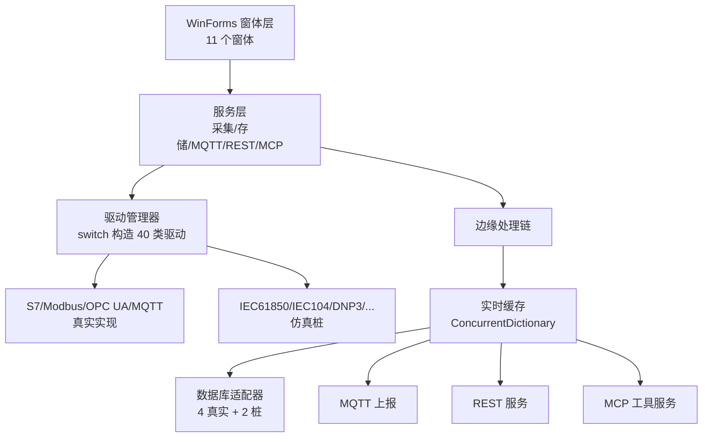

# PA-12｜单体式 WinForms 采集工作站

> **分析对象**：桌面应用（.NET Framework 4.8 WinForms 单可执行文件）
> **编号**：PA-12（按脱敏约定，不披露来源标识）
> **技术栈**：.NET Framework 4.8 / WinForms；S7.Net、NModbus、OPC UA、MQTTnet；SQLite/MySQL/SQL Server/PostgreSQL/Oracle/TDengine 六类数据库适配器
> **规模画像**：91 个 `.cs`；驱动目录 43 个文件（约 1.09 万行）、服务层约 7200 行、窗体层约 1.17 万行；驱动管理器中可核实 **40 个驱动类型**，其中约 **15 个为纯仿真实现**；内置 MCP 服务可核实 **19 个已注册工具**
> **成熟度画像**：内部可用（采集/存储/北向主链路可跑，但仿真占比较高、无自动化测试、文档数字与代码不符）

---

## 1. 定位与问题域

### 1.1 它是什么

PA-12 是一个「一个 exe 装下采集、存储、北向、运维」的 Windows 单体工作站：南向用一个统一的驱动接口接多种协议，中间做边缘处理与告警，北向同时提供数据库落库、MQTT 上报、REST 接口与 MCP（供 AI 客户端调用的工具服务）。

它的自我定位是**「现场工程师双击即用」的一体化工具**，而非可嵌入的 SDK。判断依据来自三处代码事实：

| 事实 | 说明 |
|---|---|
| 单 `.csproj`、单 WinForms 可执行文件，无插件包 | 交付物是「一个文件夹」，无安装器与运行时依赖编排 |
| 配置落在用户本地目录的设备配置文件/MQTT 配置文件/分组配置文件 | 无中心配置库，符合单机工具形态 |
| 内置 MCP 服务（默认 5101 端口）暴露采集数据与操作 | 说明作者把「AI 可调用」当作北向的一等出口 |

### 1.2 面向的用户与场景

| 用户 | 场景 | 真实诉求 |
|---|---|---|
| 现场工程师 | 一台工控机连几台 PLC，本地看数、存库 | 双击即用、不装运行时、界面直白 |
| 小型集成商 | 快速交付一个点位采集+上报的小项目 | 协议够用、配置可视化、能连数据库 |
| AI/自动化使用者 | 让 LLM 查询/操作采集数据 | 标准协议接入、工具语义清晰 |

### 1.3 边界（不做什么）

- **不做分布式/多机**：单进程单机，无节点注册、无集群。
- **不做组态/HMI**：窗体只做设备、点位、分组、MQTT、日志等配置，无画面与动画。
- **不做写点位为主的场景**：统一驱动接口只有连接、断开、启动采集、读取，**没有写入 API**（见 3.2）。
- **不做跨平台**：绑定 .NET Framework 4.8 与 WinForms，仅 Windows。
- **不提供插件扩展**：驱动在驱动管理器的 `switch` 中硬编码注册，新增协议需改主程序。

---

## 2. 功能分析

### 2.1 功能域总览

| 功能域 | 功能点 | 实现方式 | 完成度 |
|---|---|---|---|
| 设备建模 | 设备、点位、分组三层 | 设备配置文件持久化 + 窗体编辑 | 完整 |
| 驱动接入 | 40 个驱动类型统一接口 | 驱动管理器按协议标识 `switch` 构造；设备通信基类四方法 + 三事件 | 完整但**约 15 个为仿真桩** |
| 采集调度 | 按设备启动采集任务，独立取消令牌 | 采集服务单例 + 每设备 `CancellationTokenSource` + `Task.Run` | 完整 |
| 边缘处理 | 缩放、开方/绝对值/变化率、公式、滤波（均值/中位/EMA）、取整、清洗、四级告警 | 边缘处理链串联 | 完整 |
| 实时缓存 | 设备最新值字典 | `ConcurrentDictionary` 按设备/点位 | 完整 |
| 历史存储 | 六类数据库适配器 | SQLite/MySQL/SQL Server/PostgreSQL 为真实实现；Oracle/TDengine 为桩 | 中（两类桩） |
| 北向 MQTT | 批量主题 + 按变量子主题 | MQTTnet | 完整 |
| 北向 REST | 本地 HTTP 监听 + Token | `HttpListener`，端口 5000 | 完整（轻量） |
| 北向 MCP | 工具化查询与操作 | Streamable HTTP，默认 5101，**19 个工具** | 可用（文档声称 50 个，与代码不符） |
| 诊断日志 | 采集日志与运行日志 | 窗体日志视图 + 文件 | 可用 |

### 2.2 协议与接口覆盖

| 协议/接口 | 角色 | 传输 | 代码位置（角色名） | 备注 |
|---|---|---|---|---|
| S7（S7-200/300/400/1200/1500） | 主站 | TCP | 驱动目录 | S7.Net，真实实现 |
| Modbus TCP/RTU | 主站 | TCP/串口 | 驱动目录 | NModbus，真实实现 |
| OPC UA | 客户端 | TCP | 驱动目录 | 真实实现 |
| MQTT | 双角色 | TCP | 驱动目录 | MQTTnet，真实实现 |
| IEC 61850 | 主站 | TCP | 驱动目录 | **仿真桩**（自增计数器） |
| IEC 60870-5-104 | 主站 | TCP | 驱动目录 | **仿真桩** |
| DNP3 | 主站 | TCP | 驱动目录 | **仿真桩** |
| 欧姆龙 FINS | 主站 | TCP/UDP | 驱动目录 | **仿真桩** |
| EtherNet/IP | 主站 | TCP | 驱动目录 | **仿真桩** |
| BACnet | 主站 | UDP | 驱动目录 | **仿真桩** |
| 三菱 MC | 主站 | TCP | 驱动目录 | **仿真桩** |
| PROFINET | 主站 | 以太网 | 驱动目录 | **仿真桩** |
| SECS/GEM | 主站 | TCP | 驱动目录 | **仿真桩** |
| （其余二十余类） | — | — | 驱动目录 | 混合真假，详见 2.4 |

**核实方式**：驱动管理器的协议分支计数得到 40 个驱动类型；驱动实现中带自增计数器（仿真自增计数器）且无真实 socket/编解码的分支约 15 个。因此「宣称 40 种协议」在**类型数**上成立，在**真实可用协议数**上不成立。README 声称的「50 个 MCP 工具」也被代码否证——实际注册为 19 个。

### 2.3 典型使用流程

```
打开 exe → 在窗体中新增设备（选协议、填地址参数）
  → 新增点位（地址、类型、缩放、死区、告警上下限）
  → （可选）配置边缘处理链与四级告警
  → 启动采集 → 服务按设备建任务 → 驱动读取 → 处理链 → 缓存
  → 历史落库（选数据库适配器）/ MQTT 上报 / REST 查询 / MCP 工具调用
  → 窗体查看实时值、日志与告警
```

### 2.4 功能完成度评估

| 能力 | 完成度 | 依据 |
|---|---|---|
| 真实协议接入 | 中 | 仅 S7/Modbus/OPC UA/MQTT 等约 7 个为真实库实现 |
| 协议类型覆盖 | 高（数字上） | 40 个类型注册，但约 15 个是仿真桩 |
| 边缘处理 | 高 | 缩放/开方/公式/滤波/取整/清洗/四级告警齐全 |
| 历史存储 | 中 | 四类真实 + 两类桩（Oracle/TDengine） |
| 北向 MQTT/REST | 高 | 批量 + 子主题、Token 鉴权 |
| 北向 MCP | 中 | 19 工具可用，但与文档宣称的 50 个不符 |
| 写点位/控制 | 未见 | 设备通信基类无写接口 |
| 自动化测试 | 未见 | 无测试工程 |

---

## 3. 架构分析

### 3.1 分层与模块



### 3.2 关键抽象与接口

| 抽象 | 职责 | 边界 | 位置 |
|---|---|---|---|
| 设备通信基类（统一驱动契约） | 连接/断开/启动采集/异步读取 + 三事件 | **只读**，无写入方法；无批量读/订阅能力声明 | 驱动目录 |
| 驱动管理器 | 按协议标识构造具体驱动 | 硬编码 `switch`，新增协议需改主程序 | 驱动目录 |
| 采集服务 | 单例，按设备建任务与取消令牌 | 全局单例，无多实例隔离 | 服务层 |
| 边缘处理器 | 缩放/开方/公式/滤波/取整/清洗/告警 | 串行节点，顺序固定 | 服务层 |
| 数据库适配器 | 建表/写入/查询 | 接口统一，Oracle/TDengine 为空实现 | 服务层 |
| MCP 工具注册表 | 把采集能力暴露为工具 | 19 个工具，语义层较薄 | 服务层 |

最值得注意的是**设备通信基类只有读没有写**：连接 / 断开 / 启动采集 / 异步读取 加三个事件，没有任何写入或订阅声明。这意味着 PA-12 本质是「只读采集器」，遥控/遥调类场景不在其能力范围。

### 3.3 数据流与时序

```
用户点「启动采集」
  └→ 采集服务为设备建 CancellationTokenSource
       └→ Task.Run(启动采集)
            └→ 驱动按点位读取（真实库 或 仿真自增）
                 └→ 边缘处理链（缩放→开方/变化率→公式→滤波→取整→清洗→告警）
                      └→ 写实时缓存（ConcurrentDictionary）
                           ├→ 历史适配器落库
                           ├→ MQTT 批量/子主题上报
                           ├→ REST 查询
                           └→ MCP 工具读取
```

### 3.4 并发与连接管理

| 主题 | 做法 | 评价 |
|---|---|---|
| 采集并发 | 每设备一个 `Task.Run` + 独立 `CancellationTokenSource` | 简单；设备多时线程/任务膨胀 |
| 共享状态 | `ConcurrentDictionary<string, 驱动条目>` | 无锁读，适合高频读缓存 |
| 连接复用 | 每设备持一个驱动实例，长期复用 | 合理 |
| 故障恢复 | 重连主要靠驱动内部，未见统一退避/熔断 | 弱 |
| 背压 | 未见有界队列与溢出策略 | 弱 |
| 取消/停止 | 每设备取消令牌，停止即取消 | 清晰 |
| 写操作 | 无 | 只读形态的必然结果 |

### 3.5 配置、持久化与部署

- **配置**：设备配置文件 / MQTT 配置文件 / 分组配置文件 存于用户本地应用数据目录，随程序走。
- **部署**：单可执行文件 + 依赖 DLL 目录，无安装器；.NET Framework 4.8 通常随 Windows 提供，降低部署门槛。
- **历史库**：SQLite/MySQL/SQL Server/PostgreSQL 真实可用；Oracle/TDengine 适配器存在但为空实现（推断：预留）。
- **北向端口**：REST 默认 5000，MCP 默认 5101，均为本地监听 + Token。

### 3.6 扩展机制

扩展方式是「改代码」而非「装插件」：新增协议需在驱动管理器 `switch` 中加分支、实现设备通信基类、在窗体加配置项、重新编译。对内部团队可接受，对第三方不友好。这是它与 PA-13（插件热加载）最本质的差别。

### 3.7 工程质量观察

| 观察项 | 事实 |
|---|---|
| 测试 | 无测试工程，回归靠手工 |
| 仿真占比 | 约 15/40 驱动为仿真自增计数器桩，真实协议约 7 个 |
| 文档一致性 | README 称 40 协议、50 个 MCP 工具；代码为 40 类型、19 工具 |
| 只读约束 | 设备通信基类无写入 API，遥控场景缺位 |
| 桩实现 | Oracle/TDengine 适配器为空 |
| 许可 | Apache-2.0，商用友好 |

---

## 4. 需求分析

### 4.1 显性需求

1. 一台 Windows 工控机上双击即用，不装运行时与中间件。
2. 南向接常见 PLC 与仪表，配置可视化。
3. 采集值要能做缩放、滤波、公式换算与告警。
4. 历史数据要能落进常见关系库。
5. 数据要能上报 MQTT，并能被外部查询。
6. 要能被 AI 客户端通过标准协议调用。
7. 配置要能随程序走，换机可复制。

### 4.2 隐性需求

| 隐性需求 | 方案中的对应处理 | 若缺失的后果 |
|---|---|---|
| 只读安全边界 | 基类无写入方法 | 无法误下遥控命令（也是一种保护） |
| 采集隔离 | 每设备独立取消令牌 | 一台设备卡死不拖垮全部 |
| 点位级告警 | 四级（HH/H/L/LL） | 只能事后看数，不能即时告警 |
| 数据清洗 | 异常值清洗节点 | 脏数据污染历史 |
| 断线可见 | 驱动事件 + 日志 | 只能靠猜 |
| 部署轻量 | 单 exe + 本地配置 | 现场安装成本高 |
| 许可合规 | Apache-2.0 | 商用集成无障碍 |

### 4.3 非功能需求

| 维度 | 现状 | 判断 |
|---|---|---|
| 启动时间 | .NET Framework + WinForms | （推断）秒级，符合桌面预期 |
| 内存 | 单进程 + 缓存字典 | （推断）百 MB 量级 |
| 部署体积 | 单 exe + DLL | 小，适合 U 盘/远程分发 |
| 可观测性 | 日志视图 + 采集状态 | 中，缺指标与健康模型 |
| 水平扩展 | 单机单进程 | 弱，本就是工具形态 |
| 吞吐 | 每设备一任务，无批读规划 | 中低，适合中小点位规模 |

### 4.4 需求缺口与误判

| 缺口 | 证据 | 影响 |
|---|---|---|
| 仿真桩冒充协议支持 | 约 15 个驱动仅有自增计数 | 选型时误判「已支持 IEC 61850/DNP3」 |
| 文档数字虚高 | README 50 工具 vs 代码 19 工具 | 信任度受损，验收易争议 |
| 无写入能力 | 基类无写接口 | 遥控/遥调场景无法覆盖 |
| 无自动化测试 | 无测试工程 | 改动回归风险高 |
| 两类数据库为桩 | Oracle/TDengine 空实现 | 选型后才发现不可用 |
| 无统一重连/背压 | 依赖驱动内部 | 弱网下稳定性存疑 |

---

## 5. 可借鉴与应规避

### 5.1 可直接吸收的机制

1. **单 exe + 本地 JSON 配置的交付形态**：把「部署成本」压到最低，是现场工具类产品的正确取舍。
2. **边缘处理链的节点划分**：缩放→开方/变化率→公式→滤波（均值/中位/EMA）→取整→清洗→四级告警，这套顺序可直接作为目标产品的默认处理链。
3. **每设备独立取消令牌**：采集启停与故障隔离的最小可用解。
4. **MQTT 批量主题 + 按变量子主题双通道**：兼顾吞吐与细粒度订阅。
5. **把 MCP 作为北向一等出口**：让 AI 客户端用标准协议查询采集数据，是较前瞻的产品判断。

### 5.2 明确应规避的做法

| 做法 | 问题 | 目标产品应如何做 |
|---|---|---|
| 仿真桩计入协议数 | 误导选型与验收 | 协议清单区分「真实/仿真」，文档如实标注 |
| 文档数字与代码不符 | 信任受损 | 工具数、协议数由代码生成或 CI 校验 |
| 驱动硬编码 `switch` | 无法第三方扩展 | 插件注册表 + 热加载（参考 PA-13） |
| 基类无写入 | 遥控场景缺位 | 写能力拆为可选接口，按驱动声明 |
| 数据库适配器留空桩 | 选型后不可用 | 未实现即不注册，或显式标记实验态 |
| 无自动化测试 | 回归靠手工 | 至少覆盖处理链与适配器契约 |

### 5.3 迁移到目标产品的成本

| 机制 | 迁移成本 | 说明 |
|---|---|---|
| 边缘处理链 | 低 | 纯计算节点，语言无关 |
| 每设备取消令牌 | 低 | 标准并发原语 |
| MQTT 双主题 | 低 | 通用消息模式 |
| 本地 JSON 配置 | 低 | 简单持久化 |
| MCP 工具层 | 中 | 需重定工具语义与鉴权 |
| 真实协议实现 | 高 | 需重新找库或自研，不可照搬桩 |

---

## 6. 结论

### 6.1 六维评分

| 维度 | 分数(1-5) | 理由 |
|---|---|---|
| 协议广度 | 3 | 类型数 40 看似很广，但约 15 个为仿真桩，真实协议约 7 个 |
| 架构可演进性 | 2 | 驱动硬编码 `switch`、无插件、无写接口，扩展需改主程序 |
| 跨平台能力 | 1 | 绑定 .NET Framework 4.8 + WinForms，仅 Windows |
| 可运维性 | 3 | 日志与采集状态可用，缺指标、健康、统一重连 |
| 工程质量 | 2 | 无测试、文档数字与代码不符、多处置空桩 |
| 许可与合规风险 | 5 | Apache-2.0，商用友好 |

### 6.2 三条关键结论

1. **它是最「轻交付」的一份**：单 exe + 本地 JSON + 四类真实数据库 + MQTT/REST/MCP 三出口，把现场工具的部署成本压到极低，这一点值得直接对标。
2. **它的协议广度是「名义广度」**：40 个类型中约 15 个是自增计数桩，真实可用的约 7 个；README 的「50 个 MCP 工具」也与代码的 19 个不符。选型与对标时必须按代码核实，不能按文档。
3. **它的只读定位与硬编码扩展是结构性约束**：基类无写入意味着遥控场景缺位；驱动 `switch` 意味着第三方无法扩展。目标产品若要做「可写 + 可扩展」，这两点必须从骨架就规避。

---

**附：本文数量均来自代码检索**（驱动管理器分支计数、驱动目录文件/行数、窗体与服务层行数、MCP 工具注册计数、仿真自增计数器出现情况）。凡与 README 声明不一致处已明确标注「代码可核实值」。
