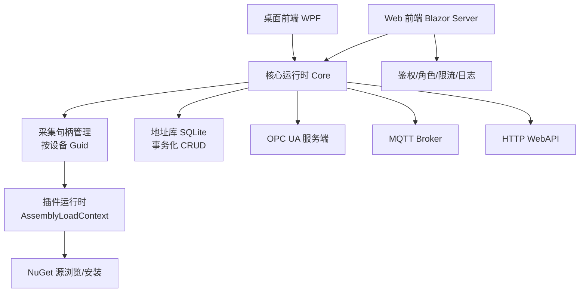

# PA-13｜插件化 DAQ 采集框架

> **分析对象**：桌面应用 + Web 管理端 + 类库（.NET 10，WPF + Blazor Server + Core 类库）
> **编号**：PA-13（按脱敏约定，不披露来源标识）
> **技术栈**：.NET 10（`net10.0` / `net10.0-windows10.0.19041`）；WPF；Blazor Server；SQLite；内置 OPC UA 服务端、MQTT Broker、HTTP WebAPI；插件经 NuGet v3 源获取并以独立 `AssemblyLoadContext` 装载
> **规模画像**：6 个工程、106 个 `.cs`；Core 约 1.0 万行、WPF 约 1.0 万行、Web 约 1.1 万行（30 个 `.razor`）；版本 1.0.3.5
> **成熟度画像**：内部可用偏生产（有事务化地址库、插件安全校验、Web 鉴权与限流、约 39 个测试用例）

---

## 1. 定位与问题域

### 1.1 它是什么

PA-13 是一个把「数据采集（DAQ）」拆成**核心运行时 + 可热插拔插件 + 双前端（桌面/Web）**的框架：核心负责设备注册、采集句柄、地址模型与生命周期；每个协议/设备以 NuGet 插件形式提供；插件在独立 `AssemblyLoadContext` 中装载卸载，主程序无需重编译即可增删协议。

它同时内置了 OPC UA 服务端、MQTT Broker 与 HTTP WebAPI，形成「采集 → 本地服务 → 北向」的自洽闭环。其自我定位是**平台/底座**，而非单一工具。判断依据：

| 事实 | 说明 |
|---|---|
| 插件经 NuGet v3 flatcontainer 浏览、安装、卸载，独立 `AssemblyLoadContext` | 扩展是一等能力，且不重启主程序 |
| 内置 OPC UA 服务端 + MQTT Broker + WebAPI | 作者把「北向出口」当作核心自带能力 |
| 同时提供 WPF 与 Blazor 两套前端，共享 Core | 面向「工控机本地」与「浏览器远程」两类部署 |

### 1.2 面向的用户与场景

| 用户 | 场景 | 真实诉求 |
|---|---|---|
| 设备/协议开发者 | 把自己的协议做成插件接入平台 | 插件契约稳定、可独立发布、热装卸 |
| 集成商 | 部署一套带 Web 管理端的采集平台 | 远程配置、权限、审计 |
| 现场运维 | 工控机本地或浏览器看采集状态 | 双前端、操作留痕 |
| 上位系统 | 通过 OPC UA/MQTT/HTTP 取数 | 标准北向接口开箱可用 |

### 1.3 边界（不做什么）

- **不做云端多租户**：Web 端是本机部署的 Blazor Server，非 SaaS。
- **不做组态/HMI**：界面是配置与运维，无画面编辑与动画。
- **不做分布式采集**：单机进程内采集，无多节点协同。
- **不以写控制为主**：核心围绕采集（DAQ），控制能力取决于插件是否暴露。
- **不内置全部协议**：只内置少量，其余靠插件生态（推断：生态规模决定实际可用协议数）。

---

## 2. 功能分析

### 2.1 功能域总览

| 功能域 | 功能点 | 实现方式 | 完成度 |
|---|---|---|---|
| 设备与句柄管理 | 按设备 Guid 管理采集句柄、数据/信息回调 | `ConcurrentDictionary<string, 采集接口>`；每 Guid 一组回调 | 完整 |
| 地址模型 | 地址/类型/长度/编码/Guid/别名/描述/主题/简化值/扩展参数/时间 | 统一地址实体，Guid 为身份 | 完整 |
| 地址库 | 事务化 CRUD、导入、删除 | SQLite + 事务 | 完整 |
| 插件浏览 | 从 NuGet v3 flatcontainer 列出可装插件 | 远程源查询 | 完整 |
| 插件安装/卸载 | 外部目录装载、独立 `AssemblyLoadContext` | 核心外部插件装载器 | 完整 |
| 插件安全 | 防 zip-slip、符号链接、大小与条目上限 | 归档校验（100MiB/200MiB/5000 条） | 完整 |
| 采集调度 | 按设备启动/停止，组包缓存复用 | 组包缓存复用、打开闸门信号量、幂等释放 | 完整 |
| OPC UA 服务端 | 把地址映射为 UA 节点，类型映射 | 冻结字典类型映射；NodeId = 父路径.地址名 | 完整 |
| MQTT Broker | 内置 Broker 供设备/北向使用 | 内置消息服务 | 完整 |
| HTTP WebAPI | 开放采集数据与操作 | ASP.NET Core | 完整 |
| Web 管理端 | Blazor Server + Cookie 鉴权 + 管理员/用户角色 + 限流 + 操作日志 + 主题/i18n | 30 个 `.razor` | 完整 |
| 桌面端 | WPF 配置与运行视图 | 10 个 `.cs` | 完整 |
| 测试 | 代码质量与菜单生命周期测试 | 约 39 个 `[Fact]/[Theory]` + JS 测试 | 可用 |

### 2.2 协议与接口覆盖

| 协议/接口 | 角色 | 传输 | 代码位置（角色名） | 备注 |
|---|---|---|---|---|
| 插件采集（协议由插件定义） | 主站 | 取决于插件 | 核心插件运行时 | 协议集合由生态决定 |
| OPC UA | 服务端 | TCP | 内置 OPC UA 服务 | NodeId 规则化映射 |
| MQTT | Broker/双角色 | TCP | 内置 MQTT 服务 | 自带 Broker |
| HTTP/WebAPI | 服务端 | TCP | Web 服务 | 采集数据与操作 |
| Web 前端 | — | HTTP/WebSocket | Blazor Server | Cookie 鉴权 + 限流 |
| 桌面前端 | — | 本地 | WPF | 配置与运行视图 |

这里与 PA-12 的根本差别：PA-12 的协议是「主程序内硬编码的真/假驱动」，PA-13 的协议是「外部插件」。因此 PA-13 的协议清单不由本仓库决定，而由插件生态决定——这是评估它时必须说清的前提。

### 2.3 典型使用流程

```
部署主程序（Core + WPF 或 Web）
  → 在插件页浏览 NuGet 源，安装所需协议插件（独立 AssemblyLoadContext 装载）
  → 新建设备（选插件、填连接参数）
  → 建地址（地址/类型/长度/编码/主题/扩展参数），或从文件导入到地址库
  → 启动采集：核心建句柄、组包、回调写地址值
  → 北向：OPC UA 节点 / MQTT Broker / HTTP API 取数
  → Web 端登录（管理员/用户）配置与查看，操作留痕
  → 需要新协议时卸载旧插件/装新插件，无需重启主程序
```

### 2.4 功能完成度评估

| 能力 | 完成度 | 依据 |
|---|---|---|
| 插件热装卸 | 高 | 独立 `AssemblyLoadContext` + NuGet 源 + 归档安全校验 |
| 采集运行时 | 高 | 组包缓存、信号量、幂等释放，生命周期严谨 |
| 地址库 | 高 | 事务化 CRUD/导入/删除，Guid 身份 |
| 北向出口 | 很高 | OPC UA 服务端 + MQTT Broker + HTTP 三出口内置 |
| Web 运维 | 高 | 鉴权/角色/限流/操作日志/主题/i18n |
| 桌面端 | 中 | WPF 存在但体量与 Web 相当，功能侧重配置 |
| 协议实现 | 取决于生态 | 本仓库不自带大量协议 |
| 自动化测试 | 中 | 约 39 个用例，偏代码质量与界面生命周期 |

---

## 3. 架构分析

### 3.1 分层与模块



### 3.2 关键抽象与接口

| 抽象 | 职责 | 边界 | 位置 |
|---|---|---|---|
| 采集接口（插件契约） | 单设备的连接、启动、停止、回调注册 | 由插件实现，核心只按 Guid 管理 | 核心 |
| 采集句柄表 | `ConcurrentDictionary<string, 采集接口>` 按设备 Guid 索引 | 值即插件实例，核心不感知协议 | 核心 |
| 地址实体 | 地址/类型/长度/编码/Guid/别名/描述/主题/简化值/扩展参数/时间 | 统一模型，扩展参数承载协议差异 | 核心 |
| 组包缓存 | 复用组包结果 | 退订时复用，避免重复组包 | 核心 |
| 打开闸门 | 打开闸门信号量 | 限制并发打开/启动 | 核心 |
| 幂等释放 | `释放闸门` + `释放任务` + `释放标志` | 保证只释放一次 | 核心 |
| 插件归档校验 | zip-slip/符号链接/大小/条目上限 | 100MiB 归档、200MiB 解压、5000 条 | 核心 |
| UA 类型映射 | 地址类型 → OPC UA 类型 | 冻结字典，启动即固定 | 内置 OPC UA |
| NodeId 规则 | 父路径 + "." + 地址名 | 规则化，便于外部寻址 | 内置 OPC UA |

三个细节体现工程质量：其一，**组包缓存：退订时复用**，避免重复把地址打包；其二，**幂等释放**用三字段保证「只释放一次」，防止重复停止导致句柄泄漏；其三，**插件归档校验**同时防 zip-slip、符号链接逃逸与解压炸弹（大小与条目双上限）。

### 3.3 数据流与时序

```
启动采集（设备 Guid）
  └→ 取用或新建采集接口插件实例（AssemblyLoadContext 内）
       └→ 注册数据回调与信息回调（按 Guid 分组）
            └→ 打开闸门（信号量）→ 插件开始采集
                 └→ 组包（复用组包缓存）→ 读设备
                      └→ 数据回调：写地址值
                           ├→ OPC UA 节点更新
                           ├→ MQTT 发布
                           └→ HTTP API 可查
停止采集
  └→ 取消订阅 → 复用组包缓存 → 幂等释放（只释放一次）
```

### 3.4 并发与连接管理

| 主题 | 做法 | 评价 |
|---|---|---|
| 句柄索引 | `ConcurrentDictionary<string, 采集接口>` 按 Guid | 无锁读，天然适合多设备 |
| 回调分组 | 每 Guid 一组数据/信息回调 | 设备隔离清晰 |
| 打开并发 | 打开闸门信号量限流 | 防止瞬时打满 |
| 组包复用 | 组包缓存，退订复用 | 减少重复计算 |
| 释放 | `释放闸门` + `释放任务` + `释放标志` 幂等 | 防重复释放，工程细节到位 |
| 插件隔离 | 独立 `AssemblyLoadContext` | 卸载不残留，但插件间不能共享类型（推断：需注意类型身份） |
| 故障恢复 | 由插件实现，核心提供生命周期钩子 | 核心不统一重连，责任下放 |
| 背压 | 未见统一有界队列 | 依赖插件与北向实现 |

### 3.5 配置、持久化与部署

- **持久化**：SQLite 存地址库与 Web 端数据，地址库操作事务化。
- **插件来源**：NuGet v3 flatcontainer，浏览→安装→卸载全流程在线。
- **插件落地**：解压到外部目录，经归档安全校验后在独立 `AssemblyLoadContext` 装载。
- **部署**：Core 类库 + WPF 桌面 + Blazor Server Web 三形态；Web 端本机部署。
- **鉴权**：Cookie 认证 + 管理员/用户两级角色 + 限流 + 操作日志。

### 3.6 扩展机制

这是 PA-13 最强的部分：新增协议 = 发布一个实现采集接口的 NuGet 包 → 在插件页安装 → 独立 `AssemblyLoadContext` 装载 → 建设备选插件。主程序不重编译、不重启。相比之下，PA-12 需要改 `switch` 重编译，PA-11 需要加协议子模块重启后端。PA-13 的插件模型是三者中扩展性最好的。

代价是：插件间类型身份隔离（每个 `AssemblyLoadContext` 独立），跨插件共享契约需放在稳定的公共程序集；插件质量与安全由发布方负责，平台只能做归档层校验。

### 3.7 工程质量观察

| 观察项 | 事实 |
|---|---|
| 测试 | 约 39 个 `[Fact]/[Theory]` + 菜单生命周期 JS 测试 |
| 安全 | 归档防 zip-slip/符号链接/解压炸弹；Web 限流 + 角色 |
| 生命周期 | 幂等释放、打开闸门、组包复用 |
| 边界 | 核心不感知协议，插件隔离 |
| 债务痕迹 | 协议实现不在本仓库；测试偏质量与界面，缺采集端到端 |
| 许可 | MIT，商用友好 |

---

## 4. 需求分析

### 4.1 显性需求

1. 新增协议不重编译主程序，最好不重启。
2. 一套核心同时服务桌面与浏览器两类使用者。
3. 采集数据要能通过标准接口（OPC UA/MQTT/HTTP）被上位系统取走。
4. 地址要能批量导入、事务化维护、以 Guid 稳定标识。
5. 插件安装要安全，不能被恶意包逃逸目录或撑爆磁盘。
6. Web 端要能多人使用，区分管理员与普通用户，并留操作痕迹。
7. 采集启停要可重复调用而不泄漏句柄。

### 4.2 隐性需求

| 隐性需求 | 方案中的对应处理 | 若缺失的后果 |
|---|---|---|
| 插件卸载干净 | 独立 `AssemblyLoadContext` | 装多了内存泄漏、类型冲突 |
| 重复停止安全 | 幂等释放三字段 | 二次停止抛异常或泄漏 |
| 并发打开可控 | 打开闸门信号量 | 瞬时打开打满设备/网络 |
| 组包不重复 | 组包缓存 | CPU 浪费、延迟升高 |
| 地址稳定身份 | Guid 作主键 | 改名/改址后历史断链 |
| 归档安全 | 大小/条目/路径三重校验 | 解压炸弹或目录逃逸 |
| 审计可追溯 | 操作日志 | 出事无法定位操作人 |
| 许可合规 | MIT | 商用集成无障碍 |

### 4.3 非功能需求

| 维度 | 现状 | 判断 |
|---|---|---|
| 启动时间 | .NET 10 + Blazor Server + Core | （推断）秒级，Web 首屏略慢 |
| 内存 | 单进程 + 插件 ALC + SQLite | （推断）百 MB 量级，随插件数增长 |
| 部署体积 | Core + WPF/Web + 插件包 | 中，插件按需下载 |
| 可观测性 | 操作日志 + 采集状态 + Web 视图 | 中高，缺统一指标导出 |
| 水平扩展 | 单机 Blazor Server | 弱，本就是本机部署 |
| 插件升级 | 卸载旧包装新包，无需重启 | 强，但需处理在途采集 |

### 4.4 需求缺口与误判

| 缺口 | 证据 | 影响 |
|---|---|---|
| 协议实现依赖生态 | 本仓库不自带大量协议 | 实际可用协议数取决于插件市场 |
| 缺端到端采集测试 | 测试偏代码质量与界面 | 插件与核心集成回归风险 |
| 无统一背压 | 依赖插件与北向 | 高峰可能积压 |
| 插件类型身份隔离 | 独立 ALC | 跨插件共享契约需谨慎设计 |
| 桌面端侧重配置 | WPF 与 Web 体量相当 | 桌面端运行视图可能不如 Web 全 |

---

## 5. 可借鉴与应规避

### 5.1 可直接吸收的机制

1. **插件热装卸 + 独立 `AssemblyLoadContext`**：这是三者中最好的扩展模型，新增协议不重编译、不重启，值得作为目标产品的扩展骨架。
2. **幂等释放三字段**（闸门 + 任务 + 标志）：把「只释放一次」变成可验证的工程约束，直接可抄。
3. **组包缓存退订复用**：减少重复组包，是采集性能的实用优化。
4. **插件归档三重校验**：大小上限 + 条目上限 + zip-slip/符号链接防护，是插件市场的安全底线。
5. **地址 Guid 身份 + 事务化地址库**：改名/改址不断链，批量导入可靠。
6. **NodeId 规则化映射**（父路径.地址名）：让外部系统可预测寻址，降低对接成本。

### 5.2 明确应规避的做法

| 做法 | 问题 | 目标产品应如何做 |
|---|---|---|
| 协议全靠生态 | 开箱可用协议少 | 核心自带若干高频协议，生态补长尾 |
| 无统一背压 | 高峰积压 | 采集与北向各自有界队列 + 溢出策略 |
| 测试偏界面 | 采集端到端无覆盖 | 增加插件契约测试与假设备端到端 |
| 插件类型隔离未文档化 | 跨插件共享易踩坑 | 明确公共契约程序集与版本策略 |
| 桌面端功能偏薄 | 与 Web 能力不对等 | 明确两端职责或统一为 Web |

### 5.3 迁移到目标产品的成本

| 机制 | 迁移成本 | 说明 |
|---|---|---|
| 插件热装卸 | 中 | 需选宿主语言的 ALC/类加载隔离方案 |
| 幂等释放 | 低 | 通用并发模式 |
| 组包缓存 | 低 | 纯数据结构 |
| 归档安全校验 | 低 | 通用文件校验 |
| 地址 Guid 身份 | 低 | 数据建模 |
| 三北向出口 | 高 | OPC UA 服务端/MQTT Broker 需成熟库 |

---

## 6. 结论

### 6.1 六维评分

| 维度 | 分数(1-5) | 理由 |
|---|---|---|
| 协议广度 | 3 | 协议由插件生态决定，本仓库不自带大量真实协议 |
| 架构可演进性 | 5 | 核心与插件彻底解耦，独立 ALC 热装卸，是三者中最佳 |
| 跨平台能力 | 3 | .NET 10 跨平台，但 WPF 桌面端仅 Windows；Web 端可跨平台 |
| 可运维性 | 4 | Web 鉴权/角色/限流/操作日志齐全，缺统一指标导出 |
| 工程质量 | 4 | 幂等释放、归档安全、事务地址库到位；测试偏界面 |
| 许可与合规风险 | 5 | MIT，商用友好 |

### 6.2 三条关键结论

1. **它是本批中扩展性最好的骨架**：插件热装卸 + 独立 `AssemblyLoadContext` + NuGet 源 + 归档安全校验，把「新增协议」从改代码变成装包，这一点应作为目标产品扩展机制的首选参照。
2. **它的工程细节值得逐条抄**：幂等释放三字段、组包缓存退订复用、地址 Guid 身份、NodeId 规则化映射、归档三重校验，都是与语言无关、可直接迁移的实用设计。
3. **它的「协议广度」是生态变量而非代码常量**：评估时不能把插件市场的潜在协议当作已实现能力；目标产品若要开箱即用，应在核心自带若干高频协议，再用插件补长尾。

---

**附：本文数量均来自代码检索**（工程与文件计数、Core/WPF/Web 行数、`.razor` 计数、测试用例计数、归档上限常量、版本号）。协议能力按「插件生态决定」如实表述，未虚报协议数量。
