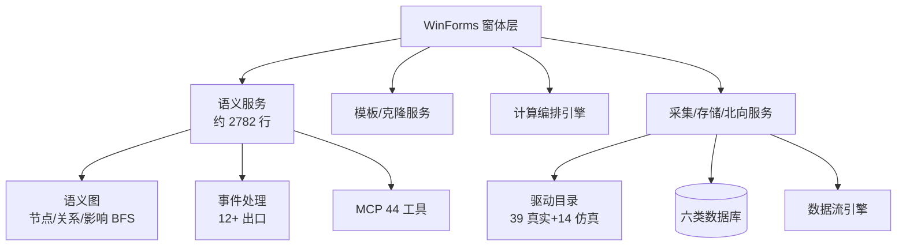

# PA-14｜语义化采集工作站

> **分析对象**：桌面应用（.NET Framework 4.8 WinForms）
> **编号**：PA-14（按脱敏约定，不披露来源标识）
> **技术栈**：.NET Framework 4.8 / WinForms；S7.Net、NModbus、OPC UA、MQTTnet；六类数据库适配器（含 Oracle/TDengine）+ 数据流引擎；内置 MCP 服务
> **规模画像**：141 个 `.cs`（约 5.8 万行）；服务层约 1.7 万行、窗体层约 2.5 万行、驱动目录约 1.1 万行（39 个驱动，约 14 个为仿真实现）；MCP 可核实 **44 个已注册工具**
> **成熟度画像**：内部可用偏生产（语义/模板/克隆/计算编排引擎较完整，鉴权与许可是明显短板）

---

## 1. 定位与问题域

### 1.1 它是什么

PA-14 是在 PA-12 的「设备—点位—存储—北向」骨架上叠加**语义层**的采集工作站：把公司、工厂、车间、产线、设备、变量等统一抽象为「语义节点」，用关系图显式建模「谁属于谁、谁依赖谁、影响面多大」；再用**设备模板 + 克隆**批量落地同型设备，用 **计算编排引擎**做聚合/趋势/阈值/日报与 AI 分析，用 MCP 把语义查询与操作暴露给 AI 客户端。

两者是「同一形态的两代」：PA-12 解决「把数采上来」，PA-14 进一步解决「数据属于谁、影响谁、如何批量治理」。本文重点写**相对 PA-12 的增量**，重合部分从简。判断依据：

| 事实 | 说明 |
|---|---|
| 语义节点统一模型 + 影响图 BFS + 上下游查询 | 语义是可推理的图，而非标签 |
| 设备模板含变量匹配（精确/包含/正则）+ 继承开关 + 版本化覆盖 | 模板是可执行的落地机制 |
| 计算编排引擎（聚合/趋势/阈值/日报 + AI 分析） | 语义之上再叠加计算层 |
| MCP 44 个工具含影响面/上下游/建议关系/建关系/建事件 | 语义能力本身就是北向 API |

### 1.2 面向的用户与场景

| 用户 | 场景 | 真实诉求 |
|---|---|---|
| 工厂数字化团队 | 把设备数据挂到组织/产线语义树 | 数据可导航、影响面可查 |
| 集成商 | 同型设备成批接入 | 模板 + 克隆，一次配置批量复制 |
| 运维/管理 | 看某设备停机影响哪些产线 | 上下游与影响图 |
| AI 使用者 | 让 LLM 按语义查询与操作 | 语义化工具，而非裸点位 |

### 1.3 边界（不做什么）

- **不做跨平台**：.NET Framework 4.8 + WinForms，仅 Windows。
- **不做 SaaS/多租户**：本机形态（推断）。
- **不做协议插件**：驱动内嵌主程序，非插件体系（与 PA-13 相反）。
- **鉴权是短板**：口令 SHA256 + 盐，代码注释自认应升级为 bcrypt/argon2。
- **许可是强传染性**：AGPL-3.0，商用分发风险很高。

---

## 2. 功能分析

### 2.1 功能域总览（标注相对 PA-12 的增量）

| 功能域 | 功能点 | 实现方式 | 完成度 | 相对 PA-12 |
|---|---|---|---|---|
| 语义建模 | 公司/事业部/工厂/车间/区域/产线/工位/设备/变量/数据源/数据表/字段/自定义 十三类节点 | 类型 + 状态 + 来源绑定 + 属性 JSON + 三类关系 | 完整 | **新增** |
| 语义同步 | 从设备/数据源同步生成节点 | 语义服务同步入口 | 完整 | **新增** |
| 影响分析 | 影响图 BFS、上下游查询、关系建议 | 图遍历 + 建议算法 | 完整 | **新增** |
| 事件 | 12+ 处理：日志/告警/消息/邮件/短信/webhook/工单/工作流/MCP/AI 分析 | 事件定义 + 多处理器 | 完整 | **新增** |
| 设备模板 | 变量匹配（精确/包含/正则）、继承开关、语义关系/计算编排引擎/事件/清洗分节、版本化覆盖、应用日志 | 模板 + 应用引擎 | 完整 | **新增** |
| 设备克隆 | 按选项复制设备及从属 | 克隆服务 + 选项 | 完整 | **新增** |
| 计算编排引擎 | 窗口聚合/趋势/阈值/日报 + AI 分析 | 约 1057 行引擎 | 完整 | **新增** |
| 采集/存储/北向 | 驱动、边缘处理、六类数据库（含 Oracle/TDengine）、数据流 Sink、MQTT/REST | 与 PA-12 同源骨架，数据库增强 | 完整 | 增强 |
| 鉴权 | 登录 + 口令哈希 + 机器绑定许可 | SHA256 + 盐；许可激活 | 可用 | 持平 |
| MCP | 44 个工具（含语义类） | Streamable HTTP | 完整 | **增强** |

### 2.2 协议与接口覆盖

| 协议/接口 | 角色 | 传输 | 代码位置（角色名） | 备注 |
|---|---|---|---|---|
| S7 / Modbus / OPC UA / MQTT | 主站/双角色 | TCP/串口 | 驱动目录 | 真实库实现 |
| IEC 61850 / IEC 104 / DNP3 等 | 主站 | TCP | 驱动目录 | 部分仿真（约 14 个） |
| 六类数据库 / 数据流引擎 | 北向 | — | 存储层 / Sink | SQLite/MySQL/SQL Server/PostgreSQL/Oracle/TDengine |
| MCP | 北向 | HTTP | 语义/采集工具 | 44 个工具 |
| 事件出口 | 北向 | 多种 | 事件处理器 | 日志/告警/消息/邮件/短信/webhook/工单/工作流 |

### 2.3 典型流程与完成度

**典型流程**：建语义树（公司→…→设备→变量）→ 绑定设备/数据源到节点 → 建模板（变量匹配 + 分节）→ 批量应用/克隆 → 配事件（越限/停机 → 告警/工单/AI）→ 采集刷新节点状态 → 查影响面/上下游或经 MCP 交给 AI。

**完成度结论**：语义建模与图推理、模板与克隆为「很高」；计算编排引擎、事件处理、数据库覆盖、MCP 语义工具为「高」；鉴权与测试为「低」（SHA256 + 盐存口令、未见测试工程）。逐项依据已在上表「完成度」列给出。

---

## 3. 架构分析

### 3.1 分层与模块



### 3.2 关键抽象与接口

| 抽象 | 职责 | 边界 | 位置 |
|---|---|---|---|
| 语义节点 | 统一表达 13 类实体 | 类型 + 状态 + 来源绑定 + 属性 JSON | 语义服务 |
| 语义关系 | 节点间归属/依赖/关联 | 三类关系，供图遍历 | 语义服务 |
| 语义服务 | 同步、影响图、上下游、关系建议、事件 | 约 2782 行，语义层核心 | 服务层 |
| 设备模板 / 克隆选项 | 声明变量匹配、继承与分节；控制复制范围 | 精确/包含/正则三种匹配；设备 + 从属 | 模板/克隆服务 |
| 计算编排引擎 | 聚合/趋势/阈值/日报 + AI 分析 | 约 1057 行，独立计算层 | 引擎 |
| 事件处理器 | 把事件分发到 12+ 出口 | 处理器可组合 | 事件服务 |

最关键的抽象是**语义节点 + 语义关系构成的有向图**：节点用 `来源类型/来源 ID` 绑定真实设备或数据源，用 `属性 JSON` 承载差异字段；关系支撑归属导航、影响面 BFS、上下游查询三件事。这把「数据在哪」升级为「数据属于谁、坏了影响谁」。

### 3.3 数据流与时序

```
采集更新变量 → 语义节点状态刷新（在线/离线/停机/删除）
  └→ 事件判定（越限/停机）→ 12+ 处理器（告警/邮件/工单/AI 分析…）
       └→ 模板应用：按变量匹配规则批量生成节点/关系/事件
            └→ 克隆：按选项复制设备及从属，绑定新语义位置
                 └→ 计算编排引擎：窗口聚合/趋势/阈值/日报 → 输出
                      └→ MCP：影响面/上下游/关系建议/建关系/建事件
```

### 3.4 并发与连接管理

| 主题 | 做法 | 评价 |
|---|---|---|
| 采集并发 | 按设备独立任务（沿用同源骨架） | 与 PA-12 持平 |
| 语义图 | 内存图 + BFS 遍历 | 查询快，超大图需注意遍历成本（推断） |
| 事件分发 | 多处理器串/并行（推断） | 出口多，需防单出口阻塞 |
| 故障恢复 | 驱动内部重连为主 | 与 PA-12 同弱点 |

### 3.5 配置、持久化与部署

- **持久化与部署**：SQLite 为主，六类数据库作历史/北向；语义节点与关系入库；单机 WinForms，无安装器，机器指纹绑定许可激活，离线可用（推断）。
- **扩展**：语义层可加节点/关系，模板层可加匹配规则，事件层可加处理器；但**协议层不可插件化**，驱动内嵌主程序，与 PA-13 相反，是架构代差。

### 3.6 工程质量观察

| 观察项 | 事实 |
|---|---|
| 语义完整度 | 13 类节点 + 影响 BFS + 上下游 + 关系建议 |
| 模板机制 | 三种匹配 + 继承开关 + 版本化 + 应用日志 |
| 鉴权 | SHA256 + 盐，代码注释自认应升级；许可 AGPL-3.0 强传染 |
| 测试 / 仿真 / 文档 | 未见测试工程；39 驱动中约 14 个仿真；README 称 44 工具，代码核实一致 |

---

## 4. 需求分析

### 4.1 显性需求

1. 数据要能挂到组织/产线/设备语义树上，而非散落点位。
2. 要能查「某设备停机影响哪些产线」「某变量的上下游是谁」。
3. 同型设备要能一次配置、批量落地。
4. 语义之上要能做聚合、趋势、阈值与日报，事件要多渠道触达。
5. AI 客户端要能按语义查询与操作，并能锁机器、离线授权。

### 4.2 隐性需求

| 隐性需求 | 方案中的对应处理 | 若缺失的后果 |
|---|---|---|
| 语义与实际绑定 | 来源类型/来源 ID 绑定 | 语义树与真实设备脱节 |
| 差异字段承载 | 属性 JSON | 节点类型爆炸 |
| 批量一致性 | 模板版本化 + 应用日志 | 批量错配无法回滚 |
| 影响面可推理 | 关系图 + BFS | 只能人工梳理依赖 |
| 计算与采集解耦 | 独立计算编排引擎 | 采集被计算拖慢 |
| 口令/许可 | SHA256 + 盐（不足）、AGPL-3.0 | 口令易破、商用分发高风险 |

### 4.3 非功能需求

| 维度 | 现状 | 判断 |
|---|---|---|
| 启动/内存 | .NET Framework + 单进程 + 语义图 | （推断）秒级启动、数百 MB，随图规模增长 |
| 部署/可观测 | 单机可执行 + 事件日志 | 中，缺统一指标 |
| 水平扩展 | 单机，内存图遍历 | 弱，（推断）万级节点可接受 |

### 4.4 需求缺口与误判

| 缺口 | 证据 | 影响 |
|---|---|---|
| 鉴权强度不足 | SHA256 + 盐，注释自认需 bcrypt/argon2 | 口令库泄露即被破解 |
| 许可强传染 | AGPL-3.0 | 商用分发需开源或隔离 |
| 协议不可插件 | 驱动内嵌 | 新增协议需改主程序 |
| 无测试证据 | 未见测试工程 | 语义/模板改动回归风险 |
| 仿真驱动计入支持 | 约 14/39 为仿真 | 选型易高估真实协议能力 |

---

## 5. 可借鉴与应规避

### 5.1 可直接吸收的机制

1. **统一语义节点 + 来源绑定 + 属性 JSON**：一套模型表达 13 类实体，差异字段进 JSON，避免类型爆炸。
2. **影响图 BFS + 上下游 + 关系建议**：把「依赖」变成可查询的图能力，支撑故障影响分析。
3. **设备模板的三种变量匹配 + 继承开关 + 版本化覆盖 + 应用日志**：模板从「文档」变成「可执行、可回滚的落地机制」。
4. **计算编排引擎与采集解耦**：计算层独立，避免拖慢采集。
5. **事件多出口组合**：告警/邮件/短信/webhook/工单/工作流/AI 分析，覆盖从通知到处置的闭环。

### 5.2 明确应规避的做法

| 做法 | 问题 | 目标产品应如何做 |
|---|---|---|
| SHA256 + 盐存口令 | 强度不足 | 直接上 bcrypt/argon2 + 迭代参数 |
| AGPL-3.0 | 商用分发高风险 | 选宽松许可，或隔离强传染部分 |
| 驱动内嵌不可插件 | 扩展需改主程序 | 采用 PA-13 式插件热装卸 |
| 无测试证据 | 语义/模板回归风险 | 语义图与模板应用必须有契约测试 |
| 仿真计入协议数 | 高估能力 | 协议清单区分真实/仿真 |

### 5.3 迁移到目标产品的成本

| 机制 | 迁移成本 | 说明 |
|---|---|---|
| 语义节点模型 / 影响图 BFS | 低 | 数据结构 + 标准图遍历，语言无关 |
| 模板匹配与版本化 | 中 | 需设计匹配 DSL 与覆盖规则 |
| 计算编排引擎 / 事件多出口 | 中 | 聚合/趋势可复用思路，需集成各通道 |
| 语义 MCP 工具 | 中 | 需重定工具语义与鉴权 |

---

## 6. 结论

### 6.1 六维评分

| 维度 | 分数(1-5) | 理由 |
|---|---|---|
| 协议广度 | 3 | 39 驱动中约 14 个仿真，真实协议数有限 |
| 架构可演进性 | 4 | 语义/模板/计算编排引擎分层清晰；协议不可插件是短板 |
| 跨平台能力 | 1 | .NET Framework 4.8 + WinForms，仅 Windows |
| 可运维性 | 3 | 事件与操作记录可用，鉴权弱、缺统一指标 |
| 工程质量 | 3 | 语义与模板完整，但鉴权弱、无测试证据 |
| 许可与合规风险 | 1 | AGPL-3.0，商用分发风险很高 |

### 6.2 三条关键结论

1. **它相对 PA-12 的本质增量是「语义层」**：统一语义节点 + 关系图 + 影响面 BFS + 上下游，把「数据在哪」升级为「数据属于谁、坏了影响谁」；模板 + 克隆 + 计算编排引擎则是语义之上的批量治理与计算层。
2. **它的模板机制是最值得抄的落地设计**：三种变量匹配 + 继承开关 + 版本化覆盖 + 应用日志，让「同型设备批量上线」从手工配置变成可回滚的批量操作。
3. **它的两处硬伤决定商用边界**：AGPL-3.0 强传染、SHA256 + 盐口令弱，叠加驱动不可插件，使其更像「内部平台」而非「可分发产品」；目标产品应在许可、鉴权、插件化三处从一开始避开。

---

**附：本文数量均来自代码检索**（文件/行数、驱动与仿真计数、MCP 工具注册计数、语义服务与计算编排引擎行数、语义节点类型数）。README 的 44 工具声明与代码一致，已如实标注。
