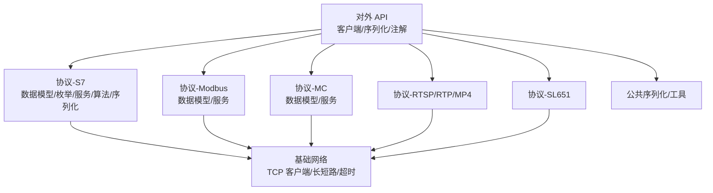

# PA-15｜Java 工业协议类库

> **分析对象**：类库（Maven 单 jar，无服务端、无界面）
> **编号**：PA-15（按脱敏约定，不披露来源标识）
> **技术栈**：Java 8 / Maven；运行期依赖仅 Lombok、slf4j，测试依赖 JUnit；版本 1.5.6；许可 MIT
> **规模画像**：474 个 `.java`（主代码 341 / 测试 133），约 6.18 万行；539 个 `@Test`；协议族 5 个（S7、Modbus、三菱 MC、RTSP/RTP/RTCP/MP4、SL651）+ 公共序列化与网络工具
> **成熟度画像**：生产可用（语义化注释、批量读写算法、视频代理、密集单测；但仅 Java 8 语法、无连接池/可观测抽象）

---

## 1. 定位与问题域

### 1.1 它是什么

PA-15 是一个**纯类库形态**的工业协议栈：不提供进程、不提供界面、不提供配置中心，只把「如何与 S7 PLC、Modbus 设备、三菱 MC 控制器、RTSP 摄像头、SL651 水文设备通信」封装成可被任意 Java 应用依赖的 jar。

它的定位是**「协议编解码与批量读写算法的实现库」**，而非平台。判断依据：

| 事实 | 说明 |
|---|---|
| 依赖仅 Lombok/slf4j（+ JUnit 测试），无 Spring/Netty | 刻意保持「零框架侵入」，可嵌进任何应用 |
| 大量数据模型/枚举类（S7 37 个数据模型、15 个枚举） | 把协议字段建模为类型，而非散落的字节偏移 |
| 独立算法包（顺序组读写重组、循环分片） | 批量读写的「切分与重组」是核心资产 |
| RTSP→RTP→H264→FMP4 全链路在库内 | 视频不是附属，而是完整的媒体管线 |

### 1.2 面向的用户与场景

| 用户 | 场景 | 真实诉求 |
|---|---|---|
| Java 后端开发者 | 在业务系统里直接读写 PLC | 引入 jar 即可，无需部署中间件 |
| 采集网关开发者 | 把协议能力作为网关南向层 | 批量读、多地址、结构化映射 |
| 视频/巡检系统 | 拉 RTSP 流转 FMP4 给浏览器播 | 协议转换在服务端完成 |
| 教学/协议研究 | 学习 S7/MC/Modbus 报文结构 | 清晰的模型与编解码 |

### 1.3 边界（不做什么）

- **不做服务端/守护进程**：没有 main、没有调度器、没有配置持久化。
- **不做北向**：无 MQTT/HTTP/数据库输出，出数由调用方负责。
- **不做连接池与指标**：连接由调用方创建管理，库只提供基础 TCP 客户端。
- **不做 UI 与组态**：纯 API。
- **不做跨语言绑定**：仅 JVM。

---

## 2. 功能分析

### 2.1 功能域总览

| 功能域 | 功能点 | 实现方式 | 完成度 |
|---|---|---|---|
| S7 通信 | S7-1500/1200/400/300/200Smart + 828D NCK | 连接协商 PDU、读写区/位/字节/字/双字/字符串/宽字符串/日期/DTL/定时器/计数器 | 完整 |
| S7 批量读写 | 多地址读、顺序组读写重组 | 顺序组算法按 PDU 长度切分与重组 | 完整 |
| S7 PLC 控制 | 热/冷重启、停止、RAM 复制到 ROM、压缩、插入 | 控制命令封装 | 完整 |
| S7 NCK | 机床位置、主轴、进给、报警、程序 | NCK 专用读写 | 完整 |
| Modbus | TCP、RTU-over-TCP、ASCII-over-TCP、TCP Server | FC 01/02/03/04/05/06/0F/10，另定义 14/16/17/2B | 完整 |
| Modbus 批量 | 按上限分片（2000 线圈 / 125 寄存器；写 123） | 循环分片算法 | 完整 |
| 三菱 MC | iQ-R/Q/L/QnA/A，1E/3E/4E 帧 | 批量/随机/多块读，远程运行/停止 | 完整 |
| RTSP 客户端 | Basic/Digest 鉴权、会话管理 | RTSP 服务 | 完整 |
| RTP/H264 | 16 类负载模型、H264 解析（FU-A 分片） | RTP 包与 H264 解析器 | 完整 |
| FMP4 封装 | 39 个 box 模型，RTSP 转 FMP4 代理 | MP4 box 编解码 + 代理 | 完整 |
| SL651 | 水文协议服务端/解析器 | 独立包 | 可用（README 未列） |
| 结构化映射 | 注解把字段映射到 PLC 地址与字节数组 | 「地址变量」/「字节数组变量」注解 + 序列化器 | 完整 |
| 基础网络 | 长/短连接、超时、重连 | TCP 客户端基类 | 完整 |

### 2.2 协议与接口覆盖

| 协议/接口 | 角色 | 传输 | 代码位置（角色名） | 备注 |
|---|---|---|---|---|
| S7（S7comm） | 主站 | TCP | 协议-S7 | 覆盖 1500/1200/400/300/200Smart + 828D NCK |
| Modbus TCP | 主站/从站 | TCP | 协议-Modbus | 含 TCP Server |
| Modbus RTU over TCP | 主站 | TCP | 协议-Modbus | 串口透传封装 |
| Modbus ASCII over TCP | 主站 | TCP | 协议-Modbus | — |
| 三菱 MC | 主站 | TCP/UDP | 协议-MC | 1E/3E/4E 帧 |
| RTSP | 客户端 | TCP | 协议-RTSP | Basic/Digest |
| RTP / H264 | 客户端 | UDP/TCP | 协议-RTP | FU-A 分片解析 |
| FMP4 | 封装/代理 | — | 协议-MP4 | 39 个 box |
| SL651 | 服务端 | TCP/串口 | 协议-SL651 | README 未列，代码可核实 |

**核实方式**：474 个 `.java`、539 个 `@Test` 均为文件与注解计数；SL651 包存在但 README 未提，属于「代码有、文档无」的增量能力，此处按代码如实列出。

### 2.3 典型使用流程

```text
// 1) 建连接（可配长连接/短连接、超时、重连）
协议客户端 client = 新建协议客户端(host, port)
client.连接()                      // 内部协商 PDU 长度

// 2) 直接读写多地址
结果集 result = client.多地址读(addresses)
client.多地址写(values)

// 3) 或用注解把 POJO 映射到 PLC 地址
class 设备状态 {
    @地址变量(地址 = "DB1.0", 类型 = SHORT) int 速度
    @字节数组变量(偏移 = 2) String 名称
}
设备状态 s = client.按类型读(设备状态.class)

// 4) Modbus
client.读保持寄存器(slaveId, start, quantity)
```

### 2.4 功能完成度评估

| 能力 | 完成度 | 依据 |
|---|---|---|
| S7 协议深度 | 很高 | 机型覆盖全、NCK 专用、PLC 控制命令齐 |
| 批量读写算法 | 很高 | 顺序组按 PDU 切分/重组，多地址读 |
| Modbus | 很高 | 四种传输 + 十种功能码 + 分片上限 |
| 三菱 MC | 高 | 五代机型 + 三种帧 + 多块读 |
| 视频管线 | 高 | RTSP→RTP→H264→FMP4 全链路 |
| 结构化映射 | 高 | 注解 + 字节数组序列化 |
| 可观测/连接治理 | 低 | 无指标、无连接池、无统一背压 |
| 文档 | 中 | README 未覆盖 SL651 等增量能力 |

---

## 3. 架构分析

### 3.1 分层与模块



### 3.2 关键抽象与接口

| 抽象 | 职责 | 边界 | 位置 |
|---|---|---|---|
| 协议客户端（各协议） | 连接、读写、控制 | 每协议一套 API，无统一基类契约 | 各协议服务层 |
| TCP 客户端基类 | 长/短连接、超时、重连 | 只管字节流，不管协议语义 | 基础网络 |
| 数据模型 | 把协议字段建模为类型（地址、类型、长度、值） | 只表达数据，不含连接状态 | 各协议数据模型 |
| 枚举 | 区域、数据类型、功能码、帧类型、机型 | 类型安全的常量表 | 各协议枚举 |
| 顺序组算法 | 把多地址请求按 PDU 容量切分并重组结果 | 纯算法，无 IO | S7 算法包 |
| 循环分片算法 | 按线圈/寄存器上限拆分批量请求 | 纯算法，无 IO | Modbus 算法包 |
| 注解 + 序列化器 | 把 POJO 字段映射到地址与字节数组 | 反射 + 字节编解码 | S7 序列化包 |
| MP4 box | FMP4 封装单元 | 纯编解码，无网络 | MP4 模型 |

关键观察：**没有统一的「协议客户端接口」**。每个协议各自定义 API 风格（S7 用多地址读写、Modbus 用功能码方法、MC 用帧类型），调用方需按协议分别编程。这降低了抽象成本，也意味着「多协议统一采集」必须由上层自行封装。

### 3.3 数据流与时序

```
connect()
  └→ TCP 建链（长连接保留 / 短连接用完即关）
       └→ 协议握手（S7 协商 PDU 长度；MC 选帧类型）
            └→ read/write
                 ├→ 多地址请求 → 顺序组算法按 PDU 切分 → 逐批发送 → 重组结果
                 ├→ Modbus 批量 → 循环分片（2000 线圈 / 125 寄存器）→ 逐批 → 合并
                 └→ 视频：RTSP 会话 → RTP 收包 → H264 FU-A 重组 → FMP4 封装 → 输出
```

### 3.4 并发与连接管理

| 主题 | 做法 | 评价 |
|---|---|---|
| 连接模式 | 长/短连接开关区分 | 长连接省握手，短连接省资源 |
| 超时 | 连接与接收各 10 秒 | 固定值，可配性一般（推断） |
| 重连 | 重连开关 | 简单开关，无退避策略 |
| 并发 | 库内不强制同步，调用方负责串行化 | 灵活但易误用（推断） |
| 批量 | 顺序组/循环分片在客户端内完成 | 降低往返次数，是核心性能点 |
| 背压 | 无 | 由调用方控制 |
| 连接池 | 无 | 每客户端一连接 |

### 3.5 配置、持久化与部署

- **交付**：单 jar，Maven 坐标发布；无配置文件、无外部资源。
- **依赖**：运行期仅 Lombok（编译期）+ slf4j，几乎零传递依赖，嵌入成本极低。
- **Java 版本**：Java 8，兼容面最广，但缺 record/var/虚拟线程等现代语法。
- **无状态**：不持久化任何配置或数据，纯「调用即用」。

### 3.6 扩展机制

扩展靠「加协议包」：新增协议 = 新建包（数据模型/枚举/服务/算法）+ 复用 TCP 客户端基类 + 在公共序列化里加映射。没有 SPI、没有注册表、没有插件发现；调用方按需 new 具体客户端。简单直接，但无法「运行期按配置选协议」。

### 3.7 工程质量观察

| 观察项 | 事实 |
|---|---|
| 测试 | 133 个测试文件 / 341 主文件 ≈ 39%，539 个 `@Test` |
| 依赖洁癖 | 仅 Lombok/slf4j/JUnit，无框架绑架 |
| 算法沉淀 | 顺序组重组、循环分片、FU-A 重组均为可复用算法 |
| 类型建模 | 大量数据模型/枚举，协议字段类型化 |
| 文档缺口 | SL651 未进 README；无统一 API 文档 |
| 现代化 | Java 8 语法，未用 record/var/虚拟线程 |
| 许可 | MIT，商用友好 |

---

## 4. 需求分析

### 4.1 显性需求

1. Java 后端不引入重型框架就能读写主流 PLC。
2. 一次读多个不连续地址，减少往返。
3. 支持 S7 全系机型与 NCK 数控场景。
4. 支持 Modbus 四种传输与常用功能码，并自动分片。
5. 支持三菱 MC 多机型与多帧类型。
6. 能把 RTSP 流转成浏览器可播的 FMP4。
7. 能把 POJO 字段直接映射到 PLC 地址。
8. 依赖越少越好，便于嵌入。

### 4.2 隐性需求

| 隐性需求 | 方案中的对应处理 | 若缺失的后果 |
|---|---|---|
| PDU 自适应 | 连接时协商 PDU 长度，批量按此切分 | 大批量请求被设备拒绝 |
| 地址越界保护 | 批量分片按协议上限切 | 一次超限整批失败 |
| 字节序/字序 | 序列化器按类型编解码 | 浮点/整型错位 |
| 长短路可选 | 长/短连接开关 | 高频短请求握手开销大 |
| 超时可控 | 连接/接收各 10 秒 | 弱网下长时间阻塞 |
| 视频分片重组 | FU-A 解析 | 大帧丢失或花屏 |
| 结构化映射 | 注解 + 序列化 | 手写字节偏移易错 |
| 许可合规 | MIT | 商用集成无障碍 |

### 4.3 非功能需求

| 维度 | 现状 | 判断 |
|---|---|---|
| 启动/内存 | 纯类库，无进程 | 由宿主决定 |
| 部署体积 | 单 jar + 极少依赖 | 很小 |
| 可观测性 | 仅 slf4j 日志 | 弱，无指标/追踪 |
| 水平扩展 | 无状态，可任意多实例 | 强（宿主侧） |
| 吞吐 | 批量分片减少往返 | 高，受设备与网络限制 |
| 跨平台 | JVM 全平台 | 强 |

### 4.4 需求缺口与误判

| 缺口 | 证据 | 影响 |
|---|---|---|
| 无统一协议接口 | 各协议 API 风格不同 | 上层多协议采集需自封装 |
| 无连接池/背压 | 每客户端一连接 | 高并发需调用方治理 |
| 重连无退避 | 重连开关仅开/关 | 断网时可能风暴（推断） |
| 文档不全 | SL651 未列 README | 能力被低估 |
| Java 8 语法 | 未用现代特性 | 代码偏冗长 |

---

## 5. 可借鉴与应规避

### 5.1 可直接吸收的机制

1. **顺序组读写重组**：按 PDU 容量切分多地址请求并重组结果，是 S7 批量读的性能核心，算法与语言无关。
2. **循环分片**：按 2000 线圈 / 125 寄存器（写 123）自动切片，避免超限失败。
3. **注解 + 序列化映射**（「地址变量」/「字节数组变量」注解）：把 POJO 字段直接映射到地址与字节数组，显著降低手写偏移的错误率。
4. **零框架依赖**：仅 Lombok/slf4j，使库能嵌进任何 JVM 应用，这是「类库」定位的正确取舍。
5. **完整视频管线**：RTSP→RTP→H264(FU-A)→FMP4 在库内闭环，省去外部转码组件。
6. **长/短连接开关**：一个长/短连接布尔开关覆盖两种典型使用模式。

### 5.2 明确应规避的做法

| 做法 | 问题 | 目标产品应如何做 |
|---|---|---|
| 无统一协议接口 | 上层多协议需自封装 | 定义统一采集器契约（参考 PA-06/PA-13） |
| 无连接池/背压 | 高并发靠调用方 | 提供连接池与有界队列 |
| 重连仅开关 | 无退避/熔断 | 指数退避 + 熔断 |
| 超时写死 10 秒 | 场景适配差 | 可配置 + 分阶段超时 |
| Java 8 语法 | 冗长 | 至少 Java 17，用 record/var |
| 文档缺口 | 能力被低估 | 由代码生成 API 文档与协议清单 |

### 5.3 迁移到目标产品的成本

| 机制 | 迁移成本 | 说明 |
|---|---|---|
| 顺序组/循环分片算法 | 低 | 纯算法，易移植 |
| 注解映射 | 中 | 需目标语言的反射/代码生成方案 |
| S7 编解码 | 高 | 报文细节多，需逐字段移植 |
| 视频管线 | 高 | FU-A/FMP4 需成熟媒体库 |
| 零依赖设计 | 低 | 选依赖时坚持最小集 |

---

## 6. 结论

### 6.1 六维评分

| 维度 | 分数(1-5) | 理由 |
|---|---|---|
| 协议广度 | 4 | 5 个协议族，S7 深度极高，含视频与 SL651；缺 OPC UA/IEC 系列 |
| 架构可演进性 | 3 | 算法与模型清晰，但无统一协议接口，扩展靠加包 |
| 跨平台能力 | 5 | JVM 全平台，零框架依赖 |
| 可运维性 | 2 | 仅日志，无指标/健康/连接治理 |
| 工程质量 | 4 | 539 个测试、类型化建模、依赖洁癖；文档与语法偏旧 |
| 许可与合规风险 | 5 | MIT，商用友好 |

### 6.2 三条关键结论

1. **它是本批中最「纯粹」的类库**：零框架依赖、无进程无界面，把「协议编解码 + 批量算法 + 结构化映射」做到可嵌入任何 JVM 应用，定位极其清晰。
2. **它的批量算法与注解映射是最值得抄的两块资产**：顺序组按 PDU 切分重组、循环分片按上限切片、注解把 POJO 映射到地址，三者共同解决了「多地址、超限、手写偏移易错」三个采集痛点。
3. **它的短板是「库」而非「平台」的必然**：无统一协议接口、无连接池/背压/退避、无可观测，意味着把它当采集底座时，上层必须补一整套运行时治理——这恰是 PA-06/PA-13 用架构解决的问题。

---

**附：本文数量均来自代码检索**（`.java` 计数、主/测试拆分、`@Test` 计数、包内数据模型/枚举/服务计数、分片上限常量、版本号）。SL651 按代码如实列入，README 未覆盖之处已标注。
