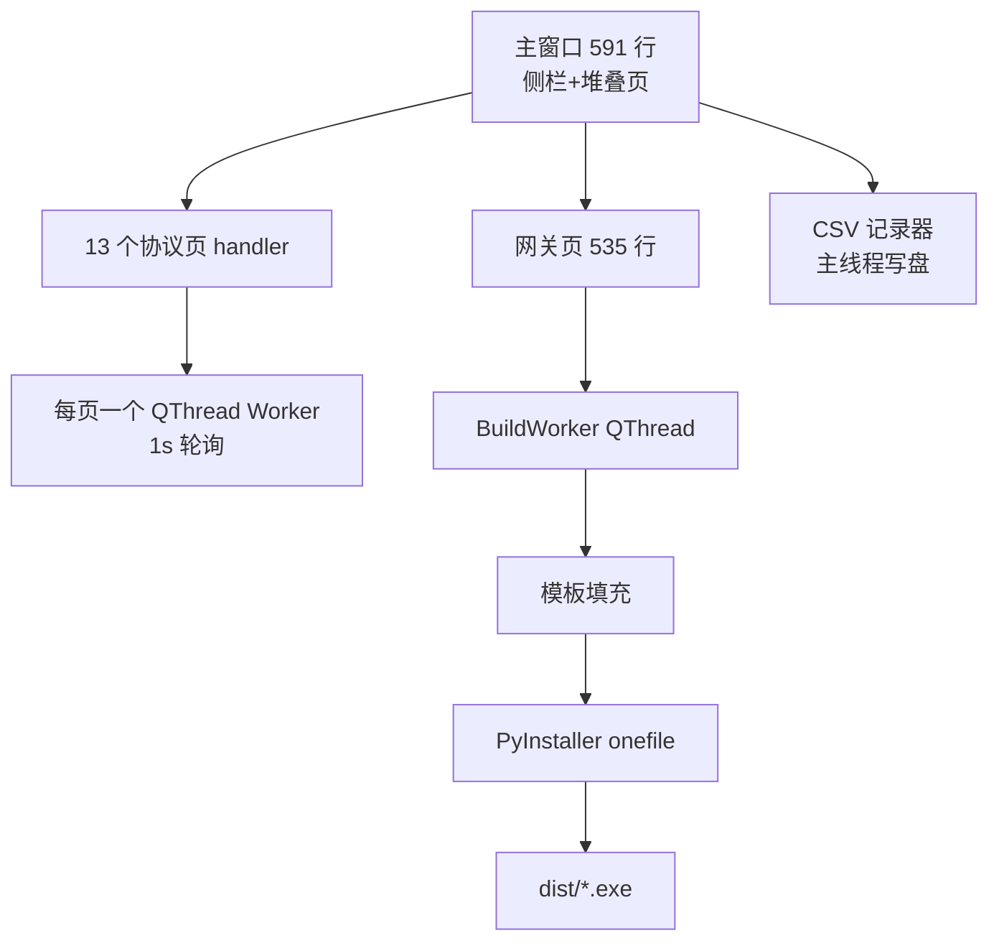

# PA-19｜Python 桌面多协议工具与网关生成器

> **分析对象**：桌面工具（PyQt6 单进程 GUI）+ 代码生成器（模板填充 + PyInstaller 打包）
> **编号**：PA-19（按脱敏约定，不披露来源标识）
> **技术栈**：Python 3 / PyQt6（`uic` 运行时加载 `.ui`）；协议侧 pymodbus、python-snap7、pycomm3、pymcprotocol、FINS 协议库、pyLSV2、asyncua、paho-mqtt、requests、pyserial；打包侧 PyInstaller `--onefile`
> **规模画像**：32 个 `.py`、4,712 行；17 个协议/功能 handler 占 3,802 行（81%）；界面为单个 2,235 行 `.ui`（288 个控件类声明）；14 项第三方依赖
> **成熟度画像**：内部可用原型——能连真机、能产出 exe，但生成物 13 种源协议中仅 3 种真实取值，无断言测试，无重连与超时策略

---

## 1. 定位与问题域

### 1.1 它是什么

一个把「工业协议调试台」与「网关代码生成器」拼在同一窗口里的桌面工具。左栏是协议页，每页一个 handler 自建标签页、表格与轮询线程；末页是网关页，把「源地址 → 目标地址」的映射表编译成独立可执行文件。真正与众不同的不是协议数量，而是**交付物形态**：配好映射、点一次按钮，工具把一份 Python 模板填上配置，交给 PyInstaller 打成 `--onefile` 单文件程序，目标机器不需要 Python。

代码里有三个信号：约 235 行的模板源码字符串常量（说明生成物是"模板文本 + `str.format()` 注入"，而非"导出配置 + 解释执行"）；打包封装在 `BuildWorker(QThread)` 里（长任务不占 UI 线程）；生成器页签独立于运行时规则页签——规则表与可交付产物是两套东西，只有后者被当作产品。

### 1.2 面向的用户与场景

- **设备集成商**：客户现场要把几台设备的数据送到 MES/云，诉求是交付一个双击即运行的 exe，不装环境、不留源码。
- **调试工程师 / 教学演示**：新设备到场核对地址与字序，诉求是连上就能看值、能看原始字节与位——这是方案最扎实的部分：S7 页同时给出字节偏移、十六进制、十进制三列，并按 Bool/Byte/Int/Word/DInt/DWord/Real 逐点解释；讲协议时也靠协议多、界面直观。

### 1.3 边界（不做什么）

- **不做历史存储**：只有 CSV 记录器，写盘即结束，无库、无保留策略、无查询。
- **不做多用户与远程管理**：单机单用户、无登录；无配置服务、升级通道、遥测回传；生成物只面向 Windows；**工具本身也无 OPC UA 服务端**（服务端只出现在生成物模板里，README 称"客户端与服务端"，代码可核实的只有客户端）。

---

## 2. 功能分析

### 2.1 功能域总览

| 功能域 | 功能点 | 实现方式 | 完成度 |
|---|---|---|---|
| 协议接入 | 13 个协议族的连接、轮询、点位表 | 每协议一个 Handler（页面控制器）+ 一个 `*Worker(QThread)`，轮询固定 1s | 可用；单点读普遍未批量化 |
| 展示与记录 | 表格、单点曲线、原始字节、CSV | `QTableWidget` 逐格写入；pyqtgraph 保留最近 100 点；`DataLogger` 每条 `flush()` | 完整，不适合长期运行 |
| 网络扫描 | 网段存活 + 端口探测 | `ping` 子进程判活，再对 7 个端口 `connect_ex` | 可用（串行，大网段极慢） |
| 映射与网关生成 | 源协议+点位 → 目标协议+点位；映射表 → Python 脚本 → exe | 7 列表格，运行时按行匹配；`TEMPLATE_CODE.format(...)` + PyInstaller | 半成品：只有 S7 点位会喂进规则引擎，生成物协议多为占位 |
| 配置存取 | 全量 JSON 保存/加载 | 每 handler 一对 `serialize()/deserialize()` 汇总 | 可用；手动文件对话框 |

### 2.2 协议与接口覆盖

| 协议/接口 | 角色 | 传输 | 代码位置（角色名） | 备注 |
|---|---|---|---|---|
| S7（S7comm） | 主站 | TCP 102 | S7 页 handler（516 行，2 个类） | 按 DB 连续字节读；按点逐条 `db_read`，N 点 = N 次请求 |
| Modbus TCP / RTU | 主站 | TCP / 串口 | Modbus 页 handler | 功能码 1/2/3/4，读连续区间；串口只暴露端口与波特率，无数据位/校验位/停止位 |
| EtherNet/IP（CIP） | 主站 | TCP | EtherNet/IP 页 handler | `LogixDriver`，`read(*tags)` 一次多标签，少数做了批读 |
| MC 协议 | 主站 | TCP | MC 页 handler | Type3E；逐点 `batchread_wordunits(dev,1)`，失败再试位设备 |
| FINS | 主站 | TCP | FINS 页 handler | 逐点 `memory_area_read`，DM/CIO/WR 三区 |
| 机器人 RWS / CNC LSV2 | 客户端 | HTTP+Digest / TCP | 机器人页、LSV2 页 handler | RWS 逐信号 GET 取 `_lvalue`；LSV2 按 M/B/W/D 四类逐地址 `read_plc_memory` |
| MTConnect / Euromap 63 | 客户端 | HTTP / 文件与 FTP | MTConnect 页、Euromap 63 页 handler | MTConnect 轮询 `/current` 递归解析 XML；Euromap 63 每 5s 扫目录取最新 `.req/.res` |
| MQTT | 双角色 | TCP | MQTT 页 handler（另有一份重复实现） | paho 回调式；订阅默认 `#` |
| OPC UA | 客户端 | TCP | OPC UA 页 handler | asyncua + 独立事件循环线程；浏览树 + 单点订阅绘图 |
| 通用裸流 / 网络扫描 | 双角色 | TCP / 串口 / ICMP | 通用页、扫描页 handler | 裸流三模式 + 正则取值；扫描探测 502/1883/8883/4840/5000/443/80 |

### 2.3 典型使用流程

```
调试：选协议页 → 填连接参数或地址 → 连接 → 勾选轮询 → 表格出值
生成并部署：Gateway 页加映射（源协议+地址+类型 → 目标 Modbus/MQTT/OPC UA）→ GENERATE EXE → PyInstaller 后台打包
          → dist/*.exe 拷到目标机双击 → 无限循环读源、写目标
```

生成物内部只有两个执行体：`source_manager` 顺序遍历映射（每条一次读，一轮 `sleep(1)`），目标侧的工作线程/事件循环。这是"轮询"，不是"采集调度"——没有时间片、没有批合并、没有失败退避。13 种可选源中只有 3 种真实取值（S7、机器人、仿真），4 种返回随机数、2 种空实现、4 种无效，而界面无法区分这些状态：

| 能力 | 工具侧 | 生成物侧 | 依据 |
|---|---|---|---|
| S7 取值 | 可用 | 可用 | 模板唯一完整读路径：`connect → db_read(4 字节) → unpack('>f') → disconnect`，每条规则每轮重建连接 |
| Modbus / EtherNet/IP / MC / FINS | 可用 | **伪实现** | 模板分支返回 `random.uniform(10,20)` / `random` 50–60 / 100–200 |
| MQTT 订阅、OPC UA 客户端、MTConnect、Euromap 63、LSV2、通用 | 可用 | **空/无效实现** | 前两者为 `pass`；MTConnect 解析未实现返回 0.0；后三者落到初值 0，不报错 |
| 目标侧写 Modbus / MQTT | — | 可用但粗糙 | Modbus 建 1000 寄存器块、值 ×10 取整、0.5s 回写；MQTT 每秒把全部键值以 `%.2f` 重发，无变化检测 |

---

## 3. 架构分析

### 3.1 分层与模块



没有服务层、没有领域模型、没有驱动注册表。所谓"协议层"就是一组页面控制器，每个都用 `ui` 句柄直接操作主窗口控件，并在构造时 `ui.tabWidget.addTab(...)` 给自己挂页签。**协议层与 UI 是同一个对象**。

### 3.2 关键抽象与接口

| 抽象 | 职责 | 边界 | 位置 |
|---|---|---|---|
| `ProtocolHandlerBase` | 声明 connect/disconnect/get_status/serialize/deserialize 与两个信号 | 抽象方法全部无参数，连接参数从 `self.ui` 现取——契约无法脱离 UI 使用 | 协议基类 |
| `data_received(str, str, object)` | 统一数据出口（协议、点位、值） | 只有 S7 点位表真正 emit，其余 handler 各自更新表格；轮询线程无共同基类 | 协议基类 |
| `serialize()/deserialize(dict)` | 配置快照 | 各 handler 自定键名，无 schema、无版本号 | 各 handler |
| `GatewayBuilder` | 生成脚本、调用打包 | 只做字符串替换与 `subprocess.run`，不校验映射合法性 | 生成器工具 |

`ProtocolHandlerBase` 是全案唯一的形式化抽象，但它继承 `QObject`、构造签名是 `__init__(self, ui)`，五个抽象方法没有一个接受参数。这决定了它只能做"页面控制器"，不能做"驱动"——生成物、CLI、批处理都无法复用它。

### 3.3 数据流与时序

Worker 轮询 → emit(data_ready) → Qt 队列投递到 GUI 线程 → 逐格 setItem →（仅 S7 点位表）emit data_received → DataLogger / 规则引擎 → CSV flush / MQTT publish。

生成物侧简单到近乎粗暴：`for 每条映射: 建连接 → 读 → 断连接 → data_store[target] = val`（每轮 sleep 1s），目标线程再把 `data_store` 全量刷给下游。两侧之间没有点位模型，只有 `dict`。映射表里采集、序列化、展示的**数据类型字段，模板从未读取**——S7 分支恒按 4 字节大端浮点解释。

### 3.4 并发与连接管理

| 主题 | 做法 | 评价 |
|---|---|---|
| 线程模型与停止 | 每页一个常驻 `QThread`，内部 `while running: ... sleep(n)`；`stop()` 置标志位后立即 `wait()` | 线程数与页面绑定，无回收；从 GUI 线程等待，最长阻塞一个轮询周期 |
| GUI 线程 I/O 与背压 | S7 两个页面用 `QTimer` 在 GUI 线程调 `db_read`/`db_write`；表格逐格写、CSV 逐条 flush | 网络卡顿即界面冻结；高频轮询下 UI 与磁盘双双成瓶颈 |
| 连接复用 | 工具侧每页一条长连接；生成物每条规则每轮新建 S7 连接 | 生成物把"连接"降级成"请求"，PLC 侧连接数周期抖动 |
| 超时与重连 | 仅 MTConnect/RWS 显式给 1–5s；仅通用页 TCP 客户端有 `sleep(5)` 重试 | 无退避、无状态机；其余异常后线程退出或空转 |

`BuildWorker` 是全案唯一"把长任务移出 GUI 线程"的正确用法，其余轮询路径反而普遍把 I/O 留在主线程或裸线程里。

### 3.5 配置、持久化与部署

- **配置格式与加载**：单 JSON，顶层键对应各 handler（`modbus/mqtt/opcua/s7/s7_tag/lsv2/mtc/eip/melsec/omron/em63/univ/abb/gateway`），段内结构由该 handler 自定；自动加载是死分支（`if os.path.exists("config.json"): ... pass`，注释称"需要静默加载但未实现"），工具启动后永远空白。
- **生成物无配置文件**：映射与参数以 Python 字面量写死、编译进 exe，**改一条映射 = 重新打包 + 重新部署**；冻结环境还需把 `PATH` 指向 `sys._MEIPASS` 才能找到原生 DLL，这条补丁本身即 onefile 的运维成本证据。

### 3.6 扩展机制

新增协议四步，其中三步在 GUI 代码里：写 `xxx_handler.py`（Worker + Handler，构造时挂页签）→ 在 `.ui` 加控件组（2,235 行单文件 XML）→ 在 `MainWindow.__init__` 实例化并在 `save_config/load_config` 各加一行 → 若要进生成物，还得在模板里加 `elif "xxx" in proto:` 分支。没有注册表或发现机制，四处硬编码必须同步改。

### 3.7 工程质量观察

- **测试**：`tests/` 下 6 个脚本全是手工联调夹具（四类假服务器 + 连通性检查），无断言、无 runner。
- **死代码、重复与静默异常**：仪表板 handler 三处引用同时注释但文件仍在；MQTT 有两份 handler（QThread 轮询式 / paho 回调式），只有一份在用；`pandas` 在 `src/` 零引用，`cpppo` 仅出现在模板注释与 try-import；模板中 `except Exception: pass` 且错误日志被注释，示例 IP、机器人默认账号、示例命名空间 URI 均为字面量。

---

## 4. 需求分析

### 4.1 显性需求

1. 一套工具接多品牌设备；连接参数可视化填写，不写代码。
2. 能看原始字节与按类型解释后的值，便于核对地址与字序；能落 CSV、能扫网段找设备，减少"这个 IP 是谁"的沟通成本。
3. **交付物必须是可执行文件**，客户机器不装 Python，且能长期后台运行。
4. 一份配置描述多条源到目标映射；目标侧对接 Modbus 主站、MQTT broker、OPC UA 客户端三种上游。

第 3 条是本方案全部差异化的来源，也是最强的现实约束：很多工厂的 IT 策略禁止在产线机安装运行时，一个 exe 是唯一能过审的形态。

### 4.2 隐性需求

| 隐性需求 | 方案中的对应处理 | 若缺失的后果 |
|---|---|---|
| 断网续传与连接存活 | 无缓存，读失败直接丢弃；无心跳、无重连状态机（S7 每轮重连算副作用） | 网络抖动即数据缺口，长时间运行后静默停更 |
| 时钟与时间戳 | 生成物不发时间戳，只发值 | 上游无法判断数据新鲜度 |
| 字节序/字序 | 工具侧可手选类型；生成物恒为大端浮点 | 温度、压力等模拟量全部错值 |
| 点位级诊断与越界保护 | 无，异常被吞；地址越界靠库抛异常 | 20 条映射里坏 1 条没人知道是哪条；一个坏地址中断整轮链路 |
| 变更不停机 / 进程守护 | 配置编译进 exe；无服务安装、无自启、无单实例锁 | 改点位要停机发版；崩溃即断数；双击两次抢同一连接 |

### 4.3 非功能需求

| 维度 | 现状 | 判断 |
|---|---|---|
| 启动、体积与内存 | onefile 需先解包到临时目录，内嵌解释器与依赖；工具侧 Python+Qt，生成物仅解释器与少量库 | 推断：冷启动数秒、工具侧数百 MB、生成物数十 MB |
| 可观测性与安全 | 工具侧有日志窗；生成物仅控制台 print（`--noconsole` 后无处可看），无版本号、示例明文凭据、暴露无鉴权的 Modbus/OPC UA 服务 | 弱 |

### 4.4 需求缺口与误判

| 缺口 | 证据 | 影响 |
|---|---|---|
| 生成器与运行时不共享协议实现 | 工具侧用 pycomm3/pymcprotocol/FINS 协议库，模板侧对四类协议写 `random` | "所见即所得"不成立，演示能过、上线不能用 |
| 数据类型与量纲是装饰 | 映射对话框收集 `type` 但模板无分支读取；Modbus 目标 `int(float(val)*10)`、MQTT `%.2f` | 用户以为选了 Int 就按 Int 发；压力/温度共用一个系数 |
| 无失败可见性 | 模板 `except: pass`，日志调用被注释 | 现场"没数据"时无法定位 |

---

## 5. 可借鉴与应规避

### 5.1 可直接吸收的机制

1. **「配置即产物」**：把一份工程配置编译成可独立运行的边缘节点，是本方案最值得保留的产品思路。目标产品应支持"导出为单二进制 + 配置文件"，而不是只导出 JSON 让用户自己找运行时。
2. **映射表是唯一用户界面**：源（协议+地址+类型）→ 目标（协议+地址/Topic）的二元组足以表达 80% 的取数上报需求，比"建设备→建点位→建推送"三段式更快。
3. **每模块一对 `serialize/deserialize`**：复合配置由各模块自描述，主容器只做键路由；加协议不必改配置中心。
4. **一份内存快照、多种北向出口**：同一份 `data_store` 同时供 Modbus 服务端、MQTT 发布、OPC UA 服务端消费，可直接复用；调试视图"字节偏移/十六进制/按类型解释"三列并置也值得作为诊断面板默认布局。

### 5.2 明确应规避的做法

| 做法 | 问题 | 目标产品应如何做 |
|---|---|---|
| 用模板字符串生成程序 | 生成物与工具是两份代码，必然漂移；本案已漂到"随机数"级别 | 生成物 = 同一运行时 + 不同配置，编译期只链接不生成 |
| 把配置编译进二进制 | 改一个点位要重新打包发版 | 配置外置（同目录 `config.yaml`），二进制只做加载与校验 |
| 协议层继承 UI 基类 / 主线程 I/O | 无法在无 GUI 环境复用、无法单测；界面冻结 | 驱动层零 UI 依赖，所有 I/O 走工作线程，UI 只消费快照 |
| 静默失败与随机数占位 | `except: pass` 让故障不可见；占位实现让"能用"与"演示"无法区分 | 未实现能力在 UI 禁用并标注；每次失败产出结构化事件（设备、点位、错误码、连续失败次数） |
| onefile 打包 + 无版本元数据 | 冷启动慢、杀软误报；现场无法对账 | 单目录包 + 内嵌版本/构建时间/配置摘要，提供 `--version` |

### 5.3 迁移到目标产品的成本

**低**：映射表模型（即"点位路由"配置）、调试三列视图、配置导出命令（若运行时已是单二进制）。**中**：异步构建进度输出（无 GUI 时可退化为 CLI）、协议元数据整理。**高**：13 个协议的实现——各自依赖不同 Python 库，Go 侧需重新实现或换库。

---

## 6. 结论

### 6.1 六维评分

| 维度 | 分数(1-5) | 理由 |
|---|---|---|
| 协议广度 | 3.5 | 13 个协议族覆盖 PLC/机器人/CNC/注塑/楼宇接口，但每个只做到"单点能读"，缺批读与写回闭环 |
| 架构可演进性 | 2 | 协议层与 UI 同一对象，无注册表，新增协议改四处；生成物与工具是两套代码 |
| 跨平台能力 | 1.5 | 工具侧理论跨平台，但生成物、`_MEIPASS` 补丁、`--noconsole` 都锁定 Windows |
| 可运维性 | 1 | 生成物无配置、无日志、无重连、无守护、无版本，现场故障基本不可诊断 |
| 工程质量 | 1.5 | 无断言测试、死代码、重复实现、静默异常、依赖冗余并存 |
| 许可与合规风险 | 3.5 | 主体为宽松许可，但打包链与各协议库需逐项复核，且未提供依赖清单 |

### 6.2 三条关键结论

1. **它验证了一个真需求，但用错了实现路径。**「交付一个 exe 给客户」是集成商的硬需求，本方案抓住了它；但"模板字符串 + 打包"等于维护两份会漂移的协议实现，最终漂到生成物里塞随机数。正确路径是"同一运行时 + 外置配置"。
2. **它暴露了这类形态的系统性运维困境：无远程管理、无升级通道、无遥测、无版本标识。** 一旦交付几十个 exe，现场版本、故障、点位变更全部失控。目标产品若要把"配置导出为边缘节点"做成卖点，必须同时给出节点身份、版本回执、远程配置下发。
3. **可保留的内核很小但关键：映射表 + 配置序列化 + 内存快照 + 多北向出口。** 这四件事与语言无关，可直接成为"边缘节点导出"功能的最小规格；其余部分（UI 耦合、模板生成、onefile 打包）应作为反面教材。

---

**附：数量核实方式**：`.py` 与行数由 `find`/`wc` 统计（含空行）；控件类声明由 `.ui` 中 `class="Q...` 计数；协议完成度按模板字符串内的分支逐一核对（`snap7`、`requests` 为真实调用，`random.*` 为占位，`pass` 为空实现，无对应分支者落到初值 0）。
