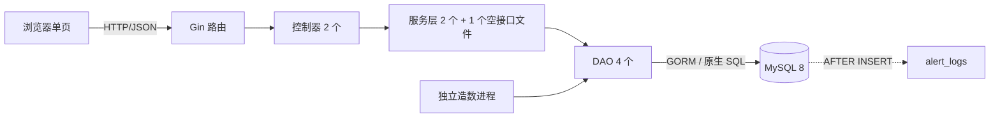

# PA-20｜Go 教学型设备监控站点

> **分析对象**：Web 监控应用（Gin 单体 + MySQL + 单页前端，另附独立造数进程）
> **编号**：PA-20（按脱敏约定，不披露来源标识）
> **技术栈**：Go 1.21 / Gin 1.9.1 / GORM 1.25.5 / Viper 1.18.2 / MySQL 8；前端为单文件 HTML + Bootstrap + ECharts（CDN，无构建步骤）
> **规模画像**：22 个 `.go`、1,768 行；5 个业务端点（另 `/health`、`/ping`、静态页）；13 张表 + 2 视图 + 1 触发器 + 1 存储过程；造数器 466 行
> **成熟度画像**：课程演示级——schema 与查询展示完整，**不含任何南向采集代码**；0 测试、无认证、无许可证文件

---

## 1. 定位与问题域

### 1.1 它是什么

一个用数据库能力讲述"设备监控"的单体 Web 应用：MySQL 里建 13 张表（车间、设备类型、设备、指标、时序、报警规则/日志、工单、仓储），Go 侧只给 5 个查询端点，前端一页三块图。技术含量集中在 SQL——多表联查、四字段模糊匹配、分组聚合、视图、触发器、存储过程各出现一次，像一份"数据库特性清单"的可运行注脚。代码里也没有一行采集逻辑：没有设备连接、没有轮询、没有协议库，`go.mod` 只有 Gin/GORM/Viper/MySQL 驱动；时序数据由独立进程用 `math/rand` 造出，"监控"在数据流上等于"读一张早已填好的表"；README 称"生产级别"，而认证、测试、许可证三项皆无。

### 1.2 面向的用户与场景

- **教学评审与前后端联调**：需要可运行、可看图、SQL 覆盖面广的样例，练习建模、聚合与图表。**不面向产线**——无采集、无实时推送、无权限。

### 1.3 边界（不做什么）

- **不做采集与协议**：没有 Modbus/OPC UA/MQTT/S7 实现，也没有"通道""点位""采集任务"这类对象；**不做实时性与权限**：前端手动点 `fetch`，无 WebSocket/SSE，`users`/`roles`/`user_roles` 三表齐全却无登录端点与中间件。

---

## 2. 功能分析

### 2.1 功能域总览

| 功能域 | 功能点 | 实现方式 | 完成度 |
|---|---|---|---|
| 关系建模 | 组织/设备/指标/时序/报警/工单/仓储 | 手写 DDL（490 行）+ GORM 结构体双份定义 | 完整；两处定义靠人工同步 |
| 查询 | 设备+类型+车间+最新温度/压力；名称/编码/车间/位置模糊匹配 | 一条原生 SQL（每设备 3 个相关子查询）、4 个 `LIKE '%?%'` | 可用；无分页、无全文索引 |
| 统计 | 类型分布（近 1h 均温）、某设备某日 min/max/avg | `GROUP BY` + 相关子查询；存储过程 | 可用；过程内 `DATE(列)=?` 使索引失效 |
| 报警与造数 | 阈值越限写日志；50 设备 / 10,000 条时序 | `AFTER INSERT` 触发器逐行判定；seeder 500 条/批 | 半成品：规则不绑定设备；数据是造的，不是采的 |

### 2.2 协议与接口覆盖

| 接口 | 角色 | 传输 | 代码位置（角色名） | 备注 |
|---|---|---|---|---|
| HTTP/JSON + 静态页 | 服务端 | TCP/HTTP | 路由装配 + 2 个控制器；`StaticFile`/`Static` 与 HTML 内 CDN | 5 个业务端点；前端同源无构建产物，内网离线不可用（推断） |
| MySQL | 客户端 | TCP 3306 | 4 个 DAO | GORM 与原生 SQL 混用；DSN 无超时参数 |

**南向协议为零**：全仓检索不到 Modbus、OPC UA、MQTT、S7 等字样，也没有常驻后台任务。

### 2.3 典型使用流程与完成度

```
建库+造数：mysql < init.sql（13 表 + 视图 + 触发器 + 存储过程 + 种子）→ go run cmd/seeder（清库、50 设备、1 万条时序）→ 运行 go run cmd/server → 打开 / → 看板/搜索/分布；POST daily-check 调存储过程
```

README 的"采集""2 视图""生产级别"都能被代码否证：数据来自随机数；两个视图在 Go 侧零引用，看板用原生 SQL 重写了同一 join；MIT 徽章指向不存在的 LICENSE。

---

## 3. 架构分析

### 3.1 分层与模块



目录是标准四层，依赖却没有倒置：无接口、无注入、无事务边界，控制器还能经 `GetDAO()` 直接取 DAO；服务层三个文件不足 100 行，其中一个是 8 行空接口加 TODO。分层在此只是"文件摆放"。

### 3.2 关键抽象与接口

| 抽象 | 职责 | 边界 | 位置 |
|---|---|---|---|
| 设备服务 / 统计服务 | 业务入口 | 无接口，构造即 new DAO；`GetDAO()` 把 DAO 泄漏给控制器 | 服务层 |
| 各 DAO | 数据访问 | 各持 `*gorm.DB`；无仓储接口、无事务封装 | 数据访问层 |
| 触发器 `trg_check_alert` | 报警判定 | 只按 `metric_id` 匹配、不区分设备；应用侧无法测试与观测 | 初始化脚本 |

### 3.3 数据流与时序

读路径只有一种：请求 → 控制器 → 服务（多为转调）→ DAO → 原生 SQL → `[]map[string]interface{}` → JSON 直出；返回类型无契约，字段名由 SQL 别名决定，统一响应仅有 `{code,message,data}` 三个字段。写路径只有两个入口：造数器批量 `Create` 与触发器写报警日志。**应用进程从不写时序表**——`RealtimeDataDAO` 的 `Create`/`BatchCreate`/`ListByDevice` 等大半方法无调用方。

### 3.4 并发与连接管理

| 主题 | 做法 | 评价 |
|---|---|---|
| HTTP 并发与连接池 | 每请求一 goroutine，`r.Run` 裸启动；空闲 10 / 最大 100（硬编码），DSN 无 `timeout` | 无读写超时与并发上限；慢查询可占满池 |
| 事务、缓存与限流 | 三者皆无 | 造数半途失败留残数据；看板每次全量重算；`LIKE '%q%'` 可刷 |

### 3.5 配置、部署、扩展与工程质量

- **配置与建库**：`config.yaml` 只有 database / server 两节；`server.mode` 读入却从未传给 Gin，`debug` 永远生效（推断：本意是切 release）。单个 `init.sql` 含 DDL、视图、触发器、存储过程与种子数据，无迁移工具与版本号，改表只能重跑脚本。
- **部署与扩展**：文档写的是本机 `go run`，无容器、无守护、无健康检查，命令还带开发机绝对路径；加一张表要同步 DDL、模型、DAO 三处，加一个端点要改四层，无注册表与接口，换存储等于重写 DAO。
- **工程质量**：0 个 `*_test.go`、无 CI；种子口令用 `MD5()`、5 个默认账号随库分发；服务层空接口文件、`/ping`、两个零引用视图、`RealtimeDataDAO` 大半方法均为死代码；可观测性只有 `log.Printf` 与常开的全量 SQL 日志，错误一律 `500 + err.Error()` 直出。

---

## 4. 需求分析

### 4.1 显性需求

1. 用一套 schema 表达"车间—设备—指标—时序—报警—工单"的关系（外键与索引合理），并用 SQL 证明四类能力：多表联查、模糊查询、分组聚合、存储过程调用。
2. 有可看的界面与万级数据，且能一键重建（清库 → 造数）。

### 4.2 隐性需求

| 隐性需求 | 方案中的对应处理 | 若缺失的后果 |
|---|---|---|
| 采集接入 | 无；数据由造数器直接入库 | "监控平台"接不进任何真实设备 |
| 时钟与时区 | DSN `loc=Local`，`TIMESTAMP` 按本地时区解释，无 UTC 约定 | 跨时区统计口径漂移 |
| 点位变更 | 指标表可增行，但 SQL 与前端硬编码 `TEMP`/`PRESS` | 加一个指标要改 SQL 和页面 |
| 数据保留与权限 | 无分区无归档，`DeleteBatch` 无调用方；权限三表齐全却无登录与中间件 | 时序表无限膨胀；角色表是装饰，接口裸奔 |
| 可观测性 | 无指标、无 trace、错误仅文本 | 变慢时无法判断是 SQL 还是连接池 |

### 4.3 非功能需求

| 维度 | 现状 | 判断 |
|---|---|---|
| 性能与伸缩 | 看板每设备 3 个子查询；`LIKE '%q%'` 无索引；单体单库无缓存 | 万级可用，十万级劣化；只能垂直扩展 |
| 安全与合规 | 无认证、MD5 口令、错误直出；无 LICENSE、无依赖清单 | 不可出内网，不可直接分发 |

### 4.4 需求缺口与误判

| 缺口 | 证据 | 影响 |
|---|---|---|
| 名实不符 | 名称与文档强调"采集/监控"，代码无采集 | 评审者会高估能力边界 |
| 数据库侧逻辑未吸收 | 报警判定在触发器、视图零引用、SQL 重写 join | 无法单测，两套口径可能漂移 |

---

## 5. 可借鉴与应规避

### 5.1 可直接吸收的机制

1. **schema 即规格**：13 张表把"组织—设备类型—设备—指标—时序—报警—工单—仓储"讲清楚了，可作最小资产模型的起点；用 `metric_code`（`TEMP`/`PRESS`）而非显示名做查询键，比按名称匹配稳。
2. **建库脚本 + 独立造数器**：让"空机 → 有图可看"只需两步，是演示环境最省事的分发形态；500 条/批插入也给了直观的吞吐参照。
3. **复合索引组合**：`(device_id, metric_id, collected_at)` 与单列 `collected_at` 并存，同时覆盖"某设备某指标最近值"与"全局时间范围"两类查询。

### 5.2 明确应规避的做法

| 做法 | 问题 | 目标产品应如何做 |
|---|---|---|
| 业务规则与过滤逻辑下沉到数据库 | 触发器做报警判定（不可测、不按设备区分）；`DATE(collected_at)=?` 使索引失效 | 判定进应用层，DB 只做约束；时间过滤用半开区间 `>= ? AND < ?` |
| 用 map 当返回类型 + 暴露 `GetDAO()` | 无契约、控制器绕过业务层，事务与校验无处安放 | 定义 DTO；服务返回领域对象，DAO 不外泄 |
| MD5 存口令 + 无登录端点 | 彩虹表可逆，权限表形同虚设 | Argon2/bcrypt + 会话中间件 |

### 5.3 迁移到目标产品的成本

**低**：数据模型与索引设计、造数器思路、单页调试界面。**中**：原生 SQL 收敛为带参数与超时的查询层、补 DTO 与错误码。**高**：无——本方案没有可迁移的协议或采集能力，这部分等于从零做。

---

## 6. 结论

### 6.1 六维评分

| 维度 | 分数(1-5) | 理由 |
|---|---|---|
| 协议广度 | 1 | 无任何南向协议；对外只有 HTTP/JSON，对内只有 MySQL |
| 架构可演进性 | 2 | 四层目录齐全，但无接口、DAO 泄漏、SQL 与模型双份维护 |
| 跨平台能力 | 4 | Go 单二进制 + 浏览器前端，跨平台成本极低；代价是强依赖 MySQL 与 CDN |
| 可运维性 | 1.5 | 无认证、无指标、无迁移、无守护，配置里还有死字段 |
| 工程质量 | 1.5 | 0 测试、死代码、MD5、无 LICENSE；但命名与目录整洁，无明显逻辑错误 |
| 许可与合规风险 | 2 | 声明 MIT 却无许可证文件，默认口令与个人路径随仓库分发 |

### 6.2 三条关键结论

1. **它是合格的数据库能力展示，不是物联网平台。** 判断标准是"数据从哪来"：这里来自 `math/rand`，所以"监控"只是查询界面；放进协议/Gateway 横向对比时，协议维度必须给 1 分而不是"未评估"。
2. **目录分层不等于架构分层。** 统一响应、四层目录、GORM 模型都到位，但服务层是转发壳、DAO 可被控制器直接取用、返回类型是 map——要加事务、权限或换存储时，这层壳挡不住任何变化。
3. **可迁移的只有数据模型与索引设计。** 复合索引、指标 code 化、单脚本建库 + 造数器可直接复用为"演示数据集"；采集、调度、可靠性这些真正难的部分，本方案没有提供参考。
