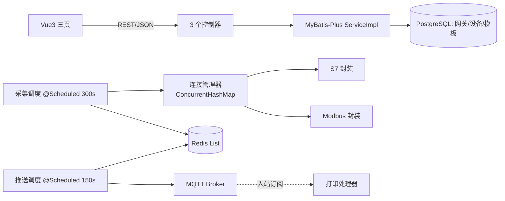

# PA-21｜Java 轻量 PLC 采集网关

> **分析对象**：Java 单体采集服务（REST 配置面 + 定时采集 + Redis 队列 + MQTT 上报）+ 独立 Vue 前端
> **编号**：PA-21（按脱敏约定，不披露来源标识）
> **技术栈**：Java 8 / Spring Boot 2.6.13 / MyBatis-Plus 3.5.6 / Druid 1.2.20 / PostgreSQL / Redis / spring-integration-mqtt（Paho）/ modbus4j 3.0.3 / s7connector 2.1 / fastjson 1.2.83；前端 Vue 3 + Element Plus + Vite
> **规模画像**：37 个 `.java`、1,846 行；17 个 REST 端点；3 张业务表；7 个 `.vue`（3 个页面各约 200 行）；0 测试
> **成熟度画像**：内部试运行级——两个协议能读真机、队列与上报链路完整；配置改动须重启、模板语义与协议耦合、无鉴权、无观测

---

## 1. 定位与问题域

### 1.1 它是什么

一台"把 PLC 寄存器搬进 MQTT"的窄用途网关，代码量小到可以一下午读完：三张表（网关、设备、模板）由前端 CRUD 维护；应用启动时按网关表建立 S7/Modbus 连接；一个定时任务遍历网关下的设备，按模板读一段连续寄存器、解析成字段、塞进 Redis List；另一个定时任务从 List 取数，发布到 MQTT。

真正值得记录的设计只有一个：**模板 = 一段连续寄存器 + 若干字段偏移**。每台设备绑定一个模板，一个采集周期只发一次读请求，字段在本地按 offset/length/type/scale/swap 切分。这是"批读计划"的手工预计算版本——把合并读请求的工作从运行时前移到了配置期。

### 1.2 面向的用户与场景

- **现场集成商/工厂自有 IT**：机房里有几台到几十台 S7 或 Modbus TCP 设备，需要一个能改配置、能看列表、能往 MQTT 推数的小服务；README 自述为实际工作中的项目，交付周期紧。
- **不适用于**：多协议混合的大规模现场、需要写回/报警/历史存储的场景。

### 1.3 边界（不做什么）

- **只读不写**：没有任何写寄存器/写 DB 块的代码路径，也没有报警、联锁、历史库。
- **只支持 S7 与 Modbus TCP**：OPC DA 仅在 README 中出现，注明"经外部工具转为 Modbus TCP"，仓库内无实现；OPC UA 标为"计划支持"。
- **无鉴权、无多租户**：所有 REST 接口裸奔，前端也不带任何凭据。

---

## 2. 功能分析

### 2.1 功能域总览

| 功能域 | 功能点 | 实现方式 | 完成度 |
|---|---|---|---|
| 网关管理 | 增删改查、分页、按名模糊查 | MyBatis-Plus `IService` + `Page`；删除走 `GET /delete/{id}` | 可用；删除用 GET，违反幂等语义 |
| 设备管理 | 设备绑定网关、模板、DB 号、起始偏移与长度 | 同上；`iot_device.id` 非自增，需外部给号 | 可用；无唯一约束防重复 |
| 模板管理 | 字段名/类型/长度/缩放/字序/字节序/偏移 | 同上，模板名做关联键 | 可用；无版本、无校验 |
| 采集调度 | 每 300s 遍历网关与设备，读块、解析、入队 | `@Scheduled(fixedDelayString)` + 线程池 | 可用；单线程提交、周期不可按设备区分 |
| 上报 | Redis List → MQTT 发布 | 另一 `@Scheduled`（150s）循环 `leftPop` | 可用；无确认、失败回队尾 |
| 前端 | 网关/设备/模板三页 CRUD | Vue3 + Element Plus + axios（baseURL 硬编码） | 可用；无构建部署说明 |

### 2.2 协议与接口覆盖

| 协议/接口 | 角色 | 传输 | 代码位置（角色名） | 备注 |
|---|---|---|---|---|
| Modbus TCP | 主站 | TCP 502 | Modbus 封装类（modbus4j） | 仅功能码 3（保持寄存器）；offset 按**字**计；无 RTU/串口 |
| S7（S7comm） | 主站 | TCP 102 | S7 封装类（s7connector） | 按 DB 块连续字节读；offset 按**字节**计；rack/slot 可配 |
| MQTT | 发布 + 订阅 | TCP 1883 | Spring Integration 入/出站适配器 | 出站 `setAsync(true)`；入站处理器只 `println` |
| Redis List | 客户端 | TCP 6379 | 缓存工具类 | `rightPush` 入、`leftPop` 出；无确认与死信 |
| OPC DA | 声称支持 | — | 无代码 | README 称由外部工具转换为 Modbus TCP |

### 2.3 典型使用流程

```
配置：前端三页 → POST /gateway/add、/devices/add、/template/add（写入 3 张表）
启动：ConnectionManager @PostConstruct 读网关表 → 按 type 建 S7 / Modbus 连接
采集：每 300s → 逐网关逐设备 submit 线程池 → 读模板 → 读块 → 解析 → rightPush 队列
上报：每 150s → while(leftPop) → MQTT publish → 队列空则退出
```

默认周期是本方案最容易被忽略的参数：采集 5 分钟一次、推送 2.5 分钟一次——"实时监控"实际是 5 分钟粒度的快照。

### 2.4 关键能力与实现证据

| 能力 | 现状 | 证据 |
|---|---|---|
| 采集调度 | 单线程遍历 + 线程池执行，设备间 `sleep(50–149ms)` 错峰 | 调度类 `doCollect()` 两个几乎相同的 `forEach` |
| 断线重连 | S7 在异常分支重连；Modbus 每次读前检查 `isInitialized` | 两个封装类各一套 `reconnectIfNeeded()` |
| 配置热加载 | **无**：`reloadConnections()` 无任何调用方 | 全仓仅定义处一处引用 |
| 协议扩展 | 写死两个 `if/else` 分支 | 连接管理器按 `type` 字符串分派 |
| 数据补发 | Redis List + 发送失败回队尾 | 推送类 `catch` 后 `rightPush` 并 `break` |

---

## 3. 架构分析

### 3.1 分层与模块



分层比同类方案规整（controller/service/mapper/entry 齐全，统一返回体与分页封装都在），但**没有驱动层**：协议实现是两个 wrapper 类，方法签名不同（S7 的 `templateRead` 多一个 DB 号参数），调度器为此把同一个循环写了两遍。加第三种协议要同时改连接管理器、调度器与配置表语义。

### 3.2 关键抽象与接口

| 抽象 | 职责 | 边界 | 位置 |
|---|---|---|---|
| 连接管理器 | 启动时按网关表建连，持有 `gwName → wrapper` 的 `ConcurrentHashMap`，关闭时销毁 | 无健康检查、无重载入口；键是网关名而非配置版本，改名即失联 | 设备包 |
| S7 封装 | 建连/重连/按 DB 块读/解析 | 内部 `@Resource` 字段由 `new` 创建，注入不生效（死字段）；读无超时参数 | 封装包 |
| Modbus 封装 | 建连/读保持寄存器/解析 | 只支持 FC3；无连接池，所有读共享一把 `synchronized` | 封装包 |
| 模板读取器 | 字节切片 → 按类型/字序/字节序 → ×scale | 两套类型词表：Modbus 用 `int16/uint16/int32/float`，S7 用 `int/Dint/Real`；同一张模板表无法跨协议复用 | 工具包 |
| 采集调度 | 遍历网关与设备，提交任务、组 JSON、入队 | 模板每轮每设备查一次库，无缓存 | 设备包 |

### 3.3 数据流与时序

每个采集周期、每台设备：`getTemplate`（一次 SQL）→ `templateRead`（一次网络读）→ `LinkedHashMap<字段, 值>` → 追加 `deviceName`/`sn` → `rightPush`。上报端 `leftPop` → JSON 原样 publish 到默认 Topic。

链路上缺三样东西：**时间戳**（值是几点采的只能靠收到的时间猜）、**质量码**（读失败与读到 0 不可区分）、**单位/类型元数据**（全部被 `scale` 乘成 float）。模板解析里还留着逐字段的 `System.out.println`（十六进制与位模式），在 5 分钟周期 ×N 设备 ×M 字段下会把控制台写满。

### 3.4 并发与连接管理

| 主题 | 做法 | 评价 |
|---|---|---|
| 调度线程 | 单个 `@Scheduled` 方法串行遍历；设备间 `sleep` 50–149ms | 提交本身占用调度线程，50 台设备即数秒启动开销 |
| 采集线程池 | core 10 / max 20 / queue 100，未设拒绝策略 | 队列满时默认中止策略，任务被丢弃且无日志（推断） |
| 连接共享 | 每网关一个 wrapper，方法级 `synchronized` | 同一网关下所有设备被串行化，连接复用与吞吐互斥 |
| 背压 | 无；生产快于消费时 Redis List 无上限 | 断网时长与积压成正比；无持久化配置，重启即失（推断） |
| 故障恢复 | S7 异常重连、Modbus 读前检查；无退避、无熔断 | 重连失败直接抛到线程池，本轮该设备静默丢失 |

### 3.5 配置、持久化与部署

- **配置**：`application-dev.yml` 明文保存数据库口令、Druid 控制台 `admin/password`、MQTT 用户名口令；`broker-url` 写作 `tcp://localhost` 而省略端口，只能靠默认值兜底（推断）。
- **持久化**：只有 3 张配置表，无外键、无采集历史表、无迁移版本；设备表的 `id` 不是自增列，新增设备必须由调用方给号。
- **部署**：后端 `mvn package` 打 jar，前端独立 `vite dev`，`baseURL` 硬编码 `localhost:8083`；无 Docker、无反向代理配置、无启动脚本。

### 3.6 扩展机制

新增协议的实际改动面：网关表的 `type` 取值 → 连接管理器加分支 → 新写一个 wrapper（并决定 `templateRead` 签名）→ 调度器再加一段几乎相同的 `forEach` → 前端类型下拉框。没有任何接口或 SPI，协议与"解析器 + 调度器"三者通过字符串和字段语义隐式耦合。

### 3.7 工程质量观察

- **测试**：0 个测试类、无 CI；验证方式是连真机手工看日志。
- **绑定风险**：mapper XML 的 `namespace` 仍是旧包前缀，与当前接口所在包不一致——按 MyBatis 的绑定规则，公共 mapper 的方法在运行期会找不到语句（事实为命名空间不一致；后果为推断）。
- **死代码与依赖**：`reloadConnections()` 无调用方；S7 封装里注入的 mapper 永不生效；`poi-ooxml` 依赖全仓未使用；Redis 工具类整段来自通用脚手架（注释风格与其余代码明显不同）。
- **日志**：热点路径 `System.out.println`、`e.printStackTrace()` 与 SLF4J 混用；`logging.level` 把业务包设为 debug。

---

## 4. 需求分析

### 4.1 显性需求

1. 不改代码就能接入新设备：网关、设备、模板三张表 + 前端三页。
2. 一块设备只发一次读请求：模板保证寄存器连续，字段在本地切分。
3. 网络抖动不丢数：采集与上报解耦，先进队列再发。
4. 至少覆盖 S7 与 Modbus TCP 两类主流设备。
5. 轻量：单体 jar + 一个小库 + 一个 Redis，现场一台工控机即可跑。

### 4.2 隐性需求

| 隐性需求 | 方案中的对应处理 | 若缺失的后果 |
|---|---|---|
| 时间戳与质量码 | 只发字段值 + `deviceName`/`sn` | 上游无法判断数据新鲜度，故障与真 0 混淆 |
| 点位变更不停机 | `reloadConnections()` 无调用方 | 改一台设备的模板就要重启，全厂采集中断 |
| 字序/字节序 | 模板有 `word_swap`/`byte_swap`，仅对 4 字节类型生效 | 2 字节类型无法换序；字序错则整块模拟量错值 |
| 模板的协议语义 | Modbus offset 按字、S7 按字节；类型词表不同 | 换协议必须重建模板，模板无法复用也无法校验 |
| 采集周期与规模 | 默认 300s 且周期全局统一 | 高频点位与慢速点位被迫同周期；50 台设备已需数秒提交 |
| 许可与合规 | README 称 MIT，仓库无 LICENSE；yml 明文口令 | 不可直接对外分发，口令随仓库扩散 |

### 4.3 非功能需求

| 维度 | 现状 | 判断 |
|---|---|---|
| 延迟与吞吐 | 采集 5 分钟、推送 2.5 分钟；单网关串行读 | 只适合慢变量（温度、压力），不适合状态与节拍 |
| 可靠性 | 队列无确认、无持久化；线程池满即丢 | 断网或重启后数据不可对账 |
| 安全 | 无鉴权；CORS `allowedOriginPatterns("*")` + `allowCredentials(true)`；Druid 控制台弱口令 | 不可出内网；浏览器侧配置本身非法组合 |
| 可维护性 | 无接口、无测试、无指标；重启才能改配置 | 现场排障只能看日志文件 |

### 4.4 需求缺口与误判

| 缺口 | 证据 | 影响 |
|---|---|---|
| 无驱动抽象 | 调度器为两种协议写了两份循环 | 第三种协议的成本是线性的，且容易漏改 |
| 模板跨协议失效 | 两套类型词表 + 两种 offset 语义共用一张表 | 配置期无法发现"模板与设备不匹配"，只在运行期得到空 map |
| 补发语义不成立 | 失败回队尾后 `break`，下一轮 150s 后才重试；出站异步化后异常极少抛到调用方 | "断线自动补发"在多数故障下不会触发（推断） |
| 无观测性 | 只有日志；无采集成功率、队列长度、连接状态指标 | 现场"没数"时无法区分是 PLC、队列还是 broker |

---

## 5. 可借鉴与应规避

### 5.1 可直接吸收的机制

1. **模板 = 连续块 + 字段偏移**：把批读计划前移到配置期，运行时一次请求读完整块、本地切字段，实现极简且对 PLC 友好（减少连接与请求数）。目标产品可把它作为"模板/点位组"的默认编辑方式，再由系统自动合并离散点位。
2. **采集与上报用队列解耦**：采集只负责"读 + 入队"，上报只负责"出队 + 发布"，两侧独立定时、独立故障域；这是边缘网关最省事的两段式结构。
3. **统一返回体 + 分页/逻辑删除约定**：`{code,msg,data}`、`TableDataInfo`、`del_flag` 逻辑删除三件套让 CRUD 面高度一致，前端三个页面可共用同一套请求封装。
4. **前端按资源拆 API 文件**：`gateway/device/template` 三个 api 模块与后端控制器一一对应，新增资源时改动面清晰。

### 5.2 明确应规避的做法

| 做法 | 问题 | 目标产品应如何做 |
|---|---|---|
| 用 `GET /delete/{id}` 删除 | 可被预取/爬虫触发；破坏幂等与审计 | 用 `DELETE` + 二次确认 + 软删除标记 |
| CORS 通配来源 + 携带凭证 | 规范禁止该组合，实际放行任意站点携带 Cookie | 白名单来源 + 显式凭证策略 |
| 明文口令进 yml | 口令随仓库与镜像扩散；Druid 控制台暴露 | 环境变量/密钥管理，控制台默认关闭 |
| 配置变更靠重启 | 采集中断，且无法按设备灰度 | 配置版本 + 热加载 + 连接按版本重建 |
| 在解析热点 `println` | 日志量随设备×字段×周期放大 | 结构化日志 + 采样 + 级别控制 |
| 协议分派写 `if/else` | 每加一种协议改三处，签名还会分叉 | 统一驱动接口（连接/读块/解析）+ 注册表 |

### 5.3 迁移到目标产品的成本

**低**：模板模型与字段元数据（offset/length/type/scale/swap）、队列解耦结构、前端 CRUD 交互。**中**：调度与线程池策略（按设备周期、拒绝策略、重连退避）、模板校验（协议无关的类型系统）。**高**：S7 与 Modbus 的实现——s7connector 与 modbus4j 都是窄库，换语言需重写，且模板语义要重新定义。

---

## 6. 结论

### 6.1 六维评分

| 维度 | 分数(1-5) | 理由 |
|---|---|---|
| 协议广度 | 2 | 真正可用的只有 S7 与 Modbus TCP 读；OPC DA 仅文档声明 |
| 架构可演进性 | 2 | 分层齐全但无驱动接口，协议与调度器通过 if/else 与字段语义耦合 |
| 跨平台能力 | 3.5 | JVM 一侧跨平台良好；但依赖 PostgreSQL/Redis/MQTT 三件套与硬编码前端地址 |
| 可运维性 | 1.5 | 配置改动须重启、无指标、无鉴权、默认 5 分钟周期且口令明文 |
| 工程质量 | 1.5 | 0 测试、命名空间不一致、死代码与未用依赖、热点 println 并存 |
| 许可与合规风险 | 2 | README 声明 MIT 却无许可证文件；示例口令与控制台弱口令随仓库分发 |

### 6.2 三条关键结论

1. **模板化整块读取是它最有价值的设计。** "一段连续寄存器 + 字段偏移"把批读计划前移，运行时一次请求拿到整块数据，既省 PLC 连接也省解析代码；这个模型与语言无关，可以直接进入目标产品的"点位组"设计，并补上自动合并与协议无关的类型校验。
2. **协议能力被写成了 if/else，而不是驱动。** 两个 wrapper 方法签名不同，调度器被迫复制循环，模板解析器维护两套类型词表——这不是"实现粗糙"，而是缺少驱动接口这一层后必然出现的形状；新增第三种协议的成本会线性叠加。
3. **可靠性叙事超过了实现。** README 讲"断线重连、数据补发"，代码里只有 S7 异常分支的重连、Redis List 的无确认队列与异步化后几乎不抛异常的 MQTT 出站；队列无持久化、无幂等、无死信，断网与重启后无法对账。目标产品若采用两段式队列，必须同时给出确认、上限与可观测指标。
