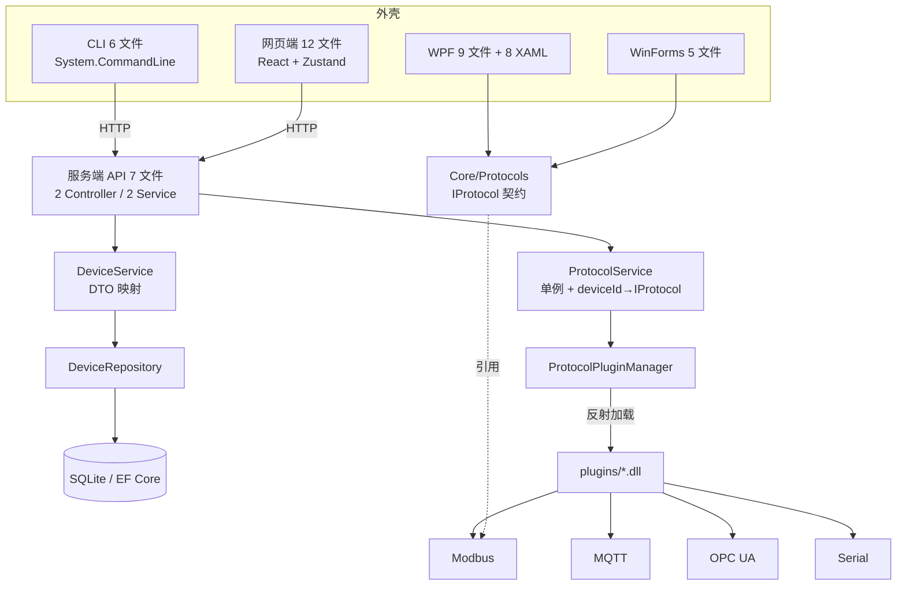

# PA-23｜.NET 8 多客户端协议调试工具集

> **分析对象**：工具集（1 个 ASP.NET Core 服务端 + 3 个桌面/终端客户端 + 1 个网页端 + 1 套旧版 WinForms 工具）
> **编号**：PA-23（按脱敏约定，不披露来源标识）
> **技术栈**：C# 12 / .NET 8（服务端与 CLI 为 `net8.0`，桌面客户端为 `net8.0-windows`）；ASP.NET Core 8 + Swagger、EF Core 8 + SQLite、MQTTnet 5.1、OPC Foundation .NET Standard 栈 1.4、System.CommandLine 2.0、xUnit；网页端 React 18 + Vite + antd
> **规模画像**：331 个 `.cs`——新工程 62 个 / 3,373 行，旧版 255 个 / 61,046 行，测试 8 个 / 1,230 行，示例 6 个 / 1,369 行；26 个 `.csproj`、1 个 `.sln`；4 个协议插件、8 个 XAML 视图、网页端 12 个 `.ts/.tsx`（477 行）
> **成熟度画像**：原型（分层与接口骨架完整；协议编码、界面交互、CI 三处仍是脚手架）

---

## 1. 定位与问题域

### 1.1 它是什么

一个把"PLC 调试能力"从**一组并列的小窗口**重做成**一套服务端能力 + 多套外壳**的尝试。判断依据来自仓库里同时存在的两代代码：

| 代际 | 形态 | 规模 | 特征 |
|---|---|---|---|
| 旧版 | WinForms 单体工具 | 255 个 `.cs` / 61,046 行 | 每个场景一个窗体：TCP 服务端、TCP 客户端、串口、串口服务端、WebSocket、LPT、MQTT、某品牌协议页；网络层自成一套（异步 TCP 服务端 + 代理 Socket + 消息管理） |
| 新版 | 分层解决方案 | 62 个 `.cs` / 3,373 行 | Core / Infrastructure / Server / Clients 四层，26 个工程中的 13 个属于新结构；同一份协议实现被 REST、CLI、WPF、WinForms、网页端五种外壳消费 |

这个演进方向本身是对的：旧版的问题是"26 个窗口 = 26 份重复的连接与解析代码"，新版的答案是"把协议收敛成 `IProtocol`，让外壳只负责交互"。但新版只走到骨架：62 个文件里有 4 个是空的 `Class1.cs`（Common / Configuration / Logging / Serial 各一个，其中 Serial 另有真实实现），核心协议类多为 40–130 行的最小可用版本。
一句话概括：**它是一个"工具集"的正确抽象，但不是"产品"的实现**。

### 1.2 面向的用户与场景

| 用户 | 场景 | 方案给出的答案 | 实际可用度 |
|---|---|---|---|
| 现场工程师 | 到了现场，不知道点位地址对不对，先连一下试试 | WinForms/WPF 的协议页：填 IP/端口/站号 → 读 → 看值 | 界面存在，但部分页面的"启动"按钮只改标签文案（见 3.7） |
| 二次开发者 | 把调试能力嵌进自己的 MES/测试台 | `IProtocol` + `IProtocolPlugin` + dll 插件目录 | 接口可用，元数据可用 |
| 自动化/CI 使用者 | 发版前跑一遍连通性回归 | CLI：`connect / read / write / monitor` | 有 4 条子命令，但硬编码 `http://localhost:5000` |
| 远程运维 | 不在现场，想让平台侧代看 | REST + Swagger | 10 个端点，无鉴权、无推送 |

### 1.3 边界（不做什么）

- **不做长期采集**：没有调度器、没有点位模型、没有质量码、没有历史库（`DataRecord` 实体存在但没有任何写入路径被调用）。
- **不做组态**：所有客户端都是"一个协议一页表单"，没有画面、没有趋势、没有报警。
- **不做从站模拟**：旧版有 TCP/串口服务端窗口，新版没有对应的服务端协议实现；真要做联调仍需外部模拟器（对照 PA-26）。
- **不做多用户**：无认证、无授权、无租户；`CORS` 策略为 `AllowAnyOrigin`。

---

## 2. 功能分析

### 2.1 功能域总览

| 功能域 | 功能点 | 实现方式 | 完成度 |
|---|---|---|---|
| 协议抽象 | 统一连接/断开/发送/事件 | `IProtocol`（6 成员 + 2 事件）+ `ProtocolBase` 模板方法 | 完整 |
| 插件发现 | 目录扫描 + 反射实例化 | `ProtocolPluginManager` 读 `plugins/*.dll`，`Assembly.LoadFrom` + `Activator.CreateInstance` | 可用（异常仅打印到控制台） |
| 协议元数据 | 名称/版本/描述/命令清单/默认配置 | `ProtocolMetadata`（6 字段，`SupportedCommands` 为字符串列表） | 完整，但无 schema |
| Modbus TCP | 8 个功能码的读/写 | 手写 12 字节 MBAP + PDU | 部分（编码只覆盖"起始地址 + 数量"形态，见 2.2） |
| MQTT | 连接/发布/订阅/退订 | MQTTnet 5.1，支持用户名密码与 CleanSession | 可用 |
| OPC UA | 会话建立、节点读、订阅 | OPC Foundation 栈；独立 `OpcUaSubscriptionManager`（176 行）按节点建 MonitoredItem | 可用 |
| 串口 | 打开/关闭/收发原始字节 | `System.IO.Ports.SerialPort` + `DataReceived` 事件 | 可用（纯透传，不含任何协议分帧） |
| 服务端 API | 设备 CRUD + 协议连接/断开/发送/状态 | 2 个 Controller、10 个端点、Swagger | 可用 |
| CLI | connect/read/write/monitor | System.CommandLine + `HttpClient` 调本地 API | 可用（地址硬编码） |
| 桌面 GUI | 分页调试界面 | WPF（MVVM + 8 个 XAML）、WinForms（代码式布局） | 骨架（多处按钮无实际动作） |
| 网页端 | 设备列表/MQTT/Modbus/OPC UA/串口页 | React + Zustand + axios | 骨架（12 个文件，已提交 1.1MB 构建产物） |
| 容器化 | 服务端 + 反向代理 | `docker-compose.yml`：2 个服务、2 个卷、bridge 网络 | 可用 |
| 持久化 | 设备、连接历史、数据记录 | EF Core + SQLite，`EnsureCreated()` 建库 | 部分（仅设备表被读写） |

### 2.2 协议与接口覆盖

| 协议/接口 | 角色 | 传输 | 代码位置（模块角色名） | 备注 |
|---|---|---|---|---|
| Modbus TCP | 主站 | TCP | 协议-Modbus（6 文件 / 296 行） | 手写 MBAP；事务号恒为 `0x0001`；单次 `ReadAsync` 读入 256 字节缓冲区，未按 MBAP 长度字段定界 |
| Modbus RTU / ASCII | —— | 串口 | 无 | 元数据描述写"TCP/RTU"，代码中无 CRC16、无 RTU 帧结构、无 ASCII 分帧，可核实为**未实现** |
| MQTT 3.1.1/5 | 双角色（客户端） | TCP | 协议-MQTT（3 文件 / 178 行） | 发布/订阅；topic 从 `Parameters["topic"]` 取，弱类型 |
| OPC UA | 客户端 | TCP | 协议-OPC UA（5 文件 / 628 行） | 支持匿名与用户名身份、订阅、`AutoAcceptUntrustedCertificates` 可配 |
| 原始串口 | 双角色 | 串口 | 协议-Serial（4 文件 / 212 行） | 透传字节流；波特率借用 `ProtocolConfig.Port` 传递 |
| REST/JSON | 服务端 | HTTP | 服务端-API（7 文件 / 384 行） | 10 端点；无版本号、无分页、无 ETag |
| gRPC | —— | —— | 无 `.proto`、无 Grpc 包引用 | README 声明，未实现 |
| WebSocket | —— | —— | 无中间件、无 Hub | README 声明，未实现 |
| MCP | —— | —— | 全仓库仅 README 出现该词 | README 声明，未实现 |

核实方式：`grep -ri "grpc|websocket|mcp"` 在新工程 `.cs/.csproj/.json` 中只命中 WinForms 旧窗口文本与前端依赖锁文件；`grep -ri "crc"` 只命中 `ProtocolBase` 的注释性字样与 Modbus 插件的描述字符串。

### 2.3 典型使用流程

两条路径共用同一套服务端能力，这是本方案最值得肯定的产品判断：

```
路径 A（可视化）：启动服务端 → 浏览器/WPF 填连接参数 → POST /api/protocol/{deviceId}/connect
        → POST /api/protocol/{deviceId}/send {CommandType:"ReadHoldingRegisters",Register:100,Length:1}
        → 返回 {Success, Data:[hi,lo], ErrorMessage}

路径 B（脚本化）：CLI `connect --protocol Modbus --address ... --port 502`
        → 写入/读取同一个服务端的 _activeProtocols 字典
        → `monitor --register 100 --interval 1000` 循环 POST /send 并打印
```

命令行侧的四个子命令全部走 HTTP，不直接引用协议库（虽然工程引用里确实引了服务端），因此"CLI 驱动的是一个已经在跑的服务端"是硬约束——单机离线调试必须先起服务。

### 2.4 功能完成度评估

| 能力 | 完成度 | 依据 |
|---|---|---|
| 协议抽象与插件机制 | 高 | 4 个插件、接口与基类职责清晰；插件加载失败不中断启动 |
| Modbus TCP 读写 | 中 | 可读保持寄存器；多寄存器写入的数据段未编码；无事务号管理 |
| OPC UA | 中高 | 会话 + 订阅 + 身份，是全仓库最完整的协议实现 |
| 服务端 CRUD | 中 | 端点数够用，但无校验、无并发控制、无审计 |
| CLI | 中 | 4 命令可用，端点与端口硬编码；循环里同步等待异步调用 |
| 桌面 GUI | 低 | 窗体与视图齐全，多个"启动/连接"按钮仅改变 UI 状态 |
| 网页端 | 低 | 页面骨架 + 一次 API 封装（794 字节），无实时刷新 |
| 部署 | 中 | Compose 双服务可起，但无健康检查、无资源限制 |
| 可观测性 | 低 | 无指标、无结构化日志、无请求追踪 |
| AI/远程（宣称） | 无 | 无代码 |

---

## 3. 架构分析

### 3.1 分层与模块



依赖方向大体正确（外壳只依赖契约，不依赖具体协议），但有两处穿透：CLI 工程直接 `ProjectReference` 了服务端工程（为复用 DTO），导致命令行工具会拖入整个 ASP.NET Core 依赖；WinForms 的 `ProtocolConnectionService` 用 `switch` 硬编码了 4 个协议类型，绕开了插件管理器。

### 3.2 关键抽象与接口

| 抽象 | 职责 | 边界 | 位置 |
|---|---|---|---|
| `IProtocol` | 名称/版本/连接态、连接、断开、发送、两个事件 | 不定义点位、不定义采集周期、不定义重连 | 协议契约模块 |
| `ProtocolBase` | 模板方法：先判连接态再调 `SendCore`；统一事件触发 | `Dispose` 用 `.Wait()` 同步阻塞，是同步套异步 | 协议契约模块 |
| `IProtocolPlugin` | 提供元数据 + 创建协议实例 | 一个插件一个协议，无法一个插件出多协议变体 | 协议契约模块 |
| `ProtocolMetadata` | 供 UI 渲染的命令清单与默认配置 | `Dictionary<string, object>`，无类型、无必填、无校验 | 协议契约模块 |
| `ProtocolPluginManager` | 目录扫描、类型发现、按名创建 | 名字冲突静默覆盖；加载异常只打印 | 协议契约模块 |
| `ProtocolService` | 按 `deviceId` 持有活动连接 | 进程内字典，无超时回收，无空闲断开 | 服务端 |
| `ProtocolRequest/Response` | 通用命令信封 | `CommandType` 是字符串；`Register/Length` 是 Modbus 语义，被其他协议勉强复用 | 协议契约模块 |

最有价值的是"元数据驱动外壳"这一条：`SupportedCommands` 让前端不必知道协议细节就能渲染可执行动作。最弱的一环是同一个设计里的 `CommandType` 字符串——它把协议语义降级成了自由文本，服务端无法校验、前端无法提示、受限协议无法表达"这个功能码只支持单寄存器写"。

### 3.3 数据流与时序

```
POST /api/protocol/{id}/send
  └→ ProtocolController.Send（DTO → ProtocolRequest）
       └→ ProtocolService.SendAsync（字典取连接）
            └→ ModbusProtocol.SendCoreAsync
                 ├ ParseFunctionCode(CommandType)   // 字符串 switch，未知即抛异常
                 ├ 组装 ModbusRequest{FunctionCode,StartAddress,Quantity,Data}
                 └→ ModbusTcpClient.SendAsync
                      ├ BuildRequest：固定 12 字节数组，事务号常量
                      ├ WriteAsync
                      ├ ReadAsync(byte[256])           // 单次读，未按长度字段定界
                      └ ParseResponse(byte[], len)     // 仅处理异常码与数据长度
```

三层之间没有任何"点位/批次"概念：一次请求就是一次 PDU。这在调试工具语境下是合理的（用户就想看单次读写），但也就注定了它无法演进成采集器——采集需要的批读规划、时间片、质量码在这里都没有落点。

### 3.4 并发与连接管理

| 主题 | 做法 | 评价 |
|---|---|---|
| 连接登记 | `ConcurrentDictionary<string, IProtocol>`，key 为 deviceId | 够用；但 `ConnectAsync` 用 `ContainsKey` 判重，存在检查-写入竞态 |
| 连接互斥 | 无 | 同一设备并发两次读会交错写同一 socket 流（推断：会出现应答错配） |
| 重连 | 无 | `ProtocolConfig.RetryCount` 字段存在但无任何代码读取 |
| 超时 | 客户端各自设置（Modbus 用 socket 超时，OPC UA 用 `OperationTimeout`） | 协议间语义不一致 |
| 反例 | `ProtocolBase.Dispose()` 调 `.Wait()`；CLI 循环内 `.GetAwaiter().GetResult()` | 在 UI 线程或请求线程上容易死锁（推断） |

### 3.5 配置、持久化与部署

- **配置**：服务端用 `appsettings` + 环境变量覆盖连接串；协议参数不进配置，全靠 REST 请求体传入，因此"服务重启后连接配置全丢"。
- **持久化**：EF Core 8 + SQLite，`EnsureCreated()` 启动建库（无迁移）。三张表：`Devices`（Id 为 GUID 字符串、`Config` 为 JSON 字符串列）、`ConnectionHistory`、`DataRecords`。
- **Docker**：`docker-compose.yml` 起 `server` + `nginx`，暴露 5000/80/443，两个命名卷分别挂 `/app/data` 与 `/app/logs`，`restart: unless-stopped`。没有健康检查、没有资源限制、没有多阶段构建证据（`server.Dockerfile` 未做构建产物分层）。
- **CI**：`.github/workflows/dotnet-desktop.yml` 直接取自平台模板，`Solution_Name: your-solution-name`、`Test_Project_Path: your-test-project-path` 等占位符未替换，却仍在跑 MSIX 打包步骤（解决方案里没有任何打包工程）——即这条流水线不可能通过。
- **目标框架**：每个工程单一 TFM（服务端/CLI 为 `net8.0`，WPF/WinForms 为 `net8.0-windows`），**没有多目标**。这意味着协议库无法被 `netstandard2.0` 的老项目或 MAUI/Unity 侧复用——与 PA-24 的做法正好相反。

### 3.6 扩展机制

新增协议的闭环是：实现 `IProtocol`（或继承 `ProtocolBase`）→ 实现 `IProtocolPlugin` 提供 `ProtocolMetadata` → 编译成 dll 丢进 `plugins/` 目录。注册表是"目录即注册表"，不需要改主干代码，这点比配置化注册更轻。
代价有三：一是**没有版本与签名**，任何 dll 进目录即被加载执行（推断：这是安全边界上的一个洞）；二是**冲突静默覆盖**，两个插件同名时后者胜出，无告警；三是**元数据无 schema**，`DefaultConfig` 只是键值对，UI 只能渲染成"字符串输入框"，无法表达枚举、范围、必填、联动。

### 3.7 工程质量观察

| 观察项 | 事实 |
|---|---|
| 空实现 | 4 个 `Class1.cs`（Common / Configuration / Logging / Serial）；`Configuration` 与 `Logging` 整个工程无其他文件 |
| 界面与逻辑脱节 | WinForms `TcpServerForm` 的"启动"仅把标签改成"运行中"并写日志，未创建监听；`SerialPortForm` 的"打开"同样只改按钮状态 |
| 测试密度 | 8 个测试工程 / 1,230 行，其中 OPC UA 测试 533 行；多数断言是"插件元数据等于某字符串"，端到端测试只覆盖设备 CRUD 与协议列表 |
| 示例超过主代码 | `examples/` 1,369 行 > 新工程 3,373 行的 40%；示例是带中文注释的分步演示（推断：为降低上手门槛而写，亦是最早由生成式工具批量产出的部分） |
| 文档与实现偏差 | README 与 `docs/api` 声明 gRPC / WebSocket / MCP，代码中均为零；`docs/api/Devices.md` 的响应示例用整数 `id`，实体用 GUID 字符串 |
| 遗留代码 | 旧版 255 文件 61,046 行原样保留在 `old_version/`，与新结构无构建关系 |

---

## 4. 需求分析

### 4.1 显性需求

1. 连着试：给 IP/端口/站号就能读一次，不必先建工程。
2. 看得见：字节、十进制、浮点三种视图随时切换。
3. 能发原始帧：调试未知协议时要能手写十六进制。
4. 能做服务端：验证自己写的上位机，需要一个假 PLC。
5. 能脚本化：把"连上—读 100 个点—导出"变成一条命令跑进 CI。
6. 能远程：不在现场时，让平台侧代看一次连接状态。
7. 多协议共用一套操作习惯：切协议不该换一套心智模型。
8. 一次部署多人用：工具装在服务器上，同事用浏览器打开。
9. 可扩展：新协议不该等主程序发版。
10. 不装运行时：交付一个容器或一个可执行文件。

本方案对 1/2/3/9/10 有明确回应，对 5/6/8 只有骨架，对 4 完全放弃（新版无服务端协议）。

### 4.2 隐性需求

| 隐性需求 | 方案中的对应处理 | 若缺失的后果 |
|---|---|---|
| 请求与应答的配对 | Modbus 事务号写死为 1，未校验回包事务号 | 高延迟链路上一旦串包，读到的是上一次的值——调试工具最致命的错误，因为它"看起来是对的" |
| 帧边界 | Modbus 侧单次读 256 字节后按固定偏移解析 | 半包/粘包时解析出错误长度甚至负数长度异常 |
| 字节序/字序 | 无任何 `byteOrder`/`wordOrder` 概念 | 32 位浮点全部要用户手工拼 |
| 地址语法 | `Register` 是 `int`，无区域（线圈/输入/保持）、无位偏移 | 无法表达 `40001`、`DB1.DBW0`、`N7:0` 这类真实写法 |
| 部分失败 | `ProtocolResponse` 只有布尔 `Success` | 批量读 10 个点坏 1 个，只能整体重试 |
| 连接与权限 | 无鉴权，`AllowAnyOrigin` | 内网任何机器都能借服务端读任意 PLC |
| 配置持久化 | 连接参数只在请求体里 | 重启后一切重来；多人共用时互相覆盖 |
| 时钟与时延 | 结果无时间戳 | 无法判断"这个值是 5 秒前的还是现在的" |
| 许可 | MIT | 商用无阻塞（唯一明确达标的合规项） |

### 4.3 非功能需求

| 维度 | 现状 | 判断 |
|---|---|---|
| 启动时间 | ASP.NET Core 最小宿主 + SQLite `EnsureCreated` | 推断：亚秒到 2 秒级，明显优于 PA-06 的 JVM 方案 |
| 常驻内存 | .NET 8 服务端空载 | 推断：60–120MB 量级 |
| 部署体积 | 服务端自包含发布 + 协议依赖（OPC UA 栈、MQTTnet、EF Core） | 推断：80–150MB；容器镜像未分层优化 |
| 长稳运行 | 无浸泡测试、无内存/句柄监控 | 未验证；串口与 OPC UA 会话是典型泄漏点 |
| 可观测性 | 默认控制台日志 | 弱；无法回答"昨晚 3 点那次读为什么超时" |

### 4.4 需求缺口与误判

| 缺口 | 证据 | 影响 |
|---|---|---|
| "多协议暴露"被误当成能力 | README 列 REST + WebSocket + gRPC 三套接口，实际只有 REST | 三套接口是**三份**契约、三份错误映射、三份鉴权、三份压测；在能力尚未跑通时先铺三套传输，是把维护成本前置 |
| "MCP 集成"是叙事而非功能 | 全仓库无 MCP 相关代码 | 若真做，其价值在于把"connect/read/write"变成可被模型调用的工具描述，而 `ProtocolMetadata` 已经具备了雏形——差的是一次 schema 化改造 |
| RTU 被写进元数据 | `Description` 声明 "Modbus TCP/RTU" | 用户按声明去接串口设备会直接失败，这是工具类产品的信誉损失 |
| CLI 依赖服务端 | 工程引用服务端程序集，地址硬编码 | "可脚本化"被"必须先起服务"削弱，CI 里要额外管一个进程 |

---

## 5. 可借鉴与应规避

### 5.1 可直接吸收的机制

1. **元数据 + 插件目录**：用 `ProtocolMetadata` 把"这个协议能做什么"变成数据，让所有外壳共用一份渲染逻辑。目标产品可以把这份元数据升级成 JSON Schema（连接字段、点位字段、能力枚举、地址示例），前端与 CLI 帮助文案都从它生成。
2. **一套能力、多条外壳、同一 API**：GUI 与 CLI 都走 REST 而不是各自 import 协议库，这一条在产品化上是对的。目标产品应固化为"内核 → 本地 API → {CLI, Web, 桌面}"，并保证 CLI 在 CI 里能只依赖内核（不经网络）。
3. **结果对象自带报文与耗时**：`Result` 类里同时保存请求帧、响应帧、耗时（PA-24 也是这个做法）。对调试工具而言，"看到发了什么、收到什么"比"操作成功"更重要。
4. **容器与分层的最小正确形态**：服务 + 反向代理 + 数据卷 + `restart` 策略即可，不必一开始就上 K8s；Core / Infrastructure / Server / Clients 四层在 13 个工程、3.4 万行以内是合适的粒度（对照 PA-06 的 16 模块单 jar）。

### 5.2 明确应规避的做法

| 做法 | 问题 | 目标产品应如何做 |
|---|---|---|
| 事务号硬编码、回包不校验 | 串包时静默返回错值 | 事务号自增 + 回包比对，不匹配丢弃并计数 |
| 固定长度缓冲区单次读 | 半包/粘包解析错乱 | 先读 MBAP 长度字段，再按长度精确读 PDU |
| `CommandType` 自由字符串 | 无法校验、无法提示、无法约束能力 | 命令注册表：`{code, 参数 schema, 支持的功能码组合}` |
| 元数据声明未实现的能力 | RTU/gRPC/WebSocket/MCP 皆如此 | 元数据里增加 `implementationState`（SUPPORTED/EXPERIMENTAL/PLANNED），前端灰显 |
| 插件无签名无隔离 | 任意 dll 进目录即执行 | 白名单 + 哈希校验；或改为独立进程 + IPC |
| 服务端与调试台同进程 | 断网即不可用 | 内核进程与外壳进程分离，二者用本地套接字 |
| 单例服务持有全部连接且无空闲回收 | 长期占用 PLC 连接数（S7 只有 8 个长连接） | 空闲 TTL + 显式释放 + 连接数上限 |
| CI 用模板不填空 | 流水线永远红，等于没有 CI | 一条"构建 + 单测 + 前端产物一致性"的最小流水线即可 |
| 空 `Class1.cs` 占位工程 | 制造"分层完整"的错觉 | 要么删工程，要么写上第一行真实代码 |

### 5.3 迁移到目标产品的成本

| 机制 | 迁移成本 | 说明 |
|---|---|---|
| 元数据驱动的插件清单 | 低 | 直接升格为 schema；与语言无关 |
| 一套内核 + 多外壳 | 中 | 需定义内核 API 边界与本地传输（HTTP over unix socket / stdio） |
| Modbus TCP 编码 | 中 | 需重写：事务号、长度定界、批量写数据段、异常码映射 |
| OPC UA 订阅封装 | 中 | 可在 Go 里用成熟栈等价实现，但"按节点建订阅"的粒度要改进为批量建项 |
| CLI 命令集 | 低 | 4 条命令语义清晰，可直接搬到目标产品的 CLI |
| 桌面 GUI | 高 | 不建议迁移；目标产品以 Web 为主，桌面用 Tauri/WebView 包一层 |

---

## 6. 结论

### 6.1 六维评分

| 维度 | 分数(1-5) | 理由 |
|---|---|---|
| 协议广度 | 2 | 可核实 4 类：Modbus TCP、MQTT、OPC UA、原始串口；RTU/ASCII 仅在描述里存在 |
| 架构可演进性 | 3 | 契约/插件/分层方向正确，但 `CommandType` 字符串与 CLI→服务端的工程引用是两处结构性债 |
| 跨平台能力 | 3 | 服务端与 CLI 跨平台；两套 GUI 绑 `net8.0-windows`，且未做多目标以复用协议库 |
| 可运维性 | 2 | 无鉴权、无指标、无结构化日志、无健康检查、无长稳验证 |
| 工程质量 | 2 | 分层与 EF/Swagger/测试齐备，但 CI 是未填写的模板、4 个空工程、界面与逻辑脱节 |
| 许可与合规风险 | 5 | MIT；无传染性依赖；插件体系带来的是技术风险而非许可风险 |

### 6.2 三条关键结论

1. **它的价值在"抽象"而不在"实现"**：把 26 个 WinForms 窗口收敛成 `IProtocol` + 元数据 + 多外壳，是一次正确的产品化判断；`ProtocolMetadata` 驱动的界面渲染、以及 GUI/CLI 同源同 API 这两条，可以直接进入目标产品需求清单。
2. **它是一个反例，说明"多传输暴露"不能替代"能力完整"**：REST/WebSocket/gRPC/MCP 四项声明只落地一项，而真正被现场需要的 Modbus RTU、地址语法、字节序、事务配对全部缺失。传输层是能力完整之后的放大器，不是能力本身。
3. **目标产品应按它验证过的顺序推进**：先有"能读一次"的内核，再有"CLI 可脚本化"，最后才是"Web 可视化与远程"。它把顺序倒过来了——先铺三层外壳（WPF、WinForms、React），内核却停在 40 行插件与 129 行 Modbus 客户端。

---

**附：本文数量核实方式**——`find -name "*.cs" | wc -l`、按工程分组的 `wc -l`、`grep -c` 端点/命令码、`docker-compose.yml` 服务项计数、`grep -ril "grpc|websocket|mcp"` 命中范围。仓库为单个压缩提交，故未对演进节奏作任何时间性判断。
