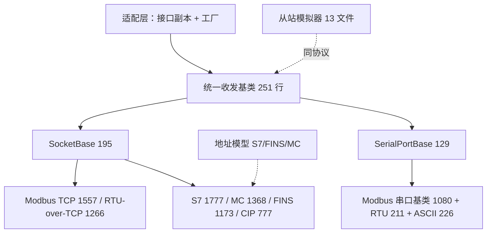

# PA-24｜.NET Standard 协议客户端库（含配套从站模拟器）

> **分析对象**：类库（`netstandard2.0` 协议客户端）+ 配套从站模拟库 + 工厂适配层
> **编号**：PA-24（按脱敏约定，不披露来源标识）
> **技术栈**：C# / `netstandard2.0`；唯一直接依赖 `System.IO.Ports 4.6.0`；适配层另用 Json.NET 11 与第三方 BACnet 栈；测试为 xUnit（`netcoreapp3.0`）
> **规模画像**：76 个 `.cs` / 18,971 行；5 个工程——客户端库 34 文件 / 11,582 行、模拟器 13 文件 / 2,597 行、适配层 13 文件 / 2,431 行、测试 16 文件 / 2,361 行；6 个协议族、7 类从站模拟；29 个测试方法
> **成熟度画像**：生产可用（有 NuGet 分发、双语文档、多年现场使用痕迹；短板在测试形态与重复代码）

---

## 1. 定位与问题域

### 1.1 它是什么

一个**只做客户端**的协议库：`Open()` 之后用"地址字符串 + 类型"读写，不涉及采集调度、点位模型与北向。API 形态是"库"而不是"框架"——调用方拿到 `Result<T>`，而不是回调、订阅或状态机。

它还有两个常被忽略的身份：**自带同协议的从站模拟库**（客户端有的协议，模拟器几乎都有对应服务端，并把内存值持久化到 XML），以及**工厂适配层**（按"型号 + 地址"返回具体客户端）。三者合起来才构成可闭环自测的最小单元——这比协议覆盖本身更值得注意（对照 PA-26）。

### 1.2 面向的用户与场景

| 用户 | 场景 | 方案给出的答案 |
|---|---|---|
| 网关/边缘开发者 | 在 Linux ARM 盒子上跑采集 | `netstandard2.0`，无 Windows-only API（除串口） |
| 桌面工具作者 | 快速拼一个调试器 | 每协议一个 `XxxClient`，构造即用，读写重载齐全 |
| 上位机集成商 | 一个程序适配多品牌 PLC | 适配层工厂按型号返回统一接口 |
| 测试工程师 | 没有真机也要回归 | 配套从站模拟器 + 可持久化内存 |

### 1.3 边界（不做什么）

- **不做采集**：没有设备、点位、批次、调度、质量码；`BatchRead` 只是"按 N 个地址切块循环"。
- **不在客户端库里做服务端**：从站能力被拆到独立工程，不随客户端库分发。
- **不做 OPC UA / 电力规约**：协议面止于"PLC 上位链路 + Modbus + BACnet（外挂）"。
- **不做异步**：全部同步阻塞 API，无 `Task` 重载。

---

## 2. 功能分析

### 2.1 功能域总览

| 功能域 | 功能点 | 实现方式 | 完成度 |
|---|---|---|---|
| 连接管理 | 打开/关闭/重连 | `SocketBase`/`SerialPortBase`；带超时的 `BeginConnect`；失败后重连并重试一次 | 完整（重试次数不可配，代码内 TODO 自认） |
| 收发定界 | 按期望长度循环读满 | `SocketRead(socket, receiveCount)` 分块读；读到 0 字节即判开并关闭 socket | 完整 |
| Modbus 四变体 | 8 功能码读写 | TCP 1,557 行、RTU over TCP 1,266 行、串口基类 1,080 行 + RTU 211 / ASCII 226 行 | 完整（CRC16 与 LRC 各为独立工具类） |
| 其它 PLC 协议 | S7 / MC / FINS / CIP | 单文件推进，各带私有地址模型（CIP 的地址模型是空类） | 完整（CIP 实现最薄，777 行） |
| 批量读写 | 地址字典 + 批大小 | `BatchRead(Dictionary<string, DataTypeEnum>, batchNumber)`，默认 19 | 可用（仅切块，不合并连续地址） |
| 结果与诊断 | 成功标志、错误码、异常、报文、耗时 | `Result` / `Result<T>`：请求帧、响应帧（含第二组）、`TimeConsuming`、错误列表 | 完整 |
| 从站模拟 | 7 类服务端 + 内存持久化 | 独立工程，写入 XML 文件 | 可用 |

### 2.2 协议与接口覆盖

| 协议 | 角色 | 传输 | 代码位置（模块角色名） | 备注 |
|---|---|---|---|---|
| Modbus（TCP / RTU / ASCII / RTU over TCP） | 主站 | TCP / 串口 | 客户端/Modbus | 四个变体各自成文件；`plcAddresses` 开关可自动减 1；RTU 带 CRC16、ASCII 带 LRC、RTU-over-TCP 不带校验 |
| S7（200/200Smart/300/400/1200/1500） | 主站 | TCP | 客户端/PLC | 六种型号枚举；支持短连接"用完即关" |
| MC 协议（A-1E / Qna-3E） | 主站 | TCP | 客户端/PLC | 两种帧型共用地址模型 |
| FINS | 主站 | TCP/UDP | 客户端/PLC | 地址解析含位/字双编码 |
| CIP（EtherNet/IP，标签寻址） | 主站 | TCP | 客户端/PLC | 标签名直接作地址 |
| BACnet/IP | 主站 | UDP | 适配层 | 依赖第三方栈；客户端库内目录为空 |

### 2.3 典型使用流程

```
var client = new XxxClient(version, new IPEndPoint(ip, 102), timeout: 1500);
client.Open();                              // 长连接：显式打开
var r = client.ReadFloat("DB4.24");         // 地址字符串 + 期望类型
if (!r.IsSucceed) Log(r.Err, r.Requst, r.Response, r.TimeConsuming);
client.Close();
// 短连接：不 Open，库内部自动 Open → 读写 → Close（finally 中 Dispose）
var batch = client.BatchRead(new Dictionary<string, DataTypeEnum> {
    ["DB4.24"] = DataTypeEnum.Float, ["DB1.434.0"] = DataTypeEnum.Bool,
});                                         // 默认每 19 个地址一次请求
```

两种模式的存在是被真实约束逼出来的：文档明确写"这类 PLC 一般最多允许 8 个长连接"，于是库提供"不主动 Open 就自动开关"的语义来省连接数——把设备侧的资源限制编码进 API 契约，是少见但正确的做法。

### 2.4 功能完成度评估

| 能力 | 完成度 | 依据 |
|---|---|---|
| 协议覆盖 | 高 | 6 协议族、4 种 Modbus 传输变体，主站侧完整 |
| 错误可诊断性 | 高 | 结果对象带请求帧/响应帧/耗时/多级错误；但全同步、无连接池、无并发保护 |
| 测试形态 | 低 | 多数用例连 `127.0.0.1` 固定端口，需真机或模拟器在场 |

---

## 3. 架构分析

### 3.1 分层与模块




只有两层：**传输基类**（Socket / 串口）与**协议客户端**（每协议一个巨型文件）。没有协议无关的会话层，也没有统一的"地址 → 请求"中间表示——除 S7/FINS/MC 各自私有的地址模型。

### 3.2 关键抽象与接口

| 抽象 | 职责 | 边界 | 位置 |
|---|---|---|---|
| `统一收发基类` | 连接态、开关、单包收发、批量读写、10 种类型读、14 种类型写 | 不定义会话、重连策略、并发 | 库根 |
| `SocketBase` | 带超时连接、分块读满、单次重试 | 只管"把 N 字节读到"，不解析协议 | 库根 |
| `Result<T>` | 成功标志 + 错误码 + 异常 + 报文 + 耗时 | 业务语义止于"这一包成功没有"，不承载质量码 | 库根 |
| 地址模型（S7/FINS/MC） | 地址串 → 区域码 + 块号 + 起始位 + 长度 + 是否位操作 | 只描述读写位置，不含类型宽度推导 | 协议子目录 |

`Result` 把**报文与耗时**放进返回值，是这套设计最实用的一处：调试时可不开抓包，两个字段就是十六进制帧与往返毫秒数。代价是每个返回值都携带潜在的大字符串（推断：高频采集时需显式丢弃，否则 GC 压力可观）。

### 3.3 数据流与时序

```
ReadFloat("DB4.24")
  └→ 未连接则 Connect()：带超时连接，设收发超时
  └→ ConvertArg → 地址模型{区域码, DB 块, 起始字节, 位偏移, 长度}
  └→ GetReadCommand → 记 Requst；SendPackageReliable（失败则重连并重发一次）
  └→ 截取响应尾部数据 → 整体 Reverse；检查错误码段 → 置 Err
  └→ finally 短连接则 Dispose；EndTime() 记耗时
```


S7 的端序处理是"整段反转"（`responseData.Reverse()`），能覆盖常见 16/32 位读写，但多字浮点的字序仍需用户处理；而 Modbus 侧却提供 `EndianFormat` 四态——**同库两套端序策略**是最容易在现场踩到的认知负担（推断）。

### 3.4 并发与连接管理

| 主题 | 做法 | 评价 |
|---|---|---|
| 并发模型 | 完全同步阻塞；无锁、无队列 | 调用方必须自行串行化，否则两线程共用一个实例会串包 |
| 连接复用 | 每实例一条连接 | 简单直接；多设备 = 多实例 |
| 连接数约束 | 短连接模式"用完即关" | 把 PLC 侧连接上限显式建模，实用 |
| 超时与重试 | 构造参数默认 1,500ms 落到 socket；失败后重连并重发一次 | 单一超时粒度粗；读重试安全，写重发有重复执行风险（推断） |

### 3.5 配置、持久化与部署

- **配置载体是构造函数**：IP/端口/超时/端序/地址风格全是参数，无配置文件、无 DI 扩展。极易嵌入，但把"设备清单治理"完全推给调用方。
- **分发与依赖**：NuGet 包，`netstandard2.0`，MIT，`PackageLicenseExpression` 已声明，两个配置都生成 XML 文档；客户端库仅依赖 `System.IO.Ports`，Json.NET 与第三方 BACnet 栈只在适配层，只用客户端不会被拖累。
- **模拟器反向依赖 NuGet 上的旧版本自身**（`0.0.78`）而非工程引用，长期会漂移（推断：作者意图是让模拟器独立演进）。
- **ARM Linux**：需注意串口设备名与 `libSystem.IO.Ports` 原生依赖；库无反射、无动态加载，单文件/裁剪发布友好。

### 3.6 扩展机制

没有插件、注册表或特性扫描。新增协议 = 新建 `XxxClient` + 工厂加一个 `case`。好处是零运行时开销、裁剪安全、编译期可查；代价是接口有 30+ 成员（只读协议也要写一堆写方法），第三方无法在不改源码的前提下扩展。

### 3.7 工程质量观察

| 观察项 | 事实 |
|---|---|
| 单文件体量 | 最大 4 个文件合计 5,978 行（S7 / Modbus TCP / MC / RTU over TCP），单文件即一个协议 |
| 重复 | Modbus TCP 与 RTU over TCP 的公开签名几乎一一对应（1,557 vs 1,266 行）；适配层接口与 `统一收发基类` 逐方法重复 |
| 测试 | 29 个 `[Fact]/[Theory]`，多数直接连 `127.0.0.1` 协议端口；无 CI 配置 |
| 兼容基线 | 测试工程目标 `netcoreapp3.0`（已停支持），库本体保持最宽的 `netstandard2.0` |
| 文档 | 双语 README，逐协议给用法；含"何时不要主动 Open""用批量读写提速"两条实践建议 |

---

## 4. 需求分析

### 4.1 显性需求

1. 在非 Windows 环境（Linux/ARM）上也能读写 PLC。
2. 一份代码适配多品牌：Modbus、S7、MC、FINS、CIP。
3. 用"地址字符串 + 类型"表达点位，不暴露字节偏移。
4. 一次调用读多个点，且能控制每包几个地址。
5. 失败要说清原因：连不上、超时、地址不存在、协议异常码。
6. 不引入重型依赖；商用许可要宽；没有真机也能测。

第 1–6 条全部有对应实现，这是它作为"库"的完成度高于多数同类项目的原因。

### 4.2 隐性需求

| 隐性需求 | 方案中的对应处理 | 若缺失的后果 |
|---|---|---|
| 地址语法校验 | 解析在客户端内做，非法地址多表现为运行时异常或笼统错误码 | 现场配错地址，报错只说"读取失败"而非"地址越界" |
| 字序与字节序 | Modbus 有 4 态端序；S7 整段反转；其余隐含 | 同一浮点在两个协议上读出不同值 |
| 并发安全 | 无 | 多线程共用一个实例会串包，且不报错 |
| 写操作幂等性 | 重试对读写一视同仁 | 网络抖动时写命令可能执行两次 |
| 长连接预算 | 短连接模式 + 文档提示 8 连接上限 | 超限时表现为"偶发连接失败" |
| 地址越界 | 无统一校验层 | 整包失败，且无法定位是哪一个点 |

### 4.3 非功能需求

| 维度 | 现状 | 判断 |
|---|---|---|
| 部署体积 | 一个 dll + `System.IO.Ports` | 优；适合单文件发布 |
| 启动开销 | 无容器、无扫描、无反射 | 毫秒级 |
| 平台矩阵 | `netstandard2.0` → .NET Framework 4.6.1+ / Core 2+ / 5+ | 覆盖面最广的一档 |
| 语言特性 | 无 `Span`、无 `async`、无 `record` | 受 `netstandard2.0` 约束，牺牲性能与现代写法 |

### 4.4 需求缺口与误判

| 缺口 | 证据 | 影响 |
|---|---|---|
| 把"批量"等同于"切块" | `BatchRead` 只按批大小分页，不按地址连续性合并 | 100 个离散点仍要发 6 个请求（推断：现场靠调用方自行排序） |
| 地址解析散落 | S7 在 `ConvertArg` 内切片，CIP 在客户端内联处理 | 无法为"地址合法性"提供统一入口，UI 侧也无从提示 |
| 同步 API 与现代调用栈 | 全同步 | 在 ASP.NET Core / GUI 线程中容易阻塞（推断） |
| 重复实现 | 4 个 Modbus 变体、2 份统一接口 | 改一处要改四处，缺陷修复容易漏分支 |

---

## 5. 可借鉴与应规避

### 5.1 可直接吸收的机制

1. **地址解析独立成层**：`{区域码, DB 块, 起始地址, 读写长度, 是否位操作}` 这种"解析结果对象"把"用户写的字符串"和"协议要的字段"解耦。目标产品应把它升格为一等公民：可校验、可规范化回显、可跨协议迁移、可生成 UI 提示。
2. **短连接/长连接双模式**：把设备侧"最多 8 个长连接"这类物理约束做成 API 开关，而不是写在文档里让人踩坑。
3. **结果对象携带报文与耗时**：调试类产品的第一性需求是"看到发了什么、收到什么"。
4. **依赖分层**：客户端库零重依赖、适配层承担 Json.NET 与第三方协议栈，让"只用 Modbus"的用户不被拖累。

### 5.2 明确应规避的做法

| 做法 | 问题 | 目标产品应如何做 |
|---|---|---|
| 单文件 1,700 行的协议实现 | 可读、可测性差，评审成本高 | 按"帧构造 / 帧解析 / 地址 / 错误码"四分，单文件控制在 500 行内 |
| 4 个 Modbus 变体各写一遍 | 修复要同步 4 处 | 抽 `ITransport`（TCP/串口/RTU-over-TCP）+ 一个 PDU 编解码器 |
| 接口 30+ 成员、读写各一套重载 | 只读协议被迫实现写方法 | 能力接口拆分（Readable / Writable / BulkReadable） |
| 重试不分读写 | 写命令可能重复执行 | 读可重试，写需幂等键或明示"不重试" |
| 端序策略不统一 | 同库两套规则 | 统一 `ByteOrder` + `WordOrder` 两维度，按类型推导默认值 |

### 5.3 迁移到目标产品的成本

| 机制 | 迁移成本 | 说明 |
|---|---|---|
| 地址模型 | 低 | 纯数据结构；建议直接定义"地址 AST"（区域 + 偏移 + 位 + 宽度） |
| 结果对象（报文+耗时） | 低 | 与语言无关；可做成调试模式开关 |
| Modbus PDU 编解码 | 中 | 需补批量写、异常码全表、PDU 长度上限推导 |
| S7 / MC / FINS 协议实现 | 高 | 需重写或找 Go 侧实现；S7 的型号差异是主要工作量 |
| 从站模拟器 | 中 | 需自建（能力清单见 PA-26） |

---

## 6. 结论

### 6.1 六维评分

| 维度 | 分数(1-5) | 理由 |
|---|---|---|
| 协议广度 | 4 | 6 协议族、4 种 Modbus 变体、7 类从站模拟；缺 OPC UA 与电力/楼宇规约 |
| 架构可演进性 | 3 | 传输基类 + 地址模型方向正确；重复实现与巨型文件使改动成本随协议数线性上升 |
| 跨平台能力 | 4 | `netstandard2.0` 覆盖面最广，Linux/ARM 可用；串口原生库是唯一门槛 |
| 可运维性 | 2 | 只有日志委托；无指标、无健康、无配置治理（本就是库的定位） |
| 工程质量 | 3 | 文档与错误诊断扎实，依赖分层干净；测试不可自动化、Modbus 四变体重复 |
| 许可与合规风险 | 5 | MIT，`PackageLicenseExpression` 显式声明；无传染性依赖 |

### 6.2 三条关键结论

1. **它证明"地址语法是一等公民"**：把地址解析成结构化对象，是这套库最值得整体搬走的设计。目标产品若把地址做成可校验、可规范化回显、可跨协议映射的一等对象，就能在"配点位"这个高频动作上直接省掉现场一半沟通成本。
2. **它用"库 + 模拟器同仓"解决了协议回归**：客户端有的协议模拟器都有，还能持久化内存值。这比一堆单元测试更贴近协议实现的真实失效方式，也正是 PA-26 那种单窗体模拟器缺的那一半。
3. **它的债务是可量化的重复**：4 个 Modbus 变体、2 份统一接口、单文件 1,700 行的协议实现，都是"每加一协议就复制一份"的必然结果。目标产品若在 v1 就把"传输层 × PDU 层 × 地址层"三轴拆开，协议数从 6 涨到 20 时成本才不会失控。

---

**附：数量核实方式**——按工程 `find | wc -l` 与 `wc -l` 统计，`grep -c "public Result"` 计重载数，枚举成员逐项计数。BACnet 在客户端库内仅有空目录，故未计入"库内协议"。
