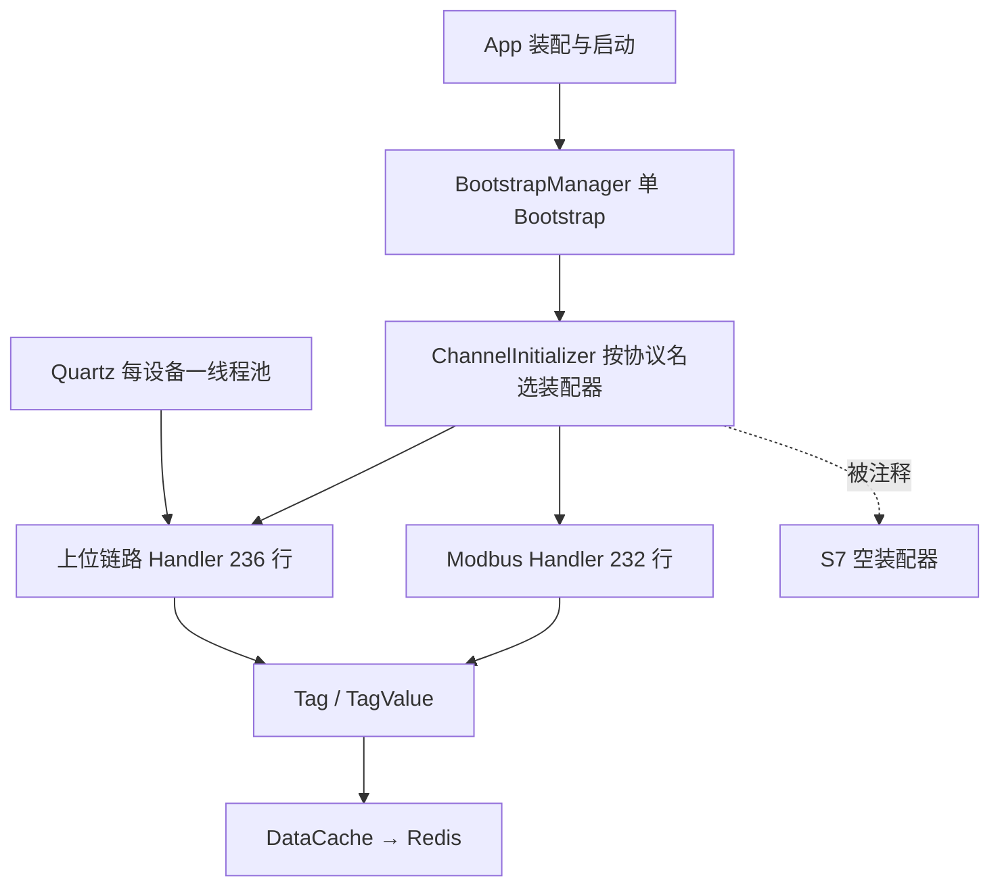

# PA-25｜Java/Netty 协议整理工程

> **分析对象**：协议集合工程（Gradle 多模块，Netty 客户端编解码 + 最小采集骨架）
> **编号**：PA-25（按脱敏约定，不披露来源标识）
> **技术栈**：Java 8 / Gradle / Netty 4.1.60 / Quartz 2.3.0 / Redisson 3.19.0 / Jackson 2.12 / snakeyaml；Spring Boot 2.4.4 仅用于未接线的网页模块
> **规模画像**：88 个 `.java` / 7,096 行；4 模块——common 2/64、protocol 53/3,884、core 31/3,095、web 2/53；可核实协议 2 个，协议枚举 3 项
> **成熟度画像**：原型（作者已声明停止更新；无自动化测试、无重连、写入未闭环）

---

## 1. 定位与问题域

### 1.1 它是什么

一个**以"把工业协议逐个整理成代码"为目标**的工程：Netty 做 TCP 客户端编解码，Quartz 定时读，Redis 存值，YAML + JSON 描述设备与点位。它更大的价值是一份**少见的技术复盘**：开篇即声明停止更新，给出四条原因（单机架构无法演进为无中心化采集、Java 缺无符号类型、工业领域 C# 生态更强、自身抽象不足需大重构），后续项目改用 Akka.NET + .NET 8；四条均可与代码状态逐条对照（见 4.4）。

### 1.2 面向的用户与场景

三类读者各有其用：**协议学习者**要 Netty 编解码范例（得到完整请求/响应类族 + Codec + 定界解码器）；**采集开发者**要"设备 + 点位 + 定时读"骨架（得到 `Device`/`Tag`/`DeviceManager` + Quartz）；**选型决策者**要知道"用 Java 做底层协议"的代价（得到一份亲历复盘）。

### 1.3 边界（不做什么）

- **不做北向**：网页模块是未接线的示例，对 core 的依赖被注释；**不做多机协同**：单进程、单 Bootstrap、启动时一次性连接全部设备；**不做串口**：全部 TCP，无 RTU/ASCII。

---

## 2. 功能分析

### 2.1 功能域总览

| 功能域 | 功能点 | 实现方式 | 完成度 |
|---|---|---|---|
| Modbus TCP 客户端 | 8 功能码请求构造与响应解析 | `ModbusMasterTCP` + 请求/响应类族 + Codec + MBAP 头 | 高（移植自 Apache-2.0 实现） |
| 上位链路协议 | ASCII 命令读写（RD/RDS/WR/WRS） | 单文件 317 行：区域校验表 + 类型映射 + 命令拼接 | 中（读通，写未闭环） |
| 设备与点位模型 | 设备 221 行、点位 289 行；区域/索引/类型/数量/间隔/超时/读写模式 | `Device` + `Tag` + `TagValue`，值以 `Object` 承载 | 中 |
| 调度与缓存 | 每设备一个 Quartz（线程池 1）；Redis 单机存值；值变化反射回调 | `TimeScheduler` + 假读任务；`DataCacheByRedis` 569 行 | 骨架（写入未接、回调弱类型） |

### 2.2 协议与接口覆盖

| 协议 | 角色 | 传输 | 代码位置（模块角色名） | 备注 |
|---|---|---|---|---|
| Modbus TCP | 主站 | TCP | 协议模块/Modbus（47 文件） | 22 顶层类 + 13 请求 + 14 响应；MBAP 与 PDU 分层 |
| 上位链路（Upper Link，ASCII） | 主站 | TCP | 协议模块/上位链路（1 文件） | 区域表含 DM/EM/FM/ZF/W/TM/Z/CM/VM 与 R/B/MR/LR/CR/VB，带型号最大地址表 |
| S7 | 主站 | TCP | 核心/装配器 | 仅骨架：管线内无编解码器，注册行被注释；文档提及的其余品牌协议在代码中也不存在，声称与可核实约 6:2 |

### 2.3 典型使用流程

```
config.yml → tags.json（devices[].tags[]：区域、索引、类型、数量、间隔、超时）
  └→ BootstrapManager 单 EventLoopGroup 逐设备 connect → 按协议名选装配器装管线
       └→ 该设备起 Quartz → 按点位间隔 encode → writeAndFlush → 解码 → Tag.onValue → Redis + 回调
```

### 2.4 功能完成度评估

| 能力 | 完成度 | 依据 |
|---|---|---|
| Modbus TCP 编解码 | 高 | 47 文件、类族完整；但整块是移植代码 |
| 上位链路协议 | 中 | 命令拼接完整，写路径未闭环 |
| 连接生命周期与测试 | 低/无 | 启动一次性连，断线/超时/重连全为 TODO；唯一"测试类"是带 `main()` 的手工脚本 |

---

## 3. 架构分析

### 3.1 分层与模块



模块划分（common / protocol / core / web）清晰，问题在 core 内部：设备注册、连接建立、管线装配、调度、缓存、回调六件事直接压在 `App` 与几个单例上，缺"通道/会话"这层抽象。

### 3.2 关键抽象与接口

| 抽象 | 职责 | 边界 | 位置 |
|---|---|---|---|
| `Protocol` | `encode(Object)` / `decode(ByteBuf)` | 入参是 `HashMap<String,Object>`，协议只能靠字符串键约定 | 协议模块 |
| `ProtocolAssembler` + handler | 装配管线；收事件、起定时器、映射点位、处理写入 | 装配器只管装；handler 一类兼五职，无会话抽象 | 核心/装配 |
| `Device` / `Tag` | 元数据 + 点位集合 + 连接状态 + 事件总线 | 连接对象与业务字段混杂；Tag 与缓存、回调耦合 | 核心/模型 |

`Protocol.encode(Object)` 是最薄弱的一环：把"协议要什么"降级成"从 Map 按字符串键取值"，既无编译期校验，也无法为不同协议定义参数集合——与 PA-23 的 `CommandType` 字符串是同一类错误的两个变体。

### 3.3 数据流与时序

```
connect → handler.connect() → start()：为该设备建 Quartz（线程池 1）
  └→ 每 Tag 按间隔注册触发器 → encode 读指令 → writeAndFlush
       └→ write() 置 sended=true，用 Exchanger 阻塞等回包 → channelRead → tag.onValue → Redis + 回调
```

同步靠 `Exchanger` + `AtomicBoolean`：写线程阻塞等回包，超时放弃。在"一问一答、单设备单线程"下可用，但把请求-应答配对押在时序上——一旦有主动上送或差错响应便无事务号可依（推断）。

### 3.4 并发与连接管理

| 主题 | 做法 | 评价 |
|---|---|---|
| 业务线程 | 每设备一个 Quartz 实例，线程池固定 1 | 设备数增长 → 线程池数线性增长（推断） |
| 请求同步 | `Exchanger` 阻塞 + `AtomicBoolean` | 简单；无事务号、无并发请求 |
| 注册表与连接 | `HashMap` 单例按 host/port/ChannelId 线性查；启动时 `connect()` 循环；`initChannel` 按 ChannelId 反查设备 | 非线程安全、O(n)；无重试、退避、健康检查；channelId 在 connect 返回后才写入，早到帧可能查不到设备（推断） |

### 3.5 配置、持久化与部署

- **配置**：`config.yml`（应用名、标签文件名、缓存类型与 Redis 连接）+ 独立设备 JSON（点位含区域、索引、类型、数量、间隔、超时、读写模式、初值、回调）；**持久化**：仅 Redis（Redisson 单机），无本地落盘与补发；**部署**：`application` + `shadow` 打胖包，源兼容 Java 8，网页模块独立于 core。

### 3.6 工程质量观察

| 观察项 | 观察结果 |
|---|---|
| 测试与空实现 | 唯一"测试"是带 `main()` 的手工脚本（注释自认没时间写 JUnit）；设备管理器/调度器/缓存/启动管理器均为双重检查锁单例，`ProtocolManager` 方法体为空 |
| 许可混合 | Modbus 编解码保留 Apache-2.0 许可头（移植代码），与仓库自身 GPL-3.0 并存 |
| 扩展成本 | 新增协议要改三处（协议类、handler、装配器 `HashMap`），该处自带"改成注解扫描"的 TODO |

---

## 4. 需求分析

### 4.1 显性需求

1. 一套 IO 框架支撑多协议客户端；设备与点位用配置描述，按点位各自间隔定时读。
2. 值进缓存供上层取用，变化时触发回调；能写：给点位下发新值。
3. 断线能自愈——只在 TODO 里；前两类已实现，写入半实现。

### 4.2 隐性需求

| 隐性需求 | 方案中的对应处理 | 若缺失的后果 |
|---|---|---|
| 请求-应答配对 | 阻塞等待 + 时序假设，无事务号 | 一次错位后所有后续值都错，且不报错 |
| 无符号与位操作 | 用 `int`/`long` 承载，手写 `& 0xff`、位移（工具类 73 行，多方法被注释） | 0xFFFF 读成 -1；每加一协议就重写一遍同类函数 |
| 设备数量增长 | 每设备一个调度器线程池 | 100 台设备 = 100 个线程池（推断） |

### 4.3 非功能需求

非功能面上，启动即 JVM + Netty + Quartz + Redisson，shadow 胖包推断为数十 MB 且强依赖 Redis 可达；可观测性仅 logback 日志，无重连与泄漏验证，长稳未知。

### 4.4 需求缺口与误判

作者的四条停止理由可在代码里逐条对上：

| 作者结论 | 代码证据 | 评价 |
|---|---|---|
| 单机架构无法演进成无中心化采集，纯 Netty 不够 | 单 Bootstrap、单进程、设备表在内存、无节点协同 | 成立；无中心化需发现/分片/共识，确超出协议库范畴 |
| Java 不支持无符号类型，需自行处理 | 数值一路用 `int`/`long` + 手工十六进制转换 | 成立；"逐位解读寄存器"的工作会被语言层持续收税 |
| 工业领域 C# 更有优势，厂商 SDK 多为 C# | Modbus 靠移植，其余协议无实现，S7 只有空装配器 | 成立；不是语言优劣，而是**生态可得性** |
| 自身抽象不足，需大重构 | `encode(Map)` 弱类型、handler 五合一、空实现类 | 成立；这类债在 Java 侧修复成本高于重写 |

四条合起来构成一个反例：**协议集合 ≠ 采集产品**。它有 47 个 Modbus 类，却没有"一条通道的生命周期"；有 Quartz，却没有"一次采集的语义"；有 Redis，却没有"值的时间与质量"。

---

## 5. 可借鉴与应规避

### 5.1 可直接吸收的机制

1. **Netty 三段式编解码**：`定界解码 → PDU 编解码 → 业务 handler`，比"一个函数拼字节"可测得多；请求/响应各成一族、由 Codec 统一调度。
2. **协议装配器**：把"某协议需要哪几个 handler、按什么顺序装"收敛到一个类，新增协议不动主干。
3. **点位级读间隔**：间隔/超时写在点位上而非设备上，符合"快慢点混布"的现场；值回调用配置声明，虽弱类型但把业务计算从协议代码里剥离了。

### 5.2 明确应规避的做法

| 做法 | 问题 | 目标产品应如何做 |
|---|---|---|
| `encode(Map)` / 一类兼五职 | 无编译期校验；handler、调度、写入混在一起 | 每协议强类型请求体 + 编解码器/会话/任务分离 |
| 一设备一调度器 | 线程池随设备数线性增长 | 单调度器 + 时间片/优先级队列（对照 PA-06 相位轮） |
| 阻塞等回包 | 无事务号、无并发请求 | 事务号 + Future 表 + 超时清理 |

### 5.3 迁移到目标产品的成本

| 机制 | 迁移成本 | 说明 |
|---|---|---|
| 三段式编解码 + 装配器 + 点位级间隔 | 低 | 均与语言无关：`bufio` + 管线注册表 + 时间字段 |
| Modbus 类族 | 中 | 47 个类可压缩为"PDU + 8 组请求/响应结构"；Java 侧其余代码不建议迁移，语言选型本身即本文结论 |

---

## 6. 结论

### 6.1 六维评分

| 维度 | 分数(1-5) | 理由 |
|---|---|---|
| 协议广度 | 2 | 可核实 2 个（Modbus TCP、上位链路），S7 仅空装配器 |
| 架构可演进性 | 2 | 装配器与编解码分层有想法，但弱类型入参、五合一 handler、单例耦合使重构成本高于重写 |
| 跨平台能力 | 4 | JVM 天然跨平台；不涉串口故无原生依赖问题 |
| 可运维性 | 1 | 无重连、无指标、无健康检查、无配置热更新 |
| 工程质量 | 1 | 零自动化测试、空实现、TODO 遍布、GPL 与 Apache-2.0 并存 |
| 许可与合规风险 | 2 | GPL-3.0 仓库内含 Apache-2.0 移植代码，商用需法务介入 |

### 6.2 三条关键结论

1. **它是一份"语言选型"的实证材料，而不是可用代码**：无符号数、字节/位操作、厂商 SDK 生态三项成本，在协议数超过 3 个后会指数化；四条复盘与代码状态逐条吻合，可直接作为"底层协议栈为何不选 JVM 系"的论据。
2. **"协议集合"与"采集产品"之间隔着一条通道生命周期**：47 个 Modbus 类没有对应重连、事务配对、质量码与点位变更。目标产品若只交付"协议实现清单"，会得到同样的结果。
3. **它的编解码分层值得抄，调度与模型不值得抄**：三段式管线、装配器、点位级间隔可映射到任何语言；"每设备一调度器""Map 传参""handler 五合一"必须在设计阶段避开。
