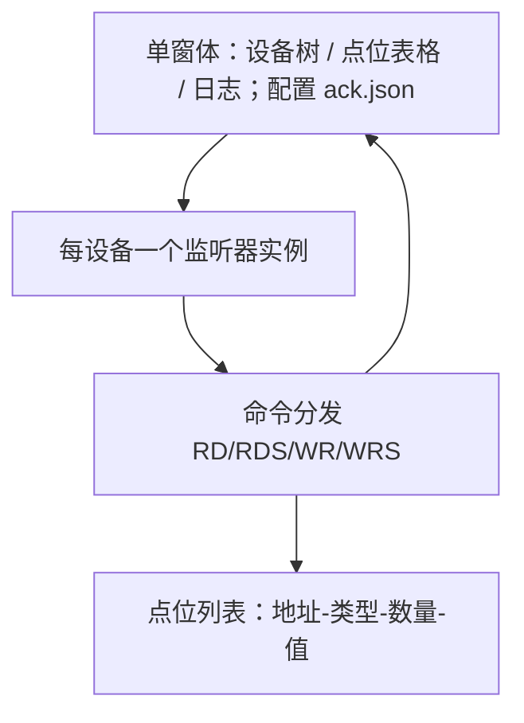

# PA-26｜上位链路从站仿真器

> **分析对象**：桌面仿真器（单窗体，模拟上位链路 ASCII 从站的读写行为）
> **编号**：PA-26（按脱敏约定，不披露来源标识）
> **技术栈**：C# / .NET 6（`net6.0-windows`）/ WinForms / BeetleX 1.8.9 / log4net 2.0.16 / Microsoft.Extensions.Configuration 8.0 / Newtonsoft.Json 13.0.3
> **规模画像**：8 个 `.cs` / 1,612 行，其中两个 Designer 文件占 626 行，手写约 986 行；单工程、单协议、单角色（从站）
> **成熟度画像**：一次性原型（单个压缩提交、无测试、无 CI、无许可证文件）

---

## 1. 定位与问题域

### 1.1 它是什么

一个**只为一种 ASCII 上位链路协议服务的从站仿真器**：在 Windows 桌面上按配置起若干 TCP 监听端口，收到 `RD/RDS/WR/WRS` 后按地址查点位表，返回数值或接受写入，用于真实 PLC 不在场时联调上位机。协议知识集中在 346 行的单文件里，界面只是设备树 + 点位表格 + 日志窗口。

### 1.2 面向的用户与场景

两类读者：**上位机开发者**要一个可读可写的假对端（得到可配多点位、可手改数值的从站）；**现场调试者**要复现某地址的异常读回（得到"未知地址自动建点并显示在表格"的行为）。

### 1.3 边界（不做什么）

- **只做一种协议、只做从站**（无其它协议、无主站）；**只做内存字符串值**（无工程量转换、无 32 位拆分、无字节序）；**只做 Windows 桌面**（无服务化、无远程接口）。

---

## 2. 功能分析

### 2.1 功能域总览

| 功能域 | 功能点 | 实现方式 | 完成度 |
|---|---|---|---|
| 协议服务 | 每设备一个 TCP 监听；显示客户端与数量；解析 `RD`/`RDS`/`WR`/`WRS` | 框架回调 + 单文件分支 + 半包缓存 | 可用（多设备有缺陷、无校验/错误码） |
| 点位与值 | 地址/类型/数量/值四列；写入即存字符串 | 点位列表 + 表格回写；类型只作标签 | 弱（无地址范围、无类型转换） |

### 2.2 协议与接口覆盖

协议只有一项：**上位链路（Upper Link，ASCII）**，角色为**从站**，传输为 **TCP**，实现位于协议单文件（346 行）。

| 命令 | 语义 | 应答 | 实现完整度 |
|---|---|---|---|
| `RD addr` | 读单点 | 数值或 `0000` | 高（地址不存在时自动建点） |
| `RDS addr count` | 连续读 N 点 | N 个零值或原值 | 中（不跨点位取值，仅拼零） |
| `WR addr value` | 写单点 | `OK` | 高（直接覆盖字符串） |
| `WRS addr count v1..vn` | 连续写 N 点 | `OK` | 中（逗号拼接保存，回读格式不一致） |

### 2.3 典型使用流程

```
启动 → 读 ack.json → 按设备建监听器 → 选中设备点"启动" → 监听端口
  └→ 收 "RD DM100\r" → 查点表 → 回值；收 "WR DM100 123\r" → 覆盖 → 回 OK → 表格刷新 → 手动"保存"落盘
```

---

## 3. 架构分析

### 3.1 分层与模块



### 3.2 关键抽象与接口

| 抽象 | 职责 | 边界 | 位置 |
|---|---|---|---|
| 配置模型（设备/点位） | 设备名、IP、端口、协议名、点位列表；点位含地址/类型/数量/值 | 字段全可空；"协议名"读入后从未参与分支 | 配置模型 |
| 监听器（继承框架会话处理器） | 启停监听、连接回调、收包解析、回包 | 一类兼监听管理与协议实现；监听对象是 `static` 字段 | 协议实现 |
| 单窗体 | 设备树、点位表格、日志、启停按钮 | 直接持有监听器列表，跨线程 `BeginInvoke` 刷控件 | 界面装配 |

### 3.3 数据流与时序

```
收包 → 按 CR 切分并缓存半包 → WR/WRS 覆盖点位值回 OK；否则查表回数值，缺地址则建点回零
```

请求与应答靠"一连接一顺序"隐式配对：无事务号，也不支持同连接并发请求。从站只需按到达顺序处理，但客户端一旦流水线化发送，应答顺序就与请求顺序绑定（推断）。

### 3.4 并发与连接管理

| 主题 | 做法 | 评价 |
|---|---|---|
| 监听实例 | 每设备 new 一个，但监听对象存于 `static` 字段 | 多设备时后启动者覆盖前者，"停止"会误停最后一个（事实） |
| 线程模型 | 网络回调线程直接改点位列表；界面侧 `BeginInvoke` 刷新 | 列表无锁，网络与界面并发读写（推断：存在竞态） |
| 故障处理 | 解析异常仅写日志；关闭 Nagle、`Linger(0)`、10 KB 缓冲、无超时 | 客户端收到空回包，无法区分"地址不存在"与"实现故障" |

### 3.5 配置、部署与工程质量

- **配置与质量**：`ack.json` 既是种子数据也是运行时状态；`appsettings.json` 内嵌明文数据库连接串（含口令）但代码未使用；全部相对路径依赖工作目录（推断：换目录启动即找不到配置）。工程质量方面，右键菜单与属性窗口均为空实现，错误码函数返回硬编码值且调用处被注释，正常事件按 `Error` 级别记录，部分中文字面量呈乱码（推断：GBK/UTF-8 混用），无测试、无 CI、无 LICENSE。

---

## 4. 需求分析

### 4.1 显性需求

1. 按配置启动一个或多个从站监听端口。
2. 解析上位链路的四类读写命令并应答；界面上查看、编辑点位值，并把状态保存下来。

### 4.2 隐性需求

| 隐性需求 | 方案中的对应处理 | 若缺失的后果 |
|---|---|---|
| 地址空间语义 | 地址仅作字符串键，无区域边界、无最大地址 | `DM999999` 也能建点；无法模拟越界，掩盖上位机缺陷 |
| 数据类型宽度 | 类型由前缀推断为 bool/uint16/uint32，但不参与读写 | 32 位值不拆双寄存器，负数与浮点无法表达 |
| 值的时间属性 | 值为静态字符串，无时标、无变化 | 无法验证上位机的超时、质量码与变化上报逻辑 |

非功能面：单用户桌面工具，无并发与吞吐目标；可观测性只有界面日志（上限 1000 行）与文件日志，无指标、无健康检查——对仿真器可接受，对测试基础设施则不足。

### 4.3 需求缺口与误判

| 缺口 | 代码证据 | 影响 |
|---|---|---|
| 错误应答 | 错误码函数固定返回一个值，调用处被注释；未知地址回 `0000` | 上位机无法练习异常分支，"地址错"被伪装成"值为零" |
| 协议保真 | 回包终止符拼接被注释；`WRS` 以逗号存值，`RDS` 以空格应答 | 严格按 CR 判帧或按空格解析的客户端会挂起或错位（推断） |
| 端口配置 | 启动时判断"IP 是否为空"而非"端口是否有效" | IP 为空而端口有值时，端口回落到默认 8501（事实） |

---

## 5. 可借鉴与应规避

### 5.1 可直接吸收的机制

1. **半包缓存**：按 CR 切分、余量留存，是 ASCII 协议服务端的最小正确做法。
2. **表格即状态**：点位表同时是运行时视图与编辑入口，运维能直接看到"对端会读到什么"。

### 5.2 明确应规避的做法

| 做法 | 问题 | 目标产品应如何做 |
|---|---|---|
| 监听对象放 `static` 字段 | 多实例互相覆盖，启停错乱 | 实例持有自己的监听句柄，容器统一管理生命周期 |
| 未知地址自动建点 | 模型被客户端输入污染，无法模拟错误 | 有界地址空间 + 明确错误码/异常回包 |

迁移成本：协议解析约 300 行，可整体重写为"命令表 + 有界寄存器区 + 错误码"三件套，成本低；配置模型的字段划分可复用；界面与静态字段部分不建议迁移。

---

## 6. 结论

### 6.1 六维评分

| 维度 | 分数(1-5) | 理由 |
|---|---|---|
| 协议广度 | 1 | 单协议、单角色，仅四类命令 |
| 架构可演进性 | 2 | 配置模型与解析尚可，但协议与窗体耦合、监听对象静态化，扩展必重构 |
| 跨平台能力 | 1 | `net6.0-windows` + WinForms，只能 Windows 运行 |
| 可运维性 | 2 | 有界面日志与保存，但无指标、无错误码、无远程管理 |
| 工程质量 | 1 | 无测试、无 CI、空实现、静态字段、正常事件按错误级别记录 |
| 许可与合规风险 | 1 | 无许可证文件，默认保留全部权利；配置中还有明文口令，不可直接分发 |

### 6.2 三条关键结论

1. **它是"能应答"的仿真器，不是"能验证"的仿真器**：没有错误码、越界、时延与故障注入，被测上位机只能练成功路径；仿真器的价值恰恰在异常路径。
2. **协议实现可借鉴，工程结构必须重写**：半包缓存与区域前缀推类型是有效技巧；静态监听字段、自动建点、协议与窗体耦合会在多设备与自动化测试场景立刻失效。
3. **它的规模说明了成本结构**：单个 ASCII 从站只需约 300 行核心代码，其余 1,300 行几乎全是界面与脚手架；目标产品若把仿真器做成"界面工程"，就会得到同样的比例。
