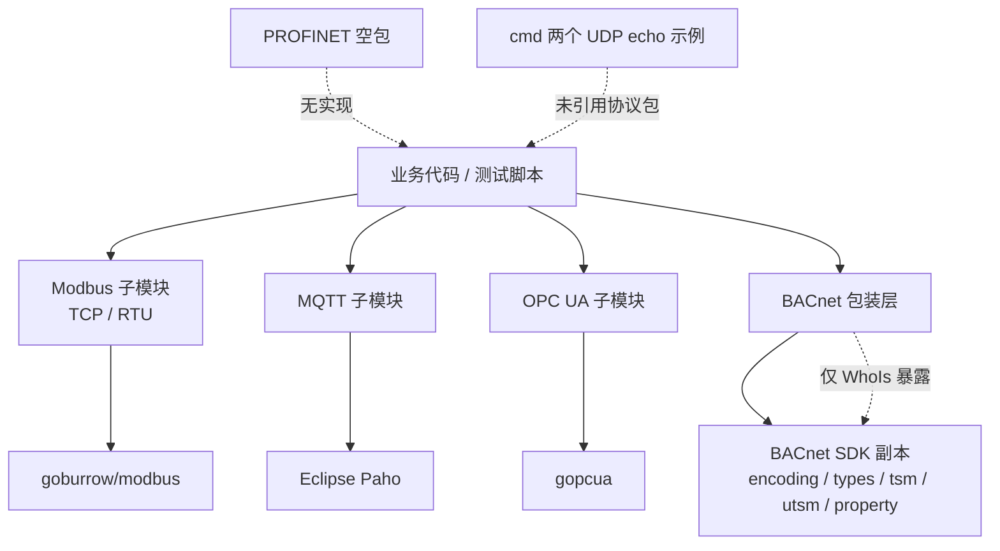

# PA-27｜Go 工控协议封装与双端演示程序

> **分析对象**：协议库集合 + 两个演示入口（单 Go module，无服务框架、无调度层、无北向）
> **编号**：PA-27（按脱敏约定，不披露来源标识）
> **技术栈**：Go 1.21；BACnet/IP 自带一份上游 SDK 源码副本；Modbus 依赖 goburrow/modbus 0.1.0（TCP/RTU）；MQTT 依赖 Eclipse Paho 1.4.3；OPC UA 依赖 gopcua 0.5.3；日志 logrus；串口经 goburrow/serial；PROFINET 仅有空包
> **规模画像**：68 个 `.go`（56 生产 / 12 测试）、7,708 行；5 个协议目录（4 个有实现，1 个空包）+ 1 个公共工具包（`comm`，86 行）；2 个演示入口；54 个测试函数
> **成熟度画像**：个人学习型原型——BACnet 有完整 SDK 却只暴露发现能力，其余协议是薄封装；无配置、无设备/点位模型、无调度、无运维面

---

## 1. 定位与问题域

### 1.1 它是什么

一个"按协议分包"的 Go 客户端封装集合。每个协议目录给出一个接口（Modbus/MQTT/OPC UA/BACnet 客户端）和一个具体传输结构体；调用方自己建连接、自己取值、自己重连。`cmd/client` 与 `cmd/server` 不是网关的南向/北向进程，而是两个 UDP 收发示例（各约 50 行），没有 import 任何协议包。

| 事实 | 说明 |
|---|---|
| 四个协议接口的方法集互不相同，且没有公共驱动接口 | 它是"库的集合"，不是"统一驱动层" |
| BACnet SDK 副本 5,996 行，占全仓 78% | 深度集中在 BACnet 编解码，而非网关能力 |
| 无 device/point/channel/task 任一模型，也无配置文件 | 采集调度、点位归一化、北向输出全部缺失 |

BACnet 目录内含 `encoding`（20 文件 / 3,183 行）、`types`（8 / 762）、`tsm`（2 / 305）、`utsm`（4 / 357）、`property`（2 / 137）五层。

### 1.2 面向的用户与场景

| 用户 | 场景 | 真实诉求 |
|---|---|---|
| 学 Go 的工控开发者 | 想知道某协议"帧怎么拼、字段怎么解" | 代码可读、能单独跑通 |
| 快速验证设备 | 在实验室 ping 一下 Modbus/OPC UA/BACnet 设备 | 最少依赖、直接改参数 |
| 目标产品的协议预研 | 评估 Go 生态里 BACnet/OPC UA 的可用库 | 判断自研成本，而不是直接集成 |

它不适合交付现场：没有配置、没有日志规范、没有断线重连、没有点位模型，测试也大多是连真机的脚本。

### 1.3 边界（不做什么）

不做网关运行时（无设备生命周期、时间片、批读计划、质量码、缓存、Outbox）；不做统一数据模型（各协议返回自己的 `[]int`、`map[string]interface{}` 或 SDK 结构体）；不做完整 BACnet 主站（SDK 有读服务，但对外只暴露 Who-Is）；不做 PROFINET（该目录只有一个 `package` 声明，1 行）；不做配置与部署（参数写死在结构体字面量或测试里，无配置文件、无容器、无 CI）。

---

## 2. 功能分析

### 2.1 功能域总览

| 功能域 | 功能点 | 实现方式 | 完成度 |
|---|---|---|---|
| BACnet 发现 | Who-Is / I-Am 收集设备 | SDK 的 UTSM 按设备号区间订阅，包装层做字段映射 | 可用（仅发现） |
| BACnet 读 | ReadProperty、ReadMultipleProperty、ObjectList | SDK 内实现，包装层未暴露 | 实现但不可达 |
| BACnet 写/订阅 | WriteProperty、SubscribeCOV、COV 通知 | 仅定义服务码常量，无编解码器 | 缺失 |
| Modbus 主站 | 读保持/输入寄存器、读线圈/离散输入、单写/批写 | goburrow/modbus + 自写值转换 | 可用，批量线圈有截断缺陷 |
| MQTT | 连接、发布、订阅、自动重连 | Paho 封装 | 可用，重连参数有误 |
| OPC UA | 连接、单点读、批量读（循环）、浏览、单点写 | gopcua 封装 | 可用（无订阅/无安全） |
| PROFINET | — | 空包 | 未实现 |
| 演示入口 | UDP echo 客户端/服务端 | 标准库 `net` | 示例级 |
| 测试 | 各协议连真机脚本 | `go test` + 硬编码地址 | 不可作为回归 |

### 2.2 协议与接口覆盖

| 协议/接口 | 角色 | 传输 | 代码位置（角色名） | 备注 |
|---|---|---|---|---|
| BACnet/IP | 主站 | UDP | 协议-BACnet 子模块 + SDK 副本 | 对外仅 `WhoIs`；读服务存在于 SDK |
| Modbus TCP | 主站 | TCP | 协议-Modbus 子模块 | 默认 `localhost:502`、从站 1 |
| Modbus RTU | 主站 | 串口 | 协议-Modbus 子模块 | 默认 `COM1`/`/dev/ttyUSB0`，校验 O、停止位 1 |
| MQTT | 客户端 | TCP | 协议-MQTT 子模块 | QoS 0、retain=true |
| OPC UA | 客户端 | TCP | 协议-OPC UA 子模块 | SecurityMode=None，无订阅 |
| PROFINET | — | — | 协议-PROFINET 子模块 | 1 行空包 |

核实方式：协议目录 5 个，有实际导出的协议接口 4 个。BACnet 服务编码器可核实为 6 个（WhoIs、IAm、ReadProperty、ReadPropertyAck、ReadMultipleProperty、ReadMultiplePropertyAck），没有 WriteProperty 与 COV。

### 2.3 典型使用流程

```
Modbus:  new TcpClient{Address, SlaveId, TimeOut} → InitModbus()
         → ReadHoldingRegisters(addr, qty) → []int（每元素一个 16 位字）
         → 自行判断长度、字节序/字序/缩放 → Close()
BACnet:  new UdpClient{InterfaceByName, Port} → InitBacNet()
         → WhoIs(low, high)：广播 Who-Is，UTSM 在区间内收集 I-Am
         → []map[string]interface{}（device_id/type/vendor/ip/port）→ Close()
```

OPC UA 的"批量读"是把单点读放进 `for` 循环，不是一次 `ReadRequest` 携带多个 NodeId；`GetPoints()` 实际调用 `GetEndpoints()`，名称与行为不一致。

### 2.4 功能完成度评估

BACnet 帧编解码做到"高"，但产品面只到"发现"；Modbus/OPC UA/MQTT 属"中"，分别有线圈截断、假批量、重连参数错误；统一驱动抽象、设备/点位/调度与工程化均为"无/低"。

---

## 3. 架构分析

### 3.1 分层与模块



模块之间没有依赖关系，只有"包装层 → 第三方库"的单向依赖。`comm` 是唯一公共包（86 行），提供三元表达式、十进制转二进制、结构体转 map、十六进制解析等零散助手。

### 3.2 关键抽象与接口

| 抽象 | 职责 | 边界 |
|---|---|---|
| `ModbusClient` | 8 个读写方法，地址/数量用 `uint16` | 不表达数据类型、字节序、字序；返回 `[]int` |
| `MqttClient` | Init/Disconnect/Publish/Subscribe | 不表达 QoS、TLS、遗嘱、主题模板 |
| `OpcUaClient` | Init/Close/ReadValue/ReadBatch/Browse/Write | 不表达订阅、方法调用、历史读、安全策略 |
| `BacnetClient` | Init/WhoIs/Close | 读/写/COV 均不在接口内 |
| SDK `Client` | 发现 + 读属性 + 读多属性 + 对象列表 | 无写、无 COV、无分段重组 |
| `TSM` / `UTSM` | 事务 ID 池 / 未确认消息按区间订阅 | TSM 有 255 个事务位；UTSM 用于 Who-Is 收集 |

核心缺口：**没有"驱动"这一层**。四个接口的初始化参数、错误形态、返回值类型都不同，调用方无法用同一段代码轮询不同协议；也没有 `Browse`、`Subscribe`、`Write` 的能力声明。

### 3.3 数据流与时序

调用方（无调度器）→ 选协议、填参数、Init → 同步调用读/写。Modbus 由 handler 持有唯一连接、请求-响应串行；MQTT 由 Paho 内部 goroutine 收消息、回调交给调用方；OPC UA 用 gopcua 会话但 `context.TODO()` 无超时；BACnet 用 UDP 广播 Who-Is → UTSM 收集 I-Am → 返回列表。全程没有时间片、批读计划、质量码、重试策略。

### 3.4 并发与连接管理

| 主题 | 做法 | 评价 |
|---|---|---|
| 连接复用 | 每个客户端持有 handler/client | 单连接串行；无连接池 |
| 并发安全 | 无锁、无并发声明 | 多 goroutine 调用需调用方加锁 |
| 超时 | Modbus 可选；OPC UA 全 `context.TODO()`；BACnet 无 | OPC UA/BACnet 可能永久阻塞 |
| 重连 | 仅 MQTT 开 `AutoReconnect`；`SetMaxReconnectInterval(3)` | Modbus/OPC UA/BACnet 断线即失败；3 是 `time.Duration`，3ns（推断：紧凑重连） |
| 错误处理 | 多处 `log.Fatal` | 库失败会退出进程 |
| 背压 | 无 | 无队列、无丢弃策略 |

### 3.5 配置、持久化与部署

- **配置/持久化**：无。连接参数、从站号、节点 ID、设备号区间写在结构体字面量或测试里；不存点位、历史、设备影子。
- **部署**：`go build` 单二进制；无 Dockerfile、无 CI、无版本 tag。
- **平台假设**：BACnet 默认网卡名 Windows 用"以太网"、Linux 用 `eth0`；Modbus RTU 默认 `COM1`/`/dev/ttyUSB0`——只适合作者本机。

### 3.6 扩展机制

新增协议 = 新建目录 + 定义接口 + 实现传输结构体；没有注册表、没有描述符、没有能力声明。调用方要新增协议，必须自己加 `switch` 并为每个协议写参数解析。这与"统一网关"的扩展模型相差一个抽象层。

### 3.7 工程质量观察

| 观察项 | 事实 |
|---|---|
| 可构建性 | `go build ./...` 通过（实测 exit 0） |
| 静态检查 | `go vet ./protocol/...` 失败：UTSM 测试在非测试 goroutine 调 `t.Fatal`、APDU 格式化参数是函数值、结构体字面量未加字段名 |
| 测试与风格 | 54 个测试函数 / 12 个测试文件；多数连真机，含硬编码内网 IP、`log.Fatal`、`select{}` 阻塞；4 个文件未 gofmt、7 处 TODO |
| 依赖副本 | SDK 目录内 35 处 import 仍指向上游模块路径，导致 in-tree 副本编译但不执行（真正运行的是 `go.mod` 拉取的上游代码） |
| 敏感信息 | 仓库根目录有运行时日志与疑似凭据文本；某协议源文件注释中出现疑似个人访问令牌（未复述内容） |
| 许可 | 根许可为 MIT；内嵌 BACnet SDK 副本文件头是 GPLv2+（含链接例外），两者冲突 |

---

## 4. 需求分析

### 4.1 显性需求

用 Go 连 Modbus TCP/RTU 读写寄存器与线圈；连 MQTT Broker 发布/订阅；连 OPC UA 服务端读单点、浏览节点、写单点；在局域网发现 BACnet 设备（Who-Is/I-Am）。它没有声称要做网关，因此不能用"网关需求"去指责它；但可作为"协议层需要哪些下层能力"的反面清单。

### 4.2 隐性需求：两类寻址模型无法共存

把 BACnet 与 Modbus/OPC UA 放进同一个网关时，最先冲突的不是传输，而是**寻址语义**：

| 维度 | BACnet | Modbus | OPC UA |
|---|---|---|---|
| 寻址单元 | 对象类型 + 实例号 + 属性（+ 数组下标） | 从站号 + 功能码 + 偏移 + 数量 | NodeId + Attribute |
| 地址示例 | `AnalogInput:1 / PresentValue` | `slave=1, fc=3, offset=0` | `ns=3;i=1008` |
| 发现 | Who-Is/I-Am + ObjectList + ReadMultiple | 无，必须人工点表 | Browse 命名空间 |
| 类型系统 | 应用层 tagged data（13 类） | 只有 16 位寄存器，类型靠约定 | 内建类型 + StatusCode |
| 批量/订阅 | ReadPropertyMultiple；COV（本方案未实现） | 连续寄存器块 | 一次多 NodeId；Subscription（本方案未实现） |
| 质量 | 错误类/错误码 | 异常码 | StatusCode |

由此产生的隐性需求：

| 隐性需求 | 本方案的处理 | 若缺失的后果 |
|---|---|---|
| 地址能表达"寄存器"与"对象/属性"两类 | 各协议各自为政，无统一 Point | 上层无法做统一点位表 |
| 驱动能"浏览"而不只是"读点" | 只有 OPC UA 有 `BrowseNode`；BACnet 的 ObjectList 未暴露 | 新设备上线必须人工抄点表 |
| 类型/字节序/字序显式 | Modbus 返回 `[]int`，无字节序 | 浮点、32 位整数全错 |
| 批量读按协议能力规划 | 各协议各自读，无批读计划 | BACnet 逐点读、Modbus 逐寄存器读，效率低 |
| 质量码统一 | 无 | 上层无法判断"没数"还是"坏数" |
| 订阅能力可声明 | 无能力位 | 上层无法决定轮询还是订阅 |

### 4.3 非功能需求

| 维度 | 现状 | 判断 |
|---|---|---|
| 启动/体积 | 纯 Go，单二进制 | 优；但无服务形态 |
| 吞吐 | 同步单连接，无并发/批量 | 低；只适合少量设备 |
| 可观测性 | logrus + 零散 `fmt.Println` | 弱；无指标、无结构化字段 |
| 可靠性 | 无超时（OPC UA/BACnet）、无重连（除 MQTT） | 弱；现场不可用 |
| 安全 | OPC UA `SecurityModeNone`；MQTT 无 TLS 配置 | 弱；仅限隔离网络 |
| 合规 | MIT 与 GPLv2+ 副本冲突；仓库含疑似凭据 | 高风险的引入障碍 |

### 4.4 需求缺口与误判

| 缺口 | 证据 | 影响 |
|---|---|---|
| BACnet 只到"发现" | 包装接口只有 `WhoIs`；SDK 的 `ReadProperty`/`ReadMultiProperty` 未接入 | 不能采楼宇点位 |
| 无 COV | 只有服务码常量，无 `SubscribeCOV` 编解码 | 只能轮询，无法利用变更通知 |
| 无分段重组 | `APDU` 解码遇到 `SegmentAck` 直接返回错误 | 大响应（如整表 ObjectList）会失败 |
| Modbus 线圈截断 | `ReadCoils` 只取 `results[0]`；`WriteMultipleCoils` 只发 1 字节 | 超过 8 个线圈即丢位 |
| OPC UA 批量是假批量 | `ReadBatchValues` 循环调用单点 `ReadValue` | N 个点 = N 次往返 |
| OPC UA 无超时 | 全部 `context.TODO()` | 网络抖动时永久阻塞 |
| RTU 长度校验缺失 | `ReadInputRegisters` 没有 `checkLessLen` | 空响应被当成成功，返回空切片 |
| PROFINET 被目录名高估 | 目录仅 1 行 | 评估协议数时会误判 |

---

## 5. 可借鉴与应规避

### 5.1 可直接吸收的机制

1. **BACnet 的四层帧结构**：BVLC → NPDU → APDU → Service，每层独立编解码。做 BACnet 驱动时应按这四层拆包，而不是把服务字段写进一个巨型结构体。
2. **Tagged data 的类型解码表**：13 类应用数据类型用 tag number 分派，是 BACnet 解码的核心。可抽象为"协议原生类型 → 平台类型"的映射表。
3. **UTSM 的区间订阅**：把"未确认响应"按设备号区间聚合，Who-Is 收集因此不需为每个设备建事务。做设备发现时可复用"广播请求 + 时间窗聚合"的模式。
4. **错误类 + 错误码两字段**：BACnet 的 Error Class/Code 比单一字符串更能定位问题；驱动错误应至少保留 `code`、`class`、`raw` 三部分。
5. **协议目录 + 传输结构体的分层**：每个协议独立目录、独立接口，新增协议不影响其他协议；这是"多协议库"的最小正确形状。

### 5.2 明确应规避的做法

| 做法 | 问题 | 目标产品应如何做 |
|---|---|---|
| 把上游 SDK 整目录拷进仓库但不改 import | 5,996 行副本是死代码，维护两份 | 用 `go.mod` 锁版本；要改就 fork 并改全路径 |
| 包装层只暴露 `WhoIs` | SDK 能力被浪费 | 驱动接口按能力暴露 Read/Write/Browse/Subscribe |
| `context.TODO()` 贯穿 OPC UA | 无超时、不可取消 | 每个请求带 `context.WithTimeout` |
| `log.Fatal` 在库代码 / 无统一错误类型 | 库调用导致进程退出；调用方无法区分链路/协议/数据错误 | 库只返回 error，退出由 main 决定；定义 `DriverError{Kind, Code, Raw}` |
| 线圈批量只处理 1 字节 | 超过 8 点丢位 | 按 `ceil(quantity/8)` 处理字节数组 |
| MIT 根许可 + GPL 副本；仓库内放日志/凭据 | 分发合规风险；泄密与审计风险 | 选 MIT/Apache 的 BACnet 库或隔离为可选进程；首日加 `.gitignore` 与秘密扫描 |

### 5.3 迁移到目标产品的成本

| 机制 | 迁移成本 | 说明 |
|---|---|---|
| BACnet 帧布局与服务编码 | 中 | 可对照重写；注意 GPL 副本不能直接抄 |
| Tagged data 类型映射 / UTSM 区间聚合 / Modbus 读写 / OPC UA 读写浏览 | 低 | 纯查表或 channel+时间窗；Modbus 建议直接选成熟库；gopcua 已提供读写浏览，需补超时与订阅 |
| 统一 Point/驱动接口、调度/重连/质量码 | 高 | 本方案没有，需从零设计 |

---

## 6. 结论

### 6.1 六维评分

| 维度 | 分数(1-5) | 理由 |
|---|---|---|
| 协议广度 | 2.5 | 4 个可用协议，PROFINET 为空包；BACnet 深度突出但产品面窄 |
| 架构可演进性 | 2 | 协议分包清晰，但无统一驱动/设备/点位抽象，扩展靠调用方 switch |
| 跨平台能力 | 3.5 | 纯 Go 可跨平台；BACnet 默认网卡名、RTU 默认串口名带平台假设 |
| 可运维性 | 1 | 无配置、无指标、无重连、无超时；仓库含日志与疑似凭据 |
| 工程质量 | 2 | 可构建，但 vet 失败、测试连真机、SDK 副本死代码、线圈截断等缺陷明确 |
| 许可与合规风险 | 1.5 | 根 MIT 与内嵌 GPLv2+ 冲突；无版本 tag，引用方难以合规锁定 |

### 6.2 三条关键结论

1. **它是"BACnet 编解码参考"，不是"BACnet 网关"。** 5,996 行 SDK 覆盖了 BVLC/NPDU/APDU、13 类数据类型、6 个服务，但包装层只暴露 Who-Is；读属性、读多属性、对象列表都在 SDK 里"看得见、用不上"。评估时必须区分"代码里有"与"产品面可用"。
2. **它暴露了统一网关最核心的建模难题：寄存器寻址与对象寻址不是同一种东西。** Modbus 的 `(slave, fc, offset, qty)`、BACnet 的 `(objectType, instance, property, index)`、OPC UA 的 `(NodeId, attribute)` 无法用一个 `address string` 优雅表达。目标产品的 Point 模型应显式区分 `addressKind`，并把 `browse` 作为一等能力，而不是只做"读点"。
3. **它的可复用价值在"协议语义"，不在"代码依赖"。** 帧布局、类型映射、错误类/码、UTSM 聚合模式都值得对照重写；但 in-tree SDK 的死代码、GPL 副本、无超时/无重连/无测试基线，决定了它只能作为预研材料，不能作为目标产品的底座。

---

**附：本文数量均来自代码检索与构建验证**（`find` 计数、`wc -l`、`grep` 服务编码器计数、`go build ./...` 与 `go vet ./protocol/...` 实测）。BACnet SDK 的"实现但不可达"按包装层接口与 SDK 导出方法对照得出；PROFINET 按目录内容如实标注为空包。
