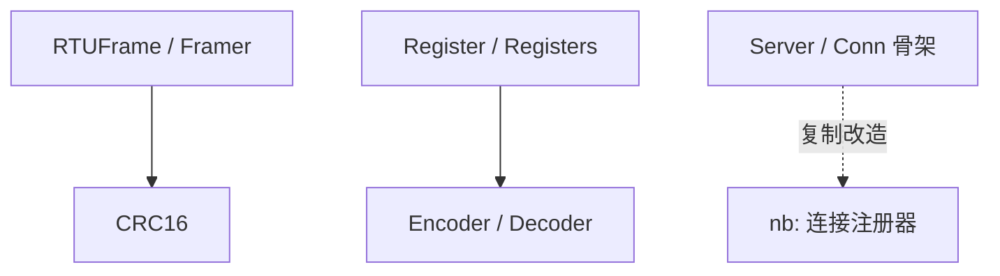

# PA-28｜Go 微型 Modbus 服务端骨架与连接注册器

> **分析对象**：同一 Go module 下的两个包——Modbus 服务端骨架、通用 TCP 连接注册器
> **编号**：PA-28（按脱敏约定，不披露来源标识）
> **技术栈**：Go 1.14；仅标准库 `net`/`log`/`sync`/`encoding/binary`（README 称依赖 zap，代码实为标准库 `log`）
> **规模画像**：12 个 `.go`（10 个 Modbus、2 个连接注册器）、1,374 行；2 个包；成熟度：早期原型，缺 TCP ADU 与功能码分发

---

## 1. 定位与问题域

### 1.1 它是什么

`modbus` 提供 RTU 帧的解析/序列化（含 CRC16）、寄存器抽象模型（`Register`/`Registers` + `Encoder`/`Decoder`）、异常码表，以及一个与协议无关的 TCP 服务端骨架（accept、每连接生命周期、收发通道）。`nb` 把该骨架复制改造为"按设备 ID 管理 TCP 长连接"的注册器。全包只有 `RTUFrame`，没有 MBAP/TCP ADU；功能码仅 0x03/0x10/0x05 三个常量，无分发器。

### 1.2 面向的用户与场景

想解析 RTU 帧的开发者（校验 CRC、拆地址/功能码/数据）；做接入试验的人（按设备 ID 维护多条 TCP 连接）；评估 Modbus 实现的读者。它不适合现场：没有主站、没有从站协议栈、没有点表与调度。

### 1.3 边界（不做什么）

不做 MBAP/TCP ADU、功能码分发、异常响应生成、寄存器读写执行；不做主站；不做 NB-IoT 的 CoAP/LwM2M/AT；不做配置、持久化、部署、CI 与许可声明。

---

## 2. 功能分析

### 2.1 功能域总览

| 功能域 | 实现方式 | 完成度 |
|---|---|---|
| RTU 帧 | `RTUFrame` + `NewRTUFrame`，校验长度与 CRC16 | 可用 |
| 寄存器模型 | `Register`/`Registers` 整块 Encode/Decode，支持相对/绝对偏移 | 可用，边界有缺陷 |
| TCP 骨架与注册 | accept、每连接 goroutine、收发通道；按设备 ID 查找/替换 | 骨架级，注册有缺陷 |

### 2.2 协议与接口覆盖

| 协议/接口 | 角色 | 传输 | 备注 |
|---|---|---|---|
| Modbus（RTU/TCP） | 帧编解码 / — | RTU：串口（未实现 IO）；TCP：无 MBAP/ADU | 仅 RTU 帧结构与 CRC；TCP 用的是通用骨架 |
| NB-IoT | — | TCP | 仅连接注册，非协议实现 |

### 2.3 典型使用流程

`NewRTUFrame(packet)` 校验长度与 CRC 后拆出地址/功能码/数据，`frame.Bytes()` 重拼并补 CRC；`Registers.Encode`/`Decode` 按各寄存器起始地址在连续缓冲区上整块读写。服务端为 `NewServer()` → 设 `Handler` → `go StartServer(":6500")` → 每读一帧 `go Handler(c, buf)`。

---

## 3. 架构分析

### 3.1 分层与模块

两个包互不 import，`nb` 是骨架的复制改造；没有共享 `Conn` 抽象，也没有协议接口。

### 3.2 关键抽象与接口

| 抽象 | 职责 | 边界 |
|---|---|---|
| `Framer` | 序列化、取功能码/数据、设异常 | 只有 RTU 实现 |
| `Register`/`Registers` | 名称、起始地址、数量、整块编解码 | 假设连续块；无类型/字节序/位域 |
| `Server`/`Conn` | accept、读循环、收发通道、关闭 | 无协议语义，Handler 决定一切 |

### 3.3 数据流与时序

读方向 `accept` → `serve()` 循环 `read()`（3 分钟 deadline）→ 每帧 `go Handler`；写方向 `Send(data)` 投 `bridgeCh` → 另一 goroutine `Receive()` 取出 → `Write()` 到 socket。`Send`/`Receive` 共用容量 1 的 `bridgeCh`，方向靠调用方约定；`Server.Addr` 与 `StartServer(address)` 参数并存，但后者忽略前者。

### 3.4 并发与连接管理

| 主题 | 做法 | 评价 |
|---|---|---|
| goroutine | 每连接一个 `serve`，每帧再起 Handler | 帧处理无序、可能重入 |
| 通道/限速 | `bridgeCh` 容量 1，收发各 5 秒超时；`Write` defer 内 `sleep 1s` | 双向共用、语义含糊；吞吐硬编码 1 次/秒 |
| 关闭/注册 | 判断后置位关闭；`SetID` 遍历关同 ID 旧连接 | 关闭非原子（推断会重复 close）；注册回调恒返回 false，只查首元素 |

### 3.5 配置、部署与工程质量

- **配置/部署/质量**：仅 `MaxBytes`（默认 500）/`Timeout`（默认 3 分钟）/`debug`，端口写死在测试（`:6500`）；连接只在内存 `sync.Map`；`go build` 单二进制，无 Dockerfile、无 CI、无 tag、无 LICENSE。工程质量上，文件职责清晰，但两个 `TestServer_Serve` 只启动服务并等信号、无断言，`go test ./...` 实测超时（exit 124）；`register.go` 用 `start > l+1` 判越界（允许越界 1 字节），`util.go` 用 `_ = packet[5]`，短包直接 panic；仅 `crc.go` 保留上游 MIT 头。整体无重连、无指标、无 TLS/鉴权，仅适合隔离网络内的试验。

---

## 4. 需求分析

### 4.1 显性需求

解析/生成 RTU 帧并按寄存器块编解码业务值；提供可按设备 ID 管理 TCP 连接的轻量服务端。它没有声称要做完整 Modbus 栈或网关。

### 4.2 隐性需求

`Registers` 把一组寄存器当连续内存块：整块 `Encode` 产出 `GetNum()*2` 字节，`Decode` 按相对/绝对偏移切片。这隐含三个假设——地址连续、值占整数个 16 位字、字节序统一。

| 隐性需求 | 本方案的处理 | 若缺失的后果 |
|---|---|---|
| 地址空洞表达 | 用 `start`/`num` 手工对齐，块内不允许空洞 | 点表稍不规则就整块失效 |
| 类型/字节序/位域 | 由各 `Encoder`/`Decoder` 自行约定；位域与线圈无模型 | 浮点/32 位整数易错位；线圈/离散量无法表达 |
| 错误传播 | 只有异常码表，`Decode` 不返回 error | 坏数被当正常值 |

### 4.3 需求缺口与误判

| 缺口 | 代码证据 | 影响 |
|---|---|---|
| 无 TCP ADU / 无功能码分发 | 无 MBAP 结构，仅 3 个功能码常量 | 不能直接对接 Modbus TCP 主站；每个调用方重写协议逻辑 |
| `nb` 名不副实 | 仅 TCP 连接注册 | 评估"NBIoT 支持"时会误判 |
| `SetID` 只查首元素 | `Range` 回调恒返回 false | 同 ID 旧连接可能不被关闭 |

---

## 5. 可借鉴与应规避

### 5.1 可直接吸收的机制

1. **相对/绝对偏移解码**：按"数据长度 vs 寄存器总字数"判断报文是紧凑块还是带前缀的上报块，再决定切片起点——适合"上报整段、只关心一段"。
2. **`Encoder`/`Decoder` 双接口 + 表驱动 CRC16**：把"值 ↔ 字节"从寄存器模型拆出；CRC 表懒初始化，读多写少时开销低。

### 5.2 明确应规避的做法

| 做法 | 问题 | 目标产品应如何做 |
|---|---|---|
| 复制骨架做第二个包 | `nb` 与 `modbus` 重复维护 | 抽公共 `Conn`/`Server`，差异用 Handler 注入 |
| `Send`/`Receive` 共用通道、`Write` 里 `sleep 1s` | 上下行混淆；吞吐写死 | 上下行各一条通道；令牌桶限速 |
| 检查-置位式 `Close`、`SetID` 只查首元素 | 并发重复 close；旧连接不关 | `sync.Once`/CAS；命中后再停遍历 |

迁移成本：RTU 帧、CRC、字节序工具约数百行，可对照重写或换成熟库；寄存器偏移思路可用但需补边界与类型；服务端骨架需重做通道与关闭模型；功能码分发要从零实现。

---

## 6. 结论

### 6.1 六维评分

| 维度 | 分数(1-5) | 理由 |
|---|---|---|
| 协议广度 | 1 | 仅 RTU 帧；无 TCP ADU、无功能码分发；`nb` 非协议实现 |
| 架构可演进性 | 1.5 | 分层清楚，但无协议接口与插拔点，扩展靠复制 |
| 跨平台能力 | 3 | 纯 Go 标准库，理论跨平台；未验证 |
| 可运维性 | 1.5 | 有超时/字节数上限/Debug，但无指标、无分级日志、无健康检查 |
| 工程质量 | 1.5 | 结构清晰、CRC 正确；但测试挂起、`SetID` 缺陷、`Close` 竞态 |
| 许可与合规风险 | 1.5 | 无根 LICENSE，默认保留所有权利；仅 CRC 文件带上游 MIT 头 |

### 6.2 三条关键结论

1. **它是"RTU 帧 + 寄存器解码"的最小切片，不是 Modbus 协议栈**：三个功能码只是常量，没有分发、没有从站执行、没有 MBAP，当 TCP 网关用会严重高估。
2. **相对/绝对偏移解码是真正可复用的部分，但必须重写边界与类型**：它承认"设备上报整段、只关心一段"的现实，比"假设地址连续"更接近现场。
3. **服务端骨架是反面教材，连接注册器是半成品**：双向共用通道、1 秒写间隔、检查-置位式关闭、`SetID` 只查首元素，都说明它停留在"能跑通"阶段；可借鉴的是意图而非实现。
