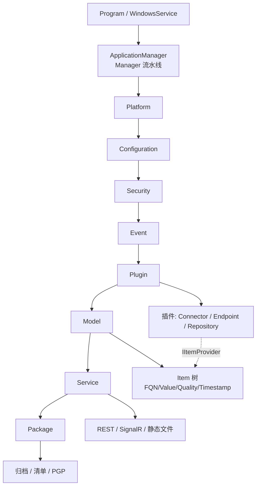

# PA-29｜C# 插件化 IoT 应用平台骨架

> **分析对象**：桌面/服务双模应用平台（C# 解决方案：核心运行时、SDK、两套测试工程）
> **编号**：PA-29（按脱敏约定，不披露来源标识）
> **技术栈**：C# / .NET Framework 4.6.1；OWIN 自宿主 + Web API + SignalR；Swashbuckle；NLog；Newtonsoft.Json；BouncyCastle（PGP）；xUnit + Moq
> **规模画像**：258 个 `.cs` / 51,395 行（Core 87、SDK 104、Core.Tests 39、SDK.Tests 28）；50 个接口、8 个 Manager、8 个 REST 控制器、31 个 `[Route]`、2 个 SignalR Hub、651 个 `[Fact]`
> **成熟度画像**：设计完整的平台骨架 + 暂停维护——单次提交（2018-02）、零协议驱动实现、脚本子系统为空类、许可为 AGPLv3

---

## 1. 定位与问题域

### 1.1 它是什么

一个"数据模型居中"的 IoT 应用平台骨架：8 个 Manager 按固定顺序装配成运行时，把设备/点位抽象成树状 `Item`，对外提供 REST API、SignalR 实时推送与静态文件服务，对内用"Connector / Endpoint / Repository"三类插件扩展数据来源与去向。它不是协议网关：仓库里**没有任何** Connector、Endpoint 或 Repository 的实现，只有三者的接口；也没有内置任何工业协议。

| 事实 | 说明 |
|---|---|
| Core 与 SDK 分离 | SDK 定义接口与模型，Core 提供实现与装配 |
| 8 个 Manager 固定顺序 | Platform → Configuration → Security → Event → Plugin → Model → Service → Package |
| 零驱动 | `IConnector`/`IEndpoint`/`IRepository` 均无实现类 |
| 单次提交、无后续 | 仓库只有一个提交（2018-02-04），README 自述"评估前端框架期间暂停" |

### 1.2 面向的用户与场景

| 用户 | 场景 | 真实诉求 |
|---|---|---|
| 平台架构学习者 | 想看"管理器流水线 + 统一数据模型 + 插件契约"怎么搭 | 可读的分层与装配顺序 |
| 想做 IIoT 中台的团队 | 评估"数据模型居中"是否适合自己 | 复用 Item 模型与 REST/SignalR 外形 |
| 插件作者 | 按接口写 Connector/Endpoint | 明确的插件契约与打包/签名流程 |

它不适合直接交付：没有可用驱动、启动时硬编码示例插件名、插件同进程加载、许可为 AGPLv3。

### 1.3 边界（不做什么）

- **不做协议实现**：无 Modbus/OPC UA/BACnet/MQTT 等任何驱动，只有插件接口。
- **不做插件隔离**：`Assembly.LoadFrom` 直接加载进同一 AppDomain，无进程/域隔离、无热卸载。
- **不做脚本引擎**：`ScriptManager` 是 11 行空类。
- **不做前端**：只提供 API/SignalR/静态文件，界面留给外部 Web 应用。
- **不做多租户/集群**：Manager 全是进程内单例，状态在内存与本地文件。

---

## 2. 功能分析

### 2.1 功能域总览

| 功能域 | 功能点 | 实现方式 | 完成度 |
|---|---|---|---|
| 平台抽象 | 目录、平台类型（Windows/UNIX）、主机指标 | `IPlatform` + 两套实现 | 可用 |
| 配置 | 分层配置、类型注册、默认值 | `ConfigurationManager` + `ConfigurableTypeRegistry` | 可用，含占位表单 |
| 安全 | 用户/角色/会话、令牌校验 | SHA-512 口令、内存会话、OWIN 中间件 | 可用，口令无盐 |
| 事件 | 进程内事件总线 | `EventManager` + 特性标注 | 可用 |
| 插件 | 扫描、加载、实例化、生命周期 | `Assembly.LoadFrom` + 反射 | 骨架级，零实现 |
| 数据模型 | 树状 Item、质量、时标、源链、订阅 | `Item` + `ModelManager` | 设计完整 |
| 服务 | REST、SignalR、Swagger、静态文件 | OWIN + Web API + SignalR | 可用 |
| 打包 | 归档、清单、PGP 签名/校验/信任 | `PackageManager` + BouncyCastle | 可用 |
| 脚本 | — | `ScriptManager` 空类 | 未实现 |

### 2.2 协议与接口覆盖

| 插件/接口 | 角色 | 关键成员 | 仓库内实现 |
|---|---|---|---|
| `IConnector` | 数据来源 | 继承 `IPluginInstance` + `IItemProvider` | 无 |
| `IEndpoint` | 数据去向 | `Result Send(object value)` | 无 |
| `IRepository` | 存储抽象 | 继承 `IPluginInstance` | 无 |
| REST/SignalR | 北向外形 | 8 控制器/31 路由/2 Hub | 可用 |

值得注意的是：插件管理器只把 `Connector` 与 `Endpoint` 列为"可加载类型"，`Repository` 虽有接口却不在加载列表内。

### 2.3 典型使用流程

```
启动：解析命令行 → 实例化 ApplicationManager（8 个 Manager）
  → 依次 Setup → 依次 Start（Platform→…→Package）
  → Startup()：建根 Item、挂 Application/Platform 的 ItemProvider
  → 订阅硬编码的示例 Item → 启动两个示例插件
  → Console.ReadLine() 常驻；停止时逆序 Stop

插件：扫描目录 → Assembly.LoadFrom → 校验四段式 FQN 与插件类型
  → 计算指纹 → Activator.CreateInstance → 注入 manager/名称/logger → 加入 PluginInstances
```

`Startup()` 里写死了"仿真"和"数据库"两个示例插件实例名，并订阅 `…Simulation.DateTime.Time` 等具体 FQN；仓库并不包含这两个插件，因此按现状启动会在此处遇空引用（推断）。

### 2.4 功能完成度评估

"平台外形"完成度高：配置、安全、事件、模型、REST、SignalR、打包都有可运行代码与测试。但"平台实质"为空：没有驱动、没有脚本、没有插件隔离、没有调度；启动流程又绑死示例插件。它更像一个**可编译的架构样板**，而非可部署的产品。

---

## 3. 架构分析

### 3.1 分层与模块



Manager 之间通过构造注入与 `RegisterDependency<T>` 建立依赖；启动正序、停止逆序。SDK 不含任何实现，Core 依赖 SDK。

### 3.2 关键抽象与接口

| 抽象 | 职责 | 边界 |
|---|---|---|
| `IManager` / `Manager` | 名称、状态机、依赖、Setup/Start/Stop、配置 | 进程内单例；无跨进程协调 |
| `Item` | FQN、值、质量、时标、父子、源链、订阅 | 每节点 6 个读写锁；递归读 |
| `IItemProvider` | `Browse()` / `Read(Item)` | 只读抽象；写入靠 `IWriteable` |
| `IConnector` | 插件即数据源 | 无内置实现 |
| `IEndpoint` | 插件即数据出口 | 单方法 `Send(object)` |
| `IRepository` | 插件即存储 | 接口为空，且不被加载 |
| `IPlugin` / `IPluginAssembly` | 指纹、FQN、版本、程序集 | 无隔离/无卸载 |
| `IPackage` / 清单 | 归档、签名、校验 | 仅文件级，不涉及运行时权限 |

关键设计是**数据模型居中**：Connector 通过 `IItemProvider` 把外部点位映射成 `Item` 树，Endpoint 从 `Item` 取值外发，REST/SignalR 直接读写 `Item`。这让"南向/北向/北向 API"共享同一套寻址与质量语义。

### 3.3 数据流与时序

```
读：REST/SignalR → ModelManager.FindItem(FQN) → Item.ReadFromSource()
      ├─ Source=Item      → 递归到 SourceItem
      ├─ Source=Provider  → IItemProvider.Read(item)（链尾）
      ├─ Source=Unknown   → 返回自身 Value
      └─ Source=Unresolved→ null + Bad
    → ChangeValue(value, quality) → 更新 Timestamp → 触发 Changed

写：Item.WriteToSource(value) → SourceItem 递归或 IWriteable.Write → 成功后 ChangeValue
订阅：Item.SubscribeToSource() → 源 Item 的 Changed 或 ISubscribable.Subscribe
```

模型是"拉 + 推"混合：REST 主动读，SignalR 靠 `Changed` 事件推送；订阅按需挂到源上，`SubscriptionsChanged()` 在没有监听者时自动退订。

### 3.4 并发与连接管理

| 主题 | 做法 | 评价 |
|---|---|---|
| 锁粒度 | 每个 `Item` 持有 6 个 `ReaderWriterLockSlim`（父子/子集/值/源/提供者/孙集） | 正确性有余、可扩展性不足；万级点位即锁爆炸 |
| 读传播 | `ReadFromSource()` 先递归子节点再读自身 | 一次读可能触发整棵子树 I/O |
| 会话 | 内存字典 + 过期清理（默认 900s、滑动、1800s 清理） | 单机可用；重启即失效 |
| 插件 | 同 AppDomain、`Assembly.LoadFrom` | 无隔离、无法安全卸载 |
| 服务器 | OWIN HttpListener 自宿主 | 单进程；无反向代理/限流/健康检查 |

### 3.5 配置、持久化与部署

- **配置**：`ConfigurationManager` 持有各 Manager 的配置实例；`ConfigurableTypeRegistry` 按类型注册；默认配置在代码里构造。
- **持久化**：配置与模型可序列化到本地文件；会话/事件/插件实例只在内存。无数据库耦合（`Repository` 是留给插件的口子）。
- **部署**：Windows 服务安装/卸载参数 + 控制台交互双模；README 声称经 Mono 跨平台，但 UNIX 平台实现只是目录/平台类型适配。

### 3.6 扩展机制

扩展点只有"写插件"：实现 `IConnector`/`IEndpoint`（理论上有 `IRepository`），打成程序集，按 `<Product>.Plugin.[Connector|Endpoint].Name` 四段式命名，放进目录后由 `PluginManager` 扫描加载。没有服务注册表、没有依赖注入容器、没有版本共存/热加载；插件之间也不能互相发现（除非通过 Model）。

### 3.7 工程质量观察

| 观察项 | 事实 |
|---|---|
| 测试 | 651 个 `[Fact]`（Core.Tests 412 / SDK.Tests 239），Moq 参与；覆盖模型、配置、打包、平台 |
| CI | AppVeyor + Travis + OpenCover/Codecov 徽章 |
| 文档 | README 引用的 `doc/img` 目录不存在；架构文档自述"不可用" |
| 空实现 | `ScriptManager` 11 行空类；`Shutdown()` 方法体只有一句注释 |
| 占位配置 | `PluginManager.GetConfigurationDefinition()` 返回硬编码的"姓名/邮箱/评论"表单与 JSON Schema，与插件配置无关 |
| 启动耦合 | `Startup()` 硬编码示例插件名与 Item FQN |
| 许可 | AGPLv3（网络使用即触发源码开放） |

---

## 4. 需求分析

### 4.1 显性需求

1. 从工业数据源采集数据，并送到一个或多个目的地。
2. 数据源与目的地由插件决定，平台不内置协议。
3. 提供 REST API、实时推送与静态前端托管，供外部应用读写数据。
4. 提供用户/角色/会话与打包签名，保证基本安全与插件可信。

### 4.2 隐性需求：统一模型要同时承载"值"与"来源"

`Item` 把 FQN、值、质量、时标、来源、父子、访问模式塞进一个节点，隐含了四个需求：

| 隐性需求 | 本方案的处理 | 若缺失的后果 |
|---|---|---|
| 统一寻址 | 点分 FQN，父子即路径 | 跨协议点位无法并列 |
| 质量与时标 | `Quality` 三态 + `Timestamp` | 上层无法区分坏数与旧值 |
| 来源可追溯 | `SourceFQN`/`SourceItem`/`Provider` 三选一 | 无法做"点位映射/转发" |
| 订阅可传播 | `Changed` + `ISubscribable` 按需挂载 | 实时推送只能轮询 |

但它把"访问模式""父子锁""来源解析"都压进同一个类，导致 `Item` 达 1,231 行、6 把锁；模型越统一，单节点越重。

### 4.3 非功能需求

| 维度 | 现状 | 判断 |
|---|---|---|
| 启动/部署 | 单进程自宿主，可装 Windows 服务 | 中；无容器/无编排 |
| 吞吐 | 每 Item 6 锁 + 递归读 | 低；面向单板/小规模 |
| 可观测性 | NLog + 仪表盘（CPU/内存/磁盘）+ 实时日志 Hub | 中；无指标/追踪/告警 |
| 安全 | 无盐 SHA-512、CORS 全开、默认弱口令 | 弱；仅限隔离网络 |
| 合规 | AGPLv3 | 高风险的商业引入障碍 |

### 4.4 需求缺口与误判

| 缺口 | 证据 | 影响 |
|---|---|---|
| 零协议驱动 | `IConnector`/`IEndpoint`/`IRepository` 无实现 | 开箱不能采集任何设备 |
| 插件无隔离 | `Assembly.LoadFrom` 进同 AppDomain | 插件崩溃/恶意代码可拖垮宿主 |
| 无热加载 | 无卸载/重载路径 | 升级插件必须重启 |
| 启动绑死示例 | `Startup()` 硬编码实例名与 FQN | 缺插件即启动失败 |
| 脚本为空 | `ScriptManager` 空类 | "可编程平台"名不副实 |
| 配置表单占位 | 返回姓名/邮箱/评论示例 | 配置界面无法真正编辑插件参数 |
| 许可为 AGPL | 根 LICENSE | 商业分发/联网服务需开源 |

---

## 5. 可借鉴与应规避

### 5.1 可直接吸收的机制

1. **Manager 流水线与生命周期**：固定顺序装配、正序启动/逆序停止、统一 `Setup/Start/Stop` 与状态机，是"多子系统宿主"的清晰骨架。
2. **数据模型居中**：南向驱动、北向出口、北向 API 共享同一 `Item` 树与质量/时标，避免三套点位模型。
3. **来源链与按需订阅**：`SourceFQN → SourceItem/Provider` 的解析链，加上"有监听才订阅"的引用计数式退订，适合"映射/转发"场景。
4. **插件四段式 FQN + 指纹**：用命名约定表达"产品.插件.类型.名称"，用"程序集 SHA-256 再哈希并加盐"做指纹，便于清单校验。
5. **打包即签名**：归档 + 清单 + PGP 签名/校验/信任的分层，比"直接拷 DLL"更接近可运维的插件分发。

### 5.2 明确应规避的做法

| 做法 | 问题 | 目标产品应如何做 |
|---|---|---|
| 插件同 AppDomain 加载 | 无隔离、无法卸载、崩溃连带 | 独立进程/AssemblyLoadContext，按插件隔离 |
| 每 Item 6 把锁 + 递归读 | 规模一大就锁竞争与放大读 | 快照/不可变值 + 批量读计划 |
| 启动硬编码示例插件 | 缺插件即启动失败 | 配置驱动装配，缺插件降级为告警 |
| 配置表单写死示例 | 设置界面形同虚设 | 由配置模型生成表单/Schema |
| 无盐 SHA-512 口令 | 彩虹表/撞库 | Argon2/bcrypt/PBKDF2 + 随机盐 |
| AGPLv3 直接商用 | 联网服务需开源 | 选 Apache/MIT，或法务评估后隔离 |
| 空类/空方法留在主干 | 误导使用者 | 明确标注未实现并移出发布路径 |

### 5.3 迁移到目标产品的成本

| 机制 | 迁移成本 | 说明 |
|---|---|---|
| Manager 流水线/生命周期 | 中 | 思想可直接借鉴，需替换依赖注入与配置来源 |
| Item 模型（FQN/质量/时标/源链） | 中 | 语义可复用；锁与递归读需重写 |
| REST/SignalR 外形 | 低 | 路由与 Hub 结构可参考 |
| 打包/签名 | 中 | PGP 流程可复用，需换密钥管理 |
| 插件隔离/热加载 | 高 | 本方案没有，需从零设计 |
| 协议驱动 | 高 | 本方案零实现，等于全部自研 |

---

## 6. 结论

### 6.1 六维评分

| 维度 | 分数(1-5) | 理由 |
|---|---|---|
| 协议广度 | 1 | 零协议驱动，仅有 Connector/Endpoint/Repository 接口 |
| 架构可演进性 | 4 | Manager 流水线、数据模型居中、插件契约清晰，是本批方案里架构最完整的之一 |
| 跨平台能力 | 2.5 | .NET Framework 4.6.1 + Mono 声明 + Windows 服务；UNIX 仅适配层 |
| 可运维性 | 3 | NLog、REST、SignalR、Swagger、仪表盘齐全；缺指标/追踪/健康检查 |
| 工程质量 | 3.5 | 651 个测试 + 双 CI；但空类、占位表单、硬编码启动、单提交暂停维护拉低上限 |
| 许可与合规风险 | 1.5 | AGPLv3，联网服务即触发开源义务，商业引入风险高 |

### 6.2 三条关键结论

1. **它是"IoT 应用平台骨架"，不是"协议网关"。** 价值在 Manager 流水线、Item 模型与插件契约；协议驱动一个都没有，评估时不能把"有接口"当成"有能力"。
2. **`Item` 模型是本批方案里最值得借鉴的单一设计。** FQN 寻址、三态质量、UTC 时标、来源链、按需订阅，五件事一次说清；但 6 把锁与递归读决定了它只能跑小规模，迁移时要把"重节点"改成"轻快照 + 批量读"。
3. **它的工程完成度与产品完成度严重背离。** 651 个测试、双 CI、Swagger、SignalR、PGP 打包都真实存在，同时脚本是空类、配置表单是占位、启动绑死示例插件、驱动为零、许可是 AGPL——适合当架构参考，不适合当交付底座。

---

**附：数量来自 `find`/`wc -l`、`grep -c '\[Fact\]'`、`grep '\[Route'` 与 `git log -1` 实测。** 接口数按 `interface I…` 声明去重计；控制器按 `public class …Controller` 计；插件"零实现"按全仓无 `: IConnector/IEndpoint/IRepository` 判定。
