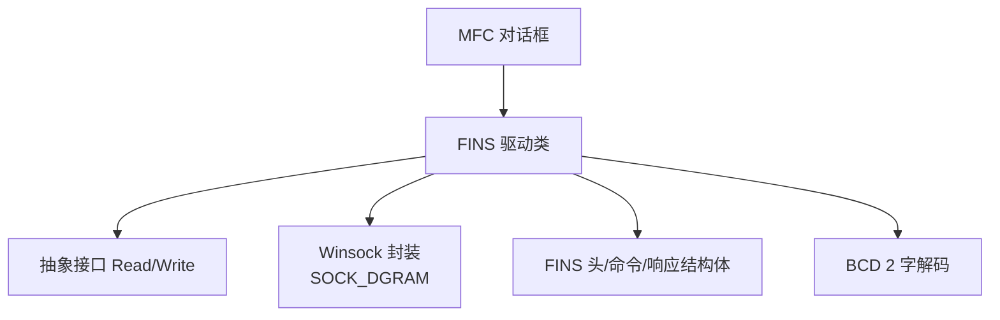

# PA-30｜C++ FINS/UDP 读取演示程序

> **分析对象**：Windows MFC 对话框程序 + 一个 FINS 驱动类 + 一个 Winsock 封装
> **编号**：PA-30（按脱敏约定，不披露来源标识）
> **技术栈**：C++ / MFC / Visual Studio 2012（工具集 v110）；Winsock；Debug 多字节、Release Unicode
> **规模画像**：29 个文件（含 Debug 构建产物）、17 个源文件（`.h`/`.cpp`）、1,352 行；单工程、单协议、单命令
> **成熟度画像**：一次性演示——只实现 FINS/UDP 的 0101 读、只读 DM 区、写为空、无测试/CI/许可

---

## 1. 定位与问题域

### 1.1 它是什么

一个 MFC 对话框程序，点"确定"后用 FINS/UDP 连到一台 PLC，读一个 DM 字并格式化成字符串。协议逻辑集中在驱动类：构造函数写死 10 字节 FINS 头，`MakeCmd` 拼 0101 请求，`PlcSendRecv` 走 UDP 收发，`CvtPlcToDbl_2WORD` 把两个字的 BCD 值转成 double。界面层只有一个按钮，没有点位表、没有配置、没有日志。

四条硬边界：socket 用 `SOCK_DGRAM`，无 FINS/TCP 的 4 字节头；0102 写只在结构体与 `MakeCmd` 分支里出现，从未被调用；`Write` 方法体为空；`Read` 不解析入参，恒读 DM1000。

### 1.2 用户、场景与边界

想确认"FINS 帧长什么样、BCD 怎么转"的开发者，或需要在实验室从一台 PLC 读一个 DM 字的学生/工程师。它不适合现场：没有超时、重连、点位表，也没有写与错误处理。不做 FINS/TCP、0102 写、CI/O/CIO 等其它存储区、位操作、多设备/多点位、配置与日志、许可声明。

---

## 2. 功能分析

### 2.1 功能域与协议覆盖

| 功能域 | 实现方式 | 完成度 |
|---|---|---|
| FINS 头 | 构造函数写死 10 字节常量（ICF=`0x80`、GCT/DNA=2、DA1=2、SA1=SA2=1、SID=0） | 可用，仅一种节点配置 |
| 0101 读请求 | `MakeCmd` 填命令/区号/地址/字数；仅 DM 区（0x82） | 可用 |
| 0102 写 | 结构体与分支存在，从未被调用 | 未实现 |
| FINS/TCP | 无 4 字节长度头，socket 为 `SOCK_DGRAM` | 无 |
| UDP 收发 | `connect` + `send`/`recv`，无超时 | 可用 |
| 响应解码 | `CvtPlcToDbl_2WORD` 解 4 位 BCD + 符号 + 标度 | 可用，只解前 2 字 |
| 写与界面 | `Write` 空方法；MFC 单按钮，硬编码 IP/端口 | 未实现 / 演示级 |

请求结构可核实为 18 字节：10 字节头 + 2 字节命令（`0x01 0x01`）+ 1 字节区号（`0x82`）+ 3 字节地址（2 字节字地址 + 1 字节位选择=0）+ 2 字节字数。

### 2.2 典型使用流程

```
点"确定" → 创建驱动对象 → ConnectPLC(固定端口, 固定内网 IP)
  → Read("D1000", value) → PlcDateGet(0, 2, 1000, ...)   // addrPLC 被丢弃
      → MakeCmd(0101, 2, 1000) → SendFrameValue → RecvFrameValue
      → 校验响应码 → CvtPlcToDbl_2WORD(前 2 字) → push 进 vector
  → 取 vector[0] 格式化为 "%f"；结果字符串未使用，驱动对象未释放
```

---

## 3. 架构分析

### 3.1 分层与模块



分层名义上存在（界面 → 驱动 → socket），但驱动类同时承担协议拼包、收发、解码与缓存，抽象接口的 `Read`/`Write` 还是带空实现的非纯虚函数。

### 3.2 关键抽象与接口

抽象接口只声明 `Read`/`Write` 两个 `virtual void`，且都带空默认实现，子类可只覆盖其一；驱动类以单例式工厂 `Create()` 暴露，却把连接、拼包、收发、解码、缓存全部收进自身，调用方还需负责释放（实际从未 `delete`）；Winsock 封装负责建 socket、连接、收发、关闭，但无超时、无错误码，收发失败直接关 socket。

### 3.3 数据流、时序与连接管理

读路径是同步阻塞：`send` 后 `recv` 一直等；`PlcDateGet` 用 `GetTickCount()` 记录起止时间却从不使用，说明超时从未真正实现。响应只取 `pData` 的前 4 字节交给解码函数，其余字节被忽略。连接侧单线程、无锁、无 `SO_RCVTIMEO`：UDP `connect` 只设默认对端，无握手/心跳，对端不回包即永久阻塞，失败后只能重启程序；析构里的 `closesocket` 也因 `Create()` 出来的对象从未 `delete` 而不会触发。

### 3.4 配置、部署与工程质量

- **配置与部署**：IP/端口写死在按钮回调里；无配置文件、无命令行参数、无安装程序。工程为 VS2012（v110）MFC 对话框，Debug 多字节、Release Unicode 两套字符集。
- **工程质量**：无测试、无 CI、无 README（仅有 MFC 向导模板说明）、无 LICENSE；Debug 目录的 `.log`/`.idb`/`.res`/`.lastbuildstate` 被提交进仓库；源码注释为 GBK，跨环境打开易乱码。`RecvFrameValue` 在 `recv` 返回后直接写 `bufFrame[retFrame] = '\0'`，未检查越界；`PlcDateGet` 把 `address` 按 `send*900` 递增（实际每包字数是 `nch`），多包读会跳地址。

---

## 4. 需求分析

### 4.1 显性需求

从一台 PLC 读一个 DM 字并显示/返回。它没有声称要做通用驱动，因此不能按"网关驱动"标准苛责；但可作为"FINS 帧最小实现"的参照。

### 4.2 隐性需求与需求缺口

即使只读一个点，也需要可配置的对端与地址、明确的字数与类型、超时与重试、错误码到可读信息的映射，以及"这次读到的值"而不是"历史上第一次读到的值"。本方案在这些点上大多缺失：

| 隐性需求 | 本方案的处理 | 若缺失的后果 |
|---|---|---|
| 地址可配 | `Read` 丢弃 `addrPLC`，恒调 `PlcDateGet(0,2,1000,…)` | 入参 `"D1000"` 只是装饰 |
| 字数/类型可配 | 字数写死 2，每包只解 BCD 2 字的首字 | 无法读位/字符串/浮点，多字只取首字 |
| 本次值语义 | `m_ReadDate` 只增不减，恒取 `[0]` | 返回值永远滞后 |
| 错误可区分 | `PlcSendRecv` 覆盖发送错误、失败返回 0，上层只判 `<0` | 网络错误后解码残留缓冲 |
| 缓冲安全 | `bufFrame[retFrame]='\0'` 无长度检查 | 满包时越界 1 字节 |
| 写能力 | `Write` 空方法 | 只能读不能控 |
| 对端可配 | 回调里写死端口与内网 IP | 换设备要改代码重编 |

---

## 5. 可借鉴与应规避

### 5.1 可直接吸收的机制

1. **FINS 头的字段化**：把 ICF/RSV/GCT/DNA/DA1/DA2/SNA/SA1/SA2/SID 拆成 10 个具名段，比"魔数数组"更易核对。
2. **0101 请求的最小布局**：命令 2 字节 + 区号 1 字节 + 地址 3 字节 + 字数 2 字节，是 FINS 读的标准形状，可直接对照实现。
3. **BCD 2 字解码**：4 位 BCD + 符号字节 + 标度字节（1/10/100/1000/10000）的查表，适合老式仪表类点位。

### 5.2 明确应规避的做法

| 做法 | 问题 | 目标产品应如何做 |
|---|---|---|
| `SOCK_DGRAM` 无超时 | 对端离线即永久阻塞 | 设 `SO_RCVTIMEO` + 重试/退避 |
| 忽略发送错误、失败返回 0 | 错误被当成功 | 统一返回错误码，调用方显式分支 |
| 结果缓存只增不减 | 返回值永远滞后 | 每次读重置结果或用局部变量 |
| `bufFrame[retFrame]='\0'` | 满包越界 | 先判 `retFrame < lengthFrame` |
| 地址/对端硬编码 | 换设备要改代码 | 配置化 + 校验 |
| 提交 Debug 产物 | 仓库噪声与信息泄露 | `.gitignore` 排除 `Debug/`、`*.idb`、`*.log` |

迁移成本：FINS 头与 0101 布局可直接对照重写（低）；BCD 解码可复用（低）；socket 封装、错误处理、超时、缓存语义需重做（中）；写、TCP、其它存储区、点位表需从零实现（高）。

---

## 6. 结论

### 6.1 六维评分

| 维度 | 分数(1-5) | 理由 |
|---|---|---|
| 协议广度 | 1 | 仅 FINS/UDP 的 0101 读，仅 DM 区；写与 TCP 均无 |
| 架构可演进性 | 1.5 | 有抽象接口与工厂，但单类承担全部职责，地址/对端硬编码 |
| 跨平台能力 | 1 | MFC + Winsock + VS2012，只能 Windows |
| 可运维性 | 1 | 无配置、无日志、无超时、无重连；对端写死 |
| 工程质量 | 1 | 无测试/CI/许可；缓存滞后、错误吞掉、越界写、构建产物入库 |
| 许可与合规风险 | 1 | 无 LICENSE，默认保留所有权利 |

### 6.2 三条关键结论

1. **它是"FINS/UDP 读一个 DM 字"的演示，不是驱动。** 入参地址被丢弃、写为空、只解前 2 字、缓存从不清空——"能读一次"与"能持续读点"之间差着整个驱动层。
2. **可复用的只有协议形状，不是实现。** 10 字节头、18 字节 0101 请求、BCD 2 字解码值得对照重写；socket、错误、超时、缓存四处都必须推翻。
3. **它的缺陷集中在"错误路径"：** 发送错误被覆盖、失败返回 0 被当成功、满包越界 1 字节、对象泄漏。现场一旦断网或换设备，这些问题会同时出现，因此只能当协议样例，不能当底座。

**附：数量来自 `find`/`wc -l`（29 个文件、17 个源文件、1,352 行）与源码逐条核对；工程工具集/字符集取自 `.vcxproj`。**
