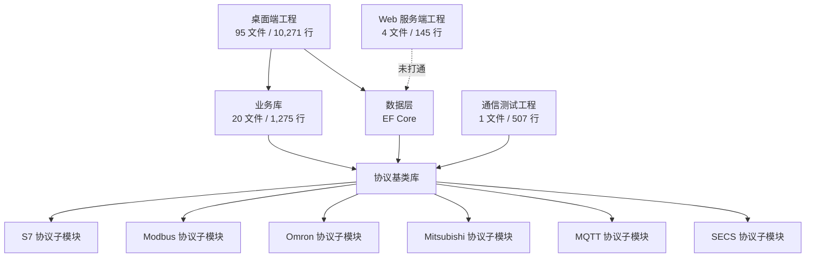

# PA-31｜WPF 多协议桌面通信平台

> **分析对象**：面向半导体/3C 产线的桌面上位机（WPF 采集端 + 协议基类库 + 配套 Web 服务端）
> **编号**：PA-31（按脱敏约定，不披露来源标识）
> **技术栈**：C# / .NET 6；桌面端 `net6.0-windows`，协议与业务库 `net6.0`；MVVM 工具包 8.2、控制反转容器、WPF UI 组件库 3.5.1、停靠布局组件 4.72.1、对象映射器 13、Excel 组件 6.1、EF Core 7（SQLite/SqlServer）
> **规模画像**：175 个 `.cs`、16 个 `.csproj`、31 个 `.xaml`，合计约 21,011 行；桌面端 95 文件 / 10,271 行，协议库合计 58 文件 / 8,939 行，业务分层 20 文件 / 1,275 行，通信测试 1 文件 / 507 行
> **成熟度画像**：原型后期（协议清单完整、骨架成型，但 SECS/GEM 之外多为桩实现；仅 1 个必然失败的测试；无持续集成）

---

## 1. 定位与问题域

### 1.1 它是什么

一个把"多品牌设备接入"收敛到统一配置模型之下的 C# 上位机方案：南向覆盖 S7、Modbus（RTU/ASCII/TCP/UDP）、欧姆龙 FINS（串口/TCP）、欧姆龙 CIP、三菱 MC 3E、MQTT（客户端与服务端）、SECS/GEM（HSMS）九类协议，中间以 EF Core 管理设备/变量/通道配置，北向附带一个尚未成型的 Web 管理端。

它的自我定位不是"某协议的驱动库"，而是**一个可扩展的多协议采集与控制底座**。判断依据来自三处代码事实：

| 事实 | 说明 |
|---|---|
| 协议以"基类 + 子模块"组织，共 58 个文件 / 8,939 行 | 协议实现与桌面端分离，具备独立复用意图 |
| 连接基类内置五态状态机与有界重连 | 作者把"连接可用性"当作一等公民建模 |
| Modbus 子模块集中实现 8 种字序与位操作 | 跨品牌字节序差异被抽象为可配置项 |

与 PA-06（Java 模块化网关）相比，本方案的广度更宽（含 SECS/GEM 半导体协议），但深度更浅：清单上九类协议中，仅 Modbus 与 S7 具备较完整的读写路径，其余多为骨架。

### 1.2 面向的用户与场景

| 用户 | 场景 | 真实诉求 |
|---|---|---|
| 产线集成商 | 一套上位机对接西门子/欧姆龙/三菱混合产线 | 协议覆盖广、配置可视化、能快速换型 |
| 半导体设备厂商 | 设备需与主机做 SECS/GEM 通信 | Stream/Function 可控、会话定时器可调 |
| 现场调试工程师 | 停机后排查"为什么采不到数" | 连接状态可见、报文可抓 |
| 二次开发者 | 复用协议库做自己的上位机 | 协议库可独立引用、不绑 UI |

### 1.3 边界（不做什么）

- **不做组态/HMI 画面编辑**：桌面端以变量绑定为主，没有画面编辑器与报警组态。
- **不做规则引擎**：无脚本、无规则 DSL，采集即轮询、处理即绑定。
- **不做真正的服务端**：Web 工程仅有一个控制器返回假数据，非生产形态。
- **不提供模拟器**：通信测试工程只有 1 个文件，未提供从站模拟能力。
- **不支持跨平台桌面**：桌面端锁定 `net6.0-windows`，仅协议库保持平台无关。

---

## 2. 功能分析

### 2.1 功能域总览

| 功能域 | 功能点 | 实现方式 | 完成度 |
|---|---|---|---|
| 设备与变量建模 | 设备、通道、变量三层；变量含地址/类型/位序 | EF Core 实体 + 代码优先迁移 | 完整 |
| 协议驱动 | 九类协议各含驱动子模块 | 基类 + 具体协议类 | 部分（多数为桩） |
| 通道管理 | 串口（RTU/ASCII）与网络（TCP/UDP） | `SerialPort` / `TcpClient` / `UdpClient` | 完整 |
| 连接管理 | 五态状态机 + 自动重连 | 连接基类统一封装 | 完整 |
| 位序与位操作 | 8 种字序；读位/置位/反转/取反 | Modbus 子模块集中实现 | 完整 |
| SECS/GEM 报文 | 4 Stream / 29 Function 的消息模型 | Stream/Function 类 + 定时器 | 部分（发送为空） |
| 配置持久化 | SQLite / SqlServer 双后端 | EF Core 7 | 完整 |
| Web 管理端 | 单一控制器 + 假数据 | ASP.NET Core | 脚手架 |

### 2.2 协议与接口覆盖

| 协议 | 角色 | 传输 | 子模块（角色名） | 备注 |
|---|---|---|---|---|
| S7 | 主站 | TCP | S7 协议子模块 | 支持主流 S7 型号 |
| Modbus RTU | 主站 | 串口 | Modbus 协议子模块 | 含 ASCII 变体 |
| Modbus ASCII | 主站 | 串口 | Modbus 协议子模块 | 共享帧封装 |
| Modbus TCP | 主站 | TCP | Modbus 协议子模块 | 寄存器/线圈读写 |
| Modbus UDP | 主站 | UDP | Modbus 协议子模块 | 复用 TCP 编解码 |
| 欧姆龙 FINS 串口 | 主站 | 串口 | Omron 协议子模块 | — |
| 欧姆龙 FINS TCP | 主站 | TCP | Omron 协议子模块 | — |
| 欧姆龙 CIP | 主站 | TCP | Omron 协议子模块 | — |
| 三菱 MC 3E | 主站 | TCP | Mitsubishi 协议子模块 | 3E 帧格式 |
| MQTT 客户端 | 客户端 | TCP | MQTT 协议子模块 | 订阅/发布 |
| MQTT 服务端 | 服务端 | TCP | MQTT 协议子模块 | 内置 broker |
| SECS/GEM HSMS | 设备侧 | TCP | SECS 协议子模块 | 半导体主机通信 |

核实方式：协议子模块枚举与类名逐一计数，协议库合计 58 个 C# 文件 / 8,939 行；SECS/GEM 子模块内定义 4 个 Stream（S1/S7/S8/S10）与 29 个 Function。

### 2.3 核心功能：连接管理

连接基类提供五态状态机：断开、连接中、已连接、重连中、故障。重连策略为固定 3000ms 间隔、最多 3 次，超限后转入故障态。这一设计把"连接是否可用"从散落的布尔标志收敛为显式状态，是方案中最扎实的通用能力之一。串口与网络两类通道共用该基类，协议子模块只关心报文编解码。

### 2.4 核心功能：位序与位操作

Modbus 子模块定义 8 种字序：`ABCD`、`BADC`、`CDAB`、`DCBA`、`ABCDEFGH`、`GHFEDCBA`、`BADCFEHG`、`GHEFCDAB`，覆盖 16 位与 32 位寄存器的高低字节/高低字交换组合。位操作提供读位、置位、反转、取反四类语义，供线圈与离散量读写复用。这套抽象直接解决了跨品牌 PLC 的字节序差异。

### 2.5 核心功能：SECS/GEM 消息模型

SECS/GEM 子模块按 SECS-II 报文头组织消息：定义 4 个 Stream 与 29 个 Function，涵盖建立通信、远程命令、事件上报、时钟同步等语义；会话定时器默认取值 T3=45s、T4=10s、T5=10s、T6=15s、T7=10s、T8=5s，心跳间隔 15s。这是半导体场景下最贴近业务的部分，报文模型完整、定时器可调。

---

## 3. 架构分析

### 3.1 分层结构



分层意图清晰：协议库独立、业务与 UI 分离。但桌面端目标框架为 `net6.0-windows`，协议库为 `net6.0`，二者框架不一致意味着跨端复用需刻意规避 Windows 专有 API。

### 3.2 关键抽象

| 抽象 | 职责 | 边界 | 评价 |
|---|---|---|---|
| 连接基类 | 状态机、重连、收发封装 | 不含协议语义 | 通用性强 |
| 通道抽象 | 串口/网络两端统一收发 | 不感知报文 | 合理 |
| 协议子模块 | 请求编码、响应解码 | 依赖通道与连接基类 | 边界清晰 |
| 字节数据视图 | 字节数组的多类型读写视图 | 不感知业务含义 | 可复用 |
| 数据访问层 | 实体映射与迁移 | 不感知 UI | 标准 |

### 3.3 数据流

```
EF Core 加载设备/变量配置
  └→ 通道按配置建立（串口或 Socket）
       └→ 视图模型定时器轮询到期变量
            └→ 协议子模块编码请求 → 通道收发
                 └→ 响应解码 → 写回变量 → UI 数据绑定刷新
```

该链路在 Modbus/S7 上可闭合，但末端多为桩：SECS/GEM 视图模型的连接/断开/发送命令体为空，CIP 视图日志为硬编码字符串，Web 端控制器五个方法全部返回假数据。从"能发报文"到"能处理并回显"的关键环节尚未实现。

### 3.4 并发与调度

桌面端 ViewModel 使用 `System.Timers.Timer` 做周期轮询，属典型"定时器 + 变量绑定"模型。该模型实现简单，但在变量数量增长后存在两个隐患：定时器回调可能重入（上一轮未结束即触发下一轮），以及轮询间隔固定、缺乏自适应与背压。协议库内部未见统一的调度器抽象。

### 3.5 配置、持久化与部署

- **配置来源**：EF Core 代码优先，支持 SQLite 与 SqlServer 两种后端。
- **持久化**：实体层含设备、通道、变量等表，迁移由 EF Core 管理。
- **部署形态**：桌面端为 Windows 可执行程序；Web 端为 ASP.NET Core 进程，但尚未与桌面端共享同一配置源。
- **敏感信息**：`appsettings.json` 以明文保存 SQL Server 连接口令，属明确的合规红线。

### 3.6 工程质量观察

| 观察项 | 事实 |
|---|---|
| 测试密度 | 仅 1 个测试文件，且只含一条必然失败的断言 |
| 持续集成 | 未见任何 CI 配置 |
| 命名一致性 | 存在拼写不一致的命名变体（同一概念出现少字母写法） |
| 标识符语言 | 大量中文标识符，跨语言协作成本高 |
| 空实现 | SECS/GEM 命令体、CIP 日志、Web 控制器均为占位 |
| 许可证 | 仓库未见许可证文件 |

---

## 4. 需求分析

### 4.1 显性需求

从"一套上位机对接多品牌设备"这一命题反推，方案覆盖了以下显性需求：

1. 同时接入西门子、欧姆龙、三菱等多品牌 PLC。
2. 支持串口与网口两类物理链路。
3. 连接断开后能自动重连，且重连次数可控。
4. 变量配置可视化，改型不需改代码。
5. 正确处理不同品牌的字节序与字序。
6. 支持线圈/寄存器/离散量的读写与位操作。
7. 半导体场景需与主机做 SECS/GEM 通信。
8. 配置需持久化，重启后不丢失。
9. 提供 Web 端做远程配置管理。

### 4.2 隐性需求

| 隐性需求 | 方案中的对应处理 | 若缺失的后果 |
|---|---|---|
| 字节序差异 | 8 种字序枚举 | 浮点数/长整型全错 |
| 连接抖动 | 五态状态机 + 有界重连 | 断线后永久失联 |
| 定时器重入 | 未见防护 | 高负载下请求叠加 |
| 配置版本 | 未见版本/差异机制 | 改配置需全量重启 |
| 敏感信息保护 | 明文口令 | 口令泄露 |
| 可测试性 | 无测试基础设施 | 协议改动无法回归 |
| 协议可扩展 | 基类 + 子模块 | 新增协议成本可控 |

### 4.3 非功能需求

| 维度 | 现状 | 判断 |
|---|---|---|
| 启动时间 | .NET 6 桌面应用 | （推断）秒级，可接受 |
| 内存 | WPF + EF Core 常驻 | （推断）数百 MB 量级 |
| 可观测性 | 无指标/结构化日志/健康检查 | 弱，现场排障依赖日志文件 |
| 跨平台 | 桌面端锁 Windows | 弱，仅协议库平台无关 |
| 水平扩展 | 桌面单机形态 | 不适用 |
| 安全 | 无认证、明文口令 | 不可投产 |

### 4.4 需求缺口与误判

| 缺口 | 证据 | 影响 |
|---|---|---|
| 端到端未打通 | SECS/GEM 命令体为空、CIP 日志硬编码 | 协议广度成为能力错觉 |
| Web 端未成型 | 单控制器返回假数据、`DataUserService` 空实现 | 远程管理不可用 |
| 无认证 | Web 端无任何鉴权 | 配置接口裸奔 |
| 明文口令 | `appsettings.json` 含 SQL Server 口令 | 合规红线 |
| 无测试 | 仅一条必然失败的断言 | 无法回归 |
| 无许可证 | 仓库无 LICENSE | 商用集成法务阻塞 |

---

## 5. 可借鉴与应规避

### 5.1 可直接吸收的机制

1. **协议基类分层**：以统一基类封装连接生命周期，具体协议只实现编解码，新增协议的最小闭环清晰。
2. **连接五态状态机**：把"连接是否可用"从布尔标志升级为显式状态，配合有界重连，是可靠性的实用基线。
3. **位序抽象**：8 种字序 + 四类位操作的集中实现，可直接迁移为跨品牌兼容层。
4. **SECS/GEM 报文模型**：Stream/Function 组织 + T3–T8 定时器，是半导体场景可复用的骨架。
5. **字节数据视图**：以字节数组为底、按类型视图读写的抽象，适合做协议层的通用值容器。

### 5.2 明确应规避的做法

| 做法 | 问题 | 目标产品应如何做 |
|---|---|---|
| 空实现充功能 | 命令体为空却对外暴露 | 以显式"未实现"标记替代占位 |
| 脚手架当成品 | Web 端假数据、无认证 | 要么补齐，要么明确标注"非生产" |
| 明文口令 | 配置文件直存数据库口令 | 用密钥管理/环境变量注入 |
| 目标框架割裂 | 桌面锁 Windows、库平台无关 | 统一目标框架或明确分层契约 |
| 中文标识符 | 跨语言协作成本高 | 统一英文命名规范 |
| 无测试无 CI | 协议改动无法回归 | 至少覆盖编解码与连接状态机 |
| 无许可证 | 商用集成受阻 | 明确开源或商业许可 |

### 5.3 迁移到目标产品的成本

| 机制 | 迁移成本 | 说明 |
|---|---|---|
| 连接状态机 | 低 | 枚举 + 状态转移，语言无关 |
| 位序/位操作 | 低 | 纯函数，可直接移植 |
| 协议基类分层 | 低 | 接口 + 抽象类即可复刻 |
| SECS/GEM 报文模型 | 中 | 需重写消息类与定时器 |
| 协议实现 | 高 | 九类协议需重新验证或自研 |
| Web 端 | 高 | 现状不可复用，需重做 |

---

## 6. 结论

### 6.1 六维评分

| 维度 | 分数(1-5) | 理由 |
|---|---|---|
| 协议广度 | 4 | 九类协议覆盖 PLC/半导体/MQTT，串口与网口齐备；扣分在深度不足 |
| 架构可演进性 | 3 | 协议库分层清晰、可独立复用；扣分在框架割裂与桌面耦合 |
| 跨平台能力 | 2 | 仅协议库平台无关，桌面端锁 Windows |
| 可运维性 | 1 | 无指标、无健康检查、Web 端无认证且含明文口令 |
| 工程质量 | 2 | 大量空实现，仅 1 个必然失败的测试，无 CI |
| 许可与合规风险 | 2 | 无许可证文件；明文口令属合规红线 |

### 6.2 三条关键结论

1. **这是一份"广度优先"的协议骨架，而非可交付产品**：九类协议的清单具有参考价值，但 SECS/GEM 之外多为桩实现，Web 端停留在脚手架，端到端链路未打通，不能以协议数量衡量其成熟度。
2. **通用能力值得整体吸收**：连接五态状态机、8 种字序与四类位操作、SECS/GEM 的 Stream/Function 报文模型，这三项与语言无关，可直接抽象为需求条目迁移到目标产品。
3. **短板集中在工程治理而非架构**：空实现、无测试、无 CI、明文口令、无许可证，这些是可修复的治理问题；真正的架构风险在于桌面端与协议库的框架割裂，需在复用前解决。

---

**附：本文所有数量均来自代码检索**（文件计数、协议子模块枚举、Stream/Function 计数、字序枚举成员数、定时器常量）。未引用任何 README 声明，空实现与明文口令等判断均以源码事实为依据。
