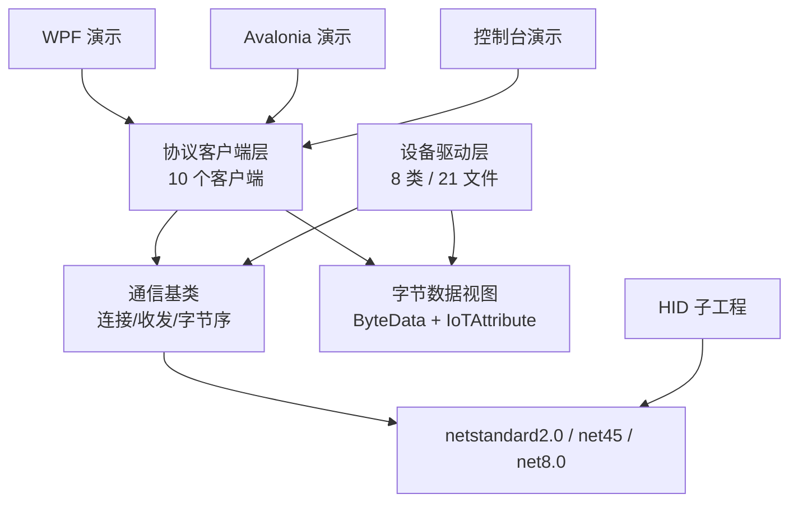

# PA-32｜跨平台 C# 工业通信类库

> **分析对象**：以 NuGet 包形态分发的跨平台 PLC 通信类库（协议客户端 + 数据视图 + 设备驱动），附 WPF/Avalonia/控制台三种演示端
> **编号**：PA-32（按脱敏约定，不披露来源标识）
> **技术栈**：C#；核心库多目标 `net45;netstandard2.0;net8.0`；HID 子工程 `net45;netstandard2.0`；WPF 演示 `net45;net8.0-windows`；Avalonia 演示 `net8.0;netstandard2.0`
> **规模画像**：92 个 `.cs`；核心库 78 文件 / 17,394 行，HID 3 文件 / 155 行，WPF 演示 9 文件 / 1,023 行，Avalonia 演示 1 文件 / 231 行，控制台演示 1 文件 / 366 行；版本 v0.13.0
> **成熟度画像**：可用库（协议客户端完整、多目标框架分发、有示例；但无测试工程，示例即验证）

---

## 1. 定位与问题域

### 1.1 它是什么

一个以类库形态存在的工业通信组件：南向提供 10 个 PLC 协议客户端，中间以"字节数据视图 + 属性映射"统一数据类型与字节序处理，外延提供 8 类设备驱动（RFID、扫码器、螺丝机、焊接、温控、气密、打标、机器人）。它的定位是**给上位机开发者用的协议与设备工具箱**，而不是完整的采集系统——没有调度、没有持久化、没有 UI 业务。

判断依据：

| 事实 | 说明 |
|---|---|
| 核心库多目标 `net45;netstandard2.0;net8.0` | 明确面向"被广泛引用"而非"自成一体" |
| 10 个协议客户端各自独立 | 无统一调度层，调用方自行编排 |
| `ByteData` + `IoTAttribute` | 以反射属性映射替代手写解析，是核心抽象 |
| 三种演示端（WPF/Avalonia/控制台） | 以示例替代测试，验证方式偏弱 |

### 1.2 面向的用户与场景

| 用户 | 场景 | 真实诉求 |
|---|---|---|
| 上位机开发者 | 在自己的 WinForm/WPF 项目里接 PLC | 引用即用、API 简单 |
| 跨平台开发者 | Linux/ARM 上跑采集 | 目标框架覆盖 netstandard |
| 设备集成商 | 接扫码器、螺丝机、温控等外设 | 设备驱动现成可用 |
| 学习者 | 研究 PLC 协议实现 | 源码可读、示例可跑 |

### 1.3 边界（不做什么）

- **不做采集调度**：无轮询器、无连接池管理，连接由调用方持有。
- **不做数据持久化**：无数据库、无历史存储。
- **不做 UI 业务**：演示端仅展示调用方式，不含业务逻辑。
- **不做服务端**：所有协议均为客户端角色。
- **不做测试工程**：控制台演示承担"能跑通"的验证职责。

---

## 2. 功能分析

### 2.1 功能域总览

| 功能域 | 功能点 | 实现方式 | 完成度 |
|---|---|---|---|
| 协议客户端 | 10 个 PLC 协议 | 各自独立的客户端类 | 完整 |
| 数据视图 | 字节数组的多类型读写 | `ByteData` + 10 个类型转换器 | 完整 |
| 属性映射 | 按特性把对象映射到字节偏移 | `IoTAttribute`（Offset/IsIgnore） | 完整 |
| 字节序 | 4 种字序 | `EndianFormat` 枚举 | 完整 |
| 接收模式 | 5 种收包策略 | `ReceiveMode` 枚举 | 完整 |
| 连接模式 | 3 种连接管理 | `ConnectionMode` 枚举 | 完整 |
| 数据处理 | 9 个处理器 | 独立处理器类 | 完整 |
| 算法 | 7 个算法 | 独立算法类 | 完整 |
| 设备驱动 | 8 类设备 / 21 文件 | 独立驱动类 | 完整 |
| HID | USB HID 读写 | 独立子工程 | 完整 |

### 2.2 协议覆盖

| 协议 | 角色 | 传输 | 备注 |
|---|---|---|---|
| Modbus TCP | 客户端 | TCP | 寄存器/线圈 |
| Modbus RTU | 客户端 | 串口 | — |
| Modbus ASCII | 客户端 | 串口 | — |
| 西门子 S7 | 客户端 | TCP | 主流 S7 型号 |
| 三菱 MC | 客户端 | TCP | — |
| 欧姆龙 FINS | 客户端 | TCP | — |
| 欧姆龙 CIP | 客户端 | TCP | — |
| 罗克韦尔 CIP | 客户端 | TCP | EtherNet/IP |
| 基恩士 HostLink | 客户端 | 串口 | — |
| 汇川 Modbus TCP | 客户端 | TCP | 基于 Modbus 扩展 |

核实方式：协议客户端类逐一计数，共 10 个；核心库 78 个文件 / 17,394 行。

### 2.3 核心抽象：字节数据视图

`ByteData` 是方案的中心抽象：以字节数组为底，按类型视图读写。默认内置 10 个类型转换器（Byte/SByte/Int16/UInt16/Int32/UInt32/Single/Int64/UInt64/Double），覆盖工业现场绝大多数数据类型。

`IoTAttribute` 提供两个字段：`Offset` 指定属性在字节流中的偏移，`IsIgnore` 标记不参与映射。基于反射遍历属性完成对象与字节流的双向映射。设计取舍明确——只支持属性、不支持字段，换取更简单的反射实现。

### 2.4 核心抽象：字节序与收包

`EndianFormat` 定义 4 种字序：`ABCD`、`BADC`、`CDAB`、`DCBA`，覆盖 16/32 位的高低字节与高低字组合。`ReceiveMode` 定义 5 种收包策略：按字节、按全部字节、按字符、按时间、读到结束，适配不同协议的响应特征。`ConnectionMode` 定义 3 种连接管理：手动、自动打开、自动重连。

### 2.5 设备驱动层

设备驱动共 21 个文件、8 类：RFID、扫码器、螺丝机、焊接设备、温控器、气密测试、打标机、机器人。这一层把"PLC 之外的现场外设"也纳入类库，是相对少见的设计——多数同类库只做 PLC。

---

## 3. 架构分析

### 3.1 分层结构

核心库以"基类 + 客户端"组织，设备驱动与协议客户端并列复用同一套通信与数据抽象。多目标框架通过条件编译适配 `net45` 与 `netstandard2.0` 的 API 差异。

### 3.2 关键抽象

| 抽象 | 职责 | 边界 | 评价 |
|---|---|---|---|
| 通信基类 | 连接、收发、字节序转换 | 不感知具体协议 | 通用 |
| 协议客户端 | 请求编码、响应解码 | 依赖通信基类与数据视图 | 边界清晰 |
| `ByteData` | 字节数组的多类型视图 | 不感知业务语义 | 核心复用点 |
| `IoTAttribute` | 属性偏移与忽略标记 | 仅属性，不含字段 | 简单但有限 |
| 设备驱动 | 外设协议封装 | 与 PLC 客户端解耦 | 覆盖广 |

### 3.3 调用流程

调用方构造客户端并按 `ConnectionMode` 建立连接，随后以"地址 + 类型 + 字序"调用读写；通信基类完成编解码与收发，响应写入 `ByteData` 后按 `IoTAttribute` 映射到对象属性。整条链路无调度介入，节奏完全由调用方掌控。

### 3.4 并发与连接管理

方案不提供连接池或调度器，连接生命周期由调用方持有；`ConnectionMode` 的自动重连是被动补偿，而非主动健康管理。这在"少量设备、调用方自己写循环"的场景下够用，但在"上百设备、需统一调度"的场景下需调用方自行搭建并发与背压。

### 3.5 分发与版本

- **分发形态**：NuGet 类库，多目标框架打包。
- **版本**：v0.13.0，处于 0.x 阶段，API 稳定性未承诺。
- **演示端**：WPF、Avalonia、控制台三套，覆盖桌面与跨平台两种使用方式。
- **HID**：独立子工程，仅支持 `net45` 与 `netstandard2.0`，未跟进 `net8.0`。

### 3.6 工程质量观察

| 观察项 | 事实 |
|---|---|
| 测试 | 无测试工程；控制台演示承担验证 |
| 多目标 | 核心库三目标，HID 两目标 |
| 文档 | 以示例代码为主 |
| 许可证 | Apache-2.0 |
| 版本阶段 | 0.x，API 可能变动 |

---

## 4. 需求分析

### 4.1 显性需求

1. 一个类库覆盖多品牌 PLC，避免每接一个品牌换一套库。
2. 数据类型与字节序差异要由库统一处理。
3. 支持 .NET Framework 与 .NET Core/.NET 8 两类运行时。
4. 提供对象与字节流的映射，减少手写解析。
5. 覆盖 PLC 之外的常见现场外设。
6. 提供可运行的示例，降低上手成本。

### 4.2 隐性需求

| 隐性需求 | 方案中的对应处理 | 若缺失的后果 |
|---|---|---|
| 字节序差异 | 4 种字序 | 数值解析错误 |
| 响应长度不定 | 5 种收包模式 | 粘包/截断 |
| 断线恢复 | 3 种连接模式 | 断线后需人工重连 |
| 类型覆盖 | 10 个转换器 | 特殊类型需自行扩展 |
| 多运行时 | 多目标框架 | 老项目无法引用 |
| 外设接入 | 8 类设备驱动 | 需另找库 |

### 4.3 非功能需求

| 维度 | 现状 | 判断 |
|---|---|---|
| 跨平台 | `netstandard2.0` 覆盖 Linux/ARM | 强 |
| 兼容性 | 支持 `net45` 老项目 | 强 |
| 性能 | 反射映射有开销 | （推断）高频场景需缓存 |
| 可测试性 | 无测试工程 | 弱 |
| 可观测性 | 无内置日志/指标 | 依赖调用方 |
| 稳定性 | 0.x 版本 | API 可能破坏性变更 |

---

## 5. 可借鉴与应规避

### 5.1 可直接吸收的机制

1. **字节数据视图**：以字节数组为底、按类型视图读写的抽象，是协议层的通用值容器，可直接迁移。
2. **属性偏移映射**：`Offset` + `IsIgnore` 两字段即完成对象与字节流的映射，简单有效。
3. **多目标框架分发**：同时兼顾 `net45` 与 `netstandard2.0`，扩大了引用面。
4. **收包模式枚举**：5 种策略覆盖不同协议响应特征，比硬编码读取更通用。
5. **设备驱动外延**：把 PLC 之外的外设纳入同一类库，提升复用价值。

### 5.2 明确应规避的做法

| 做法 | 问题 | 目标产品应如何做 |
|---|---|---|
| 示例代测试 | 无自动化测试 | 至少覆盖编解码与映射 |
| 反射无缓存 | 高频映射有开销 | 缓存属性元数据或生成代码 |
| 仅支持属性 | 字段/结构体受限 | 扩展字段支持或明确契约 |
| 无调度层 | 大规模需自建 | 提供可选调度器 |
| 0.x 无稳定承诺 | API 易破坏 | 明确语义化版本策略 |

---

## 6. 结论

### 6.1 六维评分

| 维度 | 分数(1-5) | 理由 |
|---|---|---|
| 协议广度 | 4 | 10 个 PLC 客户端 + 8 类设备驱动，覆盖主流品牌与外设 |
| 架构可演进性 | 4 | 基类 + 客户端分层清晰，数据视图抽象干净；扣分在无调度层 |
| 跨平台能力 | 5 | `netstandard2.0` 覆盖 Linux/ARM，兼顾 `net45` 老项目 |
| 可运维性 | 2 | 无日志/指标/健康检查，运维依赖调用方 |
| 工程质量 | 3 | 多目标与示例完善；扣分在无测试工程、0.x 版本 |
| 许可与合规风险 | 5 | Apache-2.0，无传染性许可风险 |

### 6.2 三条关键结论

1. **这是本批最"可引用"的一份**：以类库形态、多目标框架、Apache-2.0 分发，定位清晰，适合作为目标产品的协议层参考或直接依赖。
2. **核心价值在数据抽象而非协议实现**：`ByteData` + `IoTAttribute` + 字序/收包枚举构成一套通用的字节流处理模型，与语言无关，可直接迁移。
3. **短板是工程化而非设计**：无测试、无调度、反射无缓存、0.x 版本，这些是可用性边界；若目标产品要承载大规模采集，需在其上补调度与可观测层。

---

**附：本文所有数量均来自代码检索**（文件计数、协议客户端枚举、类型转换器计数、字序/收包/连接模式枚举成员数、设备驱动分类）。示例端承担验证职责，未发现独立测试工程。
