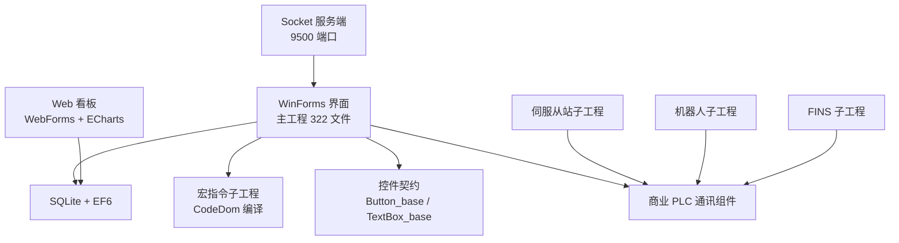

# PA-33｜WinForms 上位机控制框架

> **分析对象**：以 WinForms 为主体、以"控件即接口"为核心范式的上位机控制框架，含宏指令脚本引擎、Socket 通信服务、Web 看板与多类设备子工程
> **编号**：PA-33（按脱敏约定，不披露来源标识）
> **技术栈**：C# / .NET Framework 4.7.2（主工程）、4.6.1（宏指令子工程）；EntityFramework 6、EF.Extended、SQLite、商业 PLC 通讯组件、第三方 UI 控件库、C# 脚本引擎库（CodeDom）、JSON 组件
> **规模画像**：解决方案 12 个项目；主工程 322 个 `.cs` / 192,238 行；全仓 490 个 `.cs`；仓库约 268MB（含第三方 DLL 与演示资源）
> **成熟度画像**：长期演进的单机交付系统（功能完整、业务闭环；但无测试、强耦合、技术栈陈旧）

---

## 1. 定位与问题域

### 1.1 它是什么

一套面向产线设备的 WinForms 上位机框架：以"控件即接口"为核心范式——UI 控件自身声明自己绑定的 PLC、地址与读写语义，运行时由框架统一扫描并驱动。它同时内置宏指令脚本引擎、固定端口的 Socket 通信服务、SQLite 本地库与 Web 看板，构成"界面 + 逻辑 + 通信 + 存储 + 展示"的单机闭环。

判断依据：

| 事实 | 说明 |
|---|---|
| 主工程 322 个文件 / 192,238 行 | 单工程承载绝大部分业务，属典型单体 |
| `Button_base` / `TextBox_base` 接口声明 PLC 相关属性 | 控件元数据即设备绑定契约 |
| `macroinstruction_data<T>` 持有静态数据区 | 宏指令与主程序共享内存模型 |
| Socket 服务固定端口 + 16 个功能码 | 与外部系统以私有协议对接 |

### 1.2 面向的用户与场景

| 用户 | 场景 | 真实诉求 |
|---|---|---|
| 设备厂商 | 为某类产线设备配套上位机 | 交付快、界面现成、能对接 PLC |
| 现场工程师 | 用宏指令做小逻辑定制 | 不重新编译即可改逻辑 |
| 系统集成商 | 上位机需与 MES/看板交换数据 | 稳定的私有通信通道 |
| 维护人员 | 多年后仍能改配置 | 配置与数据可本地留存 |

### 1.3 边界（不做什么）

- **不做跨平台**：WinForms + .NET Framework，锁定 Windows。
- **不做微服务/云原生**：单机部署，Socket 私有协议。
- **不做通用组态**：控件绑定是开发期约定，非运行期组态。
- **不做自动化测试**：未见测试工程。
- **不做多租户**：权限为单一整型等级 + 静态账号。

---

## 2. 功能分析

### 2.1 功能域总览

| 功能域 | 功能点 | 实现方式 | 完成度 |
|---|---|---|---|
| 控件绑定 | 控件声明 PLC/地址/读写语义 | `Button_base` / `TextBox_base` 接口 | 完整 |
| PLC 接入 | 8 类 PLC 目标 | `PLC` 枚举 + 商业通讯组件 | 完整 |
| Socket 服务 | 16 个功能码的私有协议 | `BeginAccept`/`BeginReceive` + JSON | 完整 |
| 宏指令 | C# 脚本动态编译执行 | CodeDom + 静态数据区 | 完整 |
| 本地存储 | SQLite + EF6 | `Extent1.db` | 完整 |
| 权限 | 整型等级 + 静态账号 | `Privilege` 字段 | 基础 |
| Web 看板 | 网页图表展示 | WebForms + ECharts | 完整 |
| 设备子工程 | 伺服/机器人/FINS | 独立项目 | 完整 |

### 2.2 核心范式：控件即接口

框架把"设备绑定"下沉到控件契约：`Button_base` 与 `TextBox_base` 接口声明 `PLC`（目标品牌）、`PLC_Enable`（是否启用）、`PLC_Contact`（触点/地址）、`PLC_Address`（地址）、`PLC_time`（时间参数）等属性；按钮额外声明 `Backdrop_ON/OFF`、`Text_ON/OFF`、`Button_select`、`DAButton_pattern` 等外观与状态属性。

这带来一种独特的分工：开发者拖控件、填属性，框架在运行时扫描控件树即可知道"这个按钮要读哪个 PLC 的哪个地址、按下时写什么"。优点是界面即配置、交付极快；代价是业务逻辑与 UI 强耦合，脱离 WinForms 无法复用。

### 2.3 核心功能：Socket 通信服务

服务端固定监听 9500 端口，采用 `BeginAccept` / `BeginReceive` 异步模型。报文为 JSON 包装的 `COPYDATASTRUCT` 结构，定义 H01–H16 共 16 个功能码：

| 功能码段 | 语义 |
|---|---|
| H01 / H02 | 读上位机 M 区 / D 区 |
| H03 / H04 | 写上上位机 M 区 / D 区 |
| H05–H08 | 三菱 PLC 的 bool / D 寄存器读写 |
| H10 / H12 | 西门子 PLC 读写 |
| H13–H16 | Modbus TCP 读写 |

这套功能码把"上位机自身内存"与"外部 PLC"统一编码，是私有协议里少见但实用的设计——外部系统既能读上位机的缓存区，也能直接穿透到 PLC。

### 2.4 核心功能：宏指令引擎

宏指令子工程用 CodeDom 动态编译 C# 片段，运行时加载执行。数据模型为 `macroinstruction_data<T>`：静态 `D_Data[1024]`（object 数组）、`M_Data[1024]`（bool 数组）、`thread[100]`。宏指令与主程序共享这组静态数据区，实现"脚本读写同一份内存"。

这让现场工程师不重新编译即可改逻辑，是框架最实用的扩展点；但静态共享内存 + 动态编译也带来并发与安全风险——脚本可任意访问进程内数据，且编译产物无隔离。

### 2.5 权限与存储

权限为单一整型 `Privilege` 字段 + 静态用户名/密码，等级比较决定可操作性。存储使用 SQLite（`Extent1.db`，约 820KB）+ EF6，配合 EF.Extended 做批量操作。权限模型极简，适合单机场景，但不满足审计与多角色诉求。

---

## 3. 架构分析

### 3.1 分层结构

主工程是绝对中心，几乎所有业务都在其中；子工程围绕主工程提供设备或展示能力。分层实际是"UI 为中心 + 若干外挂"，而非严格分层架构。

### 3.2 关键抽象

| 抽象 | 职责 | 边界 | 评价 |
|---|---|---|---|
| `Button_base` | 按钮的 PLC 绑定契约 | 绑定语义 + 外观状态 | 耦合重 |
| `TextBox_base` | 文本框的 PLC 绑定契约 | 地址与读写语义 | 耦合重 |
| `PLC` 枚举 | 8 类目标品牌 | 仅品牌分类 | 简单 |
| `macroinstruction_data<T>` | 宏指令共享数据区 | 静态内存 | 无隔离 |
| Socket 功能码 | 私有协议语义 | H01–H16 | 实用 |

### 3.3 数据流

三条数据流汇聚到同一进程内存：UI 按 `PLC_Address` 直连 PLC 并刷新控件外观；外部系统经 9500 端口按功能码读写上位机 M/D 区或穿透到 PLC；宏指令经 CodeDom 编译后读写 `D_Data`/`M_Data`。三者缺乏统一的总线与状态层。

### 3.4 并发与通信模型

Socket 采用 `BeginAccept` / `BeginReceive` 的异步回调模型，属 .NET Framework 时代的经典写法；回调中直接处理报文并操作共享数据，需自行保证线程安全。宏指令的 `thread[100]` 表明存在多线程脚本执行，但未见统一的同步原语。整体并发模型是"回调 + 静态共享内存"，在高并发下正确性依赖开发者自觉。

### 3.5 配置、存储与部署

- **存储**：SQLite 单文件（`Extent1.db`，约 820KB），EF6 + EF.Extended。
- **配置**：大量绑定信息写在控件属性上，随界面代码固化。
- **部署**：单机 Windows 交付，依赖第三方 DLL 与商业通讯组件。
- **Web 看板**：WebForms/aspx + ECharts，读同一 SQLite 库。
- **体积**：仓库约 268MB，含第三方 DLL 与演示资源。

### 3.6 工程质量观察

| 观察项 | 事实 |
|---|---|
| 测试 | 未见测试工程 |
| 技术栈 | .NET Framework 4.7.2 / 4.6.1，已停止演进 |
| 依赖 | 商业 PLC 通讯组件 + 第三方 UI 控件库 |
| 耦合 | 业务逻辑散落于 UI 事件 |
| 脚本安全 | CodeDom 动态编译，无沙箱 |
| 许可证 | MIT，但许可证头含作者信息（不引用） |

---

## 4. 需求分析

### 4.1 显性需求

1. 一套上位机对接多品牌 PLC（三菱/西门子/欧姆龙/发那科等）。
2. 界面开发要快，控件拖拽即可完成设备绑定。
3. 现场可改逻辑，无需重新编译。
4. 与外部系统（MES/看板）稳定交换数据。
5. 本地留存配置与生产数据。
6. 提供网页看板做远程展示。
7. 支持伺服、机器人等专用设备。

### 4.2 隐性需求

| 隐性需求 | 方案中的对应处理 | 若缺失的后果 |
|---|---|---|
| 地址变更 | 控件属性集中声明 | 改地址需改界面代码 |
| 逻辑热更新 | 宏指令脚本 | 每次改动需重新编译 |
| 外部穿透 | H 系列功能码 | 外部系统无法读 PLC |
| 数据留存 | SQLite | 断网丢数据 |
| 权限分级 | 整型等级 | 无审计、易越权 |
| 多线程安全 | 静态共享内存 | 并发下数据竞争 |

### 4.3 非功能需求

| 维度 | 现状 | 判断 |
|---|---|---|
| 启动时间 | .NET Framework WinForms | （推断）秒级 |
| 内存 | 单进程 + 静态数据区 | （推断）数百 MB |
| 跨平台 | 锁 Windows | 弱 |
| 可维护性 | UI 与逻辑强耦合 | 弱 |
| 可测试性 | 无测试工程 | 极弱 |
| 安全 | 静态账号 + 无沙箱脚本 | 弱 |

---

## 5. 可借鉴与应规避

### 5.1 可直接吸收的机制

1. **控件即接口**：把设备绑定声明为控件契约，拖拽即配置，是"低代码上位机"的实用范式——但应把契约与 UI 解耦后借鉴。
2. **功能码统一内存与设备**：H01–H16 同时覆盖"上位机内存"与"外部 PLC"，外部系统一次接入即可两种访问。
3. **宏指令热更新**：脚本引擎让现场改逻辑不需重编译，是长期交付系统的关键能力。
4. **多设备子工程**：伺服/机器人/FINS 独立成项目，边界清晰。

### 5.2 明确应规避的做法

| 做法 | 问题 | 目标产品应如何做 |
|---|---|---|
| 业务写进 UI 事件 | 强耦合、不可测 | 抽到独立的领域/服务层 |
| 静态共享内存 | 并发竞争、无隔离 | 用显式状态容器 + 同步 |
| 脚本无沙箱 | 可破坏进程 | 限制 API + 超时 + 隔离 |
| 整型权限 | 无审计、易越权 | 角色 + 操作审计 |
| .NET Framework | 锁 Windows | 迁移到现代 .NET |
| 私有协议无文档 | 外部难对接 | 明确协议规范与版本 |

---

## 6. 结论

### 6.1 六维评分

| 维度 | 分数(1-5) | 理由 |
|---|---|---|
| 协议广度 | 3 | 8 类 PLC + 多设备子工程，但依赖商业组件 |
| 架构可演进性 | 2 | UI 为中心，业务耦合，难拆分 |
| 跨平台能力 | 1 | WinForms + .NET Framework，锁 Windows |
| 可运维性 | 2 | 有本地库与看板；扣分在权限与脚本安全 |
| 工程质量 | 2 | 无测试、技术栈陈旧、强耦合 |
| 许可与合规风险 | 3 | MIT，但含商业组件与作者信息头 |

### 6.2 三条关键结论

1. **"控件即接口"是本方案最有价值的范式**：把设备绑定下沉到控件契约，实现了极快的界面交付；但必须把契约与 UI 解耦后再借鉴，否则会把耦合一并继承。
2. **功能完整但结构性陈旧**：8 类 PLC、16 功能码、宏指令、看板构成完整闭环，价值在业务理解而非技术；.NET Framework + WinForms + 商业组件决定了它无法演进到跨平台。
3. **短板是耦合与治理**：业务写进 UI 事件、脚本无沙箱、权限过简、无测试，这些使系统难以维护与审计；目标产品应在保留"低代码绑定"体验的同时，把逻辑、状态与权限收敛到独立层。

---

**附：本文所有数量均来自代码检索**（项目计数、文件与行数、`PLC` 枚举成员、功能码范围、静态数据区容量、数据库文件大小）。许可证头含作者信息，按约定不予引用。
