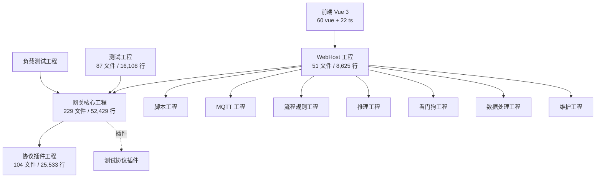

# PA-34｜Web 化边缘通信网关

> **分析对象**：以 .NET 10 为运行时、前后端分离的 Web 化边缘网关：南向覆盖 25 种工业协议，北向提供 REST/健康检查/指标/审计，内置脚本、流程规则、推理与看门狗
> **编号**：PA-34（按脱敏约定，不披露来源标识）
> **技术栈**：C# / .NET 10（全部 13 个工程）；前端 Vue 3.5、Vite 6.4、Element Plus 2.14、ECharts 6.1；PostgreSQL、Docker、Nginx、Prometheus、OpenTelemetry
> **规模画像**：13 个 `.csproj`；548 个 `.cs` / 112,730 行；前端 60 个 `.vue` + 22 个 `.ts`；核心 229 文件 / 52,429 行，协议插件 104 文件 / 25,533 行，测试 87 文件 / 16,108 行
> **成熟度画像**：准生产（有测试、指标、健康检查、发布清单、供应链脚本；扣分在部分能力仍为骨架）

---

## 1. 定位与问题域

### 1.1 它是什么

一个把"边缘采集"做成 Web 平台服务的 C# 网关：南向接 25 种现场协议，中间做设备调度、通道加权、质量判定、脚本与流程规则，北向提供 REST 配置、健康检查、Prometheus 指标与审计日志，前端为 Vue 3 管理台。

它的自我定位不是"某协议的驱动库"，而是**一个可运维、可扩展、可升级的边缘网关**。判断依据来自四处代码事实：

| 事实 | 说明 |
|---|---|
| 25 个 `PlcProtocol` 枚举值 | 协议清单以枚举集中声明，新增协议走插件 |
| 63 个权限常量 + 57 条目录权限 | 权限被建模为可分配的细粒度集合 |
| 36 个 Prometheus/OpenTelemetry 指标 | 可观测性是一等需求，而非事后补 |
| 插件清单含 SHA256/签名/版本约束 | 扩展机制考虑了供应链安全 |

### 1.2 面向的用户与场景

| 用户 | 场景 | 真实诉求 |
|---|---|---|
| 集成商 | 一套网关适配多品牌设备 | 协议广、配置可视化、能远程升级 |
| 平台厂商 | 把采集能力作为 IIoT 底座 | 插件化、北向可换、指标齐全 |
| 现场运维 | 停机后远程定位"为什么没数" | 健康检查、质量码、审计 |
| 安全/合规 | 交付到受监管环境 | 签名校验、审计留痕、权限分级 |

### 1.3 边界（不做什么）

- **不做组态/HMI**：管理台以配置与监控为主，无画面编辑器。
- **不做云原生微服务**：单进程网关，非服务网格形态。
- **不做通用 BI**：前端图表服务于设备监控，非分析平台。
- **不做多租户**：权限为角色/常量集合，非租户隔离。

---

## 2. 功能分析

### 2.1 功能域总览

| 功能域 | 功能点 | 实现方式 | 完成度 |
|---|---|---|---|
| 协议接入 | 25 种协议 | `PlcProtocol` 枚举 + 插件 | 完整（部分为骨架） |
| 设备调度 | 每设备串行队列 + 通道加权 | `DeviceActor` + `ConfiguredChannelScheduler` | 完整 |
| 质量判定 | 11 态 `TagQuality` | 点位级质量码 | 完整 |
| 背压与熔断 | 水位 + 失败阈值 + 降级 | 调度器 + 熔断器 | 完整 |
| 脚本引擎 | C# 脚本执行 | 独立脚本工程 | 完整 |
| 流程规则 | 规则编排 | 流程规则工程 | 完整 |
| 推理 | 轻量推理 | 推理工程 | 完整 |
| 看门狗 | 进程/任务守护 | 看门狗工程 | 完整 |
| 数据处理 | 处理链 | 数据处理工程 | 完整 |
| 插件体系 | 清单 + 签名 + 版本约束 | 协议插件工程 | 完整 |
| 热升级 | zip 包 + 回滚点 | 维护工程 | 完整 |
| 认证授权 | HMAC 双段 token + 权限 | WebHost 中间件 | 完整 |
| 可观测性 | 36 指标 + 健康检查 | Prometheus/OpenTelemetry | 完整 |
| 审计 | 文件 + 数据库双源 | 审计日志 + CSV 导出 | 完整 |
| 前端管理台 | 配置/监控/审计 | Vue 3 + Element Plus + ECharts | 完整 |

### 2.2 协议覆盖

| 协议 | 角色 | 传输 | 备注 |
|---|---|---|---|
| Rockwell CIP | 主站 | TCP | EtherNet/IP 体系 |
| Rockwell PCCC | 主站 | TCP | 老式罗克韦尔协议 |
| Siemens S7 | 主站 | TCP | 主流 S7 型号 |
| Mitsubishi MC | 主站 | TCP | 3E/4E 体系 |
| Mitsubishi MC 1E | 主站 | TCP | 1E 帧 |
| Mitsubishi 串口 | 主站 | 串口 | 串行链路 |
| Mitsubishi QL 串口 | 主站 | 串口 | Q/L 系列串口 |
| Omron FINS | 主站 | TCP/UDP | — |
| Modbus TCP | 主站 | TCP | 寄存器/线圈 |
| Modbus RTU | 主站 | 串口 | — |
| Modbus ASCII | 主站 | 串口 | — |
| DL/T 645-2007 | 主站 | 串口 | 电力表计 |
| CJ/T 188-2004 | 主站 | 串口 | 表计 |
| CJ/T 188-2018 | 主站 | 串口 | 表计新版本 |
| CANopen | 主站 | 总线 | — |
| BACnet/IP | 主站 | UDP | 楼宇 |
| OPC UA | 主站 | TCP | 标准协议 |
| OPC DA | 主站 | COM/DCOM | — |
| Virtual PLC | 模拟 | — | 虚拟设备 |
| Plugin | 扩展 | — | 插件占位 |
| Beckhoff ADS | 主站 | TCP | 倍福 |
| SNMP | 主站 | UDP | 网络设备 |
| MQTT Client | 客户端 | TCP | 南向订阅 |
| DNP3 | 主站 | TCP | 电力 |
| EtherNet/IP | 主站 | TCP | 通用 CIP |

核实方式：`PlcProtocol` 枚举逐项计数，共 25 个成员；协议插件工程 104 文件 / 25,533 行。

### 2.3 典型使用流程

```
运维打开管理台 → 选协议 → 填连接/点位 → 保存（权限中间件校验写权限）
  → 设备进入调度 → DeviceActor 串行执行轮询
    → 通道调度器按权重分配，写优先
      → 采集结果带 TagQuality 质量码
        → 指标上报 + 健康检查聚合 → 管理台轮询展示
        → 断线/失败 → 熔断降级（SkipDevicePoll）→ 恢复
```

### 2.4 调度与熔断参数

| 参数 | 默认值 | 说明 |
|---|---|---|
| 最大并发设备轮询 | `max(16, min(64, CPU×8))` | 配置示例为 8，代码为动态上限 |
| 轮询间隔 | 100ms | 调度节拍 |
| 队列容量 | 1024 | 有界队列 |
| 高水位 | 80% | 触发背压 |
| 低水位 | 50% | 解除背压 |
| 背压延迟 | 500ms | 高水位时延迟 |
| 慢轮询阈值 | 5000ms | 标记慢设备 |
| 轮询超时 | 10000ms | 超时中断 |
| 熔断失败阈值 | 3 | 连续失败触发 |
| 熔断成功阈值 | 1 | 恢复条件 |
| 熔断断开时长 | 30s | 降级窗口 |
| 降级动作 | `SkipDevicePoll` | 跳过轮询 |

### 2.5 质量与健康

`TagQuality` 定义 11 态：Unknown、Good、Bad、Disabled、NotConnected、ReadError、NotFound、AccessDenied、OutOfRange、Filtered、Spike。这比"好/坏"二元质量更细，能区分"连不上""地址不存在""越权""越界""被过滤""尖峰"。健康检查暴露 `/health`、`/health/live`、`/health/ready` 及其 `/api` 别名，readiness 聚合 gateway/config/mqtt/outbox/history/ruleEngine/scheduler/systemResources 等组件。

---

## 3. 架构分析

### 3.1 分层与工程



13 个工程围绕核心组合：WebHost 作入口、Core 作内核、协议插件作南向、脚本/规则/推理/看门狗/数据处理作能力扩展、维护作升级、测试与负载测试作质量保障。

### 3.2 关键抽象

| 抽象 | 职责 | 边界 | 评价 |
|---|---|---|---|
| `DeviceActor` | 每设备串行队列 | `AsyncLocal` 内联执行 | 避免同设备并发 |
| `ConfiguredChannelScheduler` | 按通道加权调度 | `SemaphoreSlim` + 写优先 | 通道级公平 |
| `TagQuality` | 点位质量 11 态 | 点位级 | 细粒度可观测 |
| 熔断器 | 失败阈值 + 降级 | 设备级 | 防雪崩 |
| 插件清单 | 驱动元数据 + 签名 | 供应链安全 | 可校验 |
| 权限集合 | 63 常量 + 57 目录项 | 页面/按钮两级 | 细粒度 |

`DeviceActor` 的"每设备串行"设计是关键：同一设备的请求永不并发，避免协议层竞态；跨设备则由通道调度器并行。`ConfiguredChannelScheduler` 用 `SemaphoreSlim` 控制并发数，并以 `WaitingWrites` 实现写优先——防止大量读请求饿死写命令。

### 3.3 数据流与时序

调度器每 100ms 取到期设备，交由 `DeviceActor` 串行入队，再由 `ConfiguredChannelScheduler` 按通道加权授权；插件编码请求、解码响应并判定 `TagQuality`，结果分三路流向指标、健康聚合与管理台；失败累计 3 次触发 30s 熔断并降级为 `SkipDevicePoll`。

### 3.4 并发、背压与熔断

| 主题 | 做法 | 评价 |
|---|---|---|
| 设备内并发 | `DeviceActor` 串行队列 | 消除协议竞态 |
| 跨设备并发 | 通道加权 + `SemaphoreSlim` | 通道级公平 |
| 写优先 | `WaitingWrites` 计数 | 防读饿死写 |
| 背压 | 80%/50% 水位 + 500ms 延迟 | 有界、可恢复 |
| 慢设备 | 5000ms 阈值标记 | 便于定位 |
| 超时 | 10000ms 中断 | 防挂死 |
| 熔断 | 3 次失败 / 30s / 降级 | 防雪崩 |
| 并发上限 | `max(16, min(64, CPU×8))` | 随核数自适应 |

### 3.5 插件与热升级

插件清单字段：DriverId、DisplayName、Version、Min/MaxGatewayVersion、Assembly、EntryType、AssemblySha256、Signature、SignatureAlgorithm、Signer。加载时校验版本区间与哈希，签名可选。升级流程：上传 zip 包 + `gateway-package.json` → 校验文件清单 SHA256 → 可选签名验证 → 记录回滚点 → 写 `pending-action.json` → `apply-pending-update.ps1` 落地。这套"清单 + 哈希 + 回滚点"是供应链安全的实用实现。

### 3.6 安全与可观测

- **认证**：HMAC-SHA256 双段 token，12 小时有效期；另有 API Token。
- **授权**：63 个权限常量，目录 17 个页面级 + 40 个按钮级 = 57 条；中间件保护 `/api/config` 写操作。
- **审计**：401/403 审计，文件 + 数据库双源，支持 CSV 导出，分页上限 500。
- **指标**：36 个 Prometheus/OpenTelemetry 指标定义。
- **健康**：`/health`、`/health/live`、`/health/ready` 及 `/api` 别名，readiness 聚合多组件。

### 3.7 部署与工程质量

| 观察项 | 事实 |
|---|---|
| 部署形态 | Docker + PostgreSQL、Windows Service、Linux systemd、Nginx 反代 |
| 运维配套 | Prometheus、模拟器、供应链脚本、`RELEASE_CHECKLIST.md`、`BROWSER_SMOKE_CHECKLIST.md` |
| 测试密度 | 测试工程 87 文件 / 16,108 行，另有负载测试 |
| 前端 | Vue 3 + Vite + Element Plus + ECharts |
| 许可证 | Apache-2.0 |
| 债务痕迹 | 部分协议与能力仍为骨架 |

---

## 4. 需求分析

### 4.1 显性需求

1. 一套网关接 25 种工业协议，覆盖 PLC/电力/楼宇/总线/网络设备。
2. 设备与通道调度需可控，避免同时打满网络。
3. 采集失败要能区分"连不上/地址错/越权/越界"。
4. 单设备故障不能拖垮全局（熔断 + 降级）。
5. 协议可插件化扩展，且能校验来源与版本。
6. 网关可远程热升级，失败可回滚。
7. 配置与操作需权限控制与审计留痕。
8. 运维需健康检查与指标，前端需可视化。

### 4.2 隐性需求

| 隐性需求 | 方案中的对应处理 | 若缺失的后果 |
|---|---|---|
| 协议竞态 | `DeviceActor` 串行 | 同设备请求交错 |
| 读饿死写 | `WaitingWrites` 写优先 | 写命令延迟 |
| 队列溢出 | 80%/50% 水位背压 | OOM |
| 慢设备拖累 | 5000ms 慢阈值 | 全局变慢 |
| 雪崩 | 熔断 + `SkipDevicePoll` | 故障扩散 |
| 供应链攻击 | SHA256 + 签名 + 版本区间 | 恶意插件 |
| 升级失败 | 回滚点 + pending-action | 变砖 |
| 越权操作 | 权限 middleware + 审计 | 配置被篡改 |

### 4.3 非功能需求

| 维度 | 现状 | 判断 |
|---|---|---|
| 可观测性 | 36 指标 + 多组件健康检查 | 强 |
| 安全性 | HMAC token + 权限 + 审计 + 签名 | 强 |
| 可测试性 | 87 测试文件 + 负载测试 | 中上 |
| 可运维性 | 多部署形态 + 发布清单 + 回滚 | 强 |
| 跨平台 | .NET 10 + Linux/Windows | 强 |
| 扩展性 | 插件 + 脚本 + 规则 + 推理 | 强 |

### 4.4 需求缺口

| 缺口 | 证据 | 影响 |
|---|---|---|
| 部分协议骨架 | 枚举含 Plugin/Virtual 等占位 | 协议广度需按协议核实 |
| 多租户缺失 | 权限为常量集合 | 不适合 SaaS 隔离 |
| 推理能力有限 | 推理工程仅 4 文件 | 复杂规则需外挂 |
| 前端测试偏少 | 以冒烟清单为主 | UI 回归依赖人工 |

---

## 5. 可借鉴与应规避

### 5.1 可直接吸收的机制

1. **每设备串行 + 通道加权**：`DeviceActor` + `ConfiguredChannelScheduler` 把"设备内串行、跨设备并行、通道公平"三件事一次解决。
2. **写优先调度**：`WaitingWrites` 防止读请求饿死写命令，是工业网关的实战细节。
3. **11 态质量码**：区分连不上/地址错/越权/越界/过滤/尖峰，比二元质量更可运维。
4. **水位背压 + 熔断降级**：80/50 水位 + 3 次失败/30s + `SkipDevicePoll`，形成完整防雪崩链。
5. **插件清单 + 哈希 + 签名 + 版本区间**：供应链安全的实用落地。
6. **热升级回滚点 + pending-action**：把"升级失败"显式建模。
7. **细粒度权限 + 双源审计**：57 条目录权限 + 文件/数据库审计 + CSV 导出。

### 5.2 明确应规避的做法

| 做法 | 问题 | 目标产品应如何做 |
|---|---|---|
| 枚举含占位协议 | 清单广度易高估 | 按协议标注实现状态 |
| 单进程单租户 | 不适合 SaaS | 明确单机定位或引入租户 |
| 推理能力薄弱 | 复杂规则需外挂 | 明确规则边界或增强 |
| 前端测试偏少 | UI 回归靠人工 | 补组件/端到端测试 |
| 服务名/版权头暴露 | 品牌与作者信息 | 交付前统一脱敏 |

### 5.3 迁移到目标产品的成本

| 机制 | 迁移成本 | 说明 |
|---|---|---|
| 调度与背压 | 中 | 需重写队列与水位逻辑 |
| 质量码 | 低 | 枚举 + 判定，语言无关 |
| 熔断降级 | 低 | 状态机 + 阈值 |
| 插件/签名 | 中 | 需选定打包与验签方案 |
| 热升级 | 中 | 需设计回滚与原子切换 |
| 权限/审计 | 中 | 需与认证体系集成 |

---

## 6. 结论

### 6.1 六维评分

| 维度 | 分数(1-5) | 理由 |
|---|---|---|
| 协议广度 | 5 | 25 种协议覆盖 PLC/电力/楼宇/总线/网络，串口与网口齐备 |
| 架构可演进性 | 4 | 插件化 + 能力工程化拆分；扣分在部分骨架与单进程限制 |
| 跨平台能力 | 5 | .NET 10 + Docker + systemd/Windows Service，双平台就绪 |
| 可运维性 | 5 | 36 指标 + 多组件健康 + 审计 + 发布清单 + 回滚 |
| 工程质量 | 4 | 87 测试文件 + 负载测试 + 供应链脚本；扣分在前端测试与骨架 |
| 许可与合规风险 | 5 | Apache-2.0；签名/审计/脱敏机制健全（需去除品牌头） |

### 6.2 三条关键结论

1. **这是本批最接近"可运维系统"的一份**：调度、背压、熔断、质量码、指标、健康、审计、升级构成闭环，其机制组合可直接抽象为需求条目，与语言无关。
2. **工程化细节值得整体借鉴**：每设备串行 + 通道加权 + 写优先、11 态质量、水位背压、插件哈希签名、回滚点，这些是"能上线"与"能跑"的分界。
3. **短板在广度真实性与边界**：枚举含占位协议、推理偏薄、单进程无多租户，评估时需按协议与场景分别核实，不能以枚举数量代替实现深度。

---

**附：本文所有数量均来自代码检索**（工程与文件计数、`PlcProtocol` 枚举成员、权限常量、指标定义、健康检查路由、调度与熔断默认值、插件清单字段、质量码枚举）。服务名与版权头按脱敏约定不予引用。
