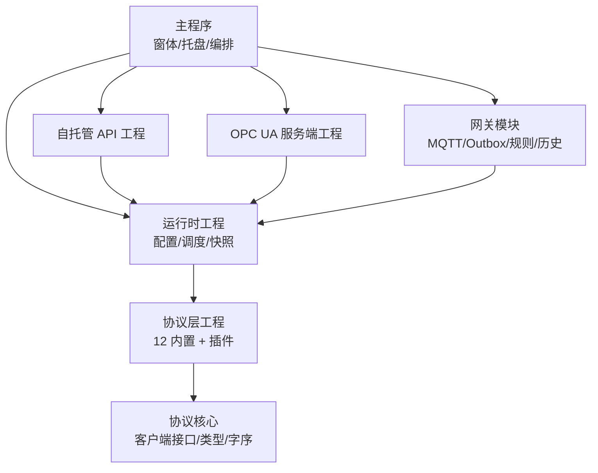

# PA-35｜Windows 桌面边缘网关（单体 WinForms）

> **分析对象**：Windows 桌面应用（WinForms 单体：采集运行时 + 自托管 HTTP API + OPC UA 服务端 + MQTT 网关同进程）
> **编号**：PA-35（按脱敏约定，不披露来源标识）
> **技术栈**：C# 7.3 / .NET Framework 4.8.1 / WinForms；XML 序列化配置；6 个第三方协议库（S7、Modbus、CIP、OPC UA 客户端、OPC DA 桥接、三菱 MC 各一）＋ OPC UA 服务端栈 1.5.x；自托管 HTTP 基于 `HttpListener`
> **规模画像**：228 个 `.cs`（不含 obj/bin），约 4.5 万行；6 个工程；协议枚举 13 项（12 内置 + 1 插件位，含虚拟 PLC）；WebAPI 约 20 条路由（含别名）
> **成熟度画像**：内部可用（功能面宽，含配置版本/回滚/Outbox；但仅 Windows、无正式测试工程、文档与代码有偏差）

---

## 1. 定位与问题域

### 1.1 它是什么

一个把「桌面调试工具」和「边缘网关」压进同一进程的 Windows 应用：项目树与点位编辑在左，采集运行时、规则引擎、本地历史、MQTT、HTTP API 与 OPC UA 服务端在右。它不是驱动库，而是**现场工程师能带到产线、双击即用的采集终端**。

三个细节说明它是按「常驻」而非「工具」设计：启动即加载 `Data/project.xml` 并开始轮询，没有「部署」步骤，配置即项目文件；关闭窗口默认最小化到托盘，`--tray` 可开机静默运行；远程配置动作约 19 个，含备份、版本跳过、失败回滚，无人值守是默认前提。

它同时承担四种角色：SCADA 的南向采集器、MES/云的北向发布器、第三方系统的 HTTP 读写服务、OPC UA 客户端的数据源。这种「四合一」是最大便利，也是最大耦合来源。

### 1.2 面向的用户与场景

| 用户 | 场景 | 真实诉求 |
|---|---|---|
| 现场调试工程师 | 到产线接 PLC，改地址、看值、试写 | 不装运行时、点两下就出数 |
| 小型项目交付 | 一台工控机接 3～30 台设备，上报 MQTT | 断网不丢数、配置能远程改 |
| 上位系统开发者 | HTTP 读点位、写点位、查历史 | 接口稳定、错误码可判别、不引入 OPC 授权 |
| 运维 | 设备在客户现场，人不在 | 远程自检、配置回滚、插件热刷新 |

### 1.3 边界（不做什么）

- **不做 Web 化**：界面是 WinForms，远程只能通过 API 操作，没有浏览器控制台。
- **不做通用脚本**：规则是固定 5 种条件类型的表单模型，不是脚本引擎或 DSL。
- **不承诺跨平台**：`HttpListener`、OPC DA（COM）、WinForms 托盘共同把它锁在 Windows。

---

## 2. 功能分析

### 2.1 功能域总览

| 功能域 | 功能点 | 实现方式 | 完成度 |
|---|---|---|---|
| 项目建模 | 项目 → 通道 → 设备 → 分组/标签；点位编码、资产路径、精度 | XML 序列化模型 + 仓储读写；旧配置补默认值 | 完整 |
| 协议接入 | 12 个内置协议 + 插件驱动 | 协议枚举 + 工厂 switch；插件按 `DriverId` 加载 | 完整 |
| 采集调度 | 100ms 定时器、通道并发闸门、设备内串行 I/O、点位独立周期 | 单 Timer 推进 + 信号量限流 + 代次校验 | 完整 |
| 读写与质量 | 6 种质量码；工程值缩放与反算 | 快照字典 + 逐点质量；写入前校验类型与权限 | 完整 |
| 报警与规则 | 上下限报警；阈值、死区、变化率、条件、组合、延时确认 | 报警比较 + 独立规则服务按状态机求值 | 完整（报警无回差） |
| 断网缓存 | 落盘、重连补发、PUBACK 后删除、过期/超量/超字节清理 | 每条消息一个文件，先写临时文件再原子改名 | 完整 |
| 本地历史 | 采集值/报警/上报三类，按天文件，保留 N 天 | 追加写 + 定时清理；查询按时间倒序扫描 | 可用（无索引） |

### 2.2 协议与接口覆盖

| 协议/接口 | 角色 | 传输 | 代码位置（角色名） | 备注 |
|---|---|---|---|---|
| Rockwell CIP | 主站 | TCP | 协议层/CIP | 自带路径与类型码编解码 |
| Siemens S7 | 主站 | TCP | 协议层/S7 | 支持 200/300/400/1200/1500 参数化 |
| 三菱 MC 3E / 1E | 主站 | TCP/UDP | 协议层/MC | 两代分开实现 |
| 三菱串口 / Q-L 串口 | 主站 | 串口 | 协议层/串口 | 走共享串口总线 |
| 欧姆龙 FINS | 主站 | TCP/UDP | 协议层/FINS | UDP 与 TCP 两条路径 |
| Modbus TCP / RTU | 主站 | TCP/串口 | 协议层/Modbus | 批量项模型，非逐点 |
| OPC UA | 主站 | TCP | 协议层/OPC UA | 客户端，非服务端 |
| OPC DA | 主站 | COM/DCOM | 协议层/OPC DA | **文档未列出，代码已编译进工程** |
| 插件驱动 | 主站 | 由插件决定 | 协议层/插件注册表 | `DriverId` + 参数 JSON |
| HTTP API | 服务端 | TCP | 自托管 API 工程 | 读写、健康、历史、配置、运维 |
| MQTT | 双角色 | TCP | 主程序/网关模块 | 既是北向出口，也是写值与配置入口 |

`PlcProtocol` 枚举共 13 个成员；工厂 switch 对 12 个内置协议逐一建客户端，`Plugin` 分支走注册表。README 只列 11 个 + 插件，漏了 OPC DA，这是文档滞后于代码的直接证据。

### 2.3 典型使用流程

```
双击启动 → 加载 project.xml → 启动运行时/MQTT/历史/规则
  → 项目树加通道 → 加设备（IP/端口/站号）→ 加分组/标签 → 保存
  → 运行时按 100ms 节拍扫描到期点位 → 缩放 → 快照 + 报警 + 规则
  → 第三方 GET /api/tags 读缓存，POST /api/tags/write 直写 PLC
```

一个未在文档明说的不对称：HTTP 读接口返回**运行时快照**，不触发新的 PLC 读取；写接口则直接下发设备。读走缓存、写走实时。

### 2.4 功能完成度评估

南向协议广度与采集调度均高：12 个内置协议覆盖日系/欧系/美系 PLC 与两代 OPC，通道并发、点位独立周期、代次隔离、失败点位单独退避齐备。北向可靠性高（Outbox 落盘 + PUBACK 删除 + 三类清理）；边缘规则中高（5 类条件 + 延时 + 组合，但无脚本与跨点位窗口函数）；安全低（HTTP 无鉴权、无 TLS、MQTT 口令明文存配置）。

---

## 3. 架构分析

### 3.1 分层与模块



六个工程，依赖方向基本单向：协议层不依赖运行时，运行时不知道 UI，API 与 OPC UA 服务端只吃运行时的只读接口。真正的问题是**主程序同时承担编排、UI、网关和远程配置应用**——配置协调器与 MQTT 网关都在可执行工程里，无法被无 UI 宿主复用。

### 3.2 关键抽象与接口

| 抽象 | 职责 | 边界 | 位置 |
|---|---|---|---|
| 协议客户端接口 | 连接、单点/多点读、写、断开 | 不负责重连与调度 | 协议核心 |
| 驱动插件接口 | `DriverId` + 显示名 + 建客户端 | 不参与配置 UI | 协议核心 |
| 运行时服务接口 | 快照、写入、设备状态、通道并发、错误列表 | UI 与 API 的唯一读口 | 运行时 |
| 通道配置 | 通道级协议与并发上限 | 端点/站号仍在设备上 | 运行时 |

职责边界有一处错位：通道配置只拥有「驱动选择」，而设备连接参数仍保留协议字段。两者不一致时以通道为准（有迁移与校验），但旧字段未删除，读代码时容易误判。

### 3.3 数据流与时序

```
Timer(100ms, 单次重入保护)
  └→ 遍历设备，判断是否到期（点位最小扫描周期）
       └→ 取通道闸门（默认上限 64）→ 取设备 I/O 锁（同设备串行）
            └→ 逐点位/逐批 read → 解码 → 缩放 → 质量判定
                 ├→ 快照字典（供 UI/API/OPC UA 读）
                 ├→ 报警比较 → 规则引擎 → MQTT 发布
                 └→ Outbox 落盘 → PUBACK → 删除
```

失败路径：连接异常 → 关闭客户端 → 指数退避（1s 起，30s 封顶）→ 到点重连；单点位读失败 → 仅该点位置 `ReadError` 并按 1～30s 退避，不拖垮同设备其他点位。

### 3.4 并发与连接管理

| 主题 | 做法 | 评价 |
|---|---|---|
| 调度并发 | 单 Timer + 防重入 + 通道信号量 | 避免每设备一线程的线性膨胀 |
| 通道限流 | 并发上限默认 64，可配 | 默认值偏大，实际约束靠设备侧 |
| 代次隔离 | 每次启动递增 generation，迟到结果丢弃 | 解决重启后旧值覆盖新值 |
| 重连 | 1s → 30s 指数退避，失败点位单独退避 | 有上限，不会无限重试打爆网络 |
| 背压 | Outbox 有字节/条数/时长三重上限 | 超限删最旧，属「丢旧保新」策略 |

### 3.5 配置、持久化与部署

- **配置**：单个 `project.xml`，XML 序列化读写；读取时对缺失节点补默认值，属「宽进严出」。
- **版本与备份**：状态文件记录当前/期望版本、来源、动作、状态、备份文件与回滚次数；备份按保留数量清理，应用前先备份，失败自动恢复。
- **历史与 Outbox**：历史按天 `jsonl`（默认保留 7 天）；Outbox 每条消息一个文件，按名排序补发。
- **部署**：绿色目录 + `Data/`，无安装器、无服务注册；局域网访问需手工 `netsh` 授权 URL ACL。

### 3.6 扩展机制

新增内置协议要改三处：协议枚举、工厂 switch、协议目录；新增插件协议只需实现插件接口并把 DLL 放进驱动目录。远程配置动作是白名单式的：`apply`、`replaceProject`、`upsertDevice`、`replaceTags`、`upsertRule`、`updateMqtt`、`applySettings` 等约 19 个，未知动作直接拒绝。这种「枚举 + 白名单」可预测，但每次扩展都要动主干代码。

### 3.7 工程质量观察

`tests/` 下只有 2 个独立回归脚本（字节通道、字符串安全），无单元测试工程；文档覆盖安装、协议、API、配置项且密度高，但协议清单漏 OPC DA；错误处理上大量静默吞异常（连接释放、历史读取），可观测性靠日志补偿。

---

## 4. 需求分析

### 4.1 显性需求

1. 一套软件接多品牌 PLC，新增协议不改 UI。
2. 点位要能分组、能单独设扫描周期、能缩放、能配读写权限。
3. 采集值要能上报云，断网不能丢；第三方要通过 HTTP 读写，不装 OPC 中间件。
4. 现场要能看到「哪个设备、哪个点位、什么质量」。
5. 配置要能远程改，改坏了要能回滚；报警要能上报，阈值按点位配。
6. 历史要能本地留存几天，断网后可追溯；一个目录拷过去就能跑，不装数据库。

### 4.2 隐性需求

| 隐性需求 | 方案中的对应处理 | 若缺失的后果 |
|---|---|---|
| 地址越界保护 | 地址解析异常收敛为点位级 `ReadError` | 一个坏地址拖垮整批 |
| 字节序/字序 | 数据类型含 5 种字序变体，配置可选 | 浮点数全错 |
| 点位变更不停机 | 保存后重建索引并重启运行时 | 改一个点位全厂停采（该方案整体重载，代价偏高） |
| 时钟漂移 | 快照带采集时间戳；历史按本地时间切天 | 无法判断数据陈旧 |
| 通道参数冲突 | 通道协议为唯一来源，加载时迁移旧字段 | 设备协议与通道协议打架 |
| 许可与合规 | 无运行时授权限制；第三方库许可需逐项核对 | 商用分发时的法务风险 |

### 4.3 非功能需求

启动为 .NET Framework + WinForms、加载 XML 后启动轮询（推断冷启动 1～3 秒）；内存为全量快照字典 + 历史文件列表 + WinForms（推断数十到百 MB，随点位数增长）；可观测性中上（运行监视、质量码、设备状态、自检、错误列表、日志，缺指标导出）；安全弱（无 API 鉴权、无 TLS、配置明文，只能靠网络隔离）。

### 4.4 需求缺口与误判

| 缺口 | 证据 | 影响 |
|---|---|---|
| HTTP 无鉴权 | API 只按路径分发，没有 token/角色检查 | 局域网内任何人都能写 PLC |
| 配置重载粒度粗 | 保存后整体重启运行时，非按设备差异重启 | 大项目改一个点位会短暂全断 |
| 历史不可扩展 | 逐行追加、查询全扫描 | 点数多时查询慢、磁盘增长快 |
| 报警无回差/延时 | 只有上下限与预警偏差 | 值在阈值附近抖动会刷屏 |

---

## 5. 可借鉴与应规避

### 5.1 可直接吸收的机制

1. **Outbox 的「一消息一文件」实现**：先写临时文件再原子改名，按文件名排序补发，PUBACK 后删除，另有条数/字节/时长三类清理。用文件系统实现「至少一次 + 有界队列」，比引入消息中间件更适合边缘。
2. **配置版本 + 应用前备份 + 失败自动回滚**：期望版本不高于当前版本直接跳过，失败恢复备份并累加回滚计数。这套语义可直接搬到任何远程配置通道。
3. **远程动作白名单**：约 19 个动作各有明确输入结构，未知动作拒绝，比「传一个 JSON 随便改」安全得多。
4. **质量码分层**：把「没数」拆成禁用/未连接/读错误/不存在/拒绝访问五种原因，现场排障价值极高。

### 5.2 明确应规避的做法

| 做法 | 问题 | 目标产品应如何做 |
|---|---|---|
| UI 与网关同进程 | 关 UI 就停采集；无法 headless 部署 | 采集运行时独立进程/服务，UI 只是客户端 |
| 无 API 鉴权 | 任何人可写 PLC | 至少 token + 只读/运维两级 |
| 整体重载配置 | 改一个点位全量重启 | 按设备差异重启 + 防抖 |
| `jsonl` 当历史库 | 无索引、无聚合、无压缩 | 列式/时序存储或至少分片索引 |

### 5.3 迁移到目标产品的成本

Outbox（原子改名 + 有序目录扫描）与配置版本/回滚（版本号 + 备份目录 + 状态文件）成本低；远程动作白名单成本中，需为每个动作定义 schema 与权限；12 个协议成本高，需重新找库或自研，OPC DA 还要 COM 桥。

---

## 6. 结论

### 6.1 六维评分

| 维度 | 分数(1-5) | 理由 |
|---|---|---|
| 协议广度 | 4 | 12 个内置协议覆盖主流 PLC 与两代 OPC；缺 IEC 104/61850、BACnet 等电力/楼宇协议 |
| 架构可演进性 | 3 | 分层方向正确，但 UI 与网关同进程、整体重载、枚举扩展开销大 |
| 跨平台能力 | 1 | WinForms + `HttpListener` + OPC DA，实际锁死 Windows |
| 可运维性 | 4 | 运行监视、质量码、自检、配置版本与回滚齐全；缺指标导出与远程日志 |
| 工程质量 | 3 | 功能密度高、文档细；但无正式测试工程、静默吞异常、依赖管理老旧 |
| 许可与合规风险 | 3 | 自身无授权限制，但 6 个第三方协议库与 OPC UA 服务端栈需逐项核对 |

### 6.2 三条关键结论

1. **最值得抄的不是协议，而是「无人值守三件套」**：Outbox 落盘补发、配置版本化 + 备份回滚、远程运维命令。三者共同回答「设备在客户现场、人不在」的核心命题，且与语言无关。
2. **架构天花板是「UI 即宿主」**：采集、规则、MQTT、HTTP、OPC UA 全挂在 WinForms 进程里，导致无法 headless、无法做服务、关窗即停采。目标产品若从第一行代码就把采集运行时做成独立进程，UI 只做可选客户端，就直接越过这一代。
3. **功能宽度掩盖了安全与测试的欠账**：HTTP 无鉴权、配置明文、无单元测试、静默吞异常，在演示环境无感，在客户现场是事故源。目标产品应在 v1 就把「最小鉴权 + 结构化日志 + 可重放回归」做进骨架。
