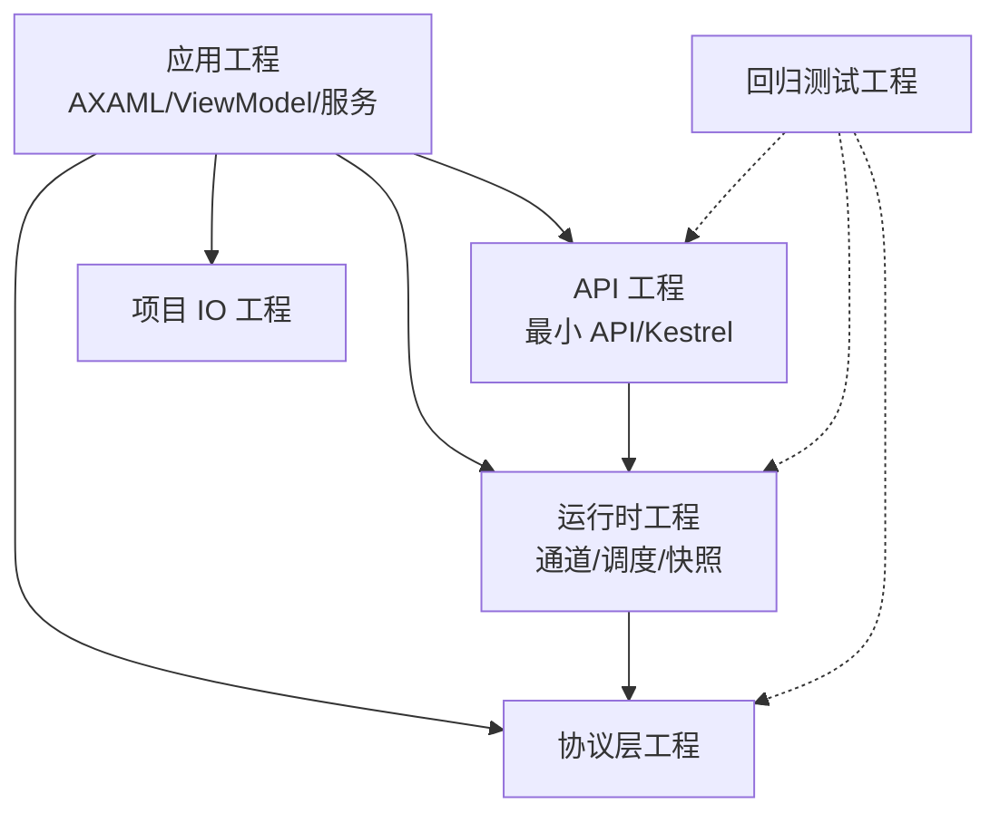

# PA-36｜Avalonia 跨平台采集工作台

> **分析对象**：跨平台桌面应用（Avalonia 单体：采集运行时 + ASP.NET Core 最小 API，同进程）
> **编号**：PA-36（按脱敏约定，不披露来源标识）
> **技术栈**：C# / .NET 8 / Avalonia 11.3.13；`System.IO.Ports` 10.0.5；ASP.NET Core 最小 API（Kestrel）；XML 项目配置 + JSON 应用设置
> **规模画像**：133 个 `.cs`（不含 obj/bin），约 1.9 万行；6 个工程（1 应用、4 类库、1 回归测试）；协议枚举 10 项（9 真实 + 虚拟）；WebAPI 4 条路由
> **成熟度画像**：内部可用（跨平台骨架与回归测试扎实，功能面约为同族 Windows 版的三分之一）

---

## 1. 定位与问题域

### 1.1 它是什么

把既有 Windows 采集工作台迁移到 Avalonia 的跨平台重写版：保留项目/通道/设备/分组/标签模型与协议客户端，重做 UI（WinForms → MVVM + AXAML）与 HTTP 宿主（`HttpListener` → Kestrel）。价值不在功能多，而在**验证「同一套采集内核能否脱离 Windows」**：目标框架 `net8.0`、HTTP 宿主换成不再依赖 Windows URL ACL 的最小 API、单实例用命名互斥量 + 命名管道唤醒（不依赖 Win32 消息）、仓库内附 19 项回归测试——迁移不是「换个壳」，关键行为有验证。

### 1.2 面向的用户与场景

| 用户 | 场景 | 真实诉求 |
|---|---|---|
| 现场调试工程师 | Linux 工控机 / 开发机接 PLC 看值 | 不装 Windows、不装运行时 |
| 项目交付 | 客户指定 Linux / 国产化环境 | 同一套配置与协议行为 |
| 维护者 / 二次开发者 | 从旧版迁移、复用采集内核 | 行为可回归、内核与 UI 解耦 |

### 1.3 边界（不做什么）

不做北向网关（无 MQTT / Outbox / 规则 / 本地历史）；不做 OPC（枚举中无 OPC UA 客户端/服务端、无 OPC DA）；不做插件（无驱动接口，新增协议必须改代码）；不做无头部署（运行时与 WebAPI 由主窗口构造时启动，无独立服务入口）；不承诺等价迁移（README 直接沿用旧版文档，声明的能力多于实现）。

---

## 2. 功能分析

### 2.1 功能域总览

| 功能域 | 功能点 | 实现方式 | 完成度 |
|---|---|---|---|
| 项目建模 | 项目→通道→设备→分组/标签；地址、类型、数组长度/偏移、缩放 | XML 序列化 + 加载时通道归一化 | 完整 |
| 通道抽象 | 通道拥有协议、启用状态、最大并发设备数（1～64，默认 4） | `ChannelConfig` + 运行时按通道建信号量 | 完整 |
| 采集调度 | 100ms 定时器、通道限流、设备内轮转、点位独立周期 | 单 Timer + 通道闸门 + 代次校验 | 完整 |
| 读写 | 单点/数组读写、工程值缩放、写权限校验 | 协议客户端 + 运行时写入口 | 完整 |
| 质量码 | Good/Disabled/NotConnected/ReadError/AccessDenied | 快照字典 + 点位级更新 | 完整 |
| 点位隔离 | 单点地址错误只影响该点；通信错误关闭失步连接 | 异常分类 + 失败点位 1～30s 退避 | 完整 |
| 串口独占 | 同一物理串口全运行时互斥，按站释放 | 端口级信号量 | 完整 |
| 运行监视 | 实时值、质量、时间戳、搜索、仅看异常、右键写值 | MVVM + 定时刷新 | 完整 |
| 协议工作台 / HTTP API | 单协议连接地址试读 / 健康、读缓存、写点位 | 独立窗口 / 最小 API | 可用/最小可用 |

### 2.2 协议与接口覆盖

| 协议/接口 | 角色 | 传输 | 代码位置（角色名） | 备注 |
|---|---|---|---|---|
| Rockwell CIP | 主站 | TCP | 协议层/CIP | 数组按 400 数据字节分段 |
| Siemens S7 | 主站 | TCP | 协议层/S7 | 按协商 PDU 分段 |
| 三菱 MC 3E | 主站 | TCP/UDP | 协议层/MC | 每段 480 字 / 960 位 |
| 三菱 MC 1E | 主站 | TCP | 协议层/MC1E | 每段 64 字 / 160 位 |
| 三菱串口 | 主站 | 串口 | 协议层/串口 | 每段 64 字 / 256 位 |
| 三菱 Q/L 串口 | 主站 | 串口 | 协议层/串口 | 每段 120 字 / 480 位 |
| 欧姆龙 FINS | 主站 | TCP | 协议层/FINS | 每段 240 字 / 480 位 |
| Modbus TCP | 主站 | TCP | 协议层/Modbus | 每段 125 寄存器 / 2000 位 |
| Modbus RTU | 主站 | 串口 | 协议层/Modbus | 每段同上 |
| 虚拟 PLC | 主站/仿真 | 进程内 | 协议层/Virtual | 支持数组切片读写 |
| HTTP API | 服务端 | TCP | API 工程 | 仅健康、读、写 |
| 串口 | 传输 | RS-232/485 | 协议层/串口总线 | 跨通道独占 |

与同族 Windows 版相比，缺少 OPC UA 客户端、OPC DA、驱动插件、OPC UA 服务端；协议枚举从 13 项降到 10 项。

### 2.3 典型使用流程

```
启动 → 构造应用服务 → 加载 ipcsettings.json 与 project.xml → 通道归一化（旧 XML 按协议补通道）
  → 启动运行时 → 启动 WebAPI → 按「项目→通道→设备→分组/标签」编辑 → 保存 → 重载运行时 → 监视器看值与质量 → 右键写值
```

### 2.4 功能完成度评估

| 能力 | 完成度 | 依据 |
|---|---|---|
| 跨平台 UI / 采集内核 | 高 | Avalonia + AXAML 无 WinForms 依赖；协议客户端与运行时基本完整，行为有回归覆盖 |
| 通道与并发 | 高 | 通道级限流、串口独占、慢设备隔离、失步恢复均有测试 |
| 北向能力 | 很低 | 只有 4 条 HTTP 路由，无 MQTT / 历史 / 规则 |
| 安全与文档一致性 | 低 | API 无鉴权、配置明文；README 沿用旧版，声明多数能力未实现 |

---

## 3. 架构分析

### 3.1 分层与模块



依赖方向干净：UI 依赖运行时与协议层，API 只依赖运行时，测试工程反向验证。问题在入口——`IpcApplicationService.Start()` 由主窗口构造函数调用，运行时、WebAPI、内存维护全挂在 UI 生命周期上。

### 3.2 关键抽象与接口

| 抽象 | 职责 | 边界 |
|---|---|---|
| 协议客户端接口 | 连接、读、写、断开 | 不管重连与调度 |
| 通道配置 | 协议、启用、并发上限 | 端点与站号仍在设备 |
| 运行时引擎 | 调度、快照、写入、设备状态 | 不做持久化 |
| 应用服务 | 组装运行时/API/设置、启停 | 被 UI 直接调用 |
| 单实例协调器 | 互斥量 + 管道唤醒 | 不参与业务 |
| WebAPI 宿主 | 路由、请求体限制、并发闸门 | 只读缓存 + 写设备 |

`ChannelConfig` 注释写明「通道拥有成员关系，通道是驱动的权威来源」，设备上的协议字段仅为旧文件兼容保留，加载时按通道回写设备协议。这个「单一权威」比同族 Windows 版更彻底。

### 3.3 数据流与时序

```
Timer(100ms)
  └→ 选择最久未调度的设备
       └→ 取通道信号量（MaxConcurrentDevices）
            └→ 取设备锁 → 逐点位轮转读取
                 ├→ 成功 → 快照（Good）
                 ├→ 地址/访问错误 → 该点 ReadError，继续下一点
                 └→ 超时/帧错误 → 关闭连接，点位退避 1～30s
```

写入与读取共用通道闸门；达到上限时写请求返回明确的「忙」错误，而不是无限排队。停止/重启时递增 generation，运行期内任何阻塞读被打断在 1 秒内，迟到的协议回调因代次不匹配被丢弃——防止「重启后旧结果覆盖新值」。

### 3.4 并发与连接管理

| 主题 | 做法 | 评价 |
|---|---|---|
| 调度 | 单 Timer + 防重入 + 最久未调度优先 | 避免慢设备饿死同通道其他设备 |
| 通道限流 | 每通道一个信号量，默认 4 | 比全局线程池更可控 |
| 串口独占 | 端口级信号量，跨通道生效 | 解决多站抢串口 |
| 代次隔离 | 停止/重启递增 generation，迟到结果丢弃 | 停止可在 1 秒内打断读 |
| 点位退避 | 失败点 1～30s，指数增长 | 不影响正常点位 |
| 背压 | 通道信号量即背压 | 无队列、无丢弃策略 |

### 3.5 配置、持久化与部署

项目为单个 XML，加载时 `NormalizeChannels()` 把旧设备按协议归入通道并把并发数钳到 1～64；应用设置 `ipcsettings.json` 存 WebAPI 开关/端口、内存维护间隔、项目路径。部署用 `dotnet` 发布或框架依赖运行，无安装器、无服务注册。日志仅 `LogToTrace()`，无结构化日志与文件落盘。没有插件接口，新增协议需加枚举成员、加客户端实现、改工厂 switch 与协议工作台。

### 3.6 工程质量观察

19 项回归测试自带极简 runner（无 xUnit/NUnit）；本地 TCP 模拟器覆盖 6 种协议，验证数组分段、偏移、拒绝后恢复；测试诚实度高——文档明确写「多个独立点位不会合并为一次 PLC 批量请求」「逐点调用，不合并相邻地址」，不把未实现说成已实现。另有一份 2026-09 的通道改造核查文档，逐协议列出上限与验证方式。缺口是无 UI 单元测试、无性能测试、无 CI 配置。

---

## 4. 需求分析

### 4.1 显性需求

1. 同一套采集配置能在 Windows/Linux 上跑，UI 不阻塞采集。
2. 一条链路接多台设备时，要能限制并发、避免互相拖死。
3. 串口设备必须独占物理端口；单点坏地址不能拖垮整台设备。
4. 停采要能立刻打断阻塞读，重启后旧结果不能覆盖新值。
5. 旧版 XML 要能直接加载，不要求用户重配。
6. 第三方仍能用 HTTP 读写设备。

### 4.2 隐性需求

| 隐性需求 | 方案中的对应处理 | 若缺失的后果 |
|---|---|---|
| 点位重复 ID | 调度键包含设备/分组/点位 ID | 复制粘贴后两点互相覆盖 |
| 设备重名 | 启动时拒绝重复路径 | 缓存键冲突、静默覆盖 |
| 字节序/字序 | 协议层按协议固定或配置 | 多字数据全错 |
| 时钟漂移 | 快照带时间戳 | 无法判断陈旧 |
| 变更不停机 | 保存后整体重载运行时 | 改一个点位短暂全断 |
| 背压 | 通道信号量 | 设备多时排队而非 OOM |

### 4.3 非功能需求

启动为 .NET 8 + Avalonia，加载 XML 后启动（推断冷启动 1～2 秒）；内存为快照字典 + 渲染（推断数十到百 MB）；跨平台能力强（`net8.0` + Avalonia + Kestrel + `System.IO.Ports`，串口驱动依赖 OS）；可观测性中（有监视器、质量码、设备状态、Trace 日志，缺指标与文件日志）；安全弱（无 API 鉴权、无 TLS）；可测试性强于同族 Windows 版（内核可注入假客户端，19 项回归）。

### 4.4 需求缺口与误判

| 缺口 | 证据 | 影响 |
|---|---|---|
| 文档超前 | README 声明 MQTT/规则/历史/OPC UA/插件，代码中均无 | 用户按文档配置会失败 |
| 无无头模式 | WebAPI 由 UI 启动，无 `--headless` | 无法作为服务部署 |
| 无离散点批读 | 文档明确「逐点调用，不合并相邻地址」 | 点数多时帧数线性增长 |
| 无鉴权 / 无持久化队列 | API 只做路径分发；无 Outbox | 局域网可任意写 PLC；断网期间数据直接丢失 |

---

## 5. 可借鉴与应规避

### 5.1 可直接吸收的机制

1. **通道作为「协议 + 并发」的单一权威**：设备只保留端点与站号，协议由通道决定，旧字段仅兼容。比「设备各自带协议」更不易出现同链路协议不一致。
2. **慢设备不阻塞同通道同伴**：调度器不等待设备 I/O 锁，按「最久未调度」选择，单个慢设备只占一个通道名额。
3. **停止即打断读 + 代次丢弃**：先失效代次再关闭传输，`Stop()` 在 1 秒内返回，迟到结果被代次丢弃。
4. **点位级异常分类**：地址/访问错误只标记该点；超时/帧错误才关闭可能失步的连接。这个区分直接决定「一个坏点是否拖垮整台设备」。

### 5.2 明确应规避的做法

| 做法 | 问题 | 目标产品应如何做 |
|---|---|---|
| UI 启动运行时/API | 关窗即停，无法服务化 | 独立宿主 + UI 可选 |
| README 整份沿用 | 声明与实现脱节 | 文档按版本生成或 CI 校验 |
| 无插件接口 | 新增协议改主干 | 驱动注册表 + 描述符 |
| 无鉴权 API / 无 Outbox | 任意写 PLC、断网丢数 | token + 只读/运维两级；落盘队列 + 至少一次 |
| 依赖框架自带日志 | 现场无文件日志 | 结构化日志 + 滚动文件 |

### 5.3 迁移到目标产品的成本

通道模型（结构体 + 信号量）迁移成本低；调度与代次需重写循环（Go 的 goroutine 更简单）；点位隔离（错误分类 + 退避表）成本低；回归测试思路（本地 TCP 模拟器）可复用；UI（AXAML 无法复用）与 9 个协议实现成本高，需重新找库或自研。

---

## 6. 结论

### 6.1 六维评分

| 维度 | 分数(1-5) | 理由 |
|---|---|---|
| 协议广度 | 2 | 9 个真实协议，全为 PLC 主站；无 OPC、无电力/楼宇协议 |
| 架构可演进性 | 3 | 通道抽象与依赖方向干净，但入口绑 UI、无插件 |
| 跨平台能力 | 5 | Avalonia + .NET 8 + Kestrel，Windows/Linux/macOS 同源 |
| 可运维性 | 2 | 有监视器与质量码，但无历史、无远程配置、无文件日志 |
| 工程质量 | 4 | 19 项回归、真实报文模拟、文档诚实；扣分在无 CI 与 UI 测试 |
| 许可与合规风险 | 4 | 依赖以 MIT/Apache 系为主，需核对 Avalonia 与串口包许可 |

### 6.2 三条关键结论

1. **它是「内核可迁移」的证明，不是「产品可交付」的证明**：采集、通道、点位隔离、代次重启都跨平台成立，但北向、规则、历史、OPC 全部缺席。
2. **通道抽象值得直接吸收**：把「协议归属 + 并发上限」收归通道，设备只留端点与站号，能同时解决协议漂移与慢设备拖累两个问题。
3. **它最大的教训是文档治理**：README 整份沿用旧版，导致声明能力是实现的数倍。目标产品若不能保证文档与代码同源，功能再多也会在第一次交付时失信。
