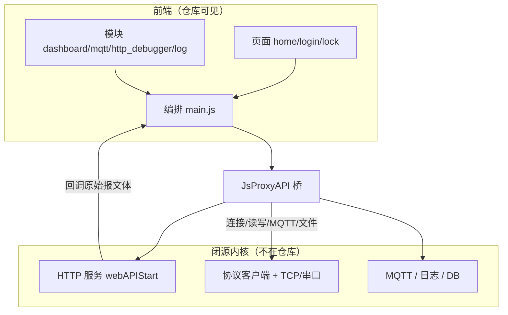

# PA-37｜Windows 桌面 PLC 通信中间件（HTTP/JSON 网关）

> **分析对象**：Windows 桌面应用（闭源 .NET 内核 + 内嵌 HTML/JS 前端 + JS↔原生桥）
> **编号**：PA-37（按脱敏约定，不披露来源标识）
> **技术栈**：前端 HTML/JS（jQuery、Bootstrap 系后台模板、i18next）；JSON 配置；内核为 .NET Framework 4.6.1+ 的闭源框架（另需 VC++ 2013 运行库）；HTTP 服务由内核提供，端口 8088
> **规模画像**：公开仓库 334 个 `.js`（绝大多数是前端第三方资源），4 个功能模块页 + 3 个页面 + 3 个配置；驱动条目 15 个；WebAPI action 4 个；协议内核代码不在仓库
> **成熟度画像**：内部可用偏产品化（有安装包、国际化与性能自测；但内核闭源、需商业授权、无断线重连）

---

## 1. 定位与问题域

### 1.1 它是什么

一个跑在 Windows 上的「PLC 通信中间件」：把主流 PLC 的读写封装成 HTTP/JSON 接口供上位系统调用，自带图形界面做设备与点位配置、调试、日志与 MQTT 转发。

必须先纠正一个常见误读：**公开仓库只是可执行程序的前端与配置，不是可构建的完整实现**。真正的协议内核是闭源的 .NET Framework 框架（下称「闭源内核」），前端通过名为 `JsProxyAPI` 的 JS↔原生桥调用内核方法；南向协议、TCP/串口收发、HTTP 服务端、MQTT、日志全部在内核里。仓库里能看到的是：页面、模块脚本、以及一份把「协议连接参数 + 调用签名」外置的驱动配置表。

| 关键事实 | 证据形态 | 含义 |
|---|---|---|
| 仓库仅含 HTML/JS 与 JSON 配置 | 无 `.cs`/C++ 源码，业务脚本通过 `JsProxyAPI.*` 调内核 | 内核不可从源码构建 |
| WebAPI 由内核 `webAPIStart(port, onStart, onMessage)` 启动 | 回调里由 JS 解析并分发 | 协议在核、路由在 JS |
| 只有 4 个 action | 见 2.2，非法 action 直接返回 4003 | 无推送、无 WebSocket、无长轮询 |
| 每设备在启动时连接一次 | `init_plc()` 遍历设备建连，失败仅弹窗 | 断线不会自动重连 |

### 1.2 面向的用户与场景

| 用户 | 场景 | 真实诉求 |
|---|---|---|
| 上位系统开发者 | 用 HTTP 读写 PLC，不想装 OPC 中间件 | 接口稳定、错误码可判别 |
| 现场调试工程师 | 图形界面加设备、点位、试读写 | 点两下就出数 |
| 小型集成 | 把 PLC 数据经 MQTT 转发到平台 | 免编程、免授权 |

### 1.3 边界（不做什么）

不做推送/订阅（只能请求-响应）；不做历史库（只有系统运行日志）；不做跨平台（仅 Windows x64）；不做开放插件内核（新增协议要改闭源内核）；不承诺多 PLC 免费（超过 2 台链路需向内核授权方付费）。

---

## 2. 功能分析

### 2.1 功能域总览

| 功能域 | 功能点 | 实现方式 | 完成度 |
|---|---|---|---|
| 设备管理 | 增删设备、配置 IP/端口/站号/串口参数 | 前端改 `plc.conf` 的 `DEVS`，重启生效 | 可用（无热加载） |
| 点位管理 | 每设备点位：地址、类型、长度、备注、当前值 | `NODES[dev][node]={addr,type,length,note,value}` | 完整 |
| 数据模型 | 7 种点位类型：Bool/Byte/Word/DWord/String/Float/Double | 类型分派到不同原生读写方法 | 完整 |
| 采集同步 | 每设备一个异步循环，约 100ms 轮询全部点位 | 逐点位 `await` 串行读，写回缓存 | 可用（串行、无批合并） |
| HTTP WebAPI | 单点/多点读、单点/多点写 | 内核 HTTP 服务回调 → JS 分发 4 action | 最小可用 |
| MQTT 客户端 | 连 Broker、订阅主题、消息含变化则回写 PLC | 经本地 WebAPI `plc_write_node` 回写 | 可用 |
| 图形调试 | 点位表、HTTP 调试器、系统日志 | 四个模块页 | 可用 |
| 国际化 | 中/英/日 | i18next 资源 | 可用 |

### 2.2 协议与接口覆盖

驱动配置共 15 条，全部为**主站**角色，覆盖日系/欧系/美系小型 PLC：

| 协议/接口 | 角色 | 传输 | 代码位置（角色名） | 备注 |
|---|---|---|---|---|
| 欧姆龙 FINS（TCP） | 主站 | TCP | 驱动表 + 闭源内核 | SA1/DA2 站号参数 |
| 欧姆龙 FINS（UDP） | 主站 | UDP | 驱动表 + 闭源内核 | 同上，UDP 通道 |
| 欧姆龙 Host Link（串口） | 主站 | 串口 | 驱动表 + 闭源内核 | 波特率/校验/单元号 |
| 欧姆龙 Host Link C-Mode | 主站 | 串口 | 驱动表 + 闭源内核 | 简化命令模式 |
| 三菱 MC（TCP） | 主站 | TCP | 驱动表 + 闭源内核 | 3E 帧 |
| 三菱 MC（UDP） | 主站 | UDP | 驱动表 + 闭源内核 | 同上，UDP 通道 |
| S7-1200 / 1500 / 200 / 200 SMART / 400 | 主站 | TCP | 驱动表 + 闭源内核 | 同一连接方法按型号分派，RACK/SLOT 可配 |
| 基恩士 MC（TCP） | 主站 | TCP | 驱动表 + 闭源内核 | — |
| 松下 MC（TCP） | 主站 | TCP | 驱动表 + 闭源内核 | — |
| 松下 Mewtocol（串口） | 主站 | 串口 | 驱动表 + 闭源内核 | — |
| Modbus TCP | 主站 | TCP | 驱动表 + 闭源内核 | SLAVEID、保持/输入/线圈地址前缀 |
| HTTP WebAPI | 服务端 | TCP | 内核 + `main.js` | 仅读写，端口 8088 |
| MQTT | 客户端 | TCP | `mqtt_client.js` + 内核 | 订阅→变化时回写 |

每个驱动条目的连接调用是「配置里的 `FUNCTION` 字符串 + 回调 + 超时 + 字节序参数」，运行时用 `eval()` 拼成原生调用。字节序由 `DATAFORMAT`（如 CDAB/DCBA）与 `STRING_REVERSE` 控制。README 声称「可连 90% 的 PLC」，代码中可核实的是上述 15 条驱动，均为小型 PLC 主站，未见 OPC UA/DA、电力、楼宇协议。

### 2.3 典型使用流程

```
启动 → 读 modules.conf(驱动表) → settings.conf → plc.conf → mqtt.conf
  → init_plc(): 逐设备建连一次（失败弹窗，不重试）
  → init_db() → init_webapi_server(): 内核起 8088
  → init_mqtt_server(): 起 MQTT 客户端
  → load_sync_workers(): 每设备一个循环，约 100ms 全量轮询点位 → 写回缓存 value
外部请求: POST JSON {action,node,value} → 内核回调 → JS 校验 → 读缓存或写 PLC
```

一个关键语义：**HTTP 读返回缓存值**（`NODES[dev][node].value`），不触发新的 PLC 读；写则经 `JsProxyAPI.plcWriteXxxBlocking` 直写设备。读走内存、写走实时。

### 2.4 功能完成度评估

| 能力 | 完成度 | 依据 |
|---|---|---|
| 南向协议广度 | 中 | 15 条驱动覆盖日系/欧系/美系小型 PLC，但无 OPC 与大型协议 |
| 北向接口 | 中 | HTTP/JSON 读写契约清晰、错误码细分；但无推送、无批量契约 |
| 采集调度 | 低中 | 每设备一循环可隔离慢设备，但逐点串行、无批合并、无全局限流 |
| 断线恢复 | 低 | 启动建连一次，断线只记日志、不重连 |
| 运维与安全 | 低 | 图形配置与日志可用；登录被禁用、HTTP 无鉴权 |

---

## 3. 架构分析

### 3.1 分层与模块



前端四层清楚：页面 → 模块脚本 → `main.js` 编排 → `JsProxyAPI` 桥。真正的工程分层在内核里，仓库看不到。这种「前端可见、内核黑盒」的边界决定了：能审计的只有路由与配置，协议正确性与资源管理无法从源码验证（推断其质量依赖内核方）。

### 3.2 关键抽象与接口

| 抽象 | 职责 | 边界 | 位置 |
|---|---|---|---|
| `JsProxyAPI` 桥 | 暴露连接、读写、MQTT、文件、日志等原生方法 | 方法集合由内核定义，前端只调用 | 内核 |
| `NODES` 数据模型 | `dev→node→{addr,type,length,note,value}` | 只管点位，不含设备连接参数 | 配置 |
| 驱动描述表 | 协议名→`{TYPE,FUNCTION,参数默认值}` | 连接签名以字符串外置 | 配置 |
| WebAPI 分发器 | 解析 action，校验 node/type，读写并回 `errcode` | 仅 4 action，不管理配置 | `main.js` |
| 同步 worker | 每设备一循环，轮询并刷新缓存 | 设备间并行、设备内串行 | `main.js` |

### 3.3 数据流与时序

```
读: HTTP POST {action:"plc_read_node", node:"NODES.dev.node"}
      → 内核透传报文体给 JS 回调 → JSON.parse → 校验 dev/node 存在
      → 返回缓存 value 与 errcode:0
写: HTTP POST {action:"plc_write_node", node, value}
      → 校验 type/value → 按 type 调 JsProxyAPI.plcWriteXxxBlocking
      → 成功 errcode:0；Modbus 输入/离散寄存器拒写返回 4058

同步: 每设备 while(true){ sleep(100ms); sync_plc_nodes_await(dev) }
      → 遍历点位，按 type + Modbus 地址前缀选择读方法 → 逐点 await
      → 写回 NODES[dev][node].value；异常置 online=false 并记日志
```

Modbus 地址前缀语义是这套模型里最实用的细节：Word/Byte/String 用 `holding`/`input`（默认保持寄存器），Bool 用 `coil`/`discrete`（默认线圈），前缀映射到内核的读方法参数。

### 3.4 并发与连接管理

| 主题 | 做法 | 评价 |
|---|---|---|
| 采集并发 | 每设备一个 async 循环，设备间并行 | 慢设备不拖累其他设备 |
| 设备内 | 逐点位 `await` 串行 | 无批读合并，点数多时帧数线性增长 |
| 全局限流 | 无 | 设备多时并发不受控 |
| PLC 连接 | 启动建连一次 | **断线不重连**，是最大可靠性缺口 |
| MQTT 连接 | 断线后每 5s 重试 | 仅 MQTT 有重连循环 |
| 驱动调用 | `eval()` 拼 `FUNCTION` 字符串 | 配置可控时可接受，配置可写时是注入面 |

### 3.5 配置、持久化与部署

- **配置**：`plc.conf`（`NODES`/`DEVS`/`WEBAPI.PORT=8088`）、`mqtt.conf`、`modules.conf`（驱动表）、`settings.conf`（显示模式）。前端改配置后 `fileWrite` 直接落盘。
- **持久化**：无业务历史库；内核侧有一个轻量数据库用于日志/审计（推断），业务点位值只在内存。
- **部署**：解压即用、双击启动；依赖 .NET Framework 4.6.1+ 与 VC++ 2013 运行库；仅 Windows x64。

### 3.6 扩展机制

新增内置协议要同时改两处：内核里实现连接/读/写方法，`modules.conf` 里加一条 `{TYPE, FUNCTION, 默认参数}`。由于内核闭源，外部用户**实际上无法新增协议**，所谓「驱动表可扩展」只对内核方成立。配置里 `FUNCTION` 为可 `eval` 的字符串，意味着协议接入是「字符串拼接」而非强类型注册表。

### 3.7 工程质量观察

| 观察项 | 事实 |
|---|---|
| 代码卫生 | 存在大量注释掉的旧逻辑与调试 `alert`，`eval` 拼接原生调用 |
| 安全默认值 | 登录页校验逻辑被注释禁用，打开即进入主界面 |
| 前端体量 | 334 个 `.js` 绝大多数是 vendored 的后台模板插件，真正的业务脚本仅少数几个 |
| 自测 | README 给出 50 读 + 50 写线程的性能数据（单点约 10～13ms、批量约 20～24ms） |
| 文档 | 有环境要求、使用法、性能与国际化说明，但能力宣称（90% PLC）缺可核实清单 |

---

## 4. 需求分析

### 4.1 显性需求

1. 上位系统能用 HTTP/JSON 读写多品牌 PLC，不引入 OPC 中间件。
2. 图形界面能配设备与点位，调试时能即时看值、试写。
3. 采集值能经 MQTT 转发到平台。
4. 接口返回统一结构，错误可判别。

### 4.2 隐性需求

| 隐性需求 | 方案中的对应处理 | 若缺失的后果 |
|---|---|---|
| 地址模型差异 | Modbus 用 holding/input/coil/discrete 前缀 | 同一地址读错区 |
| 字节序/字序 | `DATAFORMAT`（CDAB/DCBA）+ `STRING_REVERSE` | 多字数值全错 |
| 点位类型 | 7 种类型分派到不同读方法 | 类型错配读到脏值 |
| 地址越界 | 无显式保护，越界由内核返回错误码 | 坏地址可能整批失败 |
| 时钟漂移 | 无采集时间戳，只有缓存值 | 无法判断数据陈旧 |
| 许可合规 | 超过 2 台 PLC 链路需内核授权 | 商用即触发付费与法务风险 |

### 4.3 非功能需求

启动为绿色目录双击，依赖 .NET Framework 与 VC++ 运行库（推断冷启动 1～3 秒）；内存为全量点位缓存 + 前端页面（推断数十 MB）；可观测性靠系统日志与 HTTP 调试器，无指标导出；安全弱（HTTP 无鉴权、登录禁用、配置明文）；可靠性弱（无 PLC 重连、无断线缓存补发）。

### 4.4 需求缺口与误判

| 缺口 | 证据 | 影响 |
|---|---|---|
| 无断线重连 | `init_plc()` 只建连一次，断线仅置 `online=false` | 网络抖动后必须重启程序 |
| HTTP 无鉴权 | 4 个 action 不校验身份 | 局域网内任何人可写 PLC |
| 登录被禁用 | 登录页校验逻辑被注释 | 「有登录页」是假象 |
| 无批读合并 | 同步循环逐点 `await` | 点数多时帧数与延迟线性增长 |
| 文档夸大 | README 称「90% PLC」，可核实仅 15 条小型 PLC 驱动 | 选型预期落空 |

---

## 5. 可借鉴与应规避

### 5.1 可直接吸收的机制

1. **HTTP/JSON 统一读写契约 + 细分错误码**：`{"errcode","errmsg","rtval"}` 三字段，配 4001～4059 十余个语义化错误码（解析失败、action 非法、节点不存在、设备离线、类型错误、Modbus 不支持写等），比「HTTP 500 一把梭」对集成方友好得多。
2. **驱动元数据外置的思路**：把「协议类型 + 连接参数 + 调用签名」放进配置表，连接逻辑与业务解耦（尽管其 `eval` 实现应规避）。
3. **Modbus 地址前缀语义**：用 `holding/input/coil/discrete` 前缀表达寄存器区，比单纯数字地址更不易读错区。
4. **每设备独立同步 worker**：设备间并行、互不阻塞，是低成本的多设备隔离。

### 5.2 明确应规避的做法

| 做法 | 问题 | 目标产品应如何做 |
|---|---|---|
| 闭源内核 + 授权墙 | 核心能力不可自建，>2 PLC 即付费 | 自研采集内核，开源或自主可控 |
| `eval` 拼原生调用 | 配置可写即注入面 | 强类型驱动注册表 + 参数校验 |
| 无 PLC 重连 | 抖动后停采 | 指数退避重连 + 代次隔离 |
| 无鉴权 + 登录禁用 | 任意写 PLC | token + 只读/运维两级 + 审计 |
| 前端 334 个 vendored 脚本 | 审计与体积负担 | 按需构建、锁定依赖 |

### 5.3 迁移到目标产品的成本

统一 `errcode` 契约成本低（一张错误码表）；地址前缀语义成本低；驱动元数据表成本中（要替换 `eval` 为注册表）；每设备 worker 成本低（goroutine/tokio 任务即可）；批读合并与断线重连需自研（中）；15 类协议的实现成本高，需重新找库或自研。

---

## 6. 结论

### 6.1 六维评分

| 维度 | 分数(1-5) | 理由 |
|---|---|---|
| 协议广度 | 3 | 15 条驱动覆盖日系/欧系/美系小型 PLC，但无 OPC、电力、楼宇；且内核闭源不可核实 |
| 架构可演进性 | 2 | 前端/内核边界清晰，但 `eval`、无插件开放、无重连，演进受制于闭源方 |
| 跨平台能力 | 1 | 仅 Windows x64，依赖 .NET Framework 与 VC++ 运行库 |
| 可运维性 | 3 | 图形配置、系统日志、HTTP 调试器、性能自测齐全；缺重连与远程配置版本 |
| 工程质量 | 2 | 注释残留、`eval`、登录禁用、无测试、前端脚本膨胀 |
| 许可与合规风险 | 1 | 内核闭源，超过 2 台 PLC 需商业授权，运行库依赖也需核对 |

### 6.2 三条关键结论

1. **它证明了「HTTP/JSON 统一读写 + 细分错误码」是北向最小可用契约**：三字段返回与十余个语义错误码，直接可用于对接上位系统，值得照抄其错误码分层。
2. **它的形态是反面教材：开放前端 + 闭源内核 + 授权墙**：核心采集能力一旦不可自建，产品就被内核方的许可与授权政策卡住（>2 台 PLC 即付费），这与「自主可控」直接冲突。
3. **无重连 + 登录禁用 + HTTP 无鉴权，说明它把「演示可用」当成了「生产可用」**：目标产品必须在 v1 就把断线重连、鉴权、审计做进骨架，而不是等现场出事故再补。
