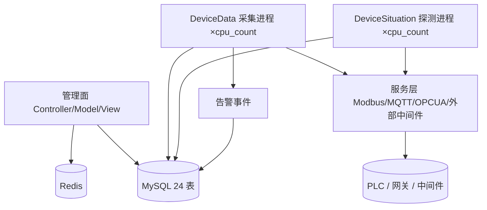

# PA-38｜PHP 物联网设备管理后台（含采集运行时）

> **分析对象**：PHP 后台管理系统（常驻进程 Web 框架 + 管理面 + 采集运行时进程）
> **编号**：PA-38（按脱敏约定，不披露来源标识）
> **技术栈**：PHP ≥8.1；Workerman 系常驻进程 Web 框架（事件循环 + 自定义进程）；ORM（think-orm / illuminate 系）；MySQL；Redis；`workerman/crontab`；事件组件；第三方 Modbus TCP 客户端库；MQTT 客户端
> **规模画像**：24 张 SQL 表；采集运行时 2 个自定义进程（数据采集、在线探测）；按设备型号名分派 8 类接入方式；管理面为 HTTP 后台，无对外采集 API
> **成熟度画像**：学习/演示（README 明示「仅供学习参考，请勿用于生产环境」，默认管理员为弱口令）

---

## 1. 定位与问题域

### 1.1 它是什么

一个基于通用 PHP 后台框架二次开发的「物联网设备管理后台」：管理面提供设备类型/型号/设备/子设备/属性/属性组/采集任务/告警的增删改查；采集运行时由两个常驻进程实现——数据采集进程按采集任务的 cron 轮询点位，在线探测进程每 30 秒探测设备状态。南向接入按**设备型号名（字符串）**分派到 Modbus TCP、Modbus RTU over TCP（DTU）、MQTT、原始 TCP、WebSocket、OPC UA，以及一个外部 HTTP 型 PLC 中间件（与 PA-37 同族）。

先纠正任务描述：任务初稿称其含「自研协议」。按代码事实，**南向协议全部依赖第三方库或外部中间件，没有自研协议栈**；它的价值在「管理面 + 采集运行时」的骨架，而非协议实现。

四个事实决定了它的定位：采集逻辑在常驻进程的 `onWorkerStart` 里（方向正确，采集与 Web 请求解耦）；采集进程数 = `cpu_count()`，且每进程都遍历 `status='start'` 任务注册同一批 Crontab（**同一任务被重复采集 N 次**）；每点位每周期一条 `insert()`（无批量、无背压）；README 自述仅供学习，不能作为生产基线。

### 1.2 面向的用户与场景

| 用户 | 场景 | 真实诉求 |
|---|---|---|
| 后台开发者 | 学习「管理面 + 采集运行时」如何分层 | 可参考的骨架 |
| 小型集成演示 | 用 Modbus/MQTT 采几个点位并在后台看值 | 快速搭起来 |
| 二次开发者 | 在管理面上加自己的设备类型 | 清晰的扩展点 |

### 1.3 边界（不做什么）

不做生产级采集（README 自述）；不做自研协议（全依赖第三方库）；不做边缘网关（无 OPC UA 服务端、无 Sparkplug、无规则引擎）；不做采集数据保留与压缩；不做采集侧断线重连（部分被注释）。

---

## 2. 功能分析

### 2.1 功能域总览

| 功能域 | 功能点 | 实现方式 | 完成度 |
|---|---|---|---|
| 设备建模 | 设备类型 → 型号 → 设备 → 子设备 | 管理面 CRUD + 关联表 | 完整 |
| 属性与信号 | 属性、属性组、信号（地址/类型/字段名） | 管理面 CRUD；信号按 `type` 区分 | 完整 |
| 采集任务 | cron 表达式 + 任务明细 + 点位集合 | 任务表 + 明细表 | 完整 |
| 数据采集 | 按型号分派协议，逐点位读并入库 | 采集进程 + Crontab | 可用（重复采集） |
| 在线探测 | 每 30 秒探测设备在线并写状态 | 探测进程 + Crontab | 可用 |
| 告警 | 阈值配置 + 记录 + 事件触发 | 事件组件同步派发 | 可用（触发期重复插） |
| 采集存储 | 采集值入库 | `iot_collect_data` 单表 | 可用（无保留策略） |
| 管理面 | RBAC、菜单、上传、字典、代码生成 | 框架自带 | 完整 |

### 2.2 协议与接口覆盖

分派键是设备型号名（小写化后字符串匹配），不是驱动接口：

| 接入方式 | 角色 | 传输 | 代码位置（角色名） | 备注 |
|---|---|---|---|---|
| Modbus TCP | 主站 | TCP | Modbus 服务（第三方库） | 全局字节序 BIG_ENDIAN_LOW_WORD_FIRST |
| Modbus RTU over TCP / DTU | 主站 | TCP | Modbus RTU/TCP 服务 | 透传型 DTU |
| MQTT | 客户端 | TCP | MQTT 客户端库 | 订阅主题→变化时入库 |
| 原始 TCP | 客户端 | TCP | 异步 TCP 连接 | 连接后发报文，收 JSON |
| WebSocket | 客户端 | WS | 异步 TCP 连接 | 同上 |
| OPC UA | 客户端 | TCP | OPC UA 服务 | 按节点名读值 |
| 外部 HTTP 型 PLC 中间件 | 客户端 | HTTP | `http_post` + `plc_read_node` | 与 PA-37 同族，节点名带前缀 |
| 管理面 HTTP | 服务端 | TCP | 框架 HTTP 进程 | 后台 CRUD，无采集 API |

README 自述「只实现了 Modbus、MQTT 与某 HTTP 型 PLC 中间件的对接」，代码中可核实的是上述 8 类接入，且全部依赖第三方库或外部软件。

### 2.3 典型使用流程

```
管理面配置设备/属性/采集任务（cron + 点位）→ 启动：每个采集进程 onWorkerStart 读 status='start' 任务
  → 每任务注册一个 Crontab（进程数=cpu_count()，故每任务被注册 N 次）
  → 到点采集：遍历明细 → 按型号名分派协议 → 逐点位读 → 每点位 insert() → 触发告警 → 探测进程每 30s 更新状态
```

### 2.4 功能完成度评估

管理面高（框架自带 RBAC/菜单/上传，CRUD 齐全）；采集骨架中（采集独立进程方向正确，但进程数与调度耦合导致重复采集）；协议接入中（8 类接入覆盖 Modbus/MQTT/TCP/WS/OPC UA/外部中间件，全依赖第三方）；告警低中（阈值判断可用，但触发期间每周期重复插记录）；可靠性低（无重连、无批量、无背压、无保留策略）。

---

## 3. 架构分析

### 3.1 分层与模块



管理面与采集运行时分离在**进程层**（不同的框架自定义进程），这是正确方向；但两者共享同一 ORM、同一 MySQL、同一 Redis，采集运行时没有独立的部署边界与资源隔离。

### 3.2 关键抽象与接口

| 抽象 | 职责 | 边界 |
|---|---|---|
| 设备型号名分派 | 用字符串匹配选择协议分支 | 无接口、无注册表 |
| 采集任务 | cron + 明细 + 点位集合 | 只管调度与点位，不管协议 |
| 采集服务 | 单协议读值 | 每次调用新建连接 |
| 告警事件 | 按阈值判断并写记录 | 同步、无状态 |
| 进程模型 | 常驻进程 + Crontab | 进程数与任务调度耦合 |

### 3.3 数据流与时序

```
Crontab(cron) → 采集(任务)：遍历明细 → 取型号名 → if/elseif 分派
  Modbus: isOnline() → 逐点位读；MQTT: 订阅主题，onMessage 入库（同秒同值去重）
  TCP/WS: 连接后发报文，onMessage 收 JSON 入库；OPC UA: 逐节点读值；外部中间件: http_post(plc_read_node)
  → 每点位 insert()（成功/失败都插）→ 成功且为 Modbus/DTU 时派发告警事件
```

### 3.4 并发与连接管理

进程模型是采集/探测各 `cpu_count()` 个进程，与「每进程注册同一批 Crontab」叠加导致重复采集；任务调度每任务一个 Crontab，无分布式锁与单点调度；设备内逐点位串行读，无批读合并；写入每点位一条 INSERT，无批量与背压；Modbus 每次采集新建连接，无连接复用；采集侧 TCP/WS 的 `reConnect` 被注释，断线不重连；字节序用全局静态 `Endian::$defaultEndian`，跨任务共享存在并发隐患。

### 3.5 配置、持久化与部署

存储为 MySQL 24 张表（管理面 RBAC/菜单/字典 + 业务表），Redis 用于少量缓存（如 TCP 信号缓存）；配置走 `.env` 与框架配置目录，进程数与监听端口在进程配置里；用 `start.php`/命令行脚本启动常驻进程，跨平台（有 `windows.bat`）。`iot_collect_data` 无唯一键、无分区、无清理任务，随采集无限增长。

### 3.6 扩展机制

新增协议 = 在采集进程里加一个 `elseif (in_array($name, [...]))` 分支，并在服务层加对应调用。没有驱动接口、没有注册表、没有描述符；分派靠型号名字符串，改型号名即改行为。

### 3.7 工程质量观察

README 明示「仅供学习参考，请勿用于生产环境」，默认管理员为弱口令且 README 直接给出；在线探测里 OPC UA 服务类名与采集侧不一致（推断为笔误，异常被吞后置离线）；采集侧 TCP/WS 的 `reConnect` 被注释、探测侧却保留；未见测试工程；告警为同步派发，触发期间每周期重复插记录。

---

## 4. 需求分析

### 4.1 显性需求

1. 能在后台管理设备、属性与采集任务，并按任务周期采集多类设备的数据入库。
2. 能配置阈值告警并留痕。
3. 能查看设备在线状态。

### 4.2 隐性需求

| 隐性需求 | 方案中的对应处理 | 若缺失的后果 |
|---|---|---|
| 字节序/字序 | Modbus 全局 BIG_ENDIAN_LOW_WORD_FIRST | 多字数值错，且无法按设备区分 |
| 点位类型 | 信号 `field_type` 映射到 int16/uint16/float 等 | 类型错配读到脏值 |
| 地址模型 | Modbus 直接地址 + 位地址 | 读错区 |
| 断线续传 | 无 | 断网期间数据丢失 |
| 时钟漂移 | 采集时间取服务器本地时间 | 无法判断陈旧 |
| 点位变更不停机 | 改配置后需重启进程 | 变更即中断 |
| 数据保留 | 无 | 磁盘无限增长 |

### 4.3 非功能需求

启动为 PHP 常驻进程（推断秒级）；内存随进程与缓存增长；跨平台好（Workerman 支持 Linux/Windows）；可观测性弱（无指标、无采集延迟统计）；安全弱（弱口令、无采集侧鉴权）；可靠性弱（无重连、无背压、无保留）。

### 4.4 需求缺口与误判

重复采集（进程数 = `cpu_count()` 且每进程注册同一 Crontab）导致同一任务被采集 N 次、数据重复与负载放大；每点位一条 INSERT 使点位多时数据库压力线性增长；`iot_collect_data` 无清理，磁盘无限增长；采集侧 `reConnect` 被注释、告警触发期每周期都插记录，导致断线后停采与告警表刷屏；README 直接给出默认弱口令，后台可被直接登录。

---

## 5. 可借鉴与应规避

### 5.1 可直接吸收的机制

1. **管理面与采集运行时分离为独立常驻进程**：把采集从 HTTP 请求里拿出来，是采集系统的基本功；这套骨架证明了方向，只是实现有缺陷。
2. **采集任务 = cron + 明细 + 点位集合**：用「任务—明细—信号」三层建模采集范围，比「每设备一个线程」更易配置与审计。
3. **在线探测独立进程**：把「在线状态」与「数据采集」解耦，避免采集失败时状态混乱。
4. **按接入方式分派的服务层**：把协议差异收敛到服务类，管理面与协议解耦。

### 5.2 明确应规避的做法

| 做法 | 问题 | 目标产品应如何做 |
|---|---|---|
| 进程数 = `cpu_count()` 且每进程注册同一 Crontab | 任务被重复采集 N 次 | 单点调度 + 多 worker 消费（分布式锁/队列） |
| 每点位一条 INSERT | 无批量、无背压 | 批量写 + 队列 + 背压 |
| 无保留策略 | 磁盘无限增长 | 分区/降采样/滚动清理 |
| 全局静态字节序 | 无法按设备区分、并发隐患 | 字节序随设备/点位配置 |
| 型号名字符串分派 | 改型号名即改行为 | 驱动注册表 + 描述符 |
| 弱口令 + 无加固 | 后台可被登录 | 强制改密 + 鉴权 + 审计 |

### 5.3 迁移到目标产品的成本

「管理面/采集分离」的进程骨架成本低（直接照搬思路）；「任务—明细—点位」建模成本低；在线探测独立进程成本低；批量写与背压需自研（中）；单点调度 + 多 worker 消费需引入锁或队列（中）；8 类协议实现成本高，需重新找库或自研。

---

## 6. 结论

### 6.1 六维评分

| 维度 | 分数(1-5) | 理由 |
|---|---|---|
| 协议广度 | 2 | 8 类接入覆盖 Modbus/MQTT/TCP/WS/OPC UA/外部中间件，但全依赖第三方，无自研 |
| 架构可演进性 | 2 | 管理面/采集分离方向正确，但型号名分派、无驱动接口、进程与调度耦合 |
| 跨平台能力 | 4 | PHP + Workerman 常驻进程，Linux/Windows 均可跑 |
| 可运维性 | 2 | 有管理面与在线状态，但无保留策略、无重连、无指标 |
| 工程质量 | 2 | 学习项目：弱口令、拼写错误、注释残留、无测试 |
| 许可与合规风险 | 2 | 框架为 MIT，但第三方库与默认口令需逐项核对 |

### 6.2 三条关键结论

1. **采集运行时独立于管理面是正确的骨架，但被进程模型做坏了**：「进程数 = `cpu_count()` + 每进程注册同一 Crontab」把正确骨架变成重复采集，说明进程模型必须与任务调度解耦——单点调度、多 worker 消费。
2. **管理面可以异构，采集运行时不该与 Web 框架同进程同语言**：每点位 INSERT、全局静态字节序、无背压，都是「把 Web 框架当采集器」的典型代价；目标产品应把采集做成独立二进制/进程。
3. **README 自述「仅供学习」是诚实，但默认弱口令与无保留策略意味着它连「可安全演示」都勉强**：目标产品不能以学习项目为基线，鉴权、审计、数据生命周期必须从 v1 就进骨架。
