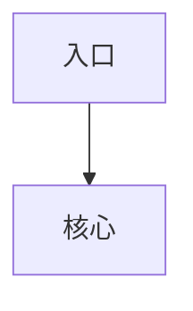

# PA-xx｜<方案类型名>

> **分析对象**：<形态：桌面应用 / 类库 / 网关服务 / 仿真器 / 平台>
> **编号**：PA-xx（按脱敏约定，不披露来源标识）
> **技术栈**：<语言 / 框架 / 运行时版本>
> **规模画像**：<源文件数、主要模块数、协议数>
> **成熟度画像**：<原型 / 内部可用 / 生产可用 / 商业化>

---

## 1. 定位与问题域

### 1.1 它是什么

### 1.2 面向的用户与场景

### 1.3 边界（不做什么）

---

## 2. 功能分析

### 2.1 功能域总览

| 功能域 | 功能点 | 实现方式 | 完成度 |
|---|---|---|---|
|  |  |  |  |

### 2.2 协议与接口覆盖

| 协议/接口 | 角色 | 传输 | 代码位置 | 备注 |
|---|---|---|---|---|
|  |  |  |  |  |

### 2.3 典型使用流程

### 2.4 功能完成度评估

---

## 3. 架构分析

### 3.1 分层与模块

### 3.2 关键抽象与接口

| 抽象 | 职责 | 边界 | 位置 |
|---|---|---|---|
|  |  |  |  |

### 3.3 数据流与时序

### 3.4 并发与连接管理

### 3.5 配置、持久化与部署

### 3.6 扩展机制

### 3.7 工程质量观察

---

## 4. 需求分析

### 4.1 显性需求

### 4.2 隐性需求

### 4.3 非功能需求

### 4.4 需求缺口与误判

---

## 5. 可借鉴与应规避

### 5.1 可直接吸收的机制

### 5.2 明确应规避的做法

### 5.3 迁移到目标产品的成本

---

## 6. 结论

### 6.1 六维评分

| 维度 | 分数(1-5) | 理由 |
|---|---|---|
| 协议广度 |  |  |
| 架构可演进性 |  |  |
| 跨平台能力 |  |  |
| 可运维性 |  |  |
| 工程质量 |  |  |
| 许可与合规风险 |  |  |

### 6.2 三条关键结论

1.
2.
3.
